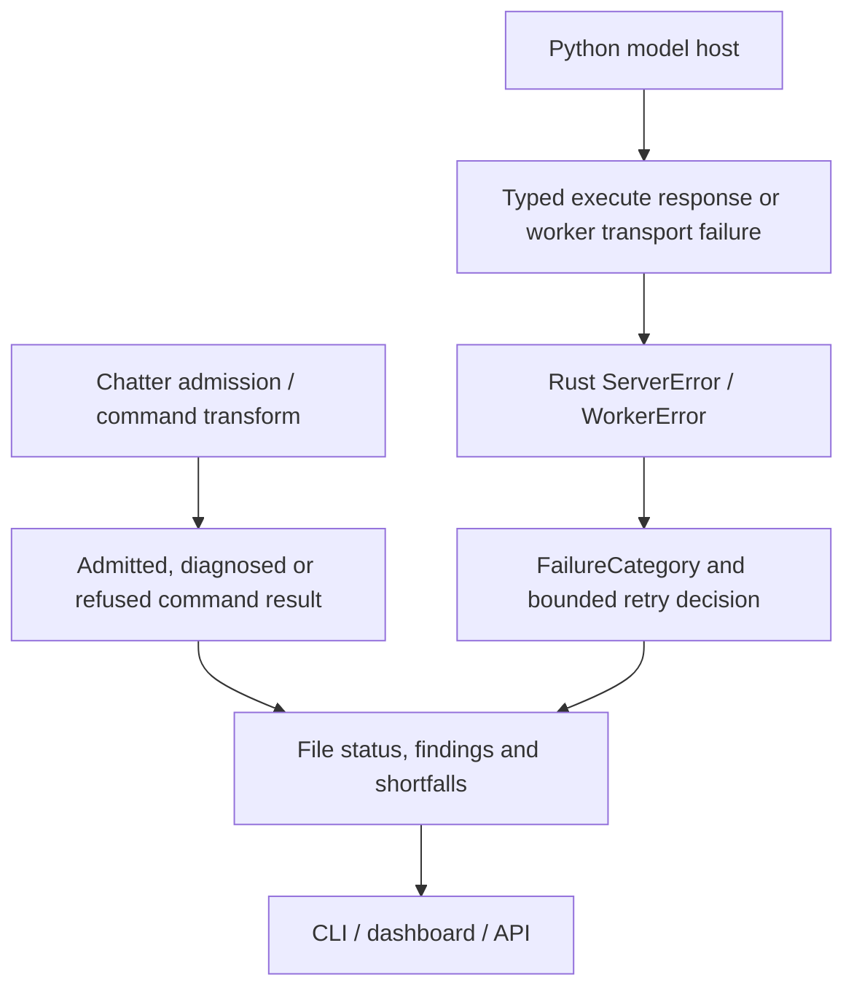

# Errors: Batchalign Runtime

**Status:** Current
**Last updated:** 2026-10-25 08:12 EDT

How Batchalign produces, propagates, and surfaces errors specific to
the ML runtime: parse modes, ML/IPC failures, network errors,
ASR-API errors, worker-crash recovery, the Python-facing exception
hierarchy, and the CLI failure summary. For the CHAT-core error
infrastructure (codes, sinks, severities), now owned by chatter, see
[chat-core-errors](https://talkbank.github.io/chatter/architecture/errors-and-validation/chat-core-errors.html).
For the typed boundary between Python and Rust workers see
[python-rust-errors](python-rust-errors.md). For the diagnostic UX
standard that applies workspace-wide, see
[error-diagnostics-ux](https://talkbank.github.io/chatter/architecture/errors-and-validation/error-diagnostics-ux.html).

## Parser and Command Failures

CHAT parsing and validation run in Rust through Chatter. The former
`ParsedChat.parse` / `parse_lenient` Python methods are retired. Command
processing uses typed input admission and output states, not a choice of
legacy Python parsing modes.

A rejected input, a diagnosed generated transcript and an optional-stage
shortfall have different output contracts. See
[validation](validation.md) and
[command contracts](../../batchalign/architecture/command-contracts.md).

## Structured Error Access (PyO3)

Structured CHAT-validation errors reach Python through the typed
boundary, not via a `ParsedChat` method surface (the legacy
`ParsedChat` binding was removed in the 2026-03-21 PyO3 slimdown to
worker-runtime-only, see [Python ↔ Rust Boundary](../python-rust-boundary/python-rust-boundary.md)).
Validation failures inside the Rust worker construct
`BatchalignBoundaryError::ChatValidation { entries, … }` (defined at
`crates/batchalign-pyo3/src/error.rs`); the boundary lowers that into
`CHATValidationException` on the Python side with a populated
`errors: list[ValidationErrorEntry]` field.

`ValidationErrorEntry` is a TypedDict (Python view of the Rust struct
at `crates/batchalign-pyo3/src/error.rs:85`) with these fields:

| Field | Type | Notes |
|---|---|---|
| `code` | `str` | e.g. `"E705"` |
| `severity` | `str` | `"error"` / `"warning"` |
| `line` | `Optional[int]` | 1-based; `None` when unavailable |
| `column` | `Optional[int]` | 1-based; `None` when unavailable |
| `message` | `str` | Full diagnostic message |
| `suggestion` | `Optional[str]` | Optional remediation hint |

Python callers inspect `exc.errors[0]["code"]` and the other dictionary fields rather than
parsing message text. The boundary contract is enforced by
`batchalign/tests/test_pyo3_error_typing.py`.

## Output Admission

The writer consumes the command's admitted or explicitly diagnosed output
state. `pipeline/post_validate.rs` owns checked output construction and
retained findings; the command's pipeline determines whether a refused
optional result keeps its predecessor or the file fails. A legacy
`validate_output` call alone is not the complete admission contract.

See [CHAT validation failures](../../batchalign/developer/chat-validation-failures.md)
for recovery and the distinction between a failed file and a retained
diagnosed transcript.

## `CHATValidationException`

Defined in Rust at `crates/batchalign-pyo3/src/error.rs` via
`pyo3::create_exception!` and re-exported through Python:

```rust,ignore
// crates/batchalign-pyo3/src/error.rs
use pyo3::create_exception;
create_exception!(batchalign_core, BatchalignError, PyException);
create_exception!(batchalign_core, CHATValidationException, BatchalignError);
```

```python
# batchalign/errors.py
from batchalign_core import BatchalignError, CHATValidationException
```

When `BatchalignBoundaryError::ChatValidation { entries, .. }` crosses
the PyO3 boundary, the `From<BatchalignBoundaryError> for PyErr` impl
constructs the Python exception with a populated `errors:
list[ValidationErrorEntry]`. Code that
catches the exception inspects `exc.errors[i]["code"]`,
`exc.errors[i]["line"]`, etc. for programmatic access without parsing
the message string.

See [Python ↔ Rust errors](python-rust-errors.md) for the full
boundary contract, including the typed-exception hierarchy and the
internals-leakage scan.

## Runtime Error Classification

Server accounting and retry policy are Rust-owned. Worker protocol failures
retain their code in `ExecuteFailureRead`; `into_server_error` maps that
code to a typed server error. `classify_server_error` and
`classify_worker_error` in `runner/util/error_classification.rs` determine the
`FailureCategory` consumed by `RetryPolicy::after_failure`.

Downloads, device memory pressure, model access refusals, provider account
refusals, quota exhaustion, malformed protocol and generic runtime failures
are separate categories. The Python compatibility helper `classify_error`
is not the server's retry authority. See
[worker failure classification](../../batchalign/architecture/worker-failure-classification.md)
for the exhaustive mapping and current retry policy.

## CLI Failure Summary

Rust CLI dispatch aggregates failures per job/server and prints
structured summaries after polling. Error details shown to users
are derived from server `FileStatusEntry` fields (`error`,
`error_category`, and any structured validation metadata).

## Error Flow



The extension's Python exception surface is a separate boundary for callers
of that extension; the live server consumes typed worker protocol results.
