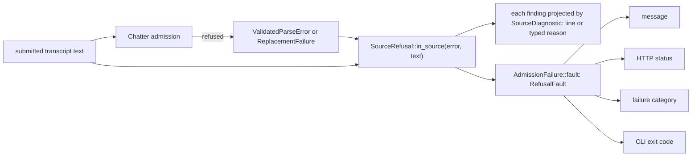
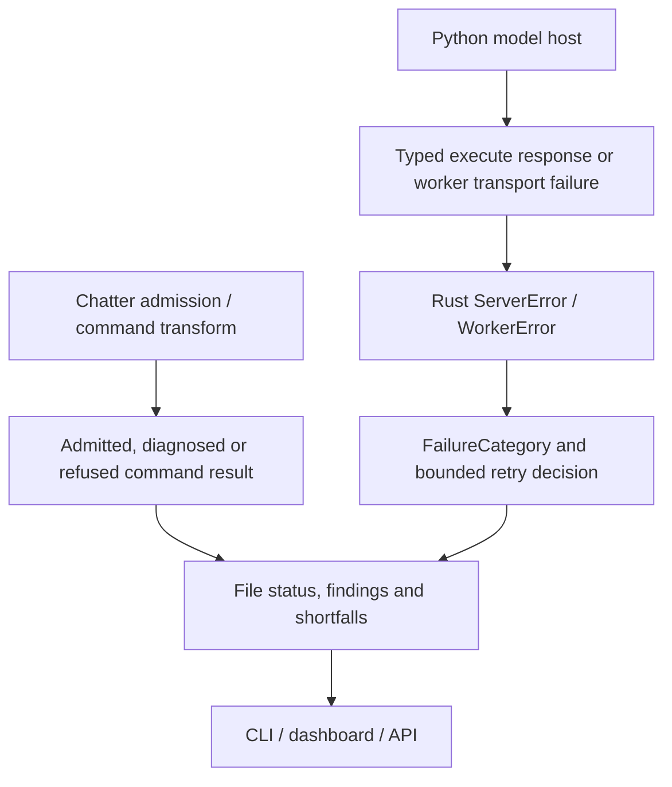

# Errors: Batchalign Runtime

**Status:** Current
**Last updated:** 2026-11-05 14:49 EST

How Batchalign produces, propagates, and surfaces errors specific to
the ML runtime: parse modes, ML/IPC failures, network errors,
ASR-API errors, worker-crash recovery, the Python-facing exception
hierarchy, and the CLI failure summary. For the CHAT-core error
infrastructure (codes, sinks, severities), now owned by chatter, see
[chat-core-errors](https://talkbank.github.io/chatter/architecture/errors-and-validation/chat-core-errors.html).
For the typed boundary between Python and Rust workers see
[python-rust-errors](python-rust-errors.md). For the diagnostic UX
standard that applies workspace-wide, see
[error-diagnostics-ux](https://talkbank.github.io/chatter/architecture/errors-and-validation/error-diagnostics-ux.html).

## Parser and Command Failures

CHAT parsing and validation run in Rust through Chatter. The former
`ParsedChat.parse` / `parse_lenient` Python methods are retired. Command
processing uses typed input admission and output states, not a choice of
legacy Python parsing modes.

A rejected input, a diagnosed generated transcript and an optional-stage
shortfall have different output contracts. See
[validation](validation.md) and
[command contracts](../../batchalign/architecture/command-contracts.md).

### Refused input transcripts

Every command that reads a submitted transcript admits it through Chatter:
complete admission (`ParsedSourceChat::admit`) for text commands, benchmark
gold files, merge-verify drafts and the UTR replay, or source-bound
replacement admission (`admit_planned_tiers`, `admit_word_timing_plan`) for
morphotag and align. A refusal reaches the user as a
`SourceRefusal<E>` (`crates/batchalign/src/error.rs`), carried by
`ServerError::ChatAdmission`, `ServerError::ChatReplacementAdmission`,
`CliError::ChatAdmission` and `MergeVerifyError::SourceAdmission`.



**Whose fault.** `AdmissionFailure::fault` decides it once, by an exhaustive
match over Chatter's failure variant, and every reader takes it from there:

| `RefusalFault` | Message | HTTP | Failure category | CLI exit |
| --- | --- | --- | --- | --- |
| `InvalidInput` | "the input transcript is not valid CHAT: line 7: E316 .... Correct the transcript and submit it again; nothing was written" | 400 | `Validation` | 2 |
| `ToolFailure` | "internal fault reading the transcript (...); this is a tool problem, not a verdict on the transcript, and nothing was written" | 500 | `System` | 6 |

`ReplacementFailure::SourceUnavailable` is a tool failure, although Chatter's
`has_internal_failure` answers `false` for it: Chatter documents it as
asserting no invalidity. Merge-verify's other failures map into the same
`RefusalFault` (`MergeVerifyError::fault`).

**Lines.** Chatter's findings carry byte spans in the refused source's
coordinates, and a line exists only once a span is projected onto that
source. Only the refusing call site holds the source, so
`SourceRefusal::in_source(error, source)` is the one constructor, and it runs
Chatter's checked projection (`enhance_errors_with_index`) there, once. A span
the source does not contain (a coordinate defect) keeps no line rather than a
wrong one, and is logged at `warn`.

**Watch out.** Nothing checks that the text passed to `in_source` is the text
Chatter refused; each site passes the string it gave Chatter. A site that
passed a preprocessed copy would get plausible but wrong line numbers. The
lasting fix is for Chatter's admissions, which hold the source when they fail,
to return positioned findings and an explicit fault verdict; `SourceRefusal`
and `AdmissionFailure` then become unnecessary.

One refusal is not fatal: when morphotag reuses an earlier transcript's
morphology and that earlier transcript is refused as invalid input, reuse is
disabled with a warning and the current input is analyzed in full.

## Structured Error Access (PyO3)

Structured CHAT-validation errors reach Python through the typed
boundary, not via a `ParsedChat` method surface (the legacy
`ParsedChat` binding was removed in the 2026-03-21 PyO3 slimdown to
worker-runtime-only, see [Python ↔ Rust Boundary](../python-rust-boundary/python-rust-boundary.md)).
Validation failures inside the Rust worker construct
`BatchalignBoundaryError::ChatValidation { entries, … }` (defined at
`crates/batchalign-pyo3/src/error.rs`); the boundary lowers that into
`CHATValidationException` on the Python side with a populated
`errors: list[ValidationErrorEntry]` field.

`ValidationErrorEntry` is a TypedDict (Python view of the Rust struct
at `crates/batchalign-pyo3/src/error.rs:85`) with these fields:

| Field | Type | Notes |
|---|---|---|
| `code` | `str` | e.g. `"E705"` |
| `severity` | `str` | `"error"` / `"warning"` |
| `line` | `Optional[int]` | 1-based; `None` when unavailable |
| `column` | `Optional[int]` | 1-based; `None` when unavailable |
| `message` | `str` | Full diagnostic message |
| `suggestion` | `Optional[str]` | Optional remediation hint |

Python callers inspect `exc.errors[0]["code"]` and the other dictionary fields rather than
parsing message text. The boundary contract is enforced by
`batchalign/tests/test_pyo3_error_typing.py`.

## Output Admission

The writer consumes the command's admitted or explicitly diagnosed output
state. `pipeline/post_validate.rs` owns checked output construction and
retained findings; the command's pipeline determines whether a refused
optional result keeps its predecessor or the file fails. A legacy
`validate_output` call alone is not the complete admission contract.

See [CHAT validation failures](../../batchalign/developer/chat-validation-failures.md)
for recovery and the distinction between a failed file and a retained
diagnosed transcript.

## `CHATValidationException`

Defined in Rust at `crates/batchalign-pyo3/src/error.rs` via
`pyo3::create_exception!` and re-exported through Python:

```rust,ignore
// crates/batchalign-pyo3/src/error.rs
use pyo3::create_exception;
create_exception!(batchalign_core, BatchalignError, PyException);
create_exception!(batchalign_core, CHATValidationException, BatchalignError);
```

```python
# batchalign/errors.py
from batchalign_core import BatchalignError, CHATValidationException
```

When `BatchalignBoundaryError::ChatValidation { entries, .. }` crosses
the PyO3 boundary, the `From<BatchalignBoundaryError> for PyErr` impl
constructs the Python exception with a populated `errors:
list[ValidationErrorEntry]`. Code that
catches the exception inspects `exc.errors[i]["code"]`,
`exc.errors[i]["line"]`, etc. for programmatic access without parsing
the message string.

See [Python ↔ Rust errors](python-rust-errors.md) for the full
boundary contract, including the typed-exception hierarchy and the
internals-leakage scan.

## Runtime Error Classification

Server accounting and retry policy are Rust-owned. Worker protocol failures
retain their code in `ExecuteFailureRead`; `into_server_error` maps that
code to a typed server error. `classify_server_error` and
`classify_worker_error` in `runner/util/error_classification.rs` determine the
`FailureCategory` consumed by `RetryPolicy::after_failure`.

Downloads, device memory pressure, model access refusals, provider account
refusals, quota exhaustion, malformed protocol and generic runtime failures
are separate categories. The Python compatibility helper `classify_error`
is not the server's retry authority. See
[worker failure classification](../../batchalign/architecture/worker-failure-classification.md)
for the exhaustive mapping and current retry policy.

## CLI Failure Summary

Rust CLI dispatch aggregates failures per job/server and prints
structured summaries after polling. Error details shown to users
are derived from server `FileStatusEntry` fields (`error`,
`error_category`, and any structured validation metadata).

## Error Flow



The extension's Python exception surface is a separate boundary for callers
of that extension; the live server consumes typed worker protocol results.
