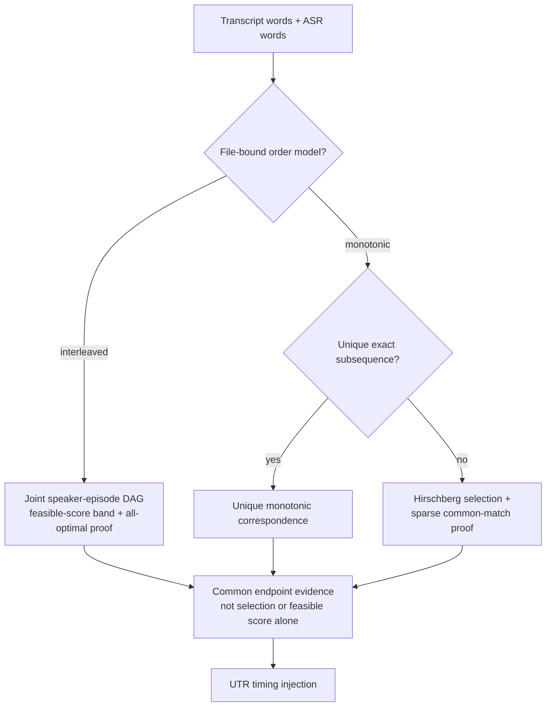
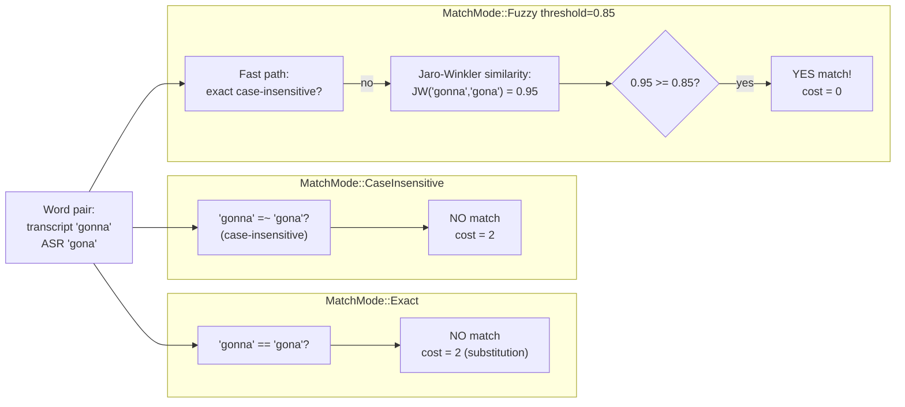
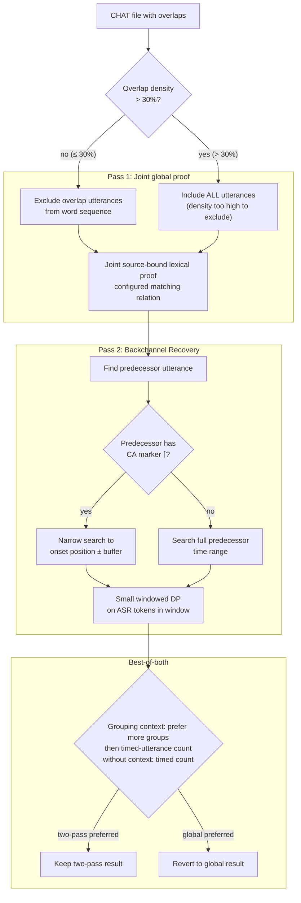
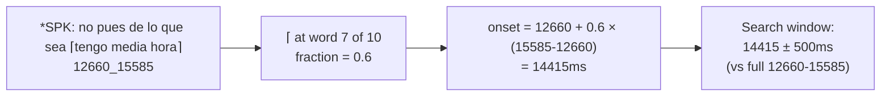

# Dynamic Programming

**Status:** Current
**Last updated:** 2026-10-15 18:33 EDT

Where dynamic programming is used at runtime across the workspace,
which uses are intrinsically necessary, and which are
correctness-critical even when avoidable. A policy test enforces
that no new runtime DP appears outside the allowlisted call sites.

## Inventory

| Area | Call site | DP algorithm | Notes |
|---|---|---|---|
| Whisper ASR timestamp extraction | `batchalign/inference/audio.py` | DTW (`_dynamic_time_warping`) | Maps decoder tokens to audio frames from cross-attention matrices |
| Whisper FA token timing | `batchalign/inference/fa.py` | DTW | Token jump times extracted in Python, mapped in Rust |
| Wave2Vec forced alignment | `batchalign/inference/fa.py` | CTC forced alignment (Viterbi-style DP) | `torchaudio.functional.forced_align` on emission matrix vs transcript |
| FA word-level remapping | `crates/batchalign/src/chat_ops/fa/alignment.rs::apply_indexed_timings` | **None** | Indexed callback protocol maps timings 1:1 by index |
| FA token-level remapping | `crates/batchalign/src/chat_ops/fa/alignment.rs::align_token_timings` | **None** | Deterministic token→word stitching only; unmatched words remain untimed |
| UTR timing recovery | `crates/batchalign/src/chat_ops/fa/utr.rs` and `crates/batchalign-transform/src/dp_align/` | Unique subsequence, sparse common-correspondence proof, or joint speaker-episode DAG | File-bound order model; selected paths cannot authorize timing |
| UTR feasible witness | `crates/batchalign-transform/src/dp_align/interleaving/episodes/band/witness.rs` | Packed literal LCS or scalar fuzzy/small LCS | A canonical-order lower bound admits exact pruning, not correspondence |
| Morphosyntax retokenize mapping | `crates/batchalign-transform/src/retokenize.rs` | **None** | Admitted span joins and owned rebuilds |
| WER / compare | `crates/batchalign-transform/src/compare/engine.rs` | Hirschberg edit-distance DP | One whole-file transcript comparison |
| Cross-run comparison | `crates/batchalign-transform/src/compare/cross_run.rs` | Hirschberg edit-distance DP | Cross-run agreement, not UTR timing authority |

## Classification

### Intrinsic: DP is the algorithm

- **WER evaluation / compare command.** Comparing two independent
  word sequences is exactly edit-distance territory.
- **CTC forced alignment** (`forced_align`). DP is intrinsic to the
  model family.
- **Whisper DTW path.** If cross-attention DTW is the chosen
  alignment method, DP is part of the method.

### Architecturally avoidable: removed from runtime

- **FA word/token remapping.** Removed; indexed or deterministic
  stitching only.
- **Retokenize char-level DP.** Removed; deterministic span-join
  with length-aware monotonic fallback.

### Correctness-critical: DP retained on purpose

- **UTR ASR → transcript correspondence.** Independent utterance matches can
  strand later words or claim a reference word twice. The global producer
  binds one source census and file order model, partitioned only at admitted
  retained timing anchors. Monotonic regions have a unique-subsequence fast
  path; otherwise a Hirschberg selection is separate from sparse all-optimal
  common-match admission. Interleaved regions use one joint speaker-episode
  DAG and exact score band. Competing regional token claims are withdrawn;
  a selected path or a feasible score never grants timing by itself.
  This is correctness-critical correspondence, not an avoidable runtime remap.

Global UTR is not solely monotonic. Its joint graph permits bounded
adjacent-speaker episodes while retaining turn order and same-speaker order;
it does not cover arbitrary reordering or three-way overlap. Missing evidence,
ambiguity and refused proof work remain explicit, not guessed timings.

Large exact/ASCII-case-insensitive canonical witnesses use packed LCS row
differences and sparse equality masks; small/fuzzy witnesses retain scalar
rows with prefix/suffix stripping. Private `CanonicalWitness` binds the score
to its relation and `Band` retains that relation for all subsequent analysis.
The score is only a feasible lower bound. Existing work, memory and candidate
limits still apply, with work-refusal `phase` and `required_at_least` diagnostics.
This general optimization needs no corpus/provider switch or new option, but
it does not change the separate monotonic producer or fuzzy witness algorithm.
See [the developer kernel contract](../../batchalign/developer/backchannel-aware-alignment.md#packed-feasible-score-producer-and-ownership)
and [user-facing recovery limits](../../batchalign/reference/forced-alignment.md#anchored-regions).

## Hirschberg Optimizations

The selected-path `dp_align/` implementation in `batchalign-transform` includes
two optimizations beyond the textbook algorithm:

- **Prefix/suffix stripping.** Before entering the O(mn) DP core,
  `align()` strips matching prefixes and suffixes in O(n). For the
  primary use case (WER / transcript comparison, 80-95% accuracy),
  reduces effective DP problem size 10-100×. Only the differing
  middle portion enters Hirschberg recursion.
- **Generic `Alignable` trait.** Both `String` (word-level) and
  `char` (character-level) entry points share one generic
  implementation. Monomorphization eliminates ~200 lines of
  duplicated code with zero runtime overhead.

## Fuzzy Matching

The DP aligner supports three word-comparison modes via `MatchMode`:

Jaro-Winkler compares two strings by counting matching characters
within a distance window, penalizing transpositions, and boosting
for common prefixes. Returns 0.0 (different) to 1.0 (identical).
Better than Levenshtein for short words because it doesn't
penalize length differences as harshly.

Without fuzzy matching, an ASR substitution ("gonna" vs "gona") is a gap
rather than a lexical match. A fuzzy relation can admit that pair, but extra
matches can also create ambiguity. Similarity or one selected path does not
prove a common correspondence, accurate audio timing or acoustic speaker
identity. The default global strategy does not use this fuzzy relation.

The experimental two-pass default threshold (0.85) was tuned across 6 corpora
and 59 files. Examples at this threshold:

| Pair | JW | Match at 0.85? |
|---|---|---|
| "gonna" / "gona" | 0.95 | Yes |
| "went" / "wen" | 0.94 | Yes |
| "yesterday" / "yestarday" | 0.92 | Yes |
| "mhm" / "mmhm" | 0.83 | No |
| "the" / "da" | 0.00 | No |
| "he" / "she" | 0.61 | No |
| "cat" / "dog" | 0.00 | No |

## UTR Two-Pass Overlap-Aware Alignment

Two-pass UTR requires explicit `--utr-strategy two-pass`. `auto` and `global`
both use `GlobalUtr`, whether overlap markers exist or not. Markers affect the
opt-in strategy's participation and local recovery, not default strategy
selection.

### Configurable parameters

All tuning flags below apply only to explicit `two-pass`. Global and auto
use case-insensitive exact matching.

| Flag | Default | Controls |
|---|---|---|
| `--utr-strategy` | `auto` | `auto` (currently global) / `global` / `two-pass` |
| `--utr-ca-markers` | `enabled` | Use ⌈⌉⌊⌋ for onset windowing |
| `--utr-density-threshold` | `0.30` | Max overlap fraction before skipping exclusion |
| `--utr-tight-buffer` | `500` | Pass-2 tight window ±ms |
| `--utr-fuzzy` | `0.85` | Jaro-Winkler similarity threshold |

### CA marker onset estimation

When a predecessor utterance has ⌈ markers, the proportional
position of ⌈ among the utterance's words estimates when overlap
begins:

Narrows the pass-2 search window from the full predecessor range
(~3 seconds in this example) to ~1 second around the estimated
onset, roughly a 3× reduction in search space.

## Known DP Failure Modes

1. **Crossing alignments / rapid overlaps.** Monotonic proof cannot represent
   crossing matches. The joint UTR graph covers bounded adjacent-speaker
   episodes, not unrestricted reorderings or three-way overlap.
2. **Repeated-token ambiguity.** Repeated words create many
   equal-cost paths. Deterministic selection is not common-match proof;
   ambiguous endpoints cannot authorize a UTR hint.
3. **ASR drift and hallucinations.** Large payload/reference
   divergence causes sparse matches and low timing coverage.
4. **Tokenization or normalization mismatch.** Char-level DP may
   align surprising spans when punctuation/case/tokenization
   differ.
5. **Temporal validity vs textual order.** Correct per-utterance
   times can still violate CHAT monotonicity when transcript order
   diverges from audio order.

### Mitigations and their authority

- **Common correspondence and retained bounds:** UTR hints use proved
  endpoints, not selected repeats. Exhausted projection/search is diagnosed;
  existing authoritative bullets remain unchanged.
- **Owned FA partitions:** requestable anchor-bounded pieces retain original
  word slots; unavailable pieces receive no request or invented word timing.
  A search envelope is not a final acoustic observation.
- **Final timing policy:** document order and same-speaker constraints are
  reconciled with main/word timing together, while valid cross-speaker overlap
  is preserved by default. See [Bullet and Word-Timing Policies](../../batchalign/reference/bullet-policies.md).
- **Untimed search windows:** source-bound UTR evidence is required; missing
  localization produces an explicit refusal without a model request.
  Proportional placement is removed. Supported requests remain fallible. See
  [Proportional FA Estimation](../alignment/proportional-fa-estimation.md).
- **Retokenization:** admitted span-owned rebuilds preserve original CHAT
  annotations and refuse invalid mappings; parser recovery is not a substitute
  for semantic admission.

## Allowlist Policy

`batchalign/tests/test_dp_allowlist.py::test_chat_ops_dp_calls_are_allowlisted`
tracks production `dp_align::align`, `dp_align::align_chars` and
`CorrespondenceAnalysis::observe[_controlled]` sites separately. It scans
`crates/batchalign/src/**/*.rs` and `crates/batchalign-transform/src/**/*.rs`:

| Call site | Purpose |
|---|---|
| `crates/batchalign-transform/src/compare/engine.rs` | One whole-file selected-path alignment for compare / WER |
| `crates/batchalign-transform/src/compare/cross_run.rs` | Cross-run selected-path agreement |
| `crates/batchalign/src/chat_ops/fa/alignment/residue.rs` | Input-bounded character residue alignment |
| `crates/batchalign/src/chat_ops/fa/utr.rs` | Monotonic region's selected path and common-correspondence admission |
| `crates/batchalign/src/chat_ops/fa/utr/two_pass.rs` | Opt-in windowed overlap selected path and common-correspondence admission |

The PyO3 boundary surface no longer hosts a `dp_align` call site
(the pre-slimdown `pyfunctions.rs` bridge was retired). Any new
runtime DP call site must be added to the allowlist in
`test_dp_allowlist.py` with a justification. The joint interleaving kernel and
its packed feasible witness are distinct implementations with their own
budget/oracle controls, not direct `dp_align::align` call sites. An allowlist
match alone is not a certificate of bounded work, common correspondence or
model accuracy.
