# Batchalign Workers

**Status:** Current
**Last updated:** 2026-10-25 08:12 EDT

Per-app worker concerns specific to the Batchalign runtime: pool
sizing, RAM-tier-aware memory budgets, model loading per worker,
saturation safeguards, and the three-layer parallelism model. These
build on the workspace's shared concurrency primitives: the Tokio
runtime, the `Semaphore + RAII` pool pattern, channels, lock ordering,
and the no-`Mutex` policy.

> **Implementation note.** Tier scaling is wired (b4189037).
> `estimate_per_worker_peak_mb_with_profile` (Phase β, `batchalign-types::memory`)
> clamps the per-job execution envelope to the detected tier's per-profile startup
> budget, so a 16 GB laptop with a clean memory state can admit a
> 1-worker morphotag job (Contract C-16GB is GREEN). The five
> architectural principles that prevent the layer-by-layer
> consolidation bug class from returning are covered by the tier-aware memory
> tests in `batchalign-types`.

## How a worker process starts

Every route that starts a Python worker (the server's pool, persistent TCP
workers, `batchalign3 worker start`) builds its command with
`worker::python::worker_command`: the resolved interpreter run as
`python -P -c <worker entry>`. The import probes (`python_has_batchalign`,
`batchalign3 doctor`) use the same isolated interpreter, so a probe checks the
import a worker will perform.

`-P` is load-bearing. Plain `python -c` puts the current working directory
first on `sys.path`, so a server started inside a source checkout ran that
checkout's `batchalign` package, uncommitted edits included, while its build
identity named the installed wheel (found 2026-10-01). `-P` removes only that
entry: an editable development install reaches its source through a `.pth`
file and still works. Tested on a real interpreter in `worker/python.rs`.

### Admitted startup and submitted work

The startup reader decodes one private ready wire representation. Its admitted
ReadySignal always retains an affirmative acknowledgement and validated runtime
identity. Consuming transport admission yields StdioReady or TcpReady. Real
spawners and shell fixtures use the same transition, so a fixture cannot skip
the ready flag or transport check. Advancing startup progress keeps the existing
loading-stall window alive.

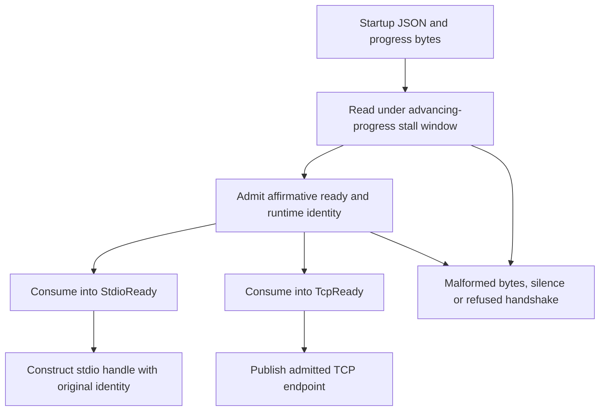

A ReadyRequest carries its already-derived TaskLoad through metadata preparation
and final FA execution. Each transport loads that carried identity through its
sealed effect adapter, then privately grants a RunPermit owning the request,
loaded-model proof and request memory. Submission consumes the permit.
Sequential transports bind the terminal reply to the original request ID and
task before returning it.

Shared submission moves that permit, its executor slot and its job cancellation
registration into the pending route. The caller retains only reply interest.
After a complete write, cancellation or timeout ends that interest while the
pending owner remains until a terminal reply or stream retirement. A retry of
the exact same still-pending packet can rejoin its detached reply before taking
another memory lease or executor slot. An active duplicate ID or changed packet
is refused. A dropped or failed partial write retires the uncertain stream.

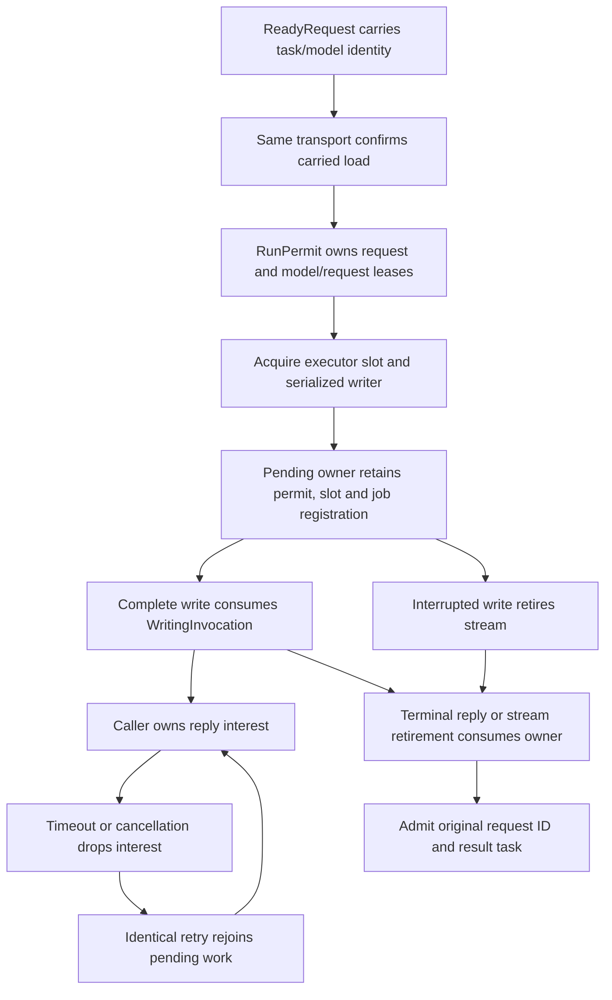

Stream retirement remains the local connection's resource boundary. A detached
external daemon may continue work after that connection ends. This ownership
graph adds no remote cancellation or physical-completion acknowledgement.

### Operation-bound control exchanges

Each control operation carries its request and derives its own wait policy.
The progress reader consumes that operation when admitting the terminal reply.
Only ControlCompletion can authorize sequential reuse. A reported operation
failure completes the exchange. A malformed or foreign terminal leaves the
stdio handle in flight for retirement. Loading additionally retains its actual
memory grant until a matching task reply can settle it.

Observation-only ExpectedLoad, ExpectedInfer and ExpectedBatch describe wire
contracts without granting request-sending authority. Test doubles run the
same progress reader using controlled time and actual decoded JSON.

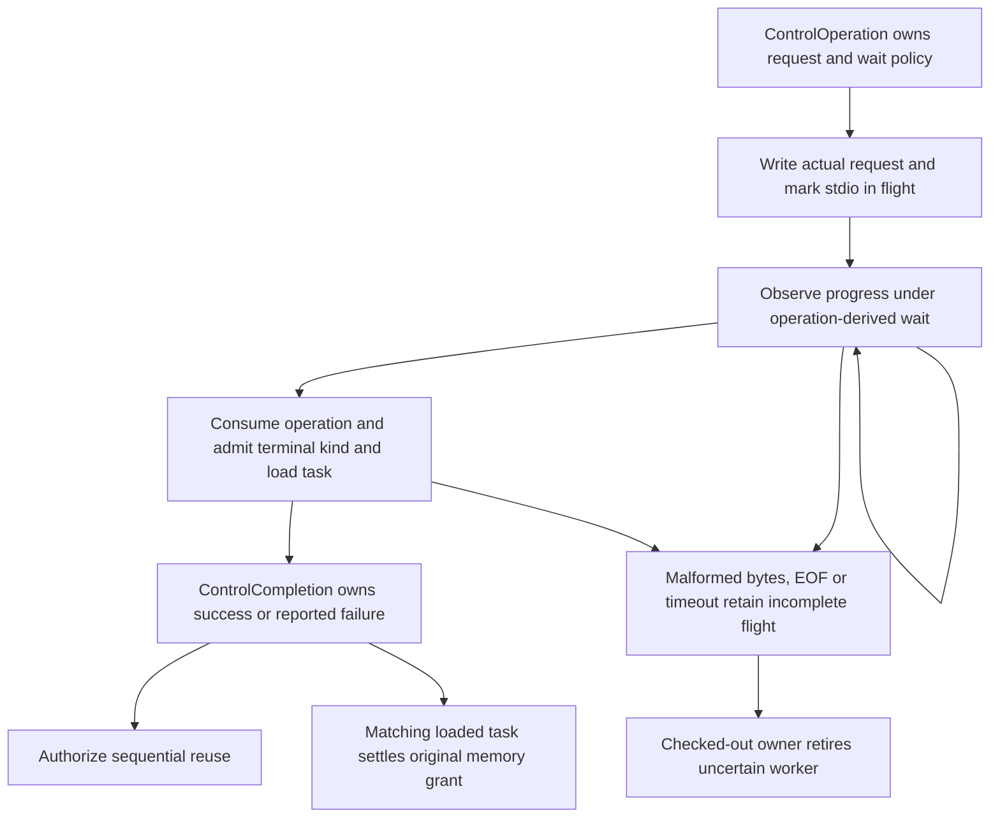

### Worker preparation retains routing facts

DispatchPreparation retains the actual request and its derived TaskLoad.
WorkerPlan consumes that preparation with the admitted GPU route or derives
its non-GPU worker key from the carried load. CommandWorkerPlan derives the
capability probe's key and load from one command recipe. Consumers use these
associated facts throughout checkout and loading.

TaskLoad shares immutable load facts through Arc. Its retained engine selection
serves worker selection without reparsing wire override strings. Cache identity
continues to use task, wire overrides and residency. Cloning a load shares its
map and derived selection.

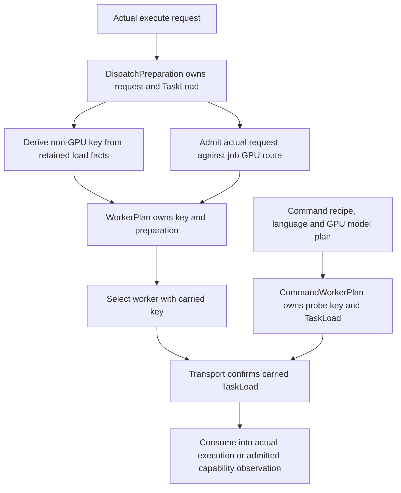

## Three Layers of Parallelism

Batchalign has three independent parallelism controls:

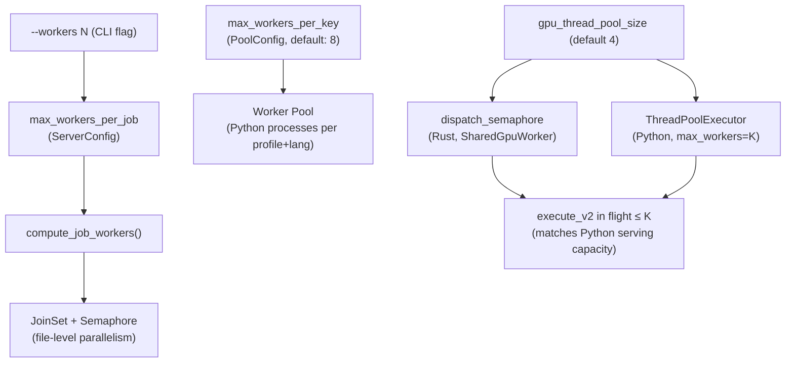

Layer 3's twin nodes (`dispatch_semaphore` on the Rust side and
`ThreadPoolExecutor` on the Python side) share **one** ceiling
`K = gpu_thread_pool_size`. The Rust gate ensures a caller waiting
for an executor slot does not hold an active per-request timer; the
timer only ticks once a slot is granted and work is issued. See
`developer/worker-protocol-v2.md` § "The dispatch semaphore contract"
for the architectural rule.

### Layer 1: File parallelism (user-facing)

How many files are processed concurrently within a single job.

- **User control**: `--workers N` CLI flag, or `max_workers_per_job`
  in `server.yaml`.
- **Default**: GPU-heavy commands (`transcribe`, `align`,
  `benchmark`): **1 file** (prevents OOM). CPU-only commands
  (`morphotag`, `utseg`, `translate`): auto-tuned by
  `compute_job_workers()` based on available RAM and CPU cores.
- **Implementation**: `runner/dispatch/` uses a `JoinSet` with a
  `Semaphore(num_workers)` to cap concurrent file-processing tasks.

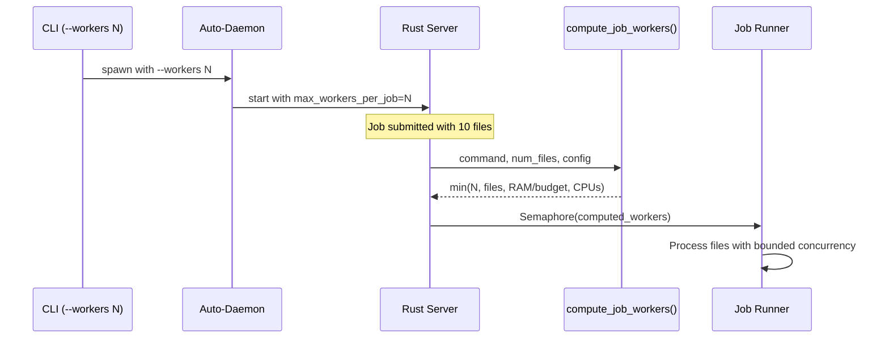

### Layer 2: Worker pool (operator-facing)

How many Python worker processes exist per `(profile, language,
engine)` key.

- **User control**: `max_workers_per_key` in `server.yaml` (not a
  CLI flag, operator concern).
- **Default**: 8 per key. GPU profile: 1 process. Stanza profile:
  auto-tuned. IO profile: 1 process.
- **Which workers it governs**: every key whose workers serve one
  request at a time (`WorkerServing::OneRequestPerProcess`,
  `worker/serving.rs`). That includes GPU workers under `force_cpu` or
  `gpu_thread_pool_size: 1`, the normal state of a CPU-only host, where
  raising it is how GPU commands use more cores. A key whose worker is
  a shared concurrent process (`SharedConcurrent`) has exactly one
  process and Layer 3 is its concurrency.
- **Implementation**: `worker/pool/mod.rs` manages worker
  lifecycle. Workers are spawned lazily and cached.

### Layer 3: GPU dispatch concurrency (Rust gate + Python pool)

How many `execute_v2` calls are in flight at the same time per
shared GPU worker.

- **User control**: `gpu_thread_pool_size` in `server.yaml`
  (default 4). Single knob sets both Python
  `ThreadPoolExecutor(max_workers=K)` and Rust-side
  `dispatch_semaphore` permit count. It applies only while the worker
  is shared: with `force_cpu`, or with `K = 1`, the server launches GPU
  workers with `--serving sequential` and scales them per key (Layer 2)
  instead of queueing every request on one process.
- **Default**: 4. On Apple Silicon (MPS excluded for batchalign3),
  set to 1, there is no compute parallelism to gain, and a higher
  value just means CPU-bound inferences contending for cores.
- **Implementation**
  - Rust: `worker/pool/shared_gpu/stdio.rs` and
    `worker/pool/shared_gpu/tcp.rs` each carry a
    `dispatch_semaphore: Arc<Semaphore>` with `K` permits, acquired
    *before* the per-request timeout starts.
  - Python:
    `batchalign/worker/_protocol.py::_serve_stdio_concurrent` hosts
    a `ThreadPoolExecutor(max_workers=K)`.

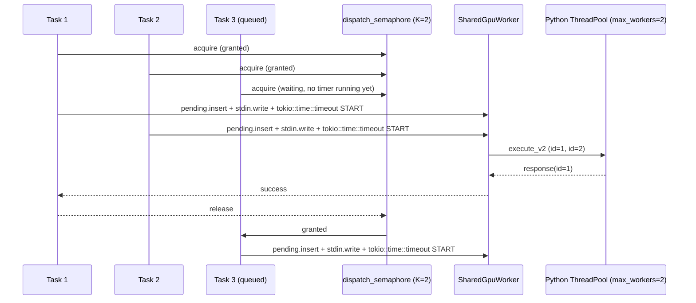

Task 3's per-request timer only starts at the moment it acquires the
permit, never during queue-wait. This is the contract asserted by
`tests/gpu_concurrent_dispatch.rs::gpu_concurrent_dispatch_does_not_charge_queue_wait_against_per_request_timeout`.

### Why GPU commands default to 1 worker

Each GPU-heavy inference (Whisper ASR, Whisper FA, Wave2Vec) loads
2-5 GB of model weights into GPU/MPS memory. Multiple concurrent
files all share the same GPU memory pool.

On a 64 GB developer machine with MPS:

- 1 concurrent file: ~5 GB GPU memory, safe.
- 4 concurrent files: ~20 GB GPU pressure, risky.
- 8 concurrent files (old default): ~40 GB GPU pressure, kernel
  OOM crash.

Setting GPU commands to default to 1 file prevents this class of
crash entirely. Operators with dedicated GPU hardware can safely
increase via `--workers N` or `server.yaml`.

## RAM-Tier Adaptive Budgets

All memory budgets are scaled automatically based on total system
RAM. The server detects the tier once at startup and logs it. No
user configuration, works on machines from 16 GB laptops to 256 GB
servers.

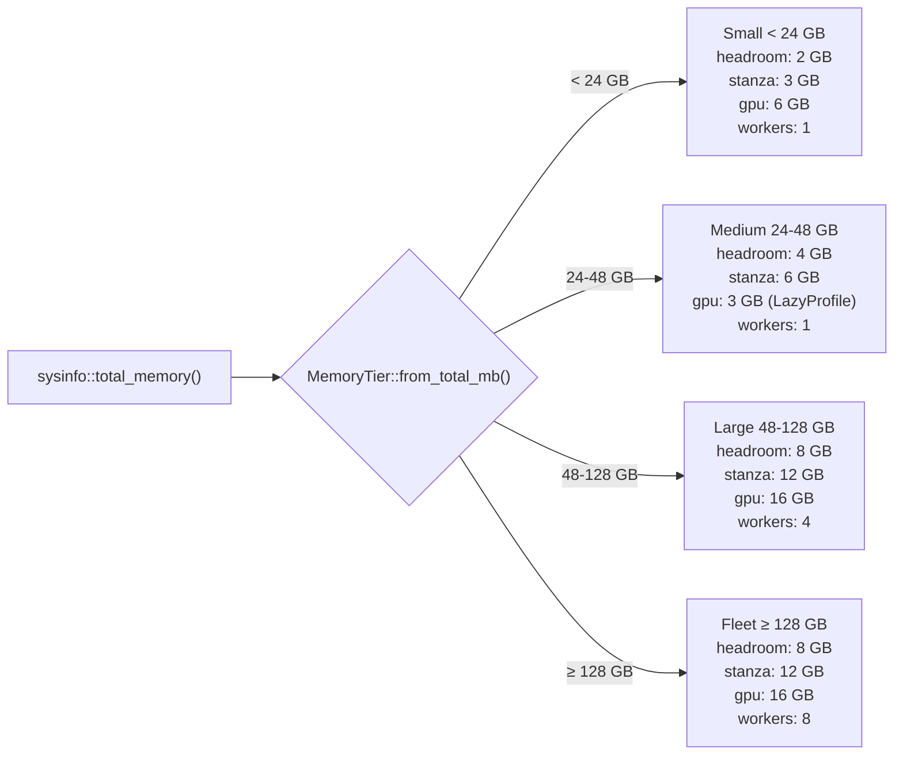

Medium-tier GPU uses **LazyProfile** mode: the GPU worker starts
with only process overhead (~3 GB), loading model weights on demand
rather than at spawn. This is what lets a 32 GB workstation admit a
GPU worker at all, eager-loading 16 GB of Whisper weights would
fail the headroom check.

The Large and Fleet tiers reproduce the original fixed constants
from `runtime_constants.toml` exactly, fleet machines see zero
behavior change. The TOML constants remain as the Large/Fleet
baseline; the tier system scales them down for smaller machines.

**Source:** `crates/batchalign/src/types/runtime.rs`,
`MemoryTier::from_total_mb()` (pure, testable), applied to the one reading
of the host each process takes at its composition root
(`HostSnapshot::read` in `crates/batchalign/src/host_facts/snapshot.rs`).
A host that will not report its memory stops the process with an error; it
is never sized as if it had none.

### Why small machines need smaller budgets

The original constants were tuned for 64-256 GB fleet machines where
multiple concurrent workers are the norm. On a 16 GB laptop the
fleet defaults are infeasible:

- **Stanza startup 12 GB** exceeds available memory (~9 GB on macOS)
  → daemon can never start.
- **Host headroom 8 GB** leaves no room for any worker at all.
- **GPU startup 16 GB** exceeds total system RAM.

The Small tier reduces these to match actual model sizes: Stanza
uses ~2-3 GB RSS, Whisper float32 ~4-5 GB. The reduced headroom
(2 GB) still prevents OOM while allowing the single-worker model to
function.

## Memory Check Flow

Every point where memory is checked or reserved, from daemon spawn
through job completion. Each gate that can block is marked.

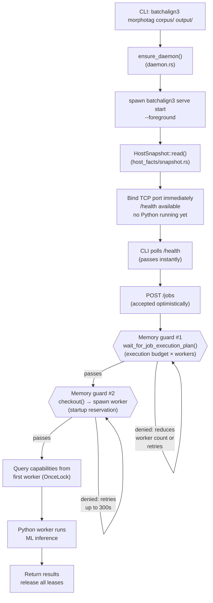

**Key behavior.** No Python process runs until the first job
arrives. The daemon starts in <1 second and uses zero memory at
idle. Memory guards only fire when actual work is requested, using
tier-scaled budgets (Small tier: 3 GB Stanza, 2 GB headroom →
`9000 − 3000 = 6000 ≥ 2000` passes on 16 GB).

## Worker-Pool Saturation Safeguards

Two safeguards together prevent silent corruption when the worker
pool hits its global cap during a multi-language morphosyntax batch.
Both exist because an earlier architecture could silently emit CHAT
files with missing `%mor`/`%gra` tiers on utterances in languages
the pool had temporarily "locked out."

### The failure mode

A morphotag batch processes utterances grouped by language. Each
language group needs a Stanza worker for its 3-letter language code.
When the batch spans more languages than the pool can hold
concurrently, earlier groups' workers go idle but stay counted in
the global cap, and later language groups find no slot available to
spawn.

Without safeguards the failure surfaces at two layers:

1. **Pool layer**: `WorkerPool::checkout` returns
   `Err(SpawnFailed("... cannot wait (would deadlock)"))` rather
   than freeing a slot from an idle worker of a different key.
2. **Orchestrator layer**: the morphosyntax batch catches the
   pool error, logs a warning, substitutes an empty `UdResponse`
   for every utterance in the affected group, and continues to
   injection. `clear_morphosyntax` already cleared the existing
   tiers; the empty placeholder is stripped by
   `remove_empty_morphosyntax_placeholders`. Net effect: file
   serialized with `rc=0` but affected utterances have lost their
   morphosyntactic annotation. Nothing in the log names the file;
   downstream auditors see a per-file success.

### Safeguard 1 — idle eviction and an observable wait

Exclusive queues contain complete PoolWorker owners. Their contents alone
establish availability. IdleView exposes read-only observations. Only the
private capacity producer can publish, remove or drain workers. There is one
global capacity semaphore whose permit remains with the actual worker through
its entire lifetime.

Checkout registers queue and pool-change notifications before inspecting the
queue or attempting startup. It takes an actual DepartedWorker immediately
when available. Otherwise it attempts admitted startup. A saturated empty group
can retire an idle worker from another group, then retry admission. Other
callers await queue publication, worker changes or the deferral's capacity event.
Each actual publication wakes one registered waiter, including burst returns.

The wait has no deadline. The report interval logs current counts and re-probes
admission. Shutdown produces PoolShuttingDown. Caller cancellation drops its
wait. The queue owns each idle worker, and each departure owns its original
capacity. Independent idle-permit counters and repeated mismatch reconciliation
have been removed.

PoolWaitObserver carries start/end observations to the file around audio,
benchmark, align pre-pass and text inference. File worker waits coexist with
pipeline progress. A host-memory wait takes presentation precedence, followed
by a worker wait, followed by the reported stage. Dropping a wait closes its
own observation. Unobserved health/background requests retain the same wait
semantics and interval logging.

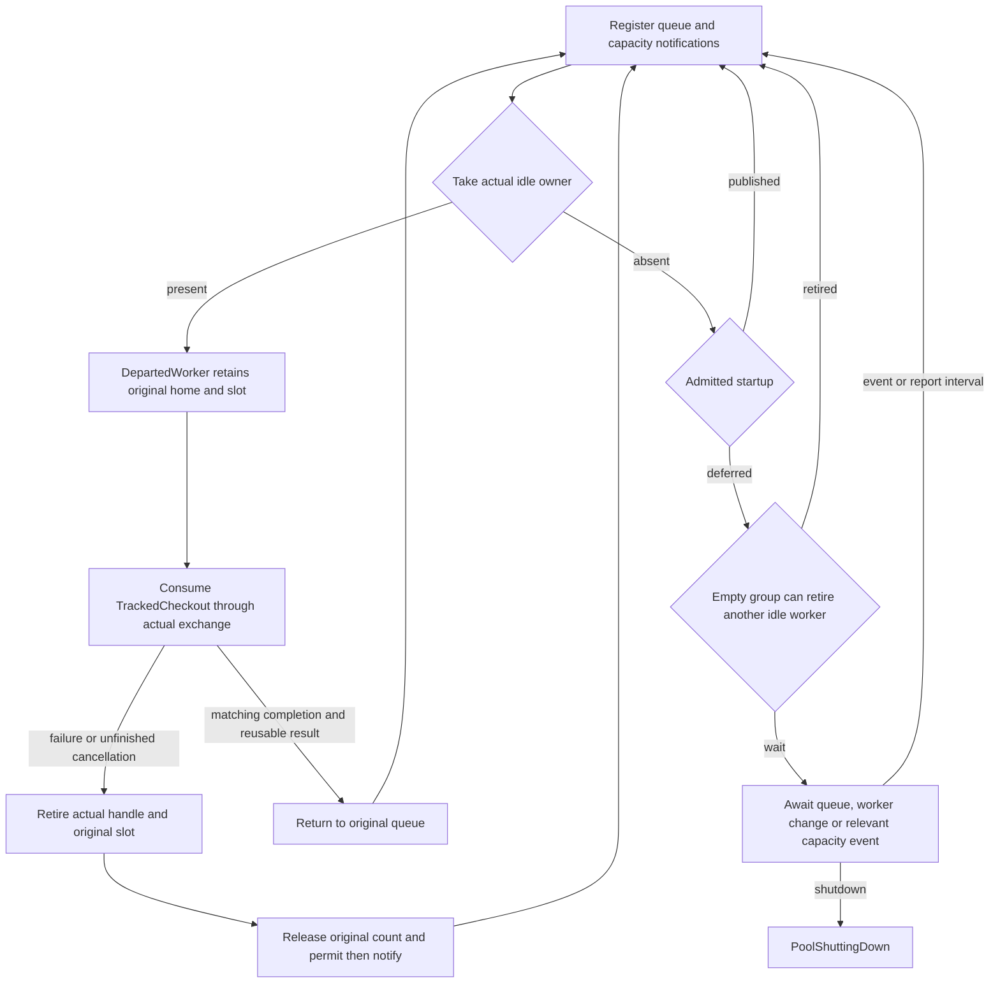

The eviction selector is a pure borrowed key/count policy. One consolidated
matrix covers skip-key exclusion, empty populations and largest-idle preference
without creating a pool, process or semaphore. Native contracts retain actual
queue publication, cancellation, capacity rollback, pipe outcomes and teardown.

### Capacity retained through the worker lifetime

GlobalCapacity retains the actual RuntimeHost that admitted the pool. Each
group derives StartupReservation once from that host, its profile and its engine
selection. The estimate travels with the group through every admission retry.
Live same-profile RSS observations can replace that fallback at the existing
memory-policy edge.

ReservedWorkerSlot owns the original global reservation and per-group count.
The captured runtime owns it during startup. StartedWorker retains the completed
native handle and reservation until consuming publication into PoolWorker.
Failure or cancellation drops the original owner and releases capacity. Queue
removal produces DepartedWorker with the actual home group. Its consuming
return method always publishes to that same queue. Unfinished stdio and TCP
checkouts retire. TrackedCheckout.run owns the actual exchange and privately
binds its returned result to completion. Callers cannot independently supply a
return decision. RequestFlight keeps incomplete sequential replies out of reuse.

Health checking drains actual owners. Healthy handles return to their original
queues. Failure and cancellation retire the held owners. Detached eviction
carries RetiringWorker on the captured runtime. The handle drops before its
original slot. Slot accounting holds no queue/group reference, avoiding an idle
Arc cycle. Temporary departures retain their home while they can return.

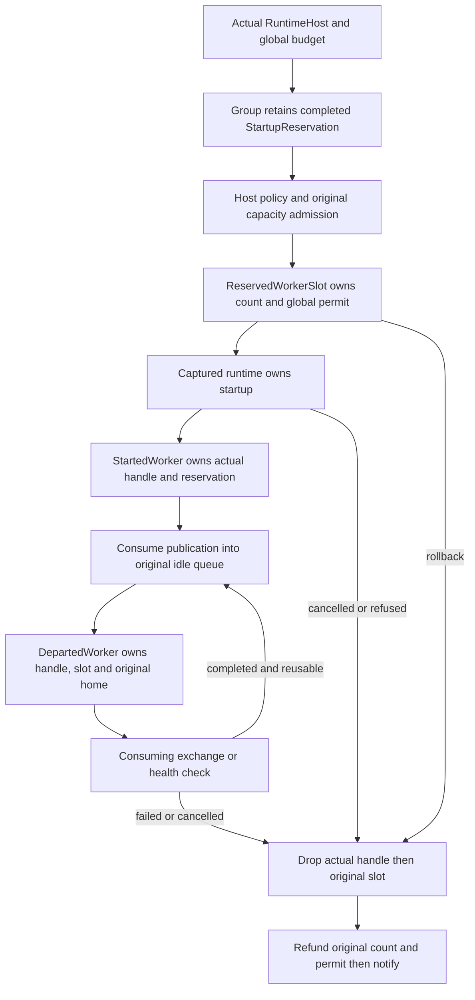

### Sampled queue observations and native process targets

IdlePopulation captures the original allocation marker with each member's key
and PID. Consuming measurement joins one kernel RSS refresh to those members.
Measured values move through pure pressure selection. Before retirement, the
original observation consumes current queue admission by allocation identity.
A worker checked out since sampling is skipped. A replacement sharing a PID
cannot satisfy another allocation's marker. The marker stays alive with the
observation, preventing allocation-address reuse while that observation exists.
RSS remains a changing kernel observation and does not reserve queue membership.

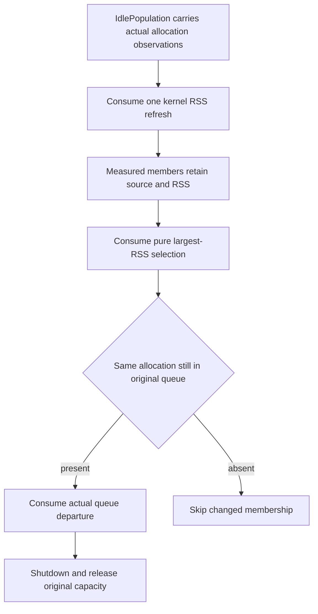

NativePid privately admits only positive IDs representable by the platform's
pid_t. Registry marker bytes, daemon PID input and owned Child IDs enter through
that boundary. Raw zero and overflow cannot reach process or group syscalls.
Closed signal operations preserve process-only and process-group policies.
NativePid establishes selector range. Process lifetime and kernel signal results
remain external observations. The isolated native contract qualifies rejection
of zero without risking another process group.

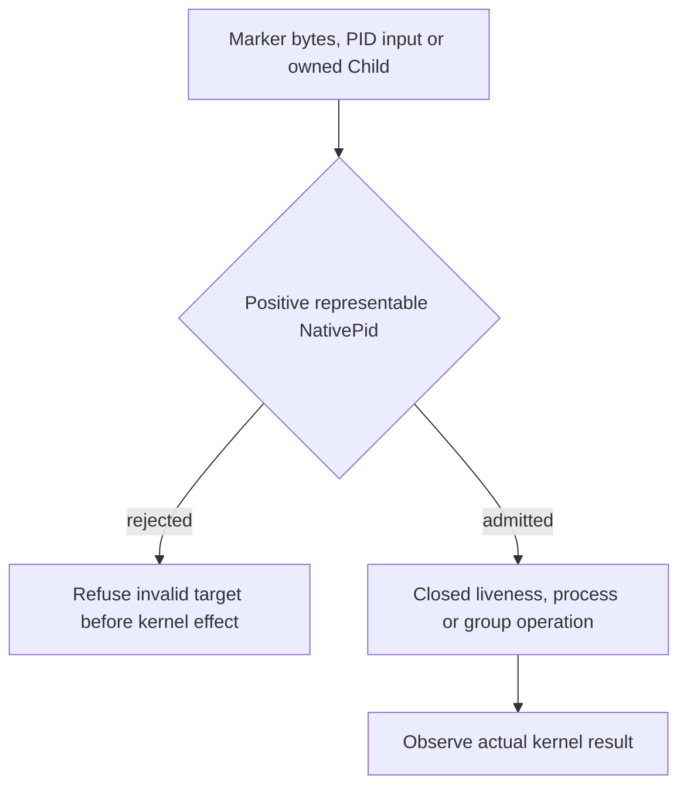

Registry discovery separately classifies owner/build policy before issuing
CompatibleEntry tied to its original immutable entry. Consuming preparation
parses that same source's profile/language once. Native connection follows the
prepared proof. Foreign ownership and stale ownership retain their earlier
priority over build checks.

### Lifetime-owned registry adoption

RegistryAdmissions issues one private, non-cloneable claim per daemon identity
within a pool. Consuming the claim produces a PreparedRegistryConnection with
the normalized key and metadata from its original source. Repeated or concurrent scans skip key
normalization and connection for a claimed daemon. The original connection
holds the claim through health probing, capability observation and pool
admission. Discovery reports actual integrations.

ProbedRegistryWorker consumes its health-checked connection into capability
observation or the existing per-scan report deferral. A completed reported
failure retains its diagnostic. An incomplete or foreign exchange retires that
connection. ReportReadyRegistryWorker admits an observed report under the key
derived from its original source before producing AdmittedRegistryWorker.

Sequential publication retains the same connection and its claim through
checkout and retirement. Shared promotion consumes that connection's buffered
reader and writer. AdoptedTcpReader keeps the claim inside the reader task until
the actual reader is dropped. Promotion performs no second connection. Shared
dispatch receives its configured concurrency separately from sequential TCP
metadata. Cancelled preparation drops its connection and claim. A failed
connection or health probe closes its socket and carries its claim through locked stale-entry
cleanup. Cleanup removes the observed row if it still matches.

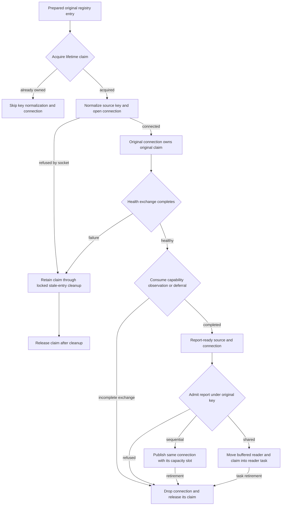

### Safeguard 2: orchestrator-level failure propagation

`crates/batchalign/src/morphosyntax/{mod.rs, worker.rs}`. Even
with idle-eviction, a language group can still fail dispatch. The
orchestrator must not silently continue with an empty `UdResponse`.

Each per-language-group infer call returns
`Result<Vec<UdResponse>, ServerError>`. The morphosyntax orchestrator
collects these results and, on any `Err`, propagates a typed
`ServerError::Validation` upward with a message naming the failed
languages. The `clear` step has already reset the affected files'
tiers in place, so failure short-circuits before injection, no file
is serialized with stripped tiers.

Files whose language groups all succeeded still get injected normally;
the CLI surfaces the per-file failure list through the standard
job/file-status reporting path.

### End-to-end contract

1. Idle-eviction prevents the saturation-induced "cannot wait
   (would deadlock)" error in the common case where other groups
   hold idle workers.
2. When every worker is genuinely checked out, the checkout waits its
   turn, visibly (file progress `waiting_for_worker`, a log line per
   report interval), and is served when a worker comes back. Pool
   shutdown or the job's cancellation ends the wait.
3. The morphosyntax orchestrator converts every pool-level failure
   into per-file errors that the CLI surfaces as non-zero exit
   codes. No code path writes a file with a stripped tier.

### Configuration knobs

| Key | Default | Purpose |
|---|---|---|
| `max_workers_per_key` | per-profile, RAM-derived (`recommend_max_workers_per_key`); GPU `≈ ram_total_mb / 16 GB`, Stanza `≈ ram_total_mb / 12 GB`, IO `1` | Per-key cap; prevents one language from hogging |
| `max_total_workers` | computed from RAM (clamped 2-32) | Global cap |
| `checkout_wait_report_interval` (`PoolConfig` field, not a server setting: `serve` passes `None`) | 300 s | How often a saturated checkout logs current counts and re-probes; no deadline |

Raising `max_total_workers` or `max_workers_per_key` reduces how
often eviction fires but never changes correctness. The
report interval only changes how often a long wait is logged and
re-probed.

## Pipeline Parallelism

The job pipeline today is **batch-all-then-dispatch**: read all
files → parse all → collect payloads → cache partition → group by
language → dispatch language groups → inject all results →
serialize → write all outputs. CPU-bound work is wrapped in
`tokio::task::spawn_blocking` and parallelized per-file with
`rayon::par_iter` so the async runtime stays responsive during
parsing, injection, and serialization.

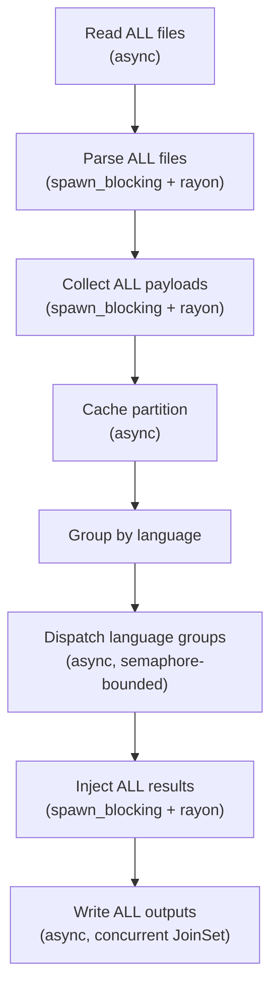

What this gives:

- Async runtime stays responsive during CPU work, heartbeats,
  progress updates, health checks all work.
- Per-file injection / serialization runs on all CPU cores. 8-core
  machine, 500-file injection: ~4 min → ~30 s.

What this does not solve:

- First file still can't complete until ALL language groups finish.
- Progress is still batch-level, not per-file-streaming.
- Memory: all 500 parsed ASTs in memory simultaneously.
- A crash after injection but before write loses all work.

A streaming redesign (per-file flow through stages with windowed
language accumulators) is a future direction; the trade-offs
(batching efficiency, cross-file language grouping, error
propagation, testing complexity) are documented in the
forward-looking proposal, not a commitment.

## Source File Map

| File | Role |
|---|---|
| `execution/morphotag/mod.rs` | Batch dispatcher: read → delegate → write |
| `morphosyntax/batch.rs` | Morphotag L2 dispatch for `@s` words |
| `morphosyntax/worker.rs` | Per-language-group worker dispatch with chunking |
| `morphosyntax/mod.rs` | Top-level morphotag orchestrator; aggregates per-language `Result<Vec<UdResponse>, ServerError>` and propagates failures upward |
| `fa/mod.rs` | FA per-file processing |
| `runner/dispatch/fa_pipeline.rs` | FA orchestrator with `JoinSet` concurrency |
| `runner/dispatch/transcribe_pipeline.rs` | Transcribe per-file with optional morphotag |
| `utseg.rs`, `coref.rs` | Other batched text commands |
| `translate/` | Translate: one request per utterance, provider pacing and retries in `provider.rs` and `items.rs` |
| `worker/pool/mod.rs` | Worker lifecycle and group management |
| `worker/pool/eviction.rs` | Idle eviction (`try_evict_idle_from_other_group`, `select_eviction_target`) |
| `worker/pool/checkout.rs` / `dispatch.rs` | Checkout state machine (saturated wait, `worker_returned` notify) |
| `worker/pool/checkout_wait.rs` | `SaturatedWait` (report interval, shutdown), `PoolWaitObserver` task local |
| `runner/util/auto_tune.rs` | `compute_job_workers()` planning |
| `types/runtime.rs` | Re-exports `MemoryTier::from_total_mb` and `estimate_per_worker_peak_mb_with_profile` from `batchalign-types::memory` (Phase β); `command_execution_budget_mb` for legacy callers. `MemoryTier` is the sole canonical source of per-tier per-profile envelopes (Principle 1); `estimate_per_worker_peak_mb_with_profile` is the tier-aware per-command estimator (Principle 2). |
| `batchalign/runtime_constants.toml` | Per-command base RAM (process and threaded variants), worker caps, command-to-task map. Generated from `batchalign-types/src/command_spec.rs` via `xtask gen-runtime-toml` (Phase β); do not edit directly. No longer holds per-profile worker startup envelopes, those live on `MemoryTier`. |
