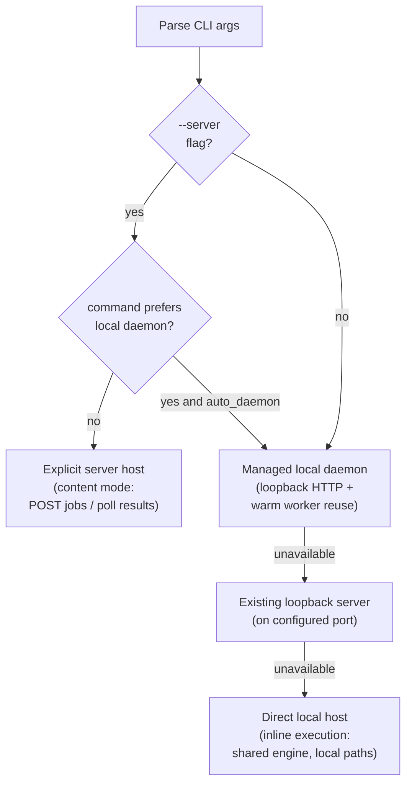
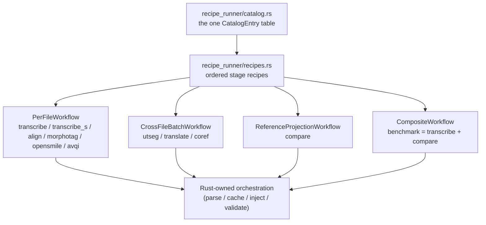
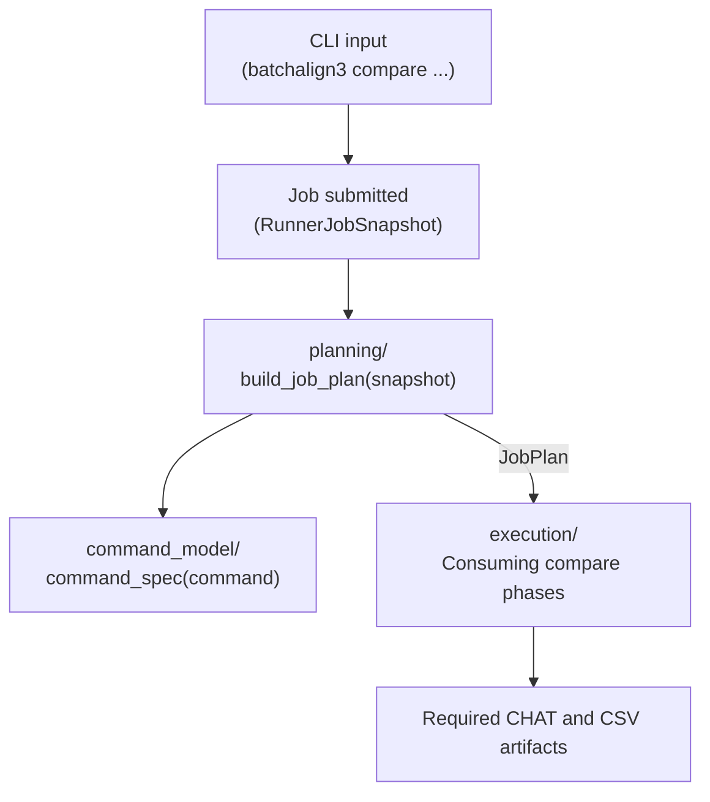
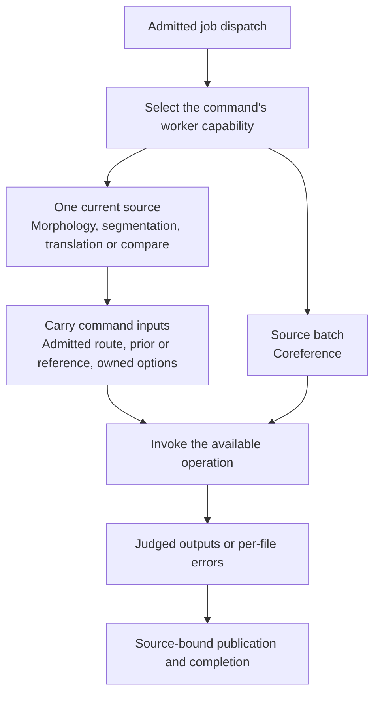
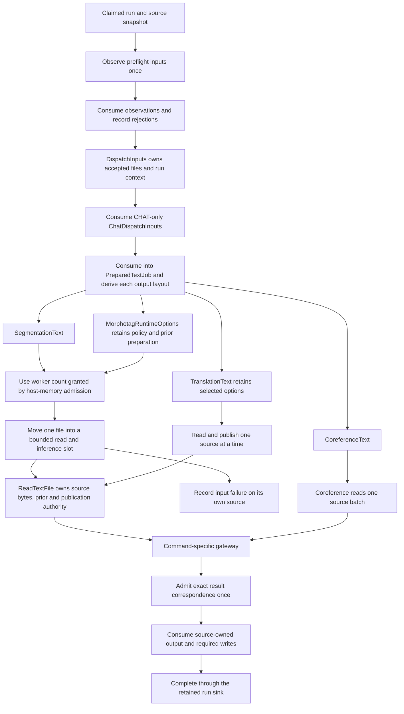

# Dispatch and Execution

**Status:** Current
**Last updated:** {{git-dates:page}}

How a job moves from the CLI to a running command: the four CLI
dispatch targets, the workflow families that organize commands, the
per-command lifecycle, and source-bound consuming execution for compare.

## CLI Dispatch: Four Targets

The CLI never owns the ML runtime directly. It routes processing
commands to one of four targets: explicit remote server, managed local
daemon, already-running loopback server, or the in-process direct
host. Source: `crates/batchalign/src/cli/dispatch/mod.rs`.



### 1. Explicit server (`--server URL`)

`--server` or `BATCHALIGN_SERVER` selects single-server HTTP dispatch.
CHAT commands use content mode (file text submitted over `POST /jobs`).
Media-only commands can submit media names when the remote server can
resolve them from `media_roots` or `media_mappings`. Multi-server
fan-out is not part of the documented release surface.

### 2. Managed local daemon

If `auto_daemon` is enabled, the CLI first tries to reuse or start a
managed loopback daemon. This keeps warm workers alive across
commands. HTTP over loopback only, no remote network. The important
performance path for repeated Apple CPU-only `align` / `transcribe` /
`benchmark` runs because it preserves loaded worker processes and
shared models.

### 3. Loopback server reuse

If daemon startup is unavailable but a loopback server is already
listening on the configured port, the CLI reuses it before falling
back to direct inline execution. Reuse is subject to the same
build-identity check as submission: a server reporting another build,
or no build at all, is refused rather than reused. See
[Server Mode](../../batchalign/user-guide/server-mode.md#build-identity-check).

### 4. Direct local host

If no usable remote or loopback server exists, the CLI prepares a
local paths-mode submission and runs it inline through `DirectHost`.
The CLI and direct host stay in one process: no HTTP hop, no queue,
no registry discovery, no persistent daemon. The same shared
execution engine still runs the command recipe and worker
orchestration.

### Local-daemon-preferring commands

`transcribe`, `transcribe_s`, `benchmark`, and `avqi` need
client-local media discovery or local audio access. If `auto_daemon`
is enabled and `--server` is also passed for one of these commands,
the CLI tries the local daemon first and warns only when that reroute
succeeds. If the local daemon path is unavailable, the explicit remote
URL remains the fallback. `benchmark` follows the same rules even
though it's a composite Rust-owned workflow.

### Worker transport

CLI ↔ server is HTTP. Server ↔ worker is stdio JSON-lines IPC. The
Python worker entry point in `batchalign/worker/_main.py` owns the
process lifetime and read/write loop, but Rust owns the generic stdio
op validation and dispatch envelope through the `batchalign_core` PyO3
bridge. HTTP is not used between the Rust server and Python workers.

## Workflow Families

Commands are organized by workflow family. Each family shares an
internal stage sequence, but the families share the same end state,
typed materialization plus validation.



### Command classification

| Class | Commands | Shape |
|---|---|---|
| Generation | `transcribe`, `transcribe_s` | Builds `ChatFile` from ASR output via `build_chat()` |
| Per-file processing | `align`, `morphotag`, `utseg` | Parse, mutate, serialize |
| Cross-file batch | `coref` | Retain the prepared source population in one gateway batch |
| Per-file, per-utterance | `translate` | One file per gateway call, one worker request per utterance, paced and retried by the engine's provider policy |
| Reference projection | `compare` | Main transcript + gold companion → projected views from typed compare bundle |
| Composite | `benchmark` (= `transcribe` + `compare`) | Chains existing workflows without reimplementing |
| Analysis | `diarize`, `opensmile`, `avqi` | Produces turns, metrics, or other non-CHAT output |

The low-level `speaker` infer task still exists for typed worker
execution but is not itself a CLI command. It is composed by both integrated
`transcribe_s` and standalone `diarize`; the latter writes anonymous turns JSON
without constructing or modifying CHAT.

## Where to add new command semantics

Start in `crates/batchalign/src/recipe_runner/catalog.rs` and
`crates/batchalign/src/command_model/catalog.rs`. Jump to
`crates/batchalign/src/recipe_runner/command_spec.rs` when you need
released-command family metadata, and to
`crates/batchalign/src/text_batch.rs` when you need shared text-family
helpers reused by the runner kernel.

The catalog owns command metadata and its recipe. Family executors in
`execution/` and `runner/dispatch/` consume that plan; `runner/` also owns job
lifecycle and queueing. There is no per-command `commands/` authoring layer.

## Processing Lifecycle

CHAT-mutating commands use command-specific typed admission and processing:

1. **Admit input** under the command's replacement-tier and validation policy.
   The parsed model and the admission evidence travel together; a recovered
   unchecked AST is not an admitted input.
2. **Collect payloads** from the admitted model, including resolved utterance
   languages and any required model-capability admission.
3. **Resolve inference** through the command's cache policy, where it has one,
   and typed `execute_v2` worker requests. Morphotag's inference is not cached;
   its incremental policy instead reuses already complete utterances.
4. **Apply results** through the owning transform, preserving typed failures
   and any permitted diagnosed or partial outcomes.
5. **Admit output** before writing. Post-validation and serialization consume
   the resulting document state; a completed job does not by itself imply a
   fully analyzed or acoustically correct transcript.

See [command contracts](../../batchalign/architecture/command-contracts.md)
for each command's admitted and diagnosed output policy.

Generation commands (`transcribe`) begin with ASR inference and typed
`build_chat()` construction, then admit the produced document before optional
CHAT processing.

`ReferenceProjection` (`compare`) intentionally diverges from this
generic loop:

1. Pair each primary transcript with `FILE.gold.cha`.
2. Morphotag the main transcript only, and carry morphotag's own
   post-validation proof rather than its bytes.
3. Parse the gold companion leniently into a `ChatFile` AST. The main side is
   already the document that proof carries, and is never serialized and read
   back.
4. Build a `ComparisonBundle` with main/gold compare views, structural
   word matches, and metrics.
5. Materialize the released main output or an internal AST-first gold
   projection.

For per-command request/response JSON shapes and per-command server
orchestration steps, see
[Command Lifecycles](../../batchalign/architecture/command-lifecycles.md).
For the boundary contract itself, see
[Python-Rust Boundary](../python-rust-boundary/python-rust-boundary.md).

### Pre-serialization validation

The server runs three validation gates before writing CHAT output:

1. **Pre-validation**: rejects malformed input early based on the
   command's required `ValidityLevel`.
2. **Alignment validation**: checks tier word counts (`%mor`/`%gra`/`%wor`
   must match the main tier). ParseHealth-aware: utterances flagged
   as unparseable are excluded.
3. **Semantic validation**: full CHAT validation (E362 monotonicity,
   E701/E704 temporal, header correctness). Only blocks on errors,
   not warnings.

A validation failure fails the file, with the validation errors as its
error; no output is written for it. Nothing is filed and no cache entry is
deleted: the file's error is the report.

## Batched Inference

Text commands share prepared-source ownership and command-specific gateways.
Morphotag and Utseg schedule individual files under the runner's admitted job
worker count. Translation reads, routes and publishes one file at a time.
Coreference retains one contiguous input batch and its publication owners.
Compare carries its main and reference through its own consuming phase graph.

The Rust pipelines own parsing, payload preparation, command-specific reuse,
worker requests, result application and post-validation. Morphotag reuses
complete unchanged morphology through its incremental policy. Its source and
prior are read once by the file-preparation producer. Python workers receive
structured NLP payloads and return model output.

## Multi-Step Pipelines

`transcribe` chains multiple steps:

```text
ASR inference → post-processing → CHAT assembly → utseg → morphosyntax
```

Each step is a separate workflow call (`process_transcribe` →
`process_utseg_with_evidence` → `process_morphosyntax`). Between steps, CHAT text
is serialized and re-parsed, each step operates on a different
version of the file. `benchmark` follows the same composition style
at the workflow level by chaining `transcribe` then `compare`, while
`compare` itself remains a reference-projection workflow with gold-
and main-shaped materializers.

## Command model, planning and consuming execution

Three modules centralize how commands are defined, planned, and
executed. They replace the old pattern where each command wired its
own dispatch function in `runner/dispatch/` with per-command
constants scattered across macro-generated files.



### `command_model/`: authoritative command registry

`crates/batchalign/src/command_model/` is the lookup surface over the one
catalog. The data lives in `recipe_runner/catalog.rs`; this module is how the
rest of the crate reaches it.

| API | Purpose |
|---|---|
| `command_spec(ReleasedCommand) -> &'static CatalogEntry` | The entry for any released command. Total: never `None` |
| `command_specs() -> &'static [CatalogEntry]` | Every entry, in capability-advertisement order |
| `command_spec(command).io_profile` | What the inputs are: `Text`, `ResolvedAudio` or `MediaInput`. `ServerTarget::parse_explicit` matches it to decide whether a `--server` on another host may run the command |
| `command_runner_dispatch_kind(command)` | Which server-side execution path owns it |

```rust,ignore
pub(crate) struct CatalogEntry {
    pub command: ReleasedCommand,
    pub family: CommandFamily,          // implies 8 runtime policies, via const fns
    pub planner: PlannerKind,
    pub capability_kind: CommandCapabilityKind,
    pub io_profile: CommandIoProfile,
    pub runner_dispatch_kind: RunnerDispatchKind,
    pub capabilities: CapabilityPlan,   // the one advertised infer task, and the surface
    pub output_policy: OutputPolicy,
    pub recipe: &'static Recipe,
}
```

Every field is declared per command. Three of them (`capability_kind`,
`io_profile`, `runner_dispatch_kind`) were derived by matching on the command
name with a catch-all default until 2026-07-29; two view types
(`CommandDefinition`, `CommandWorkflowDescriptor`) and a delegating
`commands/catalog.rs` were deleted in the same change.

The execution mode is NOT among them. It was an `execution_mode` field written
out beside the recipe that already carries it, with a catalog test asserting
the two stayed equal; the field and the test went on 2026-09-07 and the mode is
read from `entry.recipe.mode`.

Derived helpers in `catalog.rs`:

| Helper | Replaces |
|---|---|
| `io_profile_for(command)` | Per-command `CommandIoProfile` constants |
| `execution_shape_for(family)` | Per-family dispatch routing |
| `runner_dispatch_kind_for(command)` | Runner dispatch shape selection |

### `planning/`: immutable job plans

`crates/batchalign/src/planning/`. Builds typed, immutable execution
plans from runner snapshots. Centralizes work-unit planning, artifact
planning, and I/O mode resolution.

| Type | Purpose |
|---|---|
| `JobPlan` | Catalog entry, typed work units and planned artifact sets |
| `PlannedWorkUnit` | Typed text, audio, reference-paired or media-analysis work |
| `PlannedArtifactSet` | Output artifacts for one source file |

```rust,ignore
pub(crate) fn build_job_plan(job: &RunnerJobSnapshot) -> Result<JobPlan, PlanningError>
```

Calls `command_model::command_spec()` internally and delegates
work-unit enumeration to `recipe_runner::planner`.

### Consuming execution

`crates/batchalign/src/execution/` owns compare's concrete phase graph and
several text-command executors. A `PreparedComparison` carries the admitted
source/output pair and actual execution context. Reading produces main bytes
and an admitted reference. Morphology consumes that state into a judged main
and retained reference. Comparison consumes both documents into judged output
and computed metrics. Publication consumes the output owner into a written
receipt, and completion returns its consolidated row through the retained run
sink.

`CompareMorphology` exposes exactly the worker effect the compare graph needs.
The live pooled gateway implements that capability alongside the other text
operations. Compare's recording double implements the same narrow capability.
The [compare developer page](../../batchalign/developer/commands/compare.md)
contains the detailed ownership diagram and external-boundary contracts.

| File | Purpose |
| --- | --- |
| `kernel.rs` | Compare planning, per-file dispatch and consolidated output |
| `kernel/comparison.rs` | Consuming read, morphology, comparison and publication phases |
| `kernel/outputs.rs` | Required artifact writes and run-bound completion receipt |
| `morphotag/` | Prepared morphology policy, per-file work and job progress |
| `coref.rs` | Coreference execution |
| `translate.rs` | Translation execution |
| `utseg.rs` | Utterance segmentation execution |
| `text_io/` | Producer-owned preparation, adaptive file queue and consuming publication |
| `worker_gateway.rs` | Command-specific worker capabilities and their shared pooled implementation |

### Worker capabilities

Each executor receives its command's worker interface. The pooled adapter
implements all five interfaces and retains the shared pool and cache.

| Capability | Accepted work |
| --- | --- |
| `CompareMorphology` | Main text, MWT dictionary and cancellation after reference admission |
| `MorphotagGateway` | One main text, optional prior text, owned options and progress port |
| `UtsegGateway` | One source and its `ServableUtsegRoute` |
| `TranslateGateway` | One source and its `TranslationRoute` |
| `CorefGateway` | The source batch for coreference |



`UtsegGateway::utseg_file` accepts one `TextBatchFileInput`. Its live adapter
borrows that file as a one-element slice for the internal segmentation pipeline.
The dispatcher holds the file directly through the call. Morphotag's file task
moves its owned options into its gateway call.

Recording doubles implement the same narrow interfaces. Captured requests
retain source names alongside routes, or the source population for a coreference
batch. These observations check actual scheduling and route propagation through
the filesystem adapters. Language-to-model selection and registry admission
retain their constructor-policy contracts.

### Producer-owned file preparation

Recorded preflight produces one non-cloneable `DispatchInputs`. Its private
fields keep the accepted files attached to their immutable snapshot and
run-bound host context. Preflight classifies the accepted population once.
The router borrows that capability during worker selection, then consumes its
CHAT-only `ChatDispatchInputs` projection into text preparation. Fixtures enter
through the same preparation edge with files derived from their own snapshot.

Each command admits a distinct preparation state. Morphology retains its actual
`MorphotagRuntimeOptions`, including the submitted MWT dictionary and prior
policy. `TranslationText` retains the selected translation options.
`SegmentationText` and `CoreferenceText` bind their matching command and option
family. The dispatcher accepts its own state and receives the prepared options
through that owner. Coreference exposes batch reading. Morphology and
segmentation expose concurrent file scheduling.

The selected catalog output policy is resolved once for the queue. Each
accepted file's layout is derived before reading or inference. File owners
carry the actual pending input, shared immutable run facts and that completed
layout computation. The former generic batched-text plan and its synthesized
fallback morphology settings retire. Morphology option translation lives with
its executor in `execution/morphotag/options.rs`.



Morphotag and Utseg use one bounded task queue. The queue retains at most the
admitted number of active file operations and reads the next source only when
there is room. Reads are sequentially admitted while earlier file tasks can
continue. Every task retains its loaded input until publication completes.
The runner retains the job's memory lease while dispatch is active. The queue
joins submitted file tasks before returning. Cancellation stops further file
preparation.

Utseg uses the memory-admitted worker count directly. Host sizing reads CPU
count, effective configuration and memory tier from one `HostSnapshot`.
Operator limits, file count, command category and memory admission determine
the grant. The independent four-file fallback and second config lookup are
removed. Scheduling allows smaller or larger grants through the same path.

The loader distinguishes an absent prior from a failed read of a declared
prior. Morphotag reports `Failed to read declared prior input` and refuses that
file when the read fails, preserving the opportunity to repair the path or
bytes. A readable prior travels with its current source into inference.

Gateway responses still cross a runtime correspondence boundary. A singular
operation must return exactly its own source. A coreference batch must return
each prepared source exactly once, in any order. Whole-batch correspondence
admission precedes every batch write. Missing, repeated or foreign results
fail the originating prepared sources. Publication consumes private bound
results, projects the carried output plan and completes through its original
sink. Source lookup, artifact lookup and layout re-admission retire from these
four text writeback paths.

### Compare dispatch

`dispatch_compare_job(job, host, gateway, mwt)` builds the immutable plan and
admits each main file with its catalog-derived output pair. Companion reference
selection tries `*.gold.cha` first and uses `template.gold.cha` when the
companion is absent. Reference admission completes before the morphology
capability becomes callable. Successful output requires CHAT and CSV writes
before its row reaches the consolidated report.

### Migration status

| Command | Dispatch model | Notes |
|---|---|---|
| `compare` | `execution/` | Source-bound consuming phases |
| `morphotag`, `coref`, `translate`, `utseg` | `execution/` | Named text executors |
| Audio and media families | `runner/dispatch/` | Family-specific processing and writeback |

New commands with multi-stage workflows (stages that depend on prior
stage output) should use the execution kernel. Simple single-dispatch
commands can continue using legacy dispatch until migration is
complete.

## Worker Concurrency

Worker parallelism is capped based on available memory, not scaled
linearly. Each worker loads ~4-12 GB of ML models. The server
combines:

- `HostExecutionPolicy` for tier-aware bootstrap mode and
  file-parallel clamps.
- Host-memory admission planning for granted worker counts.
- Target-aware worker reuse keyed by actual `WorkerTarget`.

On large hosts this favors profile reuse; on small hosts it favors
task bootstrap. On every host a worker starts empty and loads each
task's models in that task's `ensure_task`, before its first request. See
[Batchalign Workers](batchalign-workers.md)
for pool structure, pre-scaling behavior, and host-policy details.

## Key Patterns

- **Times** throughout the pipeline are in **milliseconds**.
- **Language codes** use 3-letter ISO 639-3 (`"eng"`, `"spa"`, `"jpn"`).
- **Files are sorted largest-first** before dispatch to avoid
  stragglers.
- **Heavy imports** (`stanza`, `torch`) are lazy, CLI startup must
  stay fast.
