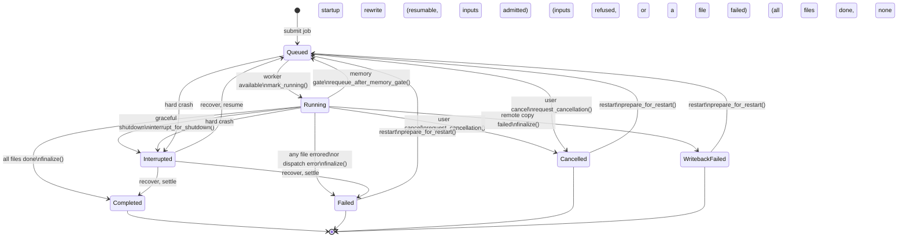
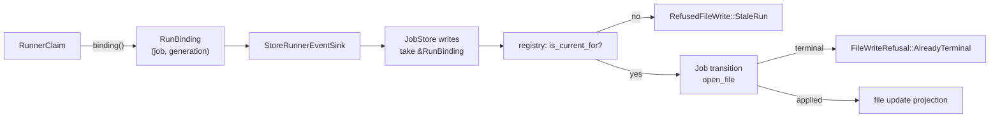
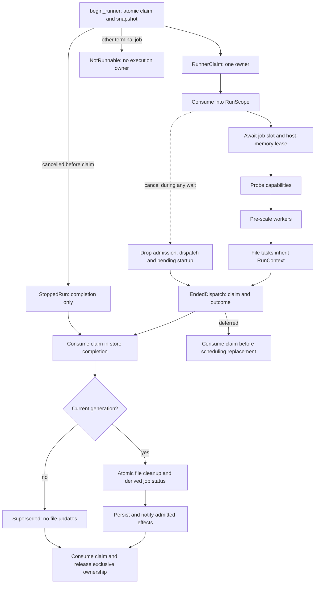

# Job State Machine

**Status:** Current
**Last updated:** 2026-11-10 16:04 EST

## Overview

This page documents the job lifecycle state machine, the allowed states,
transitions, and validation rules for jobs managed by the batchalign3 server.

## Current Implementation

A job's status and its inputs are one value, and every status change is an
event on it, legal only from the states that event leaves:

| Piece | Where | Role |
|---|---|---|
| `JobLifecycle` | `store/job/types.rs` | `Active { ActiveStatus, JobInputs }` for queued and running jobs, on inputs this process admitted; `Finished { FinishedStatus, StoredInputs }` for the rest, on inputs as stored (admitted or recorded) |
| `JobStatus::kind` | `types/status.rs` | The one classification of `JobStatus` into `ActiveStatus` and `FinishedStatus`; `is_active` and `is_terminal` are defined from it |
| the event methods | `store/job/types.rs` | `dispatch`, `memory_requeue`, `stop`, `finish`, `restart`, `resume`, `settle`: each matches the states it leaves exhaustively, and refuses the rest with `Refused { from, event }` |
| the `Job` transitions | `store/job/lifecycle.rs` | `mark_running`, `requeue_after_memory_gate`, `request_cancellation`, `interrupt_for_shutdown`, `finalize`, `fail`, `prepare_for_restart`, `recover`: each applies one event plus the timestamps, lease and failure reason it owns |

There is no transition table beside the code: the legality of a move is the
match in the event that makes it. The event names the cause, not only the
target, because the same from/to pair can be legal or illegal depending on
what caused it: `Cancelled -> Queued` is a `restart` and no other event
produces it, so the memory gate (`memory_requeue`, which leaves only active
states) cannot resurrect a cancelled job, the defect of 2026-07-29.

A job that cannot run can never be queued: "active on unadmitted inputs" is
not a value `JobLifecycle` has. The two events that leave a finished state,
`restart` (cancelled, failed, writeback failed) and `resume` (interrupted, at
startup), check the state, then admit the stored inputs under the rules in
force now, and only then move; a refused admission changes nothing. A job
read back from the database is always `Finished` (an active stored status
loads as `Interrupted`): nothing runs it in this process yet. Moving from
active to finished hands the admitted inputs over as the stored ones.

A writer whose transition is refused must persist nothing. Both the registry
wrappers and the store-level helpers propagate the refusal for exactly this
reason; a refused finalize that still wrote its status to SQLite left rows
that startup recovery never revisits.

## Incompatible recovered command/options

A persisted job whose command and typed options disagree is shown as `Failed`
with a recovery explanation. The original job and file rows are left unchanged,
including metadata that ordinary recovery would repair. File statuses remain
available for inspection; result artifacts are not guessed from incompatible
options. This job is not queued automatically.

`Job::prepare_for_restart` is a fallible transition: it admits command/options
compatibility and restart eligibility before mutating files, cancellation,
leases or run generation. An incompatible job cannot be restarted, so the
restart endpoint cannot launch its runner or persist a replacement status.
Resolve the stored mismatch through a reviewed repair or submit a correctly
specified new job; this behavior does not provide an automatic repair command.

## State Diagram

`Running --> Interrupted` is the GRACEFUL path, where `interrupt_for_shutdown`
runs. A hard crash never reaches it, so the row is still `Running` (or
`Queued`) when the server next starts; the startup rewrite marks such rows
`Interrupted` before they are loaded, so recovery sees one state either way.



## States

| State | Terminal? | Restartable? | Description |
|-------|:---------:|:------------:|-------------|
| `Queued` | No |: | Waiting for worker availability |
| `Running` | No |: | Actively processing files |
| `Completed` | Yes | No | All files succeeded |
| `Failed` | Yes | Yes | One or more files errored |
| `Cancelled` | Yes | Yes | User-initiated cancellation |
| `Interrupted` | Yes | No | Server crash detected (transient, reconciled at startup) |
| `WritebackFailed` | Yes | Yes | Remote results lost during copy-back |

## Status transition gate

The `JobLifecycle` event methods define which transitions are legal; one
`Job` helper (`accepted`) logs a refusal, so no transition has to remember.
Timestamps, lease clearing and failure reasons remain owned by the
corresponding `Job` method, and a requeue (restart or resume) clears the
previous run's error, completion time, retry time and lease in one place. A declined transition
keeps the status already accepted by cancellation or shutdown.

Runner completion has a narrower owning boundary: the caller supplies its
linear claim and dispatch outcome, never a proposed final job status. The
registry admits the generation, closes unfinished files and derives the final
status in one mutation. See [cancellation and completion](#what-a-cancel-stops).

## Runner Lifecycle

Every queued job must have a scheduled runner or a live attempt handing off
to its replacement. Only one attempt may hold its exclusive execution claim.
Submission and memory-gate requeue preserve that scheduling obligation:

### 1. Submit path

`submit_job()` in `server_backend.rs` spawns `job_task` immediately after
inserting the job:

```rust,ignore
runtime.spawn_detached(job_task(job_id, host.clone()));
```

### 2. Memory-gate requeue path

When the host-memory coordinator rejects a job, `run_hosted_job` returns
`Ok(HostedJobRunOutcome::Requeued { retry_at })`. The `job_task` match arm
catches this outcome and spawns a delayed replacement runner:

```rust,ignore
Ok(HostedJobRunOutcome::Requeued { retry_at }) => {
    // Never negative: a deadline already past is a delay of zero.
    let delay = retry_at.saturating_duration_since(host.store.now());
    tokio::spawn(async move {
        tokio::time::sleep(delay).await;
        job_task(job_id_retry, host_retry).await;
    });
}
```

The attempt has already consumed its claim and stopped its owned heartbeat
before returning `Requeued`. The replacement task must obtain a new claim
before acquiring the semaphore and memory gate after the backoff. A delayed
task for an already terminal job receives no dispatch authority.

**Why this matters:** if `Requeued` were silently discarded (e.g., swallowed by
`if let Err(e) = ...`), the job would remain `Queued` forever with
`next_eligible_at` set but no runner. Every subsequent submission of the same
files would receive a 409 conflict with no way to resolve it short of a manual
cancel.

### 3. Bootstrap path

When the daemon starts, `bootstrap_local_server_backend` calls
`store.queued_job_ids()` after `load_from_db()` and spawns `job_task` for each
recovered `Queued` job:

```rust,ignore
for job_id in queued_job_ids {
    runtime.spawn_detached(job_task(job_id, host.clone()));
}
```

This handles jobs that were `Queued` when the daemon was last stopped, either
because they survived a crash, or because a requeue runner was lost when the
process exited before the backoff timer fired.

`recover_interrupted()` (also called at startup) handles the complementary
case: jobs that were `Running` at crash time are marked `Interrupted`, then
reconciled to `Queued`/`Failed`/`Completed`. The bootstrap spawn above then
picks them up if they land in `Queued`.

**Invariant:** after bootstrap completes, every `Queued` job in the DB has
exactly one active `job_task` runner.

### Why `job_task` is not an `async fn`

`job_task` is declared as a plain function returning
`Pin<Box<dyn Future<Output=()> + Send + 'static>>` rather than `async fn`.
This is required by the requeue self-spawn:

```rust,ignore
tokio::spawn(async move {
    sleep(delay).await;
    job_task(job_id_retry, host_retry).await;  // recursive call
});
```

With `async fn`, Rust's `Send` inference on the opaque `impl Future` return
type becomes self-referential. The compiler can prove `Send` from the outside
(non-recursive call site) but not from inside the body when the future awaits
itself inside `tokio::spawn`. The explicit boxed return type breaks the cycle:
`job_task(...)` now returns a concrete `Pin<Box<dyn Future + Send>>` whose
`Send`-ness the compiler can verify unconditionally.

## File Locations

| File | Role |
|------|------|
| `types/status.rs` | `JobStatus`, `kind`, `ActiveStatus`, `FinishedStatus` |
| `store/job/types.rs` | `Job` struct, `JobLifecycle` and its events |
| `store/job/lifecycle.rs` | The `Job` transition methods and `Job::recover` |
| `runner/execution.rs` | Claimed dispatch and consuming run completion |
| `routes/jobs/lifecycle.rs` | Cancel/restart requests |
| `store/queries/recovery.rs` | Crash recovery |

## Runner ownership, restart safety, and requeue (canonical invariants)

Every submitted job gets a `job_task` runner: a self-contained async task
that owns the full lifecycle from semaphore acquire through finalization.

**Exclusive-runner invariant (2026-07-10).** Before executing, every runner
claims exclusive ownership via `store.begin_runner()`; a second runner for
the same job (typically a restart racing the cancelled runner's teardown)
WAITS on that claim instead of running concurrently. The claim also
establishes the queue lease, so the per-job heartbeat loop genuinely renews
it (and doubles as a stall alarm: ERROR log when a live runner shows no
file activity for 30 minutes). Every restart bumps the job's
`RunGeneration`; completion consumes the `RunnerClaim` and admits its
cleanup in the same registry mutation as its generation check. A superseded
claim cannot sweep or finalize a restarted population (the failure mode was: restart re-queues files, the stale
runner force-fails them as "did not reach terminal status" and finalizes
the job `failed` over the healthy new run). Contract test:
`tests/restart_handoff.rs`.

**How a claimed run ends.** `RunScope::execute` races execution against the
job's cancel token and returns the claim with one `ClaimedRunEnd`, and
`run_hosted_job` turns each into exactly one store transition on that claim.
Execution itself returns an `ExecutionEnd`, which has no cancelled ending, so
only the scope can say a run was cancelled:

| `ClaimedRunEnd` | Transition |
| --- | --- |
| `Executed(ExecutionEnd::Dispatched)` | `complete_run`: files recorded their own terminal states |
| `Cancelled` (made only by `RunScope`) | `complete_run`: the registry reads the job's cancellation |
| `Executed(ExecutionEnd::Requeued { retry_at })` | `release_run`, then a delayed retry |
| `Executed(ExecutionEnd::Refused(JobRefusal))` | `fail_run` with the refusal's reason |

A job-level refusal (a command that needs CHAT input, a worker probe
refusal, a language with no route) is a value that dispatch returns as
`DispatchEnd::Refused`, built only by `runner::refuse`. Nothing in dispatch
can mark the job failed on its own: there is no claimless `fail_job` route.
So the refusal's reason lands on the job and on every file the run left
unfinished, rather than a generic "did not reach terminal status". Contract
test: `a_refused_job_fails_its_run_with_the_refusal_reason` in
`runner/execution.rs`.

**File writes belong to their run.** Cancelling a run drops its dispatch
future and requests abort of its file tasks, but Tokio's abort is
asynchronous: a task mid-step on another worker thread finishes that step,
and a write it makes there could land after the run has finished or on the
files of the run that replaced it. So file writes are bound to the run that
owns them:

- A `RunBinding` names one run of one job: the job id and its
  `RunGeneration`, as one value with private fields. The claim holds it and
  `RunnerClaim::binding()` is the only production route to one, so no caller
  can pair a job id with a generation it chose.
- `DispatchHostContext::for_run(store, &claim)` is the only production way to
  get a dispatch context, and its `StoreRunnerEventSink` holds the claim's
  binding. No sink method names a job: the sink, the `FileRunTracker` and the
  helpers around them name only the file. The claimless constructors are
  test-only.
- Every store write from a run, per file and job-level alike (marking the
  job running, recording its worker count, requeueing it after the memory
  gate), takes `&RunBinding`. The registry asks `RunBinding::is_current_for`,
  the only reading of a generation, before it applies one. Attempt-id
  bookkeeping is checked the same way, so a stale run cannot close the
  attempt of the run that replaced it.
- A refused file write says why, as a `RefusedFileWrite`: `NoSuchJob`,
  `StaleRun`, or the job's own `FileWriteRefusal` (`UnknownFile`,
  `AlreadyTerminal`). The store logs the expected ones (a stale run, an
  already finished file) at debug and the two that mean runner and store
  disagree at warning, so no refusal is discarded silently.
- Within a run a terminal file stays terminal: every `Job::mark_file_*`
  transition that moves or redraws a file admits it through one function,
  `open_file`, which refuses a terminal phase. Only a restart, which starts a
  new generation, reopens a file.
- An attempt row is inserted before the registry holds its id, so the run
  can be superseded in between. When the attach is refused the row is closed
  at once (`Cancelled`, `Defer`), since nothing else knows its id.
- A job's completed count is derived from its file phases
  (`JobExecutionState::completed_files`), never stored, so no write can
  count a file twice.



Contract tests: `a_superseded_run_cannot_write_a_file` and
`a_finished_file_is_not_finished_again` in `store/queries/file_state.rs`.

`job_task` is a **non-recursive function returning `Pin<Box<dyn Future>>`**
(not `async fn`). This is deliberate: the `Requeued` branch spawns a fresh
`job_task` inside `tokio::spawn`. With `async fn`, Rust's Send inference
becomes circular on the self-referential opaque return type. The explicit
boxed future gives the inner call a concrete, provably-Send type.

**Requeue invariant**: when the memory gate rejects a job:

1. `run_hosted_job` returns `Ok(HostedJobRunOutcome::Requeued { retry_at })`
2. `job_task` catches this in the `match` arm (not `if let Err(...)`)
3. It spawns a new delayed `job_task` via `tokio::spawn(sleep + job_task(...))`
4. The current `job_task` instance finishes: `lease_task.abort()` +
   `release_runner_claim()` run unconditionally at the bottom
5. The new task re-acquires the semaphore and memory gate after the backoff

Without step 3, a requeued job stays `Queued` forever with no runner and
blocks all future submissions of the same files (409 conflict).

**Bootstrap invariant**: queued jobs loaded from the DB at startup:

`bootstrap_local_server_backend` calls `store.queued_job_ids()` immediately
after `load_from_db()` and spawns `job_task` for each recovered `Queued` job
via `runtime.spawn_detached(job_task(job_id, host.clone()))`. This fulfills
the recovery path when the daemon is restarted after a crash or a memory-gate
rejection that lost its runner.

**Recovery is a two-step sequence that only fires at startup:**

1. `db.recover_interrupted()` (`db/recovery.rs`) reads each `queued` or
   `running` row's status columns as their typed image
   (`JobStatusColumns`), applies `JobStatusColumns::stopped` with
   `Stop::Interrupted` (the one statement of the transition, which a live
   job's shutdown and cancellation also apply through `Job::stop`:
   the stop's status,
   completed now, no pending retry time, error and worker count kept), and
   writes the image whole, with each of the job's files the interruption
   moves, in one transaction per job. It does NOT touch existing
   `interrupted` rows and does NOT requeue.
2. `store.load_from_db()` (`store/queries/recovery.rs`) reads each row
   back into memory. For any job with `status ∈ {Interrupted, Running}`,
   it calls `Job::reconcile_recovered_runtime_state()`, which transitions
   the in-memory job (and writes back to the DB) to `Queued` if any file
   is resumable and its inputs are admitted under the current rules; to
   `Failed`, with its unfinished files closed, if they are refused; and
   otherwise to `Failed` if any file failed, `Completed` if none did. The
   disposition it returns names every file whose row changed.

If the daemon stays alive across CLI sessions, neither step runs: the
bootstrap spawn after `load_from_db()` is the only mechanism that rescues
orphaned `Queued` jobs.

### What a cancel stops

A cancel stops job-slot and host-memory admission, command preparation and
in-flight file work.
`begin_runner` atomically mints a non-cloneable `RunnerClaim` with the run
generation and its `Arc<RunnerJobSnapshot>` (including cancellation).
`RunScope::for_run` consumes that claim; only the resulting scope can dispatch
this attempt. Children inherit a cloneable `RunContext`, which grants
cancellation and job registration but no dispatch or completion authority.

Consuming `RunScope::execute` supervises admission through command dispatch,
including capability probing and worker pre-scaling. Its heartbeat starts only
after the claim exists and is stopped when execution ends. Cancellation wins
before work is polled and drops pending admission, dispatch and worker startup.
`EndedDispatch` returns the claim with completion, deferral or failure; it
cannot be reused for another execution. Completion, failure and deferral each
consume the unique claim. A task that never owned a claim cannot release one.

If cancellation was accepted before claim creation, `StoppedRun` grants only
file completion. It has no conversion into a dispatch scope. Other terminal
jobs receive `NotRunnable`, with no heartbeat, admission or dispatch authority.

Store completion consumes that claim. In one registry actor mutation, it checks
the generation, closes unfinished files, derives the terminal status and
produces persistence/notification effects. A superseded claim produces no file
updates. There is no async gap between generation admission and cleanup in
which a restart can replace the files. Cancellation closes unfinished files
with category `cancelled`; unexplained unfinished work remains a system
failure. Any failed file makes an otherwise active job failed, including partial
success. Already accepted cancellation or shutdown keeps its status and time.
`FinishingRun` retains exclusive ownership until the admitted persistence
effects finish. Lease clearing is persisted before consuming the claim's
release, so it cannot erase a replacement runner's lease. The next runner
still has to admit the resulting status. File/attempt persistence and
progress remain separate store operations, not a database transaction with
the entire run. Host-memory polling is async: dropping the wait cannot leave a
blocking retry loop behind. One already-started ledger transaction may finish;
an unreceived plan drops its lease and cannot start a worker.

Every child file task inherits the same scope, because `tokio::spawn` does not
inherit task-locals. The scope carries two facts into each task:

- the job id, re-established as the pool's `CURRENT_JOB_ID`, so every worker
  dispatch registers against the job;
- the job's cancellation token, which the supervisor races against the task.
  On cancel the task's future is dropped wherever it is (a worker dispatch, a
  cache wait, between stages) and the file is recorded with the typed outcome
  `FileTaskOutcome::StoppedByCancellation`, category `cancelled`. Nothing after
  that point runs: no further inference, forced alignment, output write or
  debug dump belongs to a cancelled job. A checked-out worker dropped with a
  request in flight is discarded, not returned to the pool.



The model-free HTTP fixture in `tests/restart_handoff/live_probe.rs` drives a
failed run through restart, advancing capability loading or worker pre-scaling,
and cancellation. It admits the target boundary only while every file remains
queued. The pre-scaling case previously left the runner and queued files open
after cancellation; a file-only cancellation test could not detect that gap.
The peer performs no recognition, downloads or model loading.

`ServerBackend::cancel_job` detaches the job's registered workers from the
tracker BEFORE publishing the cancel and terminates them after, because the
publish drops the tasks and a dropped dispatch unregisters its worker as it
unwinds; a drain after the publish could miss a shared worker still computing
for the job.

Before this, neither fact crossed the spawn. A cancelled `align` job's
in-flight files ran to completion, each
finishing its Whisper pass, dumping UTR debug data, running forced alignment
and holding the worker the live job also needed, because no dispatch had
registered for the cancel's worker kill to find and nothing told the tasks to
stop. Contract test: `tests/gpu_concurrent_dispatch/cancellation.rs`, which
cancels a real transcribe job over HTTP while an echo worker holds its file.

### Cancelled vs Interrupted at shutdown

UTR's full-file and partial-window paths share an owned CPU-work boundary.
`PendingUtr` borrows the source exclusively and sends a private candidate to
the tracing-aware blocking pool. Only a completed candidate and its matching
`UtrResult` can be installed, with no intervening await. Dropping the pending
future aborts queued work and signals started work to stop at cooperative search
checkpoints. Neither cancellation nor a task panic installs candidate mutations.
This boundary retains one additional document clone while work is pending so
the source remains available unchanged if its candidate is abandoned. Provider
tokens move into the task rather than being cloned.
Cancellation is not recorded as unmatched lexical content or a search-budget
refusal; task panics are internal system failures, not invalid CHAT.

The pure alignment algorithms accept an explicit `WorkControl`, independent of
Tokio. Interleaved forward/backward/traceback passes check between reference rows;
Hirschberg checks rows and 1,024-cell blocks, and correspondence admission checks
candidate construction and ranking. Synchronous APIs use an uninhabited
interruption error, retaining their previous signatures and matching policy.
This is cooperative cancellation, not preemption: bounded row work, allocation,
document cloning and non-search traversals may finish before a stop is observed.
No search budget is raised and no timing-recovery claim follows from scheduling
alone. Tests use explicit channels/checkpoint counts, not elapsed-time thresholds.

`JobStatus::Cancelled` is reserved for user gestures (TUI cancel, HTTP
DELETE/cancel). It is permanent: a Cancelled job is never auto-resumed.

`JobStatus::Interrupted` is the system-initiated counterpart. The graceful
shutdown path writes `Interrupted` (not `Cancelled`) for in-flight jobs, with
an audit row in the `cancellations` table tagged `source=signal,
reason=server-cancel-all`. On the next server start, the recovery sequence
above transitions any Interrupted job whose file work is not yet complete back
to `Queued`.

Shutdown also supersedes the current run generation while its old runner keeps
teardown ownership until it returns. Its completion therefore releases the
claim without turning resumable files into terminal cancellation errors. The
shutdown token stops execution; the accepted `Interrupted` state determines
recovery. A user cancellation still closes unfinished files permanently.

This matters because a server bounce mid-job (deploy, OS restart, crash)
would otherwise be indistinguishable from a user cancel in the local DB, and
the user's dashboard would show the job as "cancelled" even though no user
pressed cancel.

The runtime supervisor waits for aborted job tasks to retire before returning
its shutdown summary. File tasks use abort-on-drop ownership: dropping their
parent's supervision cannot detach inference that keeps writing file failures
after shutdown starts. GPU transport admission reports `PoolShuttingDown`
during teardown, rather than misclassifying it as a protocol violation.
Regression tests cover both task retirement after a shutdown timeout and
file-task cancellation when supervision is dropped.
