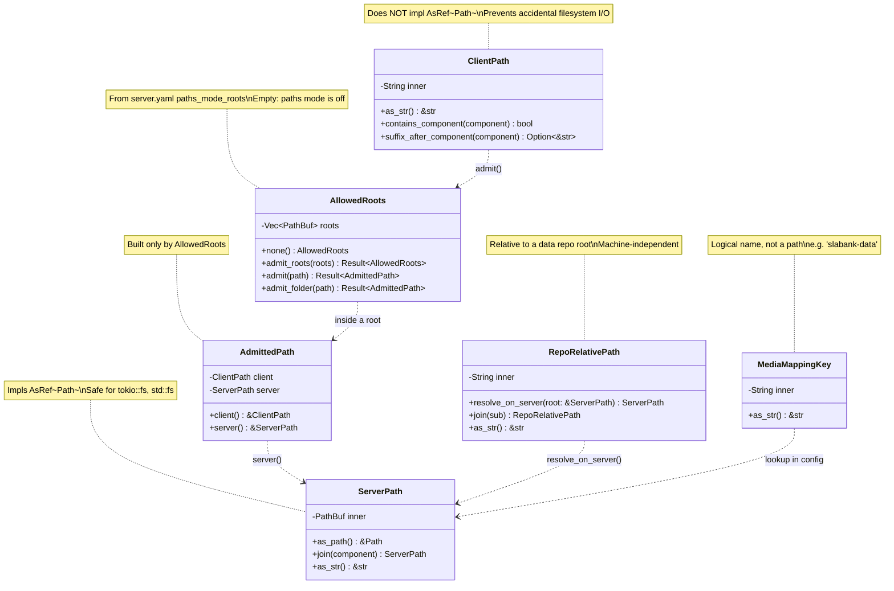
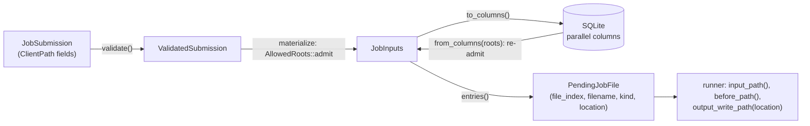
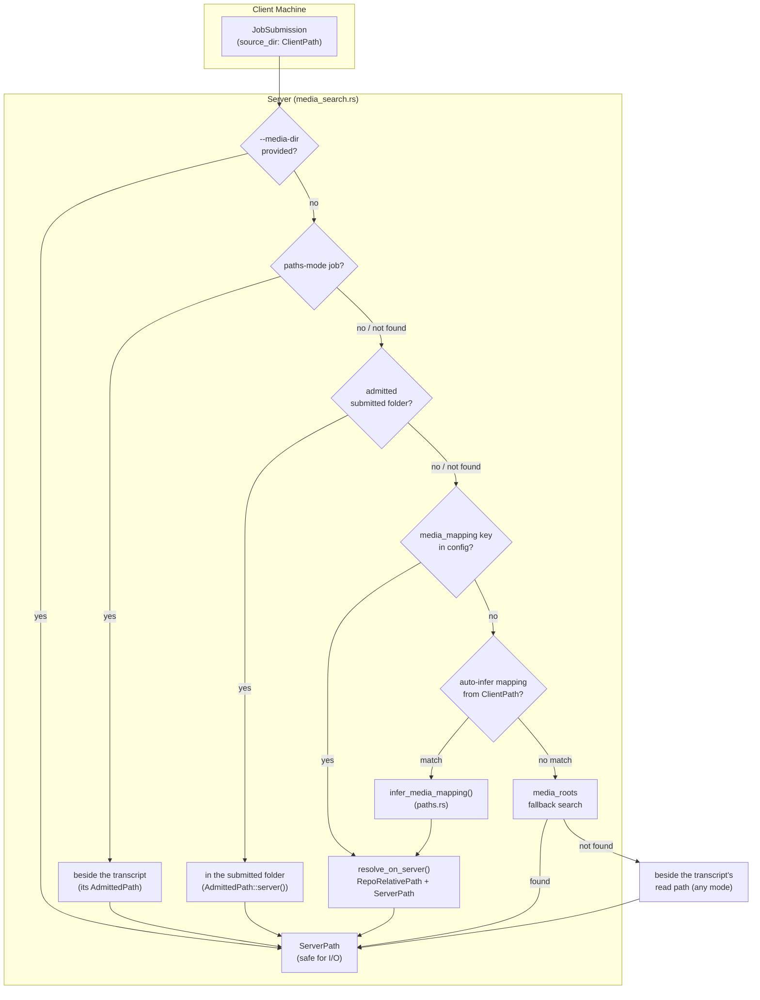

# Typed Path Provenance

**Status:** Current
**Last updated:** 2026-11-12 09:03 EST

Paths in batchalign3 cross machine boundaries: a client submits paths from
their filesystem, the server resolves media on its own filesystem (potentially
different mount points), and media mappings translate logical repo names to
physical volume roots. Untyped `String`/`PathBuf` allowed mixing client and
server paths, causing repeated media resolution failures. The path newtype
system makes provenance explicit so the compiler prevents these bugs.

## The Problem

The batchalign3 server accepts job submissions from both local daemons (same
machine, shared filesystem) and remote clients (different machines, different
mount points). Before path newtypes, both cases used bare `String` or `PathBuf`:

```rust
// BEFORE: which machine is this path on?
pub struct JobSubmission {
    pub source_dir: String,       // Client's input dir, but server can't read it
    pub media_mapping: String,    // Logical name, not a path at all
    pub source_paths: Vec<String>, // Client paths, must not be opened on server
}
```

This caused bugs where the server attempted filesystem I/O on a client's
path (which did not exist on the server), or where a logical mapping key
was accidentally used as a filesystem path.

## The Solution: Path Newtypes and Admission

All defined in `crates/batchalign-types/src/paths.rs`:



<!-- Verified against: crates/batchalign-types/src/paths.rs -->

### ClientPath

A path on the submitting client's filesystem. The server receives this as
metadata but **must not** do filesystem I/O on it directly.

**Key invariant:** `ClientPath` deliberately does NOT implement `AsRef<Path>`.
This means passing a `ClientPath` to `tokio::fs::read_to_string()` or
`std::fs::metadata()` is a compile error. The compiler enforces the boundary.

The **only** route from a `ClientPath` to a path the server opens is
admission by the server's configured paths-mode folders, described in
[Paths mode: admission by configured folders](#paths-mode-admission-by-configured-folders).
There is no assertion a caller can make instead: the old
`assume_shared_filesystem()` conversion, which let any caller declare a
client path local, was removed on 2026-11-12.

`ClientPath` also provides string-level inspection methods for media mapping
inference:

- `contains_component("slabank-data")` -- checks if a repo name appears as
  a path component
- `suffix_after_component("slabank-data")` -- extracts the repo-relative
  portion (e.g., `"French/Newcastle/Photos"`)

These are pure string operations that never touch the filesystem.

### ServerPath

A path on the server's filesystem, safe for I/O. Implements `AsRef<Path>`
so it can be passed directly to filesystem operations:

```rust,ignore
let server_path: ServerPath = /* ... */;
let contents = tokio::fs::read_to_string(&server_path).await?;
```

Created from:
- `AllowedRoots::admit()` / `admit_folder()`, as the server half of an
  `AdmittedPath` (a paths-mode client path inside a configured folder)
- `RepoRelativePath::resolve_on_server(&root)` (combining a relative path
  with a server root)
- `ServerPath::new(pathbuf)` (direct construction from a known server path)
- Media mapping config deserialization (volume roots in `server.yaml`)

### RepoRelativePath

A path relative to a data repository root (e.g., `"French/Newcastle/Photos/13"`).
This is machine-independent -- it is valid on any machine that has the
repository cloned.

Must be combined with a `ServerPath` root to produce an absolute server path:

```rust,ignore
let root = ServerPath::new("/srv/talkbank/slabank");
let rel = RepoRelativePath::new("French/Newcastle/Photos/13");
let abs = rel.resolve_on_server(&root);
// → /srv/talkbank/slabank/French/Newcastle/Photos/13
```

### MediaMappingKey

A logical name that maps to a `ServerPath` via the server's `media_mappings`
configuration. Not a filesystem path at all -- it is an index into a
`BTreeMap<MediaMappingKey, ServerPath>` in `ServerConfig`.

Examples: `"slabank-data"`, `"childes-eng-na-data"`, `"aphasia-data"`.

## Paths Mode: Admission by Configured Folders

A paths-mode job names files on the server's own disk: the server reads each
source and writes each output in place. The server has no authentication, so
whatever a paths-mode path names, any client that can reach the server could
have it read or overwritten. A request's paths are therefore admitted under
one of three authorities (`AllowedRoots`, no `Default`):

| Authority | Who | Admits |
|---|---|---|
| `same_user()` | the in-process CLI runner; a request with a valid same-user proof | any absolute path without `.` or `..` |
| configured folders | any other request | only paths inside `paths_mode_roots` |
| `none()` | any other request, when no folders are configured | nothing |

**The same-user proof** (`same_user_key.rs`). The key never leaves the
account's own processes, and what is sent proves one request once:

- **Publishing.** Each time a server starts it makes a random 32-byte key
  (`ServerKey`) and publishes it inside its handshake record, with the
  address it bound. The record is written atomically, owner-only, under the
  slot lock, and removed only by the process it names, so a key never
  outlives, precedes or belongs to another server than its handshake.
- **Proving.** A client reads `OwnServer` from this account's own handshake
  (the file must be owned by this account and `0600`; the key exactly 64
  lowercase hexadecimal characters). It sends to that server's own address,
  never to a typed host: a typed `--server` URL counts only if it is a
  loopback URL for the server's port. For each request it asks
  `POST /same-user/nonce` for a single-use nonce (good for one minute; at
  most 4096 outstanding) and sends `x-batchalign-same-user: <nonce>.<proof>`,
  where the proof is a keyed BLAKE3 hash, under the key, of the nonce, the
  method, the path and the BLAKE3 hash of the exact body bytes. The CLI uses
  a client with no proxy and no redirects. The desktop app never holds the
  key: its native side runs the hidden `serve sign-request`, which reads the
  body on stdin and prints only the header value.
- **Judging.** `AppEnvironment::authority_for` (submit parses the raw body it
  checks, with `Json::from_bytes`; restart proves an empty body): a valid
  proof from a loopback peer gives `same_user()`, no proof gives the
  configured folders, and anything else is refused (`KeyRefusal`: a proof
  under another key, a nonce unknown, used or expired, a malformed header,
  or a valid proof from another machine). The proof is compared in constant
  time. A listener in the middle (another account on the same port of
  another loopback address) learns nothing reusable: a proof is good for
  that one request, once, to the server that issued its nonce.

On Windows the handshake relies on the state folder's access list (a user
profile folder is private by default); the explicit owner and mode checks are
Unix-only.

The configured folders are listed in `server.yaml`:

```yaml
paths_mode_roots:
  - /data/corpora
  - /data/results
```

At startup each root must be absolute and must resolve on this machine
(`RootRefusal` otherwise, and the server does not start). At submission every
source, output and earlier-version path, and the submitted folder, goes
through `AllowedRoots`:

| Refusal | When |
|---|---|
| `Disabled` | `paths_mode_roots` is empty; the message names the setting |
| `Relative` | the path is not absolute |
| `DotComponent` | the path has a `.` or `..` component |
| `Outside` | the path resolves outside every root; the message lists the roots |
| `Unresolvable` | no ancestor of the path resolves |

Two containment rules apply. `admit` (a file a job reads or writes) needs the
path strictly inside a root, so a root itself can never be a job's file and an
output's folder is always inside a root. `admit_folder` (the submitted folder,
which the media search looks in) also accepts a root itself.

**Tricky part: judging a path that does not exist yet.** An output usually
does not exist at submission. `resolve_through_existing` canonicalizes the
deepest existing ancestor (following symbolic links) and appends the rest, so
an output is judged by where its folder really is, and a symbolic link inside
a root that points elsewhere is refused. A component counts as not yet
created only when nothing at all is there: a dangling symbolic link (its
target not yet created) is refused, since writing through it would create the
target wherever it points, and any other error (permission, a loop) is a
refusal, never a reason to judge the path by an ancestor. The admitted path is
kept as submitted, so the job reads and writes exactly where the client asked,
together with its resolved form.

**Files are checked as a set, on what they name.** `JobInputs::Paths` holds a
`PathsFiles`, built only by `PathsFiles::admit`, which compares each admitted
path's `FileIdentity`: the device and inode of its deepest existing component
(so symbolic links, hard links and macOS firmlinks to one file agree) and the
not-yet-created names below it, folded as that folder's volume folds names
(case only where `pathconf(_PC_CASE_SENSITIVE)` says the volume ignores it;
NFC on macOS, whose file systems ignore normalization; no folding on Linux;
on Windows the resolved path, case-folded). Two files may not write one
output, share one display name, or write another file's source or prior. A file may write
over its own source (in place). This replaced raw-string checks in
validation, which a symbolic link, a doubled separator, `.`, case or
normalization all slipped past. The submitted folder is only a media-search
hint: one outside the allowed folders (the common parent of a file list
spanning two of them, say) is not searched, and never refuses a job whose
every file is allowed.

Admission happens before anything is created on disk, so a refused job leaves
no staging directory.

After a server restart, stored inputs are read back with no filesystem access
(`InputColumns::parse`), and every job keeps them recorded
(`StoredInputs::Recorded`) inside a finished `JobLifecycle` until it is known
to run. An interrupted job whose files are all done completes (or fails) and
needs no admission. One with resumable files is admitted under the current
authority before anything changes, and only then queued
(`Job::recover`, through the lifecycle's `resume` event); if admission is refused, its
unfinished files are closed with the reason (`Job::close_unfinished_files`),
the job is failed with the reason and its lease cleared, its database rows are
rewritten to match, and the results it already wrote are kept. A cancelled job with files still open is closed the
same way, as cancelled: no runner is started for a cancelled job after a
restart, and closing a file reads no path. A stored result that cannot be
named fails its job visibly rather than dropping it from the list, and rows
of a job left out of recovery are never rewritten. A restart admits the job's inputs
again every time (`StoredInputsRef::readmit`), so every run is admitted under
the rules in force when it starts. Queuing takes those admitted inputs
(the lifecycle's `restart` event); `JobLifecycle::Active` holds nothing else, so recorded
history cannot run, and only admitted inputs can build a runner snapshot or a
runner claim.

The in-process CLI runner (`direct.rs`) admits with
`AllowedRoots::same_user()` directly: the client and the server are one
process of one user. It is an authority of its own, not a pretend folder: `/`
would not even be an absolute path on Windows.

## Typed Job Inputs

A job's files are one `JobInputs` value, one entry per file, in file order:

```rust,ignore
pub enum JobInputs {
    Paths { files: Vec<PathsInput>, source_dir: Option<AdmittedPath> },
    Content(Vec<ContentInput>),
}
// PathsInput  { display, kind, source: AdmittedPath, output: AdmittedPath, before: Option<AdmittedPath> }
// ContentInput { display, kind }
```

This replaced six parallel fields (`filenames`, `has_chat`, `paths_mode`,
`source_paths`, `output_paths`, `before_paths`), which nothing kept the same
length, and whose paths were bare client strings opened directly. A file's
name, kind and paths now cannot disagree, a paths-mode path exists only as an
admitted one, and a content-mode job has no paths to misread.



- **Storage boundary.** The database still stores parallel columns.
  `JobInputs::to_columns` is the one serializer and `JobInputs::from_columns`
  the one parser; it refuses columns of different lengths and re-admits every
  stored path.
- **Pending files.** The runner works on `PendingJobFile`s. Their fields are
  private and `JobInputs::entries` is their one constructor, so each carries
  its own input's `InputLocation` (`Paths { source, output, before }` or
  `Staged`) and no caller, test fixtures included, can pair a file with
  another file's paths. Consumers read the location from the file; none
  indexes the inputs.
- **Display names.** In paths mode a file is shown by its path relative to the
  submitted folder (`nested/a.cha`), or by its file name when it lies outside
  that folder. Two files with the same display name are refused at
  validation, since their results and statuses would collide.

## Data Flow: Media Resolution

The media search (`runner/dispatch/media_search.rs`) resolves audio files
through a multi-step cascade. Only a paths-mode job searches beside its
transcript or in its submitted folder, and only through admitted paths: a
content-mode client's folder is on another machine. The path newtypes make each step's provenance explicit.



<!-- Verified against:
  - crates/batchalign/src/runner/dispatch/media_search.rs (media resolution cascade)
  - crates/batchalign-types/src/paths.rs (all path types, infer_media_mapping)
  - crates/batchalign/src/types/config/resolve.rs:108 (ServerConfig.media_mappings)
  - crates/batchalign/src/types/request.rs (JobSubmission fields)
-->

### Auto-Inference: `infer_media_mapping()`

When no explicit `media_mapping` key is provided, the server auto-infers the
mapping from the client's source directory path. This is the function in
`crates/batchalign-types/src/paths.rs`:

```rust,ignore
pub fn infer_media_mapping<'a>(
    client_dir: &ClientPath,
    mappings: impl IntoIterator<Item = (&'a MediaMappingKey, &'a ServerPath)>,
) -> Option<(MediaMappingKey, ServerPath, RepoRelativePath)>
```

It checks whether any key in `mappings` appears as a path component in
`client_dir`. Example:

- `client_dir`: `/Users/operator/chat-data/slabank-data/French/Newcastle/Photos`
- `mappings`: `{"slabank-data" → "/srv/talkbank/slabank"}`
- Returns: `("slabank-data", "/srv/talkbank/slabank", "French/Newcastle/Photos")`

This is a **pure string operation** on `ClientPath` -- it never touches the
filesystem. The `suffix_after_component()` method extracts the repo-relative
portion, which becomes a `RepoRelativePath`.

## Where Path Types Are Used

| Type | Used in | Field / Parameter |
|------|---------|-------------------|
| `ClientPath` | `JobSubmission` | `source_dir`, `source_paths`, `output_paths`, `before_paths` |
| `ClientPath` | `JobMetadata` | `source_dir` |
| `ClientPath` | `JobFilesystemConfig` | `source_dir` (media-mapping inference only) |
| `AllowedRoots` | `ServerConfig` / `AppEnvironment` | `paths_mode_roots`, admitted at startup |
| `AdmittedPath` | `JobInputs::Paths` | every file's `source`, `output`, `before`; `source_dir` |
| `MediaMappingKey` | `JobSubmission` | `media_mapping` |
| `MediaMappingKey` | `ServerConfig` | `media_mappings` (key) |
| `ServerPath` | `ServerConfig` | `media_roots`, `media_mappings` (value) |
| `RepoRelativePath` | `JobSubmission` | `media_subdir` |
| `RepoRelativePath` | FA pipeline | Inferred corpus subdirectory |

## Design Decisions

### Why `ClientPath` stores `String`, not `PathBuf`

Client paths arrive as JSON strings over HTTP. They may reference Windows paths
(`C:\Users\...`) on a macOS server. `PathBuf` on the server would normalize
path separators, potentially corrupting the client's path. `String` preserves
the exact bytes the client sent.

### Why `ServerPath` stores `PathBuf`, not `String`

Server paths are used for actual filesystem I/O. `PathBuf` integrates with
`std::fs`, `tokio::fs`, and the `Path` trait ecosystem. The `AsRef<Path>`
implementation makes `ServerPath` a drop-in for any function that accepts paths.

### Why `From<&str>` on `ClientPath` is not `TryFrom`

`ClientPath` has no validation invariants -- any string a client sends is a
valid client path (it might not exist, but that is discovered at resolution
time). The `From<&str>` impl is genuinely infallible.

`MediaMappingKey` follows the same reasoning: any string is a valid key
(it might not match any config entry, but that is a lookup miss, not a
construction error).

### Relationship to `type-driven-design.md`

The path newtypes are an instance of Pattern 3 (Provenance Newtypes) from the
[type-driven design catalog](type-driven-design.md). The difference from text
provenance types (`ChatRawText`, `AsrNormalizedText`) is that path types also
encode **machine boundaries** -- which side of the client/server divide a value
lives on -- and enforce this through the presence or absence of `AsRef<Path>`.

## Key Source Files

| File | Role |
|------|------|
| `crates/batchalign-types/src/paths.rs` | The path newtypes, `AllowedRoots`/`AdmittedPath` admission, `infer_media_mapping()` |
| `crates/batchalign/src/types/request.rs` | `JobSubmission` uses `ClientPath`, `MediaMappingKey`, `RepoRelativePath` |
| `crates/batchalign/src/types/config/mod.rs` | `ServerConfig.media_mappings: BTreeMap<MediaMappingKey, ServerPath>` |
| `crates/batchalign/src/runner/dispatch/media_search.rs` | Media resolution cascade |
| `crates/batchalign/src/submission.rs` | Admits every paths-mode path in `materialize_submission_job()`, before staging |
| `crates/batchalign/src/store/job/types.rs` | `JobInputs`, `PendingJobFile`, `InputLocation`, the `InputColumns` storage boundary |
| `crates/batchalign/src/store/queries/recovery.rs` | Recovery: finished jobs as recorded history, unfinished ones admitted or shown failed |
