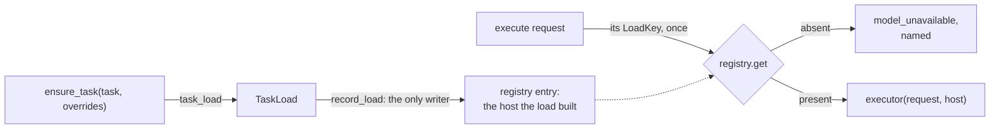

# Server Model Loading and Caching

**Status:** Current
**Last updated:** 2026-11-05 23:04 EST

This document describes every ML model loaded by batchalign3 workers,
when each model is loaded into memory, and how results are cached.

## How Models Are Loaded

The Rust server spawns Python worker processes keyed by `(target, lang)`.
Targets are either:

- a released infer task such as `infer:morphosyntax` or `infer:asr`
- or a test-echo worker bootstrapped for one infer task without loading models

Each worker loads its own models on first use: no worker loads a model at
startup, in any bootstrap mode, and each task's models load in its
`ensure_task`, which the pool sends before the worker's first request for it. Workers are managed
by a **WorkerPool** (`crates/batchalign/src/worker/pool/`) with a
pressure-driven idle eviction and automatic crash restart.

### What a worker holds: one registry of loads

Everything a worker loaded is one entry of its load registry,
`_state.loads` (`TaskLoadRegistry` in `batchalign/worker/_types.py`), the
Python mirror of Rust's `TaskLoads`. The registry is keyed by `TaskLoad`, the
closed set of loads `ensure_task` can complete (each task once, and each
speaker model, including pyannoteAI, as a load of its own), and each entry is
the host that load built (`batchalign/worker/_loads.py`): the runner over the
model it loaded and the identity of what loaded.

- **The transition.** `ensure_task_loaded` is the only writer: a completed
  load records exactly one host (`record_load` matches `TaskLoad`
  exhaustively, and a second record of one load raises). There are no
  per-model `Optional` fields on worker state and no module-level model
  globals; the Cantonese providers and the Cantonese FA aligner are objects
  their loads return.
- **The pairing is a type.** Each load has one `LoadKey[Host]` constant, typed
  by the host its load builds; `record(key, host)` and `get(key)` take the
  key and the host together, so recording or reading a load as the wrong
  host does not type-check. The parameter is a classic invariant `TypeVar`:
  mypy infers an unused PEP 695 parameter as covariant, which would admit an
  FA host under the ASR key.
- **One resolution per request.** The V2 dispatcher
  (`batchalign/worker/_execute_v2.py`) resolves the request's key once: an
  absent load is the named `model_unavailable` refusal, a present one is the
  host the executor receives as an argument. No handler tests for `None`.
  The legacy `batch_infer` route resolves the same entries.
- **Identity travels with the model.** The PyO3 executors take the host
  itself and read `backend`, `runner` and, for ASR, `model_identity` from it
  (`admit_loaded_host` in `crates/batchalign-pyo3/src/worker_execute.rs`),
  refusing a request whose backend is not the loaded one. The capability
  report names the FA identity from the FA host's `engine`, which
  `FaCacheNamespace::from_loaded` then reads.
- **Loads that build nothing are entries too.** An ASR load with no engine
  named (the plan's ASR runs in Rust: Rev.AI, whisper.cpp) records
  `ControlPlaneAsr`, and an ASR request reaching that worker is refused by
  name; pyannoteAI's load records a host that calls the API. openSMILE, AVQI
  and word segmentation record their analysis functions.
- **Memory.** An entry is the model its load built, referenced once, never
  copied. The coreference entry's runner holds a `PreparedCoref`, which owns
  no pipeline: each batch builds the pipeline and releases it, so the
  registry keeps no reference to it between batches. Measured, a built
  pipeline adds about 0.5 GB, resolving a document raises that to 2.5 GB or
  more, and a release after use returns about 1.6 GB; see the memory-safety
  chapter, whose residency table sizes the host-memory lease each load and
  each coreference batch takes, and records the open question of bounding
  coreference on long documents.

For a multi-file job the runner **pre-scales** its workers before file
dispatch begins, so the batch pays one cold start rather than one per file. A
startup `warmup` of a configured command list existed until 2026-07-30; it had
been inert on real servers since 2026-03-26 and was removed.

---

## Per-Command Model Inventory

### `morphotag` (task string: `morphosyntax`)

| Module | Model | Source | Size | Loaded When | HF Hub |
|--------|-------|--------|------|-------------|--------|
| `inference/morphosyntax.py` | Stanza pipeline (tokenize, pos, lemma, depparse, mwt) | stanza / HF Hub | 300-500 MB per language | First file for each language (lazy per-language dict) | Yes |

**Internal caching:** Per-language `stanza.Pipeline` dict in the worker state.
A single worker handles all languages without reloading.

**Result caching:** SQLite utterance cache. Key = `BLAKE3(words + lang + "|mwt")`,
gated by Stanza version. Stores final `%mor`/`%gra` strings.

---

### `align` (task string: `fa`)

The server auto-chains forced alignment + UTR + disfluency + retrace.

| Module | Model | Source | Size | Loaded When | HF Hub |
|--------|-------|--------|------|-------------|--------|
| `inference/fa.py` (Whisper FA) | `openai/whisper-large-v2` | HF Hub | ~3 GB | First FA request (`ensure_task`) | Yes |
| `inference/asr.py` (UTR) | `openai/whisper-large-v3` for every language, pinned to the commit named in `model_manifest.rs` | HF Hub | ~3 GB | First audio file (lazy) | Yes |
| Rust (disfluency) | None (rule-based data files) | local | negligible | N/A | No |
| Rust (retrace) | None (Rust n-gram) | local | negligible | N/A | No |

**Alternative:** Wave2Vec FA (`inference/fa.py`) uses `torchaudio.pipelines.MMS_FA`
(~1.6 GB, loaded at its first request's `ensure_task`, from PyTorch Hub, not HF Hub).

**Result caching:**
- Forced alignment: SQLite. Key = `BLAKE3(audio identity + time window + words + gap-healing policy + engine)`.
- UTR: SQLite. Key = `BLAKE3(realpath + filesize)`, under the namespace
  `<producer>:<UTR engine>:<the models that plan pinned>`, where the producer
  is `utr-asr-v1` for Rev.AI and Tencent and, for stock Whisper, its
  word-timestamp producer revision with the decode decision its worker is
  given for the language (`utr-asr-open-begin-v5:decode=<decision>`). The engine name
  alone said only which engine wrote a row, never which weights it wrote it
  with, so a row from before a checkpoint moved was indistinguishable from one
  after; naming the pinned models makes rows written under an older
  composition unreadable rather than silently reusable. A plan in which any
  model floats is ineligible: such a run infers without reading or writing the
  cache at all. Protected from pruning.

---

### `transcribe` (server-owned composition over `asr`)

Current CLI default engine is Rev.AI. Alternate ASR engines are selected with
`--asr-engine whisper`, `--asr-engine whisper_hub`, or
`--asr-engine whisper_rs`. (`whisperx` and `whisper_oai` are accepted names
with no implementation; submitting either is refused.) The server auto-chains
disfluency + retrace.
For languages with a dedicated utterance model (`eng`, `cmn`, `zho`, `yue`),
transcribe also runs pre-CHAT utterance segmentation before CHAT assembly.

| Module / Engine | Model | Source | Size | Loaded When | HF Hub |
|--------|-------|--------|------|-------------|--------|
| Rust `crates/batchalign/src/revai/asr.rs`: Rev (default) | Rev.AI HTTP client only | local + remote API | negligible local memory | per-file server dispatch | No |
| `inference/asr.py`: Whisper | `openai/whisper-large-v3` + optional BertUtteranceModel | HF Hub | ~3 GB + ~400 MB | First ASR request (`ensure_task`) | Yes |
| Rust (disfluency) | None | local | negligible | N/A | No |
| Rust (retrace) | None | local | negligible | N/A | No |

**BertUtteranceModel languages:** Only loaded when the Rust manifest
(`model_manifest::UTSEG_BOUNDARY_MODELS`) pins a model for the language and
sends it with the worker spawn. Currently: `eng`
(`talkbank/CHATUtterance-en`), `cmn` / `zho` (`talkbank/CHATUtterance-zh_CN`),
`yue` (Cantonese-specific model). The worker loads the pinned snapshot by local
path, never by name, so the revision it reports is one it verified on disk.

**Result caching:** Raw provider-shaped Rev.AI evidence is cached and replayed
after strict validation. Ordinary non-Rev ASR engines are not yet cached and
run inference again.

---

### `transcribe_s` (server-owned composition over `asr`)

`transcribe_s` now follows the same server-owned transcribe pipeline as
`transcribe`. The low-level task has no CLI command literally named `speaker`,
but it has two product surfaces: integrated diarized transcription and the
standalone `diarize` command. When the selected ASR
backend already returns usable speaker labels (for example Rev.AI or the
Cantonese provider adapters), Rust keeps those labels on the default path. When
`--diarize` is explicitly requested, Rust also composes the low-level `speaker`
infer task, receives raw diarization segments, and projects them onto timed ASR
words before utterance segmentation and CHAT assembly. That projection splits
prepared chunks at speaker changes even on top of Rev-labeled output.

The default dedicated diarization backend is pyannoteAI Precision-2. Its worker
adapter performs the typed `PreparedWav` to `UploadedMedia` to
`SubmittedDiarizationJob` to `CompletedDiarizationJob` lifecycle and requests
exclusive diarization for ASR reconciliation. Local Pyannote remains the
explicit alternative. Local Pyannote is built by the speaker task's load
(`ensure_task`, before the worker's first local-pyannote request, which names
it), and reused within that process; pyannoteAI loads nothing.

**Result caching:** Integrated diarized transcription and standalone
`diarize` share the same validated raw-evidence and derived-turn cache. A
normal warm run can therefore replay evidence without another paid or local
diarization call. Standalone defaults to local Pyannote but can explicitly
select pyannoteAI Precision-2; the backend and optional/known speaker
count are part of the evidence identity.

---

### `translate` (task string: `translate`)

| Module / Backend | Model | Source | Size | Loaded When | HF Hub |
|--------|-------|--------|------|-------------|--------|
| `inference/translate.py`: Google (default) | None (Google Translate API) | remote | N/A | N/A | No |
| `inference/translate.py`: Seamless | `facebook/hf-seamless-m4t-medium` | HF Hub | ~4.8 GB | First translate request (`ensure_task`) | Yes |

**Result caching:** SQLite utterance cache. Key = `BLAKE3(text + src_lang + tgt_lang)`.

---

### `utseg` (task string: `utseg`)

| Module | Model | Source | Size | Loaded When | HF Hub |
|--------|-------|--------|------|-------------|--------|
| `inference/utseg.py` | `BertUtteranceModel` for `eng` / `cmn` / `zho` / `yue`; otherwise Stanza pipeline (tokenize, pos, constituency) | HF Hub / stanza | ~400 MB for BERT model or 300-500 MB per Stanza language | Boundary model: the utseg `ensure_task`; Stanza pipeline: its language's first batch | Yes |

**Result caching:** SQLite utterance cache. Key = `BLAKE3(text + lang)`.

---

### `coref` (task string: `coref`)

| Module | Model | Source | Size | Loaded When | HF Hub |
|--------|-------|--------|------|-------------|--------|
| `inference/coref.py` | Stanza tokenizer + `ontonotes-singletons_roberta-large-lora` | stanza / HF Hub | ~1.5 GB download | Prepared by `ensure_task` (first use) on the English worker; built per batch | Yes |

English only. The coref task loads on first use, like every task. Its preparation downloads the files and
releases the pipeline; each batch (one per job) builds it from those files
and releases it at the end, under its own host-memory lease. The release
drops the pipeline's references, but measured it returns little memory to the
operating system (memory-safety chapter, residency table).
**Result caching:** None.

---

### `benchmark` (server-owned composition over `asr`)

Same engines as `transcribe` plus a Rust-side WER step:

| Module | Model | Source | Size | Loaded When | HF Hub |
|--------|-------|--------|------|-------------|--------|
| `crates/batchalign/src/benchmark.rs` | None (Rust Hirschberg DP alignment via the allowlisted `dp_align::align` call site) | local | negligible | N/A | No |

---

### `opensmile` (task string: `opensmile`)

| Module | Model | Source | Size | Loaded When | HF Hub |
|--------|-------|--------|------|-------------|--------|
| `inference/opensmile.py` | None (C++ feature extraction) | local | negligible | Worker startup | No |

Feature sets: `eGeMAPSv02`, `GeMAPSv01b`, `ComParE_2016`, `eGeMAPSv01b`.

**Result caching:** None (produces CSV output).

---

## Device Placement

ASR and forced-alignment loaders resolve `DevicePolicy` at load time.
`--force-cpu` selects CPU before any accelerator check; otherwise:

| Priority | Device | Notes |
|----------|--------|-------|
| 1 | CUDA | If `torch.cuda.is_available()` and not `--force-cpu` |
| 2 | MPS | Apple Silicon, only with explicit `--allow-mps` and when available |
| 3 | CPU | Fallback |

Local speaker engines exclude MPS even with the opt-in. Stanza manages its own
device internally (typically CPU). See [device policy](../developer/apple-mps-workarounds.md).

## Speaker engine credentials

The default cloud engine reads `BATCHALIGN_PYANNOTE_API_KEY`,
`BATCHALIGN_PYANNOTE_KEY`, or `PYANNOTE_API_KEY`, in that order. It also accepts
`engine.pyannote.key` in the `[diarize]` section of `~/.batchalign.ini` for
compatibility. This is a worker-owned credential path and audio is uploaded to
pyannoteAI.

### Hugging Face downloads for the local Pyannote engine

The released local speaker engine loads three PINNED artifacts:
`talkbank/dia-fork`, `talkbank/seg-fork-3.0`, and
`hbredin/wespeaker-voxceleb-resnet34-LM`. All three repositories are public
and ungated, and a worker downloads them anonymously; none needs `hf auth
login`, `HF_TOKEN`, accepted model terms, or a pyannoteAI API key.

**A fourth, UNPINNED artifact is fetched behind those three, and it is
currently GATED.** `pyannote.audio`'s `SpeakerDiarization` pipeline class
loads a PLDA calibration artifact unconditionally during construction,
regardless of the pinned config's clustering choice; the released config does
not override it, so the class's own default applies, which is the gated
`pyannote/speaker-diarization-community-1` repository. A worker with no
accepted terms and no Hugging Face token fails on first use naming that
repository, mapped by `batchalign.inference._model_access_errors` to a typed
`ModelAccessDeniedError` (Rust: `ProtocolErrorCodeV2::ModelAccessDenied` /
`ServerError::ModelAccessDenied` / `FailureCategory::ModelAccessDenied`,
never `Validation`). The remedy is a Hugging Face token in
`~/.batchalign.ini` `[auth] hf_token` (checked before Hugging Face's own
`HF_TOKEN`/`hf auth login` resolution, via
`batchalign.inference.pyannote_local.resolve_huggingface_hub_token`), after
accepting the repository's terms at
<https://huggingface.co/pyannote/speaker-diarization-community-1>. User-facing
detail: [diarize](../user-guide/commands/diarize.md#local-model-download-todays-truth-including-a-gated-dependency).

The repository names are not the runtime identity. The packaged
`batchalign/inference/local_pyannote_model.json` manifest owns an exact
40-hex Hugging Face commit and required artifact for every node in the graph.
Python validates the manifest before downloading and rewrites the pipeline's
transitive model references to those pinned artifacts. Rust hashes those same
manifest bytes into the raw speaker-evidence model revision. A moving Hub head
therefore cannot change inference while retaining an old cache identity, and
the Python and Rust sides cannot drift through duplicated version constants.

Release-candidate verification on 2026-08-31 exercised the packaged manifest
through the real Pyannote loader, not only mocks: the loaded pipeline retained
the manifest's pinned segmentation revision, resolved the embedding from that
revision's snapshot path, and completed local inference over one second of
prepared silent 16 kHz PCM with the expected empty segment result. This is a
runtime wiring check, not a diarization-quality claim.

This differs from some upstream Pyannote pipelines whose publishers gate their
repositories. If an operator deliberately replaces the TalkBank-pinned model
with such a custom model, that operator must provide whatever Hugging Face
authentication and terms acceptance the custom repository requires. That
credential is not part of the default Batchalign3 deployment.

Once a model is downloaded, it is cached on disk at `~/.cache/huggingface/`
and does not re-download on subsequent loads.
