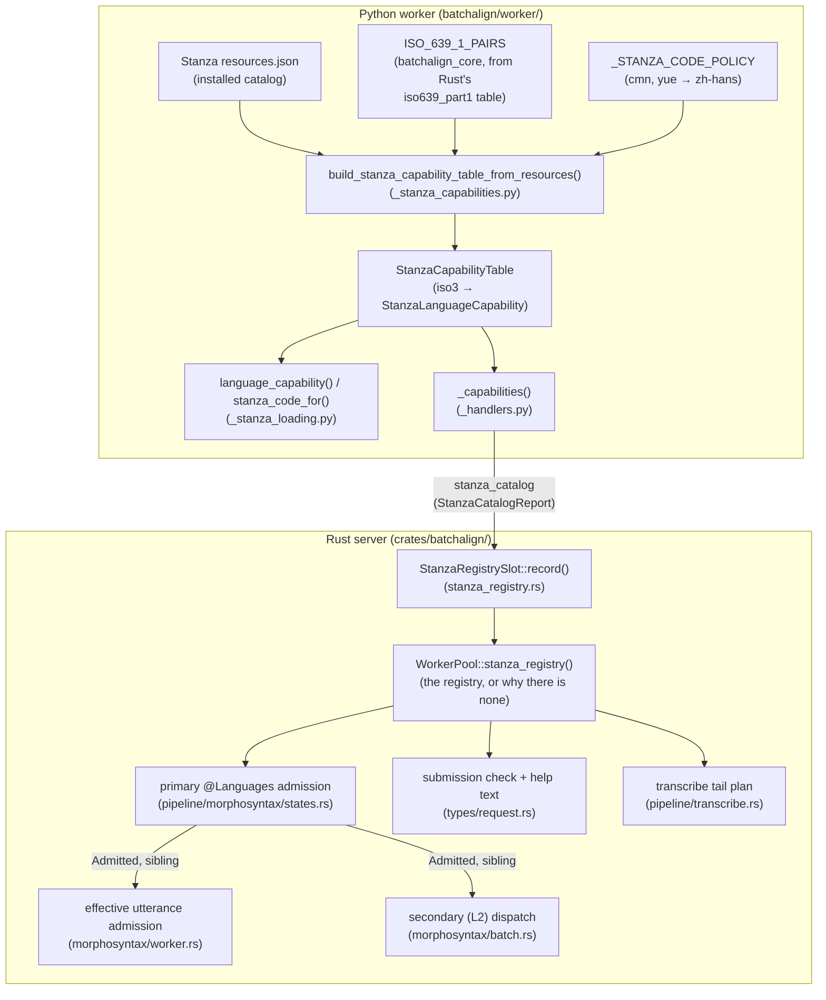
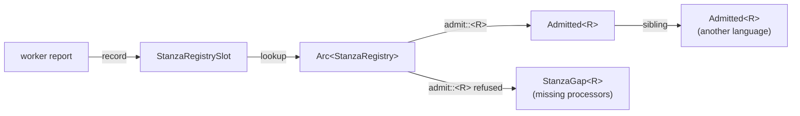

# Stanza Capability Registry

**Status:** Current
**Last updated:** 2026-10-24 21:36 EDT

One question decides whether morphosyntax can analyze a language: does the
installed Stanza catalog ship a morphotag pipeline for it? One structure
answers it. The worker builds a capability table from Stanza's own
`resources.json` and Rust's ISO 639-1 table, reports it to the server, and the
server keeps the first reported catalog as its `StanzaRegistry`. Every Stanza
admission is decided by the registry and nothing else, and yields a proof
(`Admitted<R>`) the stage carries; there is no static list of supported
languages anywhere.

## Why one authority

Two questions have to have the same answer everywhere they are asked:

- **Which processors does a language have?** (does `kaz` have
  `tokenize`/`pos`/`lemma`/`depparse`? does `nld` have `mwt`?)
- **Which catalog entry serves an ISO 639-3 code?** (`kaz` is `kk`, `yue` is
  `zh-hans`, `nor` is `nb`, `grc` is `grc`).

Every failure of this kind has had the same shape: one component (a Rust
list, a Python preflight, a code mapping) says a language is supported and
another (the catalog, `stanza.Pipeline`) disagrees. Hand-edited mirrors of the
catalog have refused languages the catalog serves in full (Kazakh, Serbian,
Belarusian and dozens more) and crashed workers on languages it does not
(a Swedish MWT model, a Dutch constituency model, a Marathi code passed
through unmapped). So nothing mirrors the catalog: the table is derived from
it, and every consumer reads the table.

## Data flow

<!-- Verified against:
  - batchalign/worker/_stanza_capabilities.py (builder, policy, table)
  - batchalign/worker/_stanza_loading.py (language_capability, stanza_code_for)
  - batchalign/worker/_handlers.py (_capabilities report)
  - crates/batchalign-pyo3/src/lib.rs (ISO_639_1_PAIRS)
  - crates/batchalign-types/src/stanza_catalog.rs (StanzaCatalogReport, StanzaProcessor, StanzaRequirement)
  - crates/batchalign/src/stanza_registry.rs (StanzaRegistry, StanzaRegistrySlot, Admitted, StanzaGap)
  - crates/batchalign/src/worker/pool/mod.rs (record_capabilities)
  - crates/batchalign/src/morphosyntax/capability.rs (AnalysisUnavailable::admit)
-->

## Python side: the capability table

`batchalign/worker/_stanza_capabilities.py` builds the table once per worker
process (`get_cached_capability_table`, cached for the process lifetime; a
fresh install downloads the catalog first).

Each catalog entry with a `tokenize` processor becomes a
`StanzaLanguageCapability`: its catalog code (`stanza_code`, a `StanzaCode`)
and the set of processors it ships, drawn from the closed
`StanzaProcessorName` (`tokenize`, `mwt`, `pos`, `lemma`, `depparse`,
`constituency`, `coref`). The catalog's alias entries (`{"alias": "nb"}` under
`no`) are kept for resolution.

An ISO 639-3 code is served by the entry found by, in order:

1. **`_STANZA_CODE_POLICY`**: Mandarin (`cmn`) and Cantonese (`yue`), which
   have no ISO 639-1 code and no catalog entry of their own, use Stanza's
   Simplified Chinese model (`zh-hans`). This is a choice BA3 makes, and the
   only hand-written table in the mapping.
2. **Its ISO 639-1 code**, from Rust's one ISO table
   (`batchalign_types::iso639_part1`, exported to Python as
   `batchalign_core.ISO_639_1_PAIRS`), looked up in the catalog directly or
   through one of the catalog's aliases. `zho` reaches `zh-hans` through the
   alias `zh`; `nor` reaches `nb` (Bokmål) through the alias `no`; `nob` and
   `nno` reach `nb` and `nn` directly; `sme` reaches `sme` through `se`.
3. **The code itself**, likewise: the catalog keys some languages by their
   three-letter code (`grc`, `kmr`, `ckb`) and aliases others (`kaz` to
   `kk`, `uzn` to `uz`).

A code none of these reaches is absent from the table, never passed through.

The worker's pipeline loaders read the same table:
`language_capability(lang)` returns the entry (raising
`UnsupportedLanguageError` when Stanza is not installed or the table has no
entry), and
`stanza_code_for(lang)` its catalog code. MWT is requested exactly when the
entry ships `mwt`. `load_stanza_models` refuses, before calling
`stanza.Pipeline`, an entry without the four morphotag processors, and
`load_utseg_pipeline` one without the three utterance segmentation processors.

## IPC: the capabilities report

The worker's capabilities response carries a required `stanza_catalog`, one
of three outcomes by type (`StanzaCatalogReport` in Rust, a discriminated
union in `_types.py`):

| `kind` | Meaning |
|--------|---------|
| `catalog` | `languages: {iso3: [processor, ...]}`, the table the worker built |
| `not_installed` | the `stanza` package does not import; `import_error` is the import exception's type and message (a test echo worker reports this too, saying it imports none) |
| `failed` | Stanza imported but the table build failed; `reason` is the exception's type and message |

`import_error` and `reason` are a `StanzaReportReason`, which cannot be
blank: a report always says something an operator can act on.

Only the `stanza` import itself counts as "not installed"
(`get_cached_capability_table` returns `StanzaNotInstalled` for it); any
other failure, such as a stale `batchalign_core` extension without
`ISO_639_1_PAIRS`, propagates and is reported as `failed` with its reason.
A failure is never an empty catalog. Rust parses the keys into `LanguageCode3`
and the processors into the closed `StanzaProcessor` when it deserializes the
report, so a malformed catalog is a malformed capabilities response.

## Rust side: `StanzaRegistry` and the admission proof

`WorkerPool::record_capabilities` hands each report to the pool's
`StanzaRegistrySlot`, the one place a report reaches the registry. The first
catalog becomes the `StanzaRegistry` (held as an `Arc`) and stays; a later
catalog that differs (a TCP worker on another installation) is logged, not
admitted. Until a catalog arrives, the most informative other report is the
reason there is none (`StanzaRegistryUnavailable`: `NoReport`,
`NotInstalled { worker, import_error }` or `ReportFailed { worker, reason }`):
a failed report is not replaced by a later "not installed", which a worker
serving no Stanza task reports.

`WorkerPool::stanza_registry()` returns a `StanzaRegistryLookup`: the shared
registry, or the reason there is none.

The requirement is a type: `R` is a sealed marker, `Morphosyntax` or
`UtteranceSegmentation`, naming one `StanzaRequirement`. `Admitted<R>` is
minted only by `StanzaRegistry::admit::<R>(language)`; it names the language
and holds the registry that admitted it. A stage that needs another language
under the same requirement asks the proof it holds (`Admitted::sibling`), so
past the first admission there is no "no registry" case and no stage re-reads
the pool. A refusal is a `StanzaGap<R>`: `NotInCatalog`, or
`ProcessorsUnavailable { missing }`, naming the processors the entry lacks.
`languages_for::<R>()` lists the languages `R` is served for, for a refusal's
help text.

## Admission

`AnalysisUnavailable::admit(requirement, language, lookup)` is morphotag's
first admission, of the file's primary language. Its typed
`AnalysisUnavailableReason` (`StanzaRefusal<Morphosyntax>`) is
`RegistryUnavailable(StanzaRegistryUnavailable)`, carrying why there is no
registry, or `Gap(StanzaGap<Morphosyntax>)`, and the refusal is a
non-retryable `AnalysisUnavailable` failure, never a CHAT verdict. It returns
the file's `Admitted<Morphosyntax>`, which the analysis carries; every later
language of the file is that proof's sibling.

| Where | Admitted by | No registry |
|-------|-------------|-------------|
| The file's primary `@Languages` (`FileLanguage::resolve`, at parse) | the pool's registry | refuses |
| Each outstanding utterance's effective language (`DispatchPlan::admit`) | the file's proof (`AnalysisUnavailable::of_sibling`); a gap refuses | cannot arise |
| Secondary (L2) `@s` spans (`dispatch_secondary_l2`) | the file's proof; a language without a pipeline is an exclusion (`L2|xxx`, reported unsupported) | cannot arise |
| Submission (`validate_language_with_registry`, job-level languages of compare and utseg, each by its own requirement) | the registry in hand; early refusal naming the languages that are available | skipped; the job meets the registry after its capability probe |
| Utseg dispatch (`UtsegRoute::admit`, after the capability probe) | the pool's registry, for the Stanza route only | refuses the job |
| Transcribe's post-CHAT segmentation (`post_chat_route`, once recognition names the language, known or auto-detected) | the pool's registry, for the Stanza route only; a refusal is not applied, recorded as a `stage_not_applied` shortfall | not applied, recorded the same way |
| Transcribe's morphosyntax (`prepare_tail`, a known language) | the pool's registry; a gap is not applied, recorded as a `stage_not_applied` shortfall | runs it; its own admission refuses and records a shortfall |

Every worker-backed job probes its worker's capabilities before dispatch
(`ensure_command_capabilities`), so a running job normally finds the registry
admitted.

## How a language becomes available

Install or upgrade Stanza. A language is available when the installed catalog
ships tokenize, pos, lemma and depparse for the entry its ISO 639-3 code
resolves to; nothing in BA3 lists languages. A language whose entry lacks a
processor (Maltese, Telugu, Thai and Vietnamese ship no trained lemmatizer
in Stanza 1.15) is refused as `ProcessorsUnavailable`; one with no entry
(Quechua) as `NotInCatalog`. Stanza's catalog names `lemma: identity` as the
default for those four (it would copy each word as its lemma); BA3 requires a
trained lemmatizer, a `lemma` model in the entry, for morphotag. Whether an
identity lemma is acceptable for languages whose words do not inflect has not
been decided. Utterance segmentation's Stanza route needs no lemmatizer but
does need a constituency parser, which of the four only Vietnamese ships
(the committed catalog snapshot gives Maltese, Telugu and Thai tokenize, pos
and depparse alone), so only Vietnamese meets that requirement. Only a language whose code the ISO table and the catalog
cannot connect needs a `_STANZA_CODE_POLICY` entry, and that is a decision
about which model analyzes it.

The census `batchalign/tests/test_stanza_language_census.py` measures the
admitted set against a committed snapshot of the catalog's shape
(`scripts/snapshot_stanza_catalog.py` writes it). After a Stanza upgrade,
regenerate the snapshot and review the census.

## Per-command processor requirements

Each Stanza-backed command is admitted by its own requirement, the closed
`StanzaRequirement` in `batchalign-types` (`stanza_catalog.rs`), as a marker
type (`validate_language_with_registry` is an exhaustive match over the
commands). The worker builds its pipelines from the same sets, read from Rust
as `batchalign_core.STANZA_REQUIREMENTS` (`requirement_processors` in
`_stanza_capabilities.py`), so what is admitted and what is loaded are one
list.

| Command | `StanzaRequirement` | Required processors | Added where the entry ships them |
|---------|---------------------|---------------------|----------------------------------|
| morphotag, compare | `Morphosyntax` | tokenize, pos, lemma, depparse | mwt |
| utseg (Stanza route only) | `UtteranceSegmentation` | tokenize, pos, constituency | mwt |
| coref | `Coreference` (the loader's list; no admission) | tokenize, coref | (English only) |
| translate, align, transcribe | none | Stanza is not loaded for the job language (transcribe's optional utseg and morphosyntax stages use theirs) | |

Coref has no admission: it is English-only by construction (no `--lang`,
English files only, `file_has_english`), and its worker always builds the
English pipeline from `Coreference`'s processor list.

Utterance segmentation reads constituency trees and never lemmas, so it loads
no lemmatizer, and it cannot segment without a constituency parser, so an
entry without one is not admitted. Only the ROUTE that runs Stanza is
admitted: a language with a TalkBank boundary model reads no Stanza output and
is held to nothing here. The Stanza route is admitted before work at
submission (`validate_language_with_registry`), at dispatch after the
capability probe (`UtsegRoute::admit`, whose `ServableUtsegRoute` carries the
`Admitted<UtteranceSegmentation>` and is the only route a utseg job is
dispatched with), and in transcribe's post-CHAT stage once recognition has
named the language.

The worker builds utseg's constituency pipeline once per language, through the
same cache and per-key construction slot as morphotag's (key `{lang}:utseg`),
and every batch calls it through that entry's guard.

## Key source files

| File | Role |
|------|------|
| `batchalign/worker/_stanza_capabilities.py` | Builds `StanzaCapabilityTable` from the catalog, the ISO table and the policy |
| `batchalign/worker/_stanza_loading.py` | `language_capability`, `stanza_code_for`; pipeline loaders |
| `batchalign/worker/_handlers.py` | Reports the outcome as `stanza_catalog` (`_stanza_catalog_report`) |
| `batchalign/worker/_types.py` | `StanzaCatalog`, `StanzaNotInstalledReport`, `StanzaCatalogFailed`, `StanzaProcessorName` |
| `crates/batchalign-types/src/stanza_catalog.rs` | `StanzaCatalogReport`, `StanzaProcessor` |
| `crates/batchalign-types/src/iso639_part1/` | The ISO 639-1 table and `pairs()` |
| `crates/batchalign-pyo3/src/lib.rs` | Exports `ISO_639_1_PAIRS` to the worker |
| `crates/batchalign/src/stanza_registry.rs` | `StanzaRegistry`, `StanzaRegistrySlot`, `StanzaRegistryUnavailable`, `Admitted<R>`, `StanzaGap<R>`, `StanzaRefusal<R>`, the requirement markers |
| `crates/batchalign/src/worker/pool/mod.rs` | Records each report (`record_capabilities`) |
| `crates/batchalign/src/morphosyntax/capability.rs` | `AnalysisUnavailable::admit`, `AnalysisUnavailable::of_sibling` |
| `crates/batchalign/src/types/request.rs` | `validate_language_with_registry` |
| `batchalign/tests/test_stanza_language_census.py` | The admitted set on a catalog snapshot |
| `scripts/snapshot_stanza_catalog.py` | Writes that snapshot |
