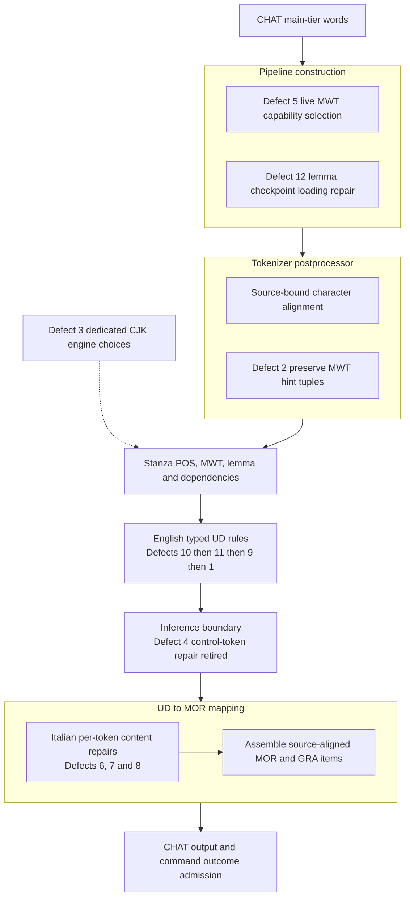

# Stanza Defect Mitigation Map

**Status:** Current
**Last updated:** 2026-11-15 09:44 EST

Stanza defects originate in model loading, tokenization, linguistic analysis
and interoperation with source CHAT. Apply a repair at the earliest typed
boundary that owns the source and completed analysis needed to establish it.
The defect's origin and BA3's intervention point are recorded separately.
Carry those facts and alignment artifacts forward through the repair.

The authoritative list of defects with version pinning, reproducers,
and re-evaluation criteria lives at
[Stanza Limitations](../reference/stanza-limitations.md). This page
is a *view* over that list, organized by **where** each defect is
patched in the pipeline.

## Qualification boundary

The 1.15.1 update keeps pipeline ownership and each defect's patch-point.
The retrained English POS model resolves the sink copula example earlier;
the lady example still exercises the post-dependency rescue. French native
elision components remain bound to the exact CHAT source token by the
realigner. The updated probe counts distinguish UD components from CHAT words.
See the [1.15.1 observations](../reference/stanza-limitations.md#stanza-1151-qualification)
and [managed qualification graph](../developer/testing.md#stanza-qualification-through-managed-sessions).
Package-version confirmation requires a paired run and recorded resource
identities. Historical rows below retain the scope of their original evidence.
The [upstream retirement procedure](../developer/upstream-defect-policy.md#retirement-review-on-an-upgrade)
tracks code, catalog and checkpoint changes, admits proposed removals from
unmitigated evidence and records the supported resource scope. See the
[1.15.1 retirement dispositions](../reference/stanza-limitations.md#workaround-dispositions-after-1151-qualification).

## Pipeline stages and their patch-points

**English UD rule order.** Tokens first: the contraction expansion (Defect
10) turns a whole `hafta` into the range Stanza should have returned, so
every later rule sees `have` + `to`. Then the transcriber's evidence
(Defect 11), then the lexicon constraint (Defect 9), then the finite-verb
rescue (Defect 1): the rescue may promote an `-ing` word the lexicon
licenses only as a noun to the clause's verb, and the clause-level
invariant outranks the word-level ones. The evidence (`UtteranceEvidence`)
is computed once per utterance in `injection.rs` from the CHAT AST, beside
the payload words, and passed down the chain; Stanza never sees it.

**Italian content repairs.** `sentence_mapping.rs::map_tokens` selects
`try_handle_italian_range_override` or `try_handle_italian_single_override`
from `lang_it.rs` for per-token Italian mapping. The range branch covers
known mis-splits, and the single-word/component rules cover registered compound
analyses. Normal assembly handles the remaining tokens. MOR-count admission
and the linguistic content of each item retain distinct obligations. Raw
UD-level count observations therefore have their own scope when reviewing
these curated repairs for retirement.

## Cross-reference table

| Defect | Stage | Mitigation file | Test pointer | Stanza version confirmed |
|:-----:|:------|:----------------|:-------------|:------|
| [1](../reference/stanza-limitations.md#defect-1-copula-s-vs-possessive-s-disambiguation-fails-before-nominal-gerunds) | Post-depparse, pre-map-UD | `crates/batchalign-transform/src/morphosyntax/invariants/finite_verb_main_clause.rs`; verb lemma from `batchalign/inference/_english_verb_reading.py` | `test_preserve_mwt_end_to_end.py`; `finite_verb_main_clause.rs` `#[cfg(test)]`; `test_english_verb_reading.py` | 1.10.1, 1.11.1, 1.12.0, 1.12.1, 1.13.0, 1.14.0, 1.15.0 |
| [2](../reference/stanza-limitations.md#defect-2-mwt-hint-tuples-must-be-preserved-through-postprocessors-stanzapython-interop-gotcha) | Tokenize (postprocessor hook) | `batchalign/inference/_tokenizer_realign.py::_realign_sentence` | `test_stanza_mwt_copula_observations.py`; `golden_l2_morphotag_*` (4 tests) | 1.10.1, 1.11.1, 1.12.0, 1.12.1, 1.13.0, 1.14.0, 1.15.0 |
| [3](../reference/stanza-limitations.md#defect-3-cjk-tokenization-and-pos-quality-reference-only--existing-workarounds) | Dedicated engines (not a pipeline patch) | `batchalign/inference/languages/cantonese/*` (PyCantonese); unified Stanza training (out-of-tree) | `test_cantonese_*`, `test_stanza_cantonese_*`, `test_mandarin_*` | 1.10.x, 1.11.x |
| [4](../reference/stanza-limitations.md#defect-4-neural-lm-control-tokens-leak-into-document-output-finnish-mwt) | Retired in Stanza 1.12.0 (no active patch-point) |, (mitigation files removed in commit `cea8f082`) |, | retired upstream in 1.12.0 |
| [5](../reference/stanza-limitations.md#defect-5-mwt-processor-selection-must-come-from-the-live-capability-table-not-a-hardcoded-mirror) | Pipeline construction | `batchalign/worker/_stanza_loading.py::language_capability` | `test_stanza_loading.py::test_mwt_is_requested_exactly_when_the_entry_ships_it`; `test_stanza_config_parity.py::TestMwtCapabilityDriven`; `test_stanza_he_el_mwt_splits.py`; `test_he_el_mwt_end_to_end.py` | every 1.x through 1.15.0 (Hebrew `לאישה` regressed in the model, 1.15.0) |
| [6](../reference/stanza-limitations.md#defect-6-italian-pos-layer-splits-words-with-clitic-shaped-endings-into-fake-verbclitic-compounds) | Per-token UD to MOR mapping | `crates/batchalign-transform/src/morphosyntax/lang_it.rs` | Italian MWT count probes and `test_italian_defect6_end_to_end.py` | Historical versions through 1.15.0, with five strict count failures on the qualified 1.15.1 population |
| [7](../reference/stanza-limitations.md#defect-7-italian-sentence-initial-article-la-gets-junk-mwt-expansion-il--i) | Per-token UD to MOR mapping | `crates/batchalign-transform/src/morphosyntax/lang_it.rs` | `parla_3sg_storia_context` count check and Italian managed CHAT controls | Historical defect evidence through 1.15.0. Its stale count xfail was removed after paired 1.15.0/1.15.1 success |
| [8](../reference/stanza-limitations.md#stanza-it-compound-imperative-mid-sentence-adj) | Per-token UD to MOR mapping | `crates/batchalign-transform/src/morphosyntax/lang_it.rs` | Compound/component controls listed in Defect 8 and Italian managed CHAT controls | Historical defect evidence through 1.15.0. Per-row unmitigated retirement remains open |
| [9](../reference/stanza-limitations.md#defect-9-english-forms-the-childes-lexicon-licenses-for-one-category-get-another-from-sentence-final-punctuation) | Post-depparse, pre-map-UD | `crates/batchalign-transform/src/morphosyntax/invariants/lexicon_category.rs`, `lexicon.rs`, `data/eng_lexicon_verdicts.json` | `lexicon_category.rs` and `lexicon.rs` `#[cfg(test)]` | 1.11.1, 1.14.0, 1.15.0 |
| [10](../reference/stanza-limitations.md#defect-10-english-chat-contractions-outside-stanzas-mwt-vocabulary-are-left-whole-and-given-an-invented-category-and-lemma) | Post-depparse, pre-map-UD (first in the English chain) | `crates/batchalign-transform/src/morphosyntax/invariants/english_contractions.rs` | `english_contractions.rs` `#[cfg(test)]` | 1.14.0, 1.15.0 |
| [11](../reference/stanza-limitations.md#defect-11-english-tags-and-responses-set-off-by-a-pause-take-a-content-word-reading-from-the-terminator) | Post-depparse, pre-map-UD (evidence computed at injection) | `crates/batchalign-transform/src/morphosyntax/evidence.rs`, `invariants/discourse_marker.rs` | `evidence.rs` and `discourse_marker.rs` `#[cfg(test)]` | 1.14.0, 1.15.0 |
| [12](../reference/stanza-limitations.md#defect-12-greek-lemmatizer-names-a-build-machine-pretrain-path) | Pipeline construction | `batchalign/worker/_stanza_lemma_pretrain.py` (applied in `_stanza_loading.py`) | `test_stanza_lemma_pretrain.py`; `test_he_el_mwt_end_to_end.py` (Greek) | 1.15.0 |

## Source contracts and intervention boundaries

The character-DP realigner carries source correspondence across languages. Its
retired per-language tokenizer tables stay retired. Stanza's internal processors
provide no BA3 hook at every model stage, so named content repairs can occur in
the downstream typed UD/MOR pipeline. English Defects 1 and 9–11 use typed UD invariants. Italian
Defects 6–8 intervene during per-token mapping. Defect 3 records engine-quality choices, and Defect 4 is retired.

## When to add a new patch-point

Use this procedure for any newly discovered Stanza defect:

1. Identify the defect's origin and the typed boundary with enough source and
   analysis evidence to repair it. A tokenizer hint loss and a POS error have
   different intervention needs. Retain provenance and completed alignment
   when moving those facts to a downstream owner.
2. **If an existing defect already patches that stage, extend its
   module.** Prefer coalescing over sprawl: the
   `crates/batchalign-transform/src/morphosyntax/invariants/` directory
   is the natural home for any future post-depparse UD-invariant
   rewrite.
3. If the change introduces a new intervention point, update this diagram and
   its source/caller pointers in the same coherent batch. Record the admitted
   input and produced outcome, including any open semantic obligations.
4. **Register the defect in
   [`stanza-limitations.md`](../reference/stanza-limitations.md)**
   with the full format (version, reproducer, correct output,
   mitigation pointer, tests, re-evaluation criteria).
5. **Cross-link back to this diagram** from the defect's BA3
   mitigation section in the registry.

## Architectural gaps

Source alignment and MOR-count admission establish their structural obligations.
Curated Italian rules cover registered Defect 6, 7 and 8 examples. A general
linguistic-content oracle remains open. Unlisted pseudo-splits or wrong
POS/lemmas can satisfy the count invariant and still require content review.
A successful parse/count check supplies its stated evidence when deciding
whether to narrow or retire a curated rule. The registry's re-evaluation
criteria supply the additional linguistic obligations.
