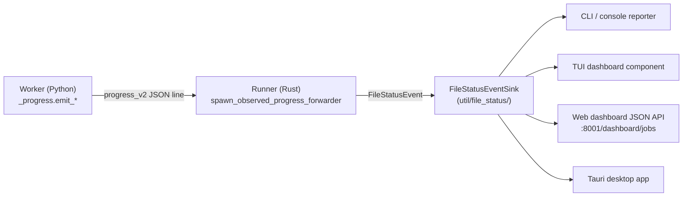
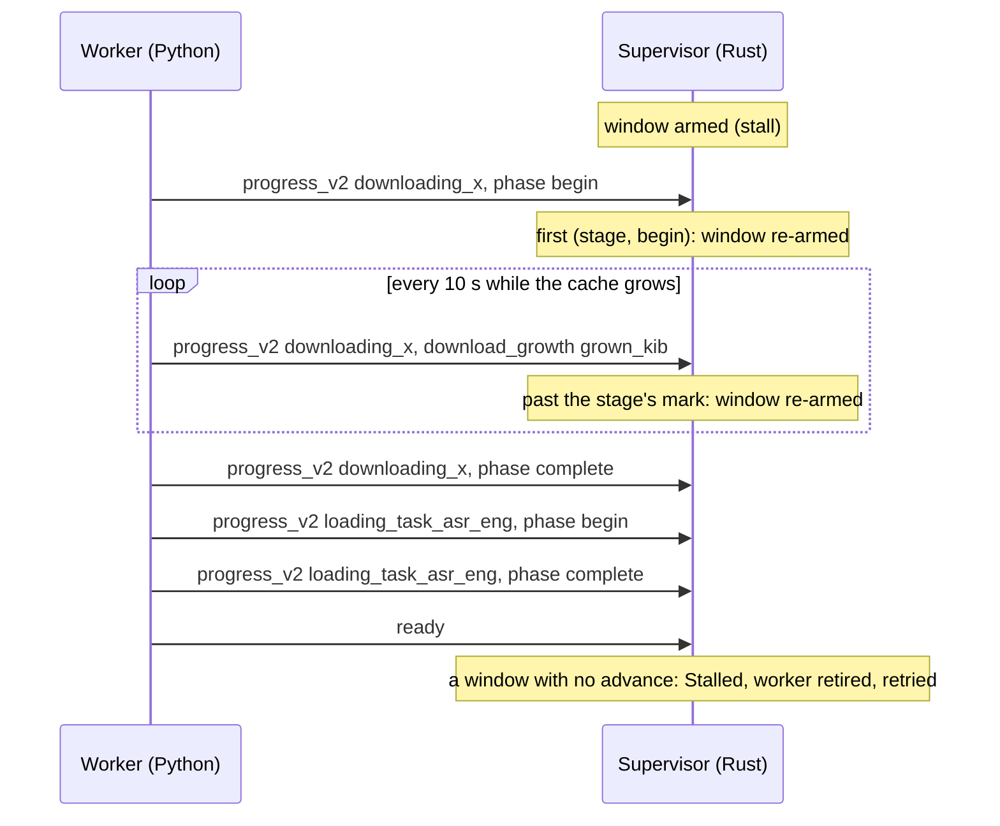

# Time Transparency: A Cross-Cutting UX Principle

**Status:** Current
**Last updated:** 2026-11-06 18:19 EST

## Principle

> Transparency about where batchalign3 spends its time is vital for UX:
> all model downloading or loading from disk must be logged and also
> prominently displayed in UI whether console, TUI, app, or web
> dashboard.

Any operation that takes more than a perceptible moment must be both
**logged** (to the daemon and worker logs with structured metadata) and
**prominently displayed** in every UI surface batchalign3 exposes (CLI,
TUI, Tauri desktop app, web dashboard). Silent waits are UX bugs, not
acceptable defaults.

The reader of this page should leave with one rule in mind: **if a worker
spends more than ~1 second on something the user could mistake for "BA3 is
stuck", that something must surface to the UI**. Examples:

- Downloading any model resource (catalog, language pack, HuggingFace
  weights, torchaudio bundle).
- Loading a model from disk into RAM or GPU.
- GPU JIT compile.
- Audio decoding for long files.
- External API calls (Rev.AI ASR, Anthropic, Aliyun, etc.), at minimum a
  `"Calling Rev.AI…"` event before the call returns.
- Sleep, backoff, retry, make the wait visible, not silent.

## Why this matters

The principle exists because of a specific incident shape that has
recurred more than once:

1. The worker enters a deterministic failure that masquerades as a wait
   (catalog missing, model not loaded, network unreachable).
2. The orchestrator treats the resulting worker exit as transient and
   retries.
3. Each retry dumps a multi-line stack trace to a log file with no
   user-visible signal.
4. The user sees an opaque error after several retries (or, worse, a
   silent multi-hour hang) and the on-call engineer finds gigabytes of
   log spam diagnosing it.

The canonical anti-pattern instance: an operator host produced hundreds
of GB of `server.log` over 24 hours because Stanza's resource catalog
was missing, the worker raised `UnsupportedLanguageError`, and the
orchestrator retried indefinitely. The user-visible message was the
unhelpful `"capability table is unavailable"`. Fix: catalog
auto-bootstrap (now emits a download event) plus this principle to
prevent the same shape from recurring with a different model family.

## Mechanism

### Wire protocol: `progress_v2` events

The worker emits user-facing events on stdout as JSON lines, distinct from
its final-result IPC payload:

```json
{"op": "progress_v2", "event": {"scope": "load", "stage": "downloading_stanza_catalog", "measure": {"kind": "phase", "edge": "begin"}}}
{"op": "progress_v2", "event": {"scope": "load", "stage": "downloading_hf_openai_whisper-large-v3", "measure": {"kind": "download_growth", "grown_kib": 2048}}}
{"op": "progress_v2", "event": {"scope": "request", "request_id": "req-7", "stage": "stanza_processing", "progress": {"completed": 40, "total": 100}}}
```

`stage` is a short machine-readable identifier (e.g.,
`downloading_stanza_catalog`, `loading_task_morphosyntax_eng`,
`attention_capture`). For a phase it is the phase's stable name with no
edge suffix: the edge is in the measure. The Rust runner uses it both as a
structured log key and as a fallback display label. The user-facing wording
lives in the emitting site (see "Wording" below).

An event is one of two **scopes** (`ProgressEventV2` in
`crates/batchalign-types/src/worker_v2/progress.rs`, mirrored in
`batchalign/worker/_types_v2.py`), and the scope decides what its number can
be:

| Scope | Carries | Emitted by | Means |
| --- | --- | --- | --- |
| `load` | `measure`: `download_growth` (`grown_kib`) | `download_liveness` | KiB a model download has grown so far |
| `load` | `measure`: `phase` (`edge`: `begin` or `complete`) | `emit_phase_event`, `download_liveness` (announcement and completion) | a named boundary; no number |
| `request` | `request_id`, `progress` (`completed`, `total`) | `_text_v2.py`, `whisper_attention.py` | one request's work counted in items |

No request owns a load's progress (worker startup, `ensure_task`, or a
download inside one), so a `load` event has no request id; a `request` event
must name its request. Units in a load, growth in a request, request progress
with an empty id, and `completed > total` are refused at the wire on both
sides (`UnitProgressV2` and `RequestProgressV2` are admitted through
`#[serde(try_from)]` and validating constructors in Rust, and pydantic
validators in Python).

These used to be one record: an empty `request_id` meant "a load", and a bare
`completed`/`total` pair meant KiB, nothing, or items according to the stage,
which the supervisor's stall window read without knowing which. A consumer now
matches on the scope: the stall window reads `load` events, request progress
(`BackendProgressPort::report` in
`crates/batchalign/src/execution/morphotag/progress.rs`) reads `request`
events and logs a load's, so neither can take the other's number for its own.

A worker writes progress through one of two functions in
`batchalign/worker/_protocol.py`: `write_load_progress(stage, measure)` makes a
`load` event (a `DownloadGrowthV2` or `PhaseV2` measure), and
`write_request_progress(request_id, stage, units)` makes a `request` event (a
`UnitProgressV2`). The split is what keeps a caller from writing a download's
growth as units, or units as a load's evidence.

### Python side: `download_liveness` and `_progress.py`

```python
with download_liveness(HfRepo(model_id), what=f"{model_id} for ASR"):
    ...  # the call that may download
emit_phase_event(Phase.LOADING_QWEN_ASR, PhaseEdgeV2.BEGIN, "Loading Qwen3-ASR model …")
```

Every call that may download a model runs inside
`_download_liveness.download_liveness`, which announces the download when
the watched cache trees first grow and reports the growth (see "Progress
as liveness" below). What is fetched is a closed `DownloadSource` (`HfRepo`,
`ModelScopeRepo`, `TorchHubBundle`, `StanzaResources`,
`StanzaWithTransformer`, `StanzaCatalog`), and the source decides both the
wire stage (`download_stage`) and the cache trees watched, taken from the
libraries' own constants, so no caller pairs a stage name with roots by
hand. There is no "is it cached?" probe anywhere: a probe is a guess, and
both guesses this package used to make were wrong somewhere (a `config.json`
probe called a partial download cached; an always-on notice claimed
downloads that never happened). The one source announced when it starts is
`StanzaCatalog`: it is fetched only once found absent, and at about 1 MB it
may never cross the growth floor.

Everything else is a PHASE, emitted by `_progress.emit_phase_event` with a
closed `PhaseStage` (`Phase` members, and `LoadingTask(task, lang)` around
each bootstrap load), none of which spells `downloading_`. So a download
can be announced by liveness and by nothing else, which a regex audit with
exemption comments used to enforce.

### Rust side: progress forwarding to the file-status sink

The runner spawns a `progress_forwarder` per request (see
`crates/batchalign/src/runner/util/file_status/supervision.rs:spawn_observed_progress_forwarder`).
It reads `progress_v2` lines from worker stdout and dispatches them to a
`FileStatusEventSink` (see
`crates/batchalign/src/runner/util/file_status/event_sink.rs`). The sink
fans out to:

- **CLI / console**: rendered as a per-file status line by the runner's
  console reporter.
- **TUI**: same line, displayed in the dashboard component.
- **Web dashboard** at `:8001/dashboard/jobs/<id>`: the file status field
  is included in the JSON the dashboard polls.
- **Tauri desktop app**: consumes the same job/file status events through
  the dashboard JSON API.

Adding a UI surface? Subscribe to `FileStatusEventSink` events and render
the `stage` (and any user-facing wording the worker emits). Do not
duplicate event-shape logic in each UI; the sink is the single source.



### Progress as liveness: how long a model load may take

Progress is not only shown; while a worker loads models it is also the
evidence that the worker is alive. A first model download takes as long as the
network makes it (14 minutes for a Paraformer composition on 2026-11-05), so a
fixed time limit on a load cannot tell a slow download from a hung worker.
Model loads therefore wait on a **stall window** instead:

- **Where loads happen.** Every model a worker needs is materialized before it
  reports ready, or inside `ensure_task`, never inside an inference request.
  `ensure_task` is the prepare step: the pool sends it before a worker's
  first request for a task in every bootstrap mode, and every model loads
  there; no worker loads one at startup. On a large host a first request
  therefore waits for its model instead of finding it preloaded, under the
  `ensure_task` stall window. The routes in: Hugging Face members through
  `pinned_hub.resolve_transformers` or `resolve_repository` (one per
  family), ModelScope members through
  `modelscope_hub.resolve_modelscope_snapshot`, and loaders such as
  `FunAudioRecognizer.load` and `QwenRecognizerConfig.load` (which takes a
  `QwenSnapshots` pair) accept only those proofs (`TransformersSnapshot`,
  `RepositorySnapshot`, `ModelScopeSnapshot`), never bare paths or hub ids. A `ModelScopeSnapshot` is admitted
  only complete: ModelScope's local lookup returns a snapshot directory
  whether or not its files finished, and a directory an interrupted download
  left with `model.pt.incomplete` once loaded with untrained weights and
  transcribed nonsense without an error. A recognizer type that
  holds a loaded model, with no lazy path, is what keeps a request from
  reaching a download.
- **Worker side.** Every resolution runs inside
  `_download_liveness.download_liveness`, which measures the hub's cache
  trees every 10 s (`HF_HUB_CACHE` and `HF_XET_CACHE` for Hugging Face,
  ModelScope's own root) and writes a `progress_v2` event (a
  `download_growth` measure, KiB grown) only when they grew by at least 1 MiB
  since the last report
  (`MIN_REPORTED_GROWTH_BYTES`), with a last measurement when the resolution
  returns. The download is announced at its first observed growth (a `phase`
  `begin` on the download's stage, with a `complete` when it finished), so a
  cache hit says nothing and no "is it cached?" probe can send a partial download
  down an unwatched branch. The rule lives in `GrowthMeter.poll`; a download
  that stops growing, or trickles (one fell to 0.14 KB/s on 2026-11-05), stops
  reporting. Stage names come from one function, `download_stage`, over a
  closed `DownloadSource`, because the supervisor tells stages apart by name.
- **ModelScope specifics.** A pinned member is resolved in its own versioned
  directory (`<root>/models/<owner>--<name>/snapshots/<tag>`, passed as
  `local_dir`): ModelScope otherwise reuses an unversioned legacy directory
  for any requested tag, and even downloads a new tag into it.
- **Supervisor side.** A wait names what it waits for and how:
  `ResponseWait::Loading { waited_for: LoadingWait, stall: LoadingStall }` for
  a load, `ResponseWait::Budget { waited_for, limit }` for a request, run as an
  opaque `RunningWait` (`crates/batchalign/src/worker/mod.rs`). A load's
  window re-arms only on an event that shows the load moving, decided by
  exhaustive matches with no catch-all: `RunningWait::observe` on the scope,
  then `LoadAdvances::advanced` on a load's measure:

  | Event | Re-arms a load when |
  | --- | --- |
  | `load`, `download_growth` | `grown_kib` exceeds the most that stage has grown (marks kept per stage; no mark is zero) |
  | `load`, `phase` | this (stage, edge) is seen for the first time; a repeat extends nothing |
  | `request` | never: request work is not a model load |

  So a startup that loads several tasks from disk, each bracketed by a
  `begin` and a `complete`, is not killed between them, while a worker
  repeating itself, or alternating between reports it already made, extends
  nothing. A budget wait is extended by nothing. A load whose window passes
  ends as
  `WorkerError::Stalled`, which can only name a `LoadingWait`; a budget ends
  as `WorkerError::Timeout`. One loop reads every transport's responses
  (`read_skipping_progress` over a `ResponseSource`: the stdio worker, the TCP
  worker, and a test line reader). The startup read is `read_ready_line`,
  for a stdio worker and a spawned TCP daemon alike: the daemon reports its
  startup progress and its ready line on the stdout it claimed, exactly as a
  stdio worker does, and then stops writing there (the spawner reads no
  further and the daemon outlives it). It used to print only a ready line, on
  stderr, which the spawner scanned under a fixed total limit
  (`TcpStartLimit`, giving up after 100 other lines) because nothing it read
  could re-arm a window. One configured window, `worker_startup_stall_s`,
  governs both; `ensure_task_stall_s` governs a load. The
  shared GPU channel's reader routes by scope: a `load` event goes to the load
  waiting in the control slot (`ControlSlot::progress`, whose channel carries
  a `LoadProgressV2` and nothing else), and a `request` event, a concurrent
  dispatch's, is dropped with a debug line naming its request, because a
  shared GPU dispatch has no progress sink.
- **Retries.** A transient startup failure (a stall included) at a job's
  worker probe is retried by the same loop as a request's dispatch
  (`infer_retry::retry_worker_operation`), with the job's cancellation raced
  against each attempt and each backoff.
- **Waiting for host memory is not a stall, and has no limit.** Before a
  worker starts, and before each model loads, the host-memory coordinator
  grants the memory it will take (`HostMemoryCoordinator::queue_for_lease`).
  A request the host cannot fit now queues: no deadline (it used to be the
  startup window too, `PermitWait`, so a full host failed a spawn after 300
  s although nothing was wrong with it), one log line when it queues, a
  warning every minute naming what it waits for, how long, and the host's
  last refusal, and the file shows `waiting_for_host_memory` ("Waiting for
  host memory") through the same task-local observer that shows a saturated
  pool's `waiting_for_worker` (`checkout_wait::MemoryWaitObserver`). A
  cancelled job drops the wait. A request larger than the host can ever fit
  is refused at once, naming the sizes.



**Known gaps.**

- Startup progress reaches the daemon log (`Pre-ready progress event`) but
  not the job's file status: a worker starts in the pool, not on behalf of
  one job's progress channel, so the job page shows the file's stage while its
  worker downloads. Forwarding it (for example through an observer like the
  pool-wait one) is the remaining time-transparency work here. A wait for
  host memory is not in this gap: it reaches the file through that observer.
- A TCP daemon's progress after its ready line (an `ensure_task` over a
  socket) is still not on the connection: the daemon writes it to its
  released stdout, the null device, so a TCP load's stall window is re-armed
  by nothing and meets it as a fixed limit.
- Every bootstrap and `ensure_task` download reports growth. Stanza
  coreference, the local pyannote pipeline and the speaker embedding model
  download inside `ensure_task` (their task loads), never inside a request.
  A coref batch still builds its pipeline from the prepared local files,
  because the model is resident only for its batch (memory, not time: see
  the memory-safety chapter); that build reads disk, not the network.
- The torchaudio MMS_FA bundle and Stanza language packs download inside
  their load call, at worker startup and under `download_liveness`, so they
  are inside the stall window; a snapshot type for either was declined (see
  the type-driven-design decision record). Every Hugging Face loader takes a
  snapshot.

## Operations that must be surfaced

This list is non-exhaustive but covers every category the codebase
currently has. Any new long operation must be added to it.

### Model downloads

Every family. See the developer-facing
[model downloads chapter](../developer/model-downloads-and-caching.md)
for the inventory and the helper-function shape.

### Model loads from disk to RAM or GPU

A multi-GB model load can take 30+ seconds even from a warm cache
(deserialization + GPU upload). Emit before the load, especially for
Whisper-large-class models.

### Audio decoding for long files

A multi-hour audio file's first decode can take a minute or more. The
worker should emit `"Decoding audio: <filename>…"` before the decode call.

### External API calls

Rev.AI ASR, Anthropic, Aliyun, OpenAI, anywhere the worker makes a
synchronous network call that could legitimately take more than a couple
seconds. At minimum: emit `"Calling <provider> for <task>…"` before the
call returns. For long-running providers like Rev.AI streaming, emit
periodic heartbeats so the user sees the call is still alive.

### Sleeps, backoffs, retries

Backoff loops that wait several seconds between attempts must surface
each wait. Without an event, a `time.sleep(30)` looks identical to "BA3
is stuck" from the outside. The orchestrator's retry layer
(`crates/batchalign/src/runner/util/error_classification.rs` and
`crates/batchalign/src/infer_retry.rs`) is the right place to hook this
in for transport-level retries.

## Wording: what the user reads

The `user_message` field, the text rendered to the user, must convey
four things for any download or load:

1. **What** is happening ("Downloading openai/whisper-large-v3 for ASR").
2. **How big**, for a download, as the measured growth so far (the
   `grown_kib` that `download_liveness` reports), never a size guessed in
   advance.
3. That it's a **one-time cost** ("future runs use the local cache").
4. That **BA3 is not stuck**: a growing count is the evidence.

`download_liveness` owns the download wording, so every download reads the
same; a caller supplies only `what` (`"<model> for <task>"`).

For loads (no download), the shape is `"Loading <model> for <task>…"` with
an implicit "this should take a few seconds" because if it took longer it
would also need a progress signal mid-load.

## What NOT to do

- **Do not** swallow exceptions from long-blocking operations and return
  a default value. The Stanza catalog incident was exactly this: the
  bootstrap path swallowed `ResourcesFileNotFoundError` and returned
  `None`, leaving the gate above to surface a misleading "language not
  supported" error. If something is recoverable (download it), do that
  and emit. If it isn't, raise a typed error.
- **Do not** rely on the upstream library's stderr progress as the user-
  visible signal. HuggingFace's `tqdm` prints to terminal stderr, which
  reaches the CLI but not the TUI, web dashboard, or desktop app. The
  `progress_v2` channel is the only signal that reaches every UI.
- **Do not** emit progress events from the Rust runner's own slow
  operations without also surfacing them. If the runner is doing something
  slow (warming caches, validating fixtures), emit on the same channel
  that worker progress uses, into the same sink.
- **Do not** suppress events on cached / fast-path runs. Announcing a
  download only when bytes arrive is the right call (`download_liveness`
  does this); but a load that genuinely takes a few seconds, even from
  cache, still warrants a "Loading X…" event, and it must not say
  "downloading" when nothing downloads. Users prefer one always-shown line to a guessing game about
  whether a wait is "real".

## Adding a new long operation: contributor checklist

1. **Identify the slow site.** Anywhere the worker (or the runner) blocks
   for > 1 s.
2. **Choose a stage identifier.** Short, snake-case, unambiguous. Examples:
   `downloading_stanza_catalog`, `loading_whisper_large`,
   `calling_rev_ai_asr`, `decoding_audio`.
3. **Choose user wording.** For a download, wrap the call in
   `download_liveness`, which owns the wording; for anything else, convey
   the four things above. Be specific.
4. **Pair start with completion** when the operation is recoverable, e.g.,
   a download has both a "Downloading…" event and a "Downloaded" event
   (`download_liveness` emits both, as a `phase` `begin` and `complete`).
   Choose the scope by what the number means: a `load` phase (through
   `emit_phase_event`) for a boundary, a `request` count (through
   `write_request_progress`) for items of a request.
5. **Verify each UI surface renders the event.** CLI: run the command and
   see the line. TUI: run with `--tui` and see the dashboard label. Web:
   poll the dashboard JSON. Tauri: check the desktop app's status panel.
6. **Add a regression test.** A unit test that mocks the slow path and
   asserts at least one `progress_v2` event was emitted with the right
   stage.

## Related references

- [User-facing model-downloads chapter](../user-guide/model-downloads.md).
- [Developer-facing model-downloads chapter](../developer/model-downloads-and-caching.md).
- Source: `batchalign/worker/_progress.py`, `batchalign/worker/_protocol.py`.
- Rust forwarder: `crates/batchalign/src/runner/util/file_status/supervision.rs:spawn_observed_progress_forwarder`.
- Sink: `crates/batchalign/src/runner/util/file_status/event_sink.rs`.
