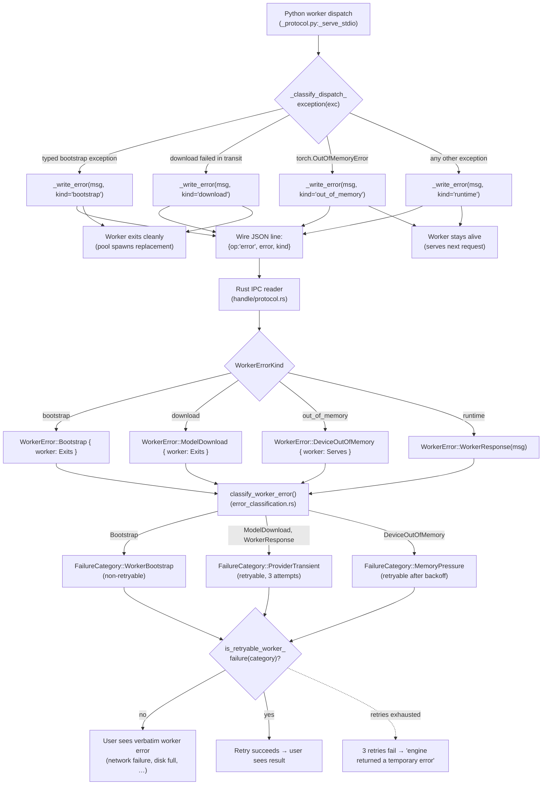
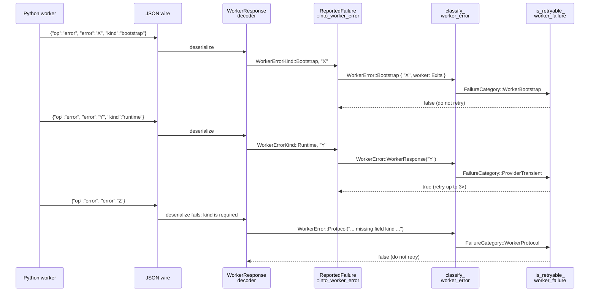

# Worker Failure Classification and Retry Architecture

**Status:** Current
**Last updated:** 2026-10-25 08:21 EDT

This chapter is the canonical contributor reference for how a Python
worker exception becomes, or does not become, an end-user error. It
covers the wire protocol, the typed error taxonomy on both sides of the
Rust/Python seam, the classifier that decides retry behavior, and the
user-facing message router. Add a new bootstrap-class error? Adding a
worker exception type? Adjusting retry policy? Start here.

The architecture documented in this chapter was rewritten on 2026-05-06
in response to two coupled defects:

1. **The on-demand model-download contract.** A fresh-install worker must
   automatically download missing models without any manual seeding. The
   user-visible failure for a missing-model condition must be an
   actionable network/disk/auth error, never an opaque "capability table
   is unavailable". See `book/src/batchalign/user-guide/model-downloads.md`.
2. **Bootstrap-class retry classification.** A worker that fails
   deterministically during bootstrap (missing model, catalog download
   failure, package import error) must NOT be retried by the
   orchestrator. Pre-fix, retries amplified one Stanza-catalog miss
   into hundreds of GB of `server.log` spam over a single day on a
   fleet host.

Both fixes are different facets of the same architectural shape, what
the worker can fail at, how it conveys that failure across the IPC seam,
and what the orchestrator does with it.

## The full pipeline at a glance



The key invariants the diagram encodes:

- **Bootstrap-class exceptions take a separate path on both sides of the
  seam.** Python emits with `kind=bootstrap`; Rust decodes into
  `WorkerError::Bootstrap`; classifier returns
  `FailureCategory::WorkerBootstrap`, whose `retryability()` is `Final`,
  so the retry policy stops.
- **The runtime path preserves all pre-2026-05-06 retry semantics.** Any
  exception that isn't a typed bootstrap error stays in the
  `WorkerResponse → ProviderTransient → retry up to 3×` loop.
- **Whether the worker goes on serving is decided once, by the kind.**
  `WorkerErrorKind::worker_after` says a `bootstrap` or `download` report
  ends the worker's service (a model may be half loaded; a stdio worker
  exits, a TCP daemon closes the connection) and every other kind does
  not. The Python loops ask it through `batchalign_core.error_kind_ends_worker`
  before deciding to stop, and the Rust readers record it on the error
  (`WorkerAfterError`), so `WorkerError::worker_after_failure` retires a
  worker that stopped serving instead of handing the retry to a dead
  handle.
- **The user-facing wording is verbatim for bootstrap errors.** The
  worker's typed error message (e.g., "Failed to download Stanza
  catalog: connection refused") reaches the user with light framing,
  not a generic "internal error" wrapper. Bootstrap errors are
  user-actionable.

## Shared stdio worker generations

A successful spawn does not prove permanent liveness. The shared GPU pool
previously stored each key's first worker in a `OnceCell`; after that process
died, every later request received the same dead handle. In the September 6
MICASE run, one FA worker failure was followed by failures for the rest of that
file and all 743 groups of another file.

`GpuWorkerSlot` now retains one stable slot across replaceable worker
generations. Its occupancy is Empty, Transitioning or Worker; status reporting
distinguishes a retained but unavailable worker from one accepting requests.
`SharedGpuWorker::check_available` supplies the same live observation to the
slot and the dispatch boundary. External process death remains a fallible
runtime event, not a permanent guarantee attached to a successful constructor.

Warm handoffs only inspect occupancy. A separate per-key transition permit
serializes retirement and replacement, without holding the map lock or blocking
unrelated warm keys. `SlotTransition` owns that permit: publishing the new worker
consumes the transition, while failure or cancellation restores Empty before
unlocking. The old process is retired through its lifecycle owner before the
replacement is initialized. The slot is never evicted while another caller
may still hold it. Pool shutdown retains responsibility for occupied slots;
an in-flight initializer observes pool cancellation and retires its result.

The integration regression kills an actual owned echo worker, then requires
four concurrent follow-up dispatches to share one new PID and checks both
processes are reaped. Run the existing worker boundary target:

```bash
cargo test -p batchalign --test gpu_concurrent_dispatch
```

This changes which process serves later requests; it does not retry the
crashing input automatically, classify every process exit as OOM, or establish
the validity of an overlong FA audio window. Those are separate decisions.

## The wire protocol

### Request envelope (Rust → Python)

Defined by `WorkerRequest` in
`crates/batchalign/src/worker/handle/protocol.rs`. Tagged-union JSON over
stdio (or TCP for shared-GPU daemons):

```jsonc
{"op": "infer", "request": {...}}
{"op": "batch_infer", "request": {...}}
{"op": "execute_v2", "request": {...}}
{"op": "ensure_task", "request": {"task": "morphosyntax", "engine_overrides": null}}
{"op": "health"}
{"op": "capabilities"}
{"op": "shutdown"}
```

### Response envelope (Python → Rust)

Defined by `WorkerResponse` in the same file. Same tagged-union shape:

```jsonc
{"op": "infer", "response": {...}}
{"op": "batch_infer", "response": {...}}
{"op": "execute_v2", "response": {...}}
{"op": "progress_v2", "event": {...}}     // intermediate, before final response
{"op": "ensure_task", "response": {...}}
{"op": "health", "response": {...}}
{"op": "capabilities", "response": {...}}
{"op": "shutdown"}
{"op": "error", "error": "<message>",
 "kind": "runtime" | "bootstrap" | "download" | "out_of_memory" | "invalid_request",
 "request_id": "<id>"}   // request_id present when the failure answers a V2 dispatch
```

The `error` op is the focus of this chapter. `kind` is required: every
reader (the sequential stdio and TCP handles and the shared GPU reader)
refuses an envelope without it as a protocol violation, so no emitter can
make a deterministic refusal look retryable by leaving it out. The wire
vocabulary is `batchalign_types::worker_v2::WorkerErrorKind`, and every
envelope is built by one function, `error_payload` in
`crates/batchalign-pyo3/src/worker_protocol.rs`: the Rust-owned request
dispatcher calls it for its own refusals (`invalid_request`), and the Python
request loops reach it through `batchalign_core.error_envelope`, which raises
`ValueError` on any other spelling. Python types the argument as the
`WorkerErrorKind` `Literal` in `batchalign/worker/_protocol.py`.

A stdio worker that cannot load its models at startup writes one such line
(uncorrelated) in place of its ready line and exits. The Rust ready reader
(`read_ready_line`) turns it into the startup error
(`ReportedFailure::into_startup_error`), so a download that failed while a
worker started is retried like one that failed in `ensure_task`, where an
unexplained exit before the ready line could only be a system failure. A
TCP daemon has no reader on its stdout and still exits with its traceback.

#### Why `kind` and not a separate `bootstrap_error` op?

Two reasons:

1. **One decode path, not two.** Adding a sibling op (`{"op":
   "bootstrap_error", ...}`) would double the number of match arms at
   every consumer of `WorkerResponse`, plus add a serializer surface. A
   discriminator field is cheaper.
2. **One builder.** A discriminator is one more argument to the one
   envelope builder; a sibling op would be a second builder whose shape
   could drift from the first.

## The Python side: `_serve_stdio` and exception handling

Source: `batchalign/worker/_protocol.py`.

### Pre-2026-05-06 behavior (the bug)

```python
def _serve_stdio() -> None:
    for raw_line in sys.stdin:
        # ... json decode ...
        dispatch = dispatch_protocol_message(message)  # raises propagate up
        _write_json(dispatch.payload)
```

An uncaught exception from `dispatch_protocol_message` propagated through
the loop, the worker's main module, and Python's interpreter shutdown
machinery, ultimately killing the process with exit code 1 and dumping
the traceback to stderr.

The Rust orchestrator saw `WorkerError::ProcessExited` →
`FailureCategory::WorkerCrash` → retryable, and retried up to 3× with
the same configuration. For deterministic bootstrap failures, every
retry crashed identically, generating ~3 KB of traceback per attempt.
On a fleet host this loop ran for ~24 hours and produced hundreds of
GB of log spam before the daemon was restarted.

### Post-2026-05-06 behavior

```python
def _serve_stdio() -> None:
    for raw_line in sys.stdin:
        # ... json decode ...
        try:
            dispatch = dispatch_protocol_message(message)
        except BaseException as exc:
            kind = _classify_dispatch_exception(exc)
            # Log the full traceback once for diagnostics …
            _write_error(str(exc) or exc.__class__.__name__, kind=kind)
            if _ends_worker(kind):
                break        # bootstrap, download: the pool spawns a replacement.
            continue          # Worker stays alive for the next request.
        _write_json(dispatch.payload)
```

The catch is intentionally broad (`BaseException`, not `Exception`), we
want every exception to produce a structured error rather than a process
exit, including ones like `KeyboardInterrupt` that would otherwise leak
through. The price of `BaseException` is one rule for contributors:
**never raise `SystemExit` from inside a dispatch handler** (use the
shutdown op instead). The catch will swallow it.

`_classify_dispatch_exception` decides the wire kind by the exception's
class:

- `download`: a model or catalog download that failed in transit. The
  question belongs to `batchalign/inference/_transient_failures.py`
  (`is_model_download_failure`), which the Rust worker boundary's
  `classify_runner_error` asks too, so a download raised while a worker
  loads and the same download raised inside a request are classified alike.
  It recognises the classes the locked dependencies actually raise:
  `StanzaCatalogDownloadError`; `httpx2`'s network, timeout and
  remote-protocol errors (Hugging Face Hub downloads through `httpx2`);
  `requests`' connection, timeout and broken-transfer errors (Stanza's other
  fetches); a Hub HTTP error whose status says the Hub is briefly unable to
  serve (408, 429, 5xx); and a Hub `LocalEntryNotFoundError` raised *from*
  one of those, which is what `hf_hub_download` raises when it cannot reach
  the Hub. A `LocalEntryNotFoundError` with no such cause (offline mode) and
  a 401 or 403 stay `ModelAccessDeniedError`. The configuration is sound
  and a later attempt may get through, so Rust retries it
  (`WorkerError::ModelDownload`, `ProviderTransient`) and it does not
  withhold a fallback.
- `out_of_memory`: `torch.OutOfMemoryError` (`is_device_out_of_memory`,
  same module), retried after a backoff (`MemoryPressure`). torch 2.14
  raises a plain `RuntimeError` for an Apple MPS shortfall, which no class
  distinguishes, so that stays `runtime`.
- `bootstrap`: the typed deterministic load failures
  (`UnsupportedLanguageError`), which recur identically.
- `runtime`: everything else.

The transient-failure module reads library classes from `sys.modules` and
imports nothing: an exception can only be an instance of a class whose
module is loaded, so the classifier never imports a model library.

### Why does the worker exit on bootstrap and download errors?

A worker that hit a bootstrap failure is in a partially-initialized
state, model loaders may have allocated GPU memory, opened file
handles, or established network connections that the surviving
`_state` does not track. Continuing to serve requests after a bootstrap
failure invites silent data corruption (e.g., a request that needed
language `eng` running against a worker whose `eng` Pipeline never
finished loading).

The exit is safe because the readers know of it: the error carries
`WorkerAfterError::Exits`, so the handle is retired and the next request
goes to a fresh worker. A bootstrap error is **non-retryable**, so the
failing request is not run again and the user gets the typed error
verbatim, no retry storm, no log explosion. A download is retried, on that
fresh worker.

For runtime errors, by contrast, the worker stays alive. A transient
inference failure on one input is no reason to throw away a fully-loaded
worker (and the gigabytes of GPU memory it holds).

### Transport coverage: stdio AND TCP

The same exception-shielding contract applies to all four worker request
loops in `_protocol.py`:

| Function | Transport | Mode |
|---|---|---|
| `_serve_stdio` | stdio | sequential |
| `_serve_stdio_concurrent` | stdio | concurrent (thread pool) |
| `_handle_tcp_connection_sequential` | TCP | sequential |
| `_handle_tcp_connection_concurrent` | TCP | concurrent (thread pool) |

Stanza/IO-profile workers use the TCP variants (one daemon, multiple
servers connecting). They are exactly the profiles that load Stanza
catalogs, the incident shape this whole architecture is designed to
prevent originally manifested on these workers. Sequential loops wrap
`dispatch_protocol_message`; concurrent handlers wrap
`dispatch_prepared_protocol_message`. Both catch `BaseException`, classify via
`_classify_dispatch_exception`, and emit the structured error envelope.
TCP handlers also tear the connection down after a kind that ends the
worker's service, after emitting that typed error.

## The Rust side: `WorkerError`, `FailureCategory`, classifier

Source files:

| Concern | File |
|---|---|
| `WorkerError` enum | `crates/batchalign/src/worker/error.rs` |
| Wire `WorkerResponse` decoder and `ReportedFailure` mapping (stdio and TCP) | `crates/batchalign/src/worker/handle/protocol.rs` |
| Wire `WorkerErrorKind` | `crates/batchalign-types/src/worker_v2/error_envelope.rs` |
| The one `op=error` envelope builder | `crates/batchalign-pyo3/src/worker_protocol.rs::error_payload` |
| `FailureCategory` enum | `crates/batchalign/src/types/scheduling.rs` |
| Classifier (`classify_worker_error`) | `crates/batchalign/src/runner/util/error_classification.rs` |
| Retry decision (`FailureCategory::retryability`, `RetryPolicy::after_failure`) | `crates/batchalign/src/types/scheduling.rs` |
| Retry loop | `crates/batchalign/src/infer_retry.rs` |
| User-facing message router | `crates/batchalign/src/runner/util/error_classification.rs::user_facing_error` |

### `WorkerError` taxonomy

Each variant has a documented retryability class.

| Variant | Fires when | Retryable? |
|---|---|---|
| `SpawnFailed(String)` | The Python child process can't start (missing python, OS resource limits) | **Terminal**: same config will fail again |
| `ReadyTimeout { timeout_s }` | Worker started but didn't emit ready signal in time | Retryable, transient stall |
| `ReadyParseFailed(String)` | Worker emitted invalid ready signal | **Terminal**: version mismatch |
| `HealthCheckFailed(String)` | Periodic health probe failed | Retryable, pool replaces worker |
| `ProcessExited { code, stderr }` | Worker died unexpectedly mid-job | Retryable, but if deterministic, replacement will die too |
| `Timeout { waited_for, limit }` | A wait on the worker ran past its limit: a reply (`WorkerWait` names which op), a model load or a TCP connection | Retryable (`WorkerTimeout`). A sequential worker is retired (its late reply could still arrive), and so is a spawned shared GPU worker (the thread serving the request may still hold one of its slots); a shared GPU daemon connection is kept (replies are routed by request id, and the daemon is not this server's to restart) |
| `Protocol(String)` | IPC framing or response shape was wrong (on either worker path: a sequential reply that fails to decode, or a shared GPU `execute_v2` line the protocol refuses) | Terminal-for-this-request, protocol desync |
| `WorkerResponse(String)` | Worker returned `{"op":"error", "kind":"runtime"}` | Retryable, per-request failure |
| **`Bootstrap { message, worker }`** | Worker returned `{"op":"error", "kind":"bootstrap"}` (worker `Exits`), or an execute response coded `model_unavailable` or `unsupported_language` (worker `Serves`) | **Terminal**: deterministic |
| `ModelDownload { message, worker }` | Worker returned `{"op":"error", "kind":"download"}` (worker `Exits`), or an execute response coded `model_download_failed` (worker `Serves`): a download failed in transit | Retryable (`ProviderTransient`); does not withhold a UTR fallback |
| `DeviceOutOfMemory { message, worker }` | Worker returned `{"op":"error", "kind":"out_of_memory"}` or an execute response coded `device_out_of_memory` (`torch.OutOfMemoryError`) | Retryable after a backoff (`MemoryPressure`) |
| `ModelRuntime(String)` | A local model's generic `RuntimeFailure` (see below) | Bounded retries (`LocalRuntime`); the code alone does not identify the cause |
| `RequestRefused(String)` | Worker returned `{"op":"error", "kind":"invalid_request"}`: the line was not JSON, the op or its `request` mapping was missing, or the payload failed the request model | **Terminal** (`WorkerProtocol`): the same request is refused again; the worker stays in service |
| `Io(io::Error)` | Pipe-level I/O failure (broken pipe, etc.) | Retryable, pool replaces worker |
| `MemoryGuard(MemoryGuardError)` | Memory-guard refused to admit the worker (insufficient headroom under the configured budget) | Retryable after a backoff (`MemoryPressure`): memory frees as other work ends |
| `NoWorker { command, lang }` | Reserved variant; unused today | Terminal |
| `PoolShuttingDown` | The pool is shutting down; dispatch, task loading and a shared worker's in-flight requests are refused | **Terminal** (`System`): nothing will serve the request; the job is recovered at the next start |
| `WorkerRetired` | The pool retired the shared worker a request was in flight on (its capability report was refused, or it is being replaced) and keeps serving | Retryable (`WorkerCrash`): the retry reaches another worker |
| `OutputNoise { last_line }` | The worker wrote `MAX_RESPONSE_STDOUT_NOISE_LINES` consecutive lines that are not protocol messages (a stdio worker writes its protocol on a private descriptor, so something wrote into it anyway) | Retryable (`WorkerCrash`): the worker is retired and the request runs on another |

The `Bootstrap` variant is the one this chapter is about.

### `FailureCategory` and the retry decision

`FailureCategory` is the broader classification that the retry loop, the
user-facing message router, and the persistence layer all consume. Its
current variants are defined in `types/scheduling.rs`:

```text
Validation, ParseError, InputMissing, EvidenceUnavailable, AnalysisUnavailable, WorkerCrash, WorkerTimeout,
WorkerProtocol, WorkerBootstrap, LocalRuntime, ProviderTransient, ProviderTerminal,
ProviderQuotaExhausted, ProviderAccountRefused, MemoryPressure, Cancelled, System,
ModelAccessDenied
```

A failure moves through three stages, each a transition from the last: the
`WorkerError` (which already says whether the worker stopped serving,
`WorkerAfterError`) is classified into a `FailureCategory`
(`classify_worker_error`); the category's `retryability()`, an exhaustive
match with no catch-all, says `Retryable` (`WorkerCrash`, `WorkerTimeout`,
`ProviderTransient`, `LocalRuntime`, `MemoryPressure`) or `Final`; and
`RetryPolicy::after_failure(attempt, category)` turns that and the budget into
a `NextAttempt`: `RetryAfter(backoff)` or `Stop(Final | BudgetSpent)`. Every
retry loop acts on the `NextAttempt`; none combines a retryable flag with a
budget test of its own. Separately, `WorkerError::worker_after_failure` turns
the same error into the worker's lifecycle action (`Reusable` or `Retire`).

`WorkerBootstrap` is intentionally absent. That's the load-bearing
property: a bootstrap-class failure cannot reach the retry loop's
`continue` branch, so a deterministic failure stops at the first
attempt instead of echoing through three.

`ProviderQuotaExhausted` is outside it too: the provider account's quota or
resource pack is used up (`ServerError::ProviderQuotaExhausted`, from the
worker protocol code of the same name), so no retry succeeds until an account
holder restores it. `ProviderAccountRefused` is outside it for the same
reason: the provider refuses the account itself (Rev.AI's 401, 402 or 403
on a submission: the key, the account's permission, its credit). The same
status on a job's status or transcript request is a terminal failure of that
request, since it may refuse only that resource (`RevAiEndpoint` says which
request a status answers). A 429 (rate limited) is `ProviderTransient` on
every request. The mapping reads the status and the request only, never the
body; no recorded Rev.AI response body backs it yet.

### Which failures withhold the same-engine UTR fallback

A first UTR pass that fails or leaves words unmatched grants one fallback
pass on the SAME engine over a different request (narrower windows). The
fallback is worth running exactly when the failure belonged to the request,
so the policy is one exhaustive match over the failure's category
(`fallback_after` in `provenance/utr.rs`); a new category must choose its
row there:

| Category | Fallback | Why |
|----------|----------|-----|
| `provider_quota_exhausted` | withheld | No request succeeds until an account holder restores the quota. |
| `provider_account_refused` | withheld | The fallback is sent from the same refused account. |
| `model_access_denied` | withheld | The fallback asks this machine for the same refused model. |
| `worker_bootstrap` | withheld | The engine's worker cannot start (a model that will not load, a runtime or model identity mismatch), and the fallback goes to that same worker key. A download that failed in transit is not this category: it is `provider_transient`. |
| every other category | permitted | The failure was this request's: a terminal provider failure (a 4xx other than an account refusal, a failed job, an undecodable response), a local model failing on this input, a download that failed in transit, a crash, a timeout, memory pressure, a protocol fault. |

A withheld fallback is still recorded: the failed pass appears in the
file's `utr_unavailable` shortfalls and stamp exactly as a permitted one
does.

### A worker's protocol failure keeps its code's category

A V2 execute response that reports failure carries a `ProtocolErrorCodeV2`.
`ExecuteFailureRead::into_server_error` is the one exhaustive mapping from that
code to a server error, used by the ASR, speaker and forced-alignment adapters,
and never reads the message. A `RuntimeFailure` is decided by where the
request's model runs (`ModelLocality`, from the backend the request named by
an exhaustive match): a local model (Whisper, Qwen, FunASR, pyannote, NeMo,
every forced-alignment engine) retains `LocalRuntime`; a remote provider
(Tencent, Aliyun, Rev.AI, pyannoteAI) retains `ProviderTransient`. Both may
retry within the configured budget. Neither generic code establishes OOM or
a deterministic input defect. Typed permanent refusals remain terminal.

| Code | Server error | Category |
|------|--------------|----------|
| `UnsupportedProtocol`, `InvalidPayload`, `MissingAttachment`, `AttachmentUnreadable` | `Worker(RequestRefused)` | `WorkerProtocol` |
| `ModelUnavailable`, `UnsupportedLanguage` | `Worker(Bootstrap)` (worker `Serves`) | `WorkerBootstrap` |
| `ModelDownloadFailed` | `Worker(ModelDownload)` (worker `Serves`) | `ProviderTransient` (retried, wherever the model runs) |
| `DeviceOutOfMemory` | `Worker(DeviceOutOfMemory)` (worker `Serves`) | `MemoryPressure` (retried after a backoff) |
| `RuntimeFailure`, from a remote provider | `Worker(WorkerResponse)` | `ProviderTransient` (retried) |
| `RuntimeFailure`, from a local model | `Worker(ModelRuntime)` | `LocalRuntime` (bounded retries) |
| `ProviderQuotaExhausted` | `ProviderQuotaExhausted` | `ProviderQuotaExhausted` |
| `ModelAccessDenied` | `ModelAccessDenied` | `ModelAccessDenied` |

None of them is `Validation`, which the dashboard shows as "Input Refused".

Nor is a successful response the server cannot use. An ASR response whose
payload cannot be lowered into the ASR domain, and an FA response that does
not fit its request (another task's result, another word count, another
engine's shape), are the worker breaking the protocol: `Worker(Protocol)`,
`WorkerProtocol`. An ASR response that names models other than the ones the
plan pinned is `ServerError::AsrModelIdentity`, classified `WorkerBootstrap`
with the runtime-code identity mismatch it resembles: it recurs for every
request that worker serves, so it is not retried.

`AnalysisUnavailable` is likewise outside the retry set. It reports a valid
source requesting analysis the configured backend cannot supply, without
calling the CHAT invalid or substituting generic internal-error advice.
The morphology admission policy and its primary-versus-secondary distinction
are documented in [the morphosyntax reference](../reference/morphosyntax.md#language-capability-admission).

### A retained provider response whose language was not admitted

A Rev.AI response that was retained but whose language could not be resolved is
carried as its own typed failure,
`ServerError::UnresolvedAsrLanguage(RetainedRevLanguageRejection)`, rather than
folded into a validation message. It answers **502**, because the provider's
evidence was unusable rather than the client's input malformed, and its body
carries `diagnostic_key` and `admission: "rejected_unresolved_language"`
alongside the message, so a caller can act on the rejection instead of parsing
prose. `classify_server_error` puts it in `ProviderTerminal`, which the
matcher above excludes: the retry would retain the same response and need the
same explicit language decision, so it is not attempted automatically.

### How `kind` flows from wire to category



`ReportedFailure` in `handle/protocol.rs` is the decoded `op=error` line
(`WorkerResponse::Error(ReportedFailure)`), and its four methods are the only
mapping from a reported failure to a `WorkerError`: `into_worker_error` for an
admitted request, `into_ensure_task_error` for the model load,
`into_startup_error` for a line written in place of the ready line, and
`into_health_error` for a health probe. The sequential stdio and TCP handles
share the one `WorkerResponse` envelope, and the shared GPU reader
(`worker/pool/shared_gpu/reader.rs`) decodes the same `ReportedFailure`, so a
shared GPU dispatch reaches the same category, and the same retry decision, as
a sequential one; the table is in the worker-protocol-v2 page under "Failure
replies on the two worker paths".

### One specialization: `ensure_task` errors are forced bootstrap

`into_ensure_task_error` reads a `runtime` kind as `Bootstrap`: `ensure_task`
is the on-demand model-loading IPC, so a failure during it is deterministic
across retries even if the worker's `_classify_dispatch_exception` does not
know the specific error type. The orchestrator does not retry it; if the
cause was transient, the user can re-submit the job. The two kinds a later
attempt can get past keep their meaning: `download` is `ModelDownload` and
`out_of_memory` is `DeviceOutOfMemory`. Each carries the kind's
`worker_after`, so the `runtime` case (the worker went on serving) returns
the handle to its pool and the `download` case retires it.

## The user-facing message

Source: `crates/batchalign/src/runner/util/error_classification.rs::user_facing_error`.

The router maps `FailureCategory` to a final string the user sees in the
dashboard, CLI, TUI, and desktop app. Two design constraints shape it:

1. **No system internals.** Strings like "Broken pipe (os error 32)",
   "exit code: Some(1)", and Python tracebacks must never reach the
   user. They get logged via `tracing` for developer debugging.
2. **Bootstrap errors are exempt from the "internal error" framing.**
   The worker has already produced an actionable, user-facing message
   (network failure, disk full, missing auth). The router surfaces it
   verbatim with light wrapping.

The `WorkerBootstrap` arm:

```rust,ignore
FailureCategory::WorkerBootstrap => {
    let detail = truncate_tail(raw_error, 1000);
    format!("{command_label} failed for {filename}: {detail}")
}
```

Compare with the `WorkerCrash` arm:

```rust,ignore
FailureCategory::WorkerCrash => {
    let detail = truncate_tail(raw_error, 500);
    format!(
        "{command_label} failed for {filename}: the processing engine crashed.\n{detail}"
    )
}
```

Bootstrap errors are *not* "the processing engine crashed", they are
*"X is missing or unreachable, here's what to do"*. The verbatim
inclusion is what makes the difference.

`EvidenceUnavailable` is likewise terminal and actionable, but it does not
mean a worker failed. It means a cache-required request reached a typed
evidence boundary without a reusable entry. `MissingRequiredEvidence` is a
closed sum type: forced alignment retains a nonempty group-index set, while
Rev.AI and speaker diarization retain the exact content-derived `CacheKey`.
All map to HTTP 412, and the user-facing message states that
`--require-media-cache` prevented inference. A missing kind cannot be confused
with another, and an empty forced-alignment miss is unrepresentable, so the
public category cannot be emitted for the successful "nothing to infer"
state.

## The retry loop

Source: `crates/batchalign/src/infer_retry.rs`.

```rust,ignore
for attempt_number in 1..=retry_policy.max_attempts {
    match pool.dispatch_execute_v2_with_progress(lang, request, progress_tx).await {
        Ok(response) => return Ok(response),
        Err(error) => {
            let category = classify_worker_error(&error);
            if let NextAttempt::RetryAfter(backoff_ms) =
                retry_policy.after_failure(attempt_number, category)
            {
                warn!(
                    task = ?request.task,
                    lang = %lang,
                    attempt_number,
                    max_attempts = retry_policy.max_attempts,
                    error = %error,
                    category = %category,
                    %backoff_ms,
                    "Retrying execute_v2 after transient worker failure"
                );
                tokio::time::sleep(Duration::from_millis(backoff_ms.0)).await;
                continue;
            }

            return Err(ServerError::Worker(error));
        }
    }
}
```

Here `after_failure` answers `Stop(Final)` for `WorkerBootstrap`, and the
function returns the error immediately.

Future enhancement (not yet landed): emit a `progress_v2` event before
each retry sleep so the UI shows "Retrying after worker error
(attempt 2/3)…". This is a clean fit with the
[time-transparency principle](time-transparency.md).

## Adding a new bootstrap-class error type

Checklist for contributors:

1. **Define the typed error in Python.** Inherit from a sensible base
   (`RuntimeError` for general bootstrap failures,
   `ValueError`/`UnsupportedLanguageError` for input-driven ones).
   Document that it is bootstrap-class in the docstring, the type
   itself is the contract.

2. **Register it where it is classified.** A deterministic class goes in
   the request loop's
   `batchalign/worker/_protocol.py:_classify_dispatch_exception` (the wire
   kind of an exception raised while a worker starts or dispatches) and in
   the Rust worker boundary's `classify_runner_error`
   (`batchalign-pyo3/src/worker_execute.rs`, the protocol code of one raised
   by a runner during a request, which needs a `ProtocolErrorCodeV2` variant
   and its server category in `ExecuteFailureRead::into_server_error`).
   Define the class in a module that imports nothing heavy, as
   `batchalign/worker/_language_errors.py` does, so both can import it. A
   class a later attempt can get past (a download, a device shortfall)
   goes in `batchalign/inference/_transient_failures.py` instead, the one
   module both classifiers ask.

3. **Make sure the error message is actionable.** The user will see it
   verbatim. Include: what failed, where (URL, file path), why
   (network / disk / auth), and what they should do.

4. **Add a test.** Two patterns, both already in the codebase:
   - `batchalign/tests/test_serve_stdio_bootstrap_error.py`: assert
     the new exception type classifies as `bootstrap`.
   - A handler-level test that mocks the underlying failure and
     asserts the worker emits the right wire envelope.

5. **No new Rust variant is required** for an additional bootstrap-class
   type raised by an op: Python emits `kind: "bootstrap"`, and Rust's
   existing `WorkerError::Bootstrap` absorbs every such error uniformly. A
   class raised by a runner inside a request still needs its arm in
   `classify_runner_error` (step 2).

If the new error class needs different orchestrator behavior (e.g.,
"retry after a delay even though it's deterministic"), that's a deeper
change, discuss before implementing.

## Adding a new wire-level worker error variant

Less common but documented for completeness. If a new orthogonal error
shape needs its own Rust variant (e.g., "external provider returned
permission-denied" → distinct user-facing remediation):

1. Add the variant to `WorkerError` in `worker/error.rs` with a doc
   comment explaining when it fires and its retryability class.
2. Add a matching `FailureCategory` variant in `types/scheduling.rs`
   (and update the `Display`/`FromStr` impls).
3. Update `classify_worker_error` to map the new `WorkerError` variant
   to the new category.
4. Update `user_facing_error` to render an actionable message for the
   new category.
5. Decide the new category's arm in `FailureCategory::retryability`
   (exhaustive, so the compiler asks).
6. Update the test in `runner/util/mod.rs::worker_error_classification_is_stable`
   to lock in the classification.
7. Update this chapter's tables.

## Concurrent reader control and shutdown

Rust admission separates executable requests from immediate reader replies.
`PendingProtocolRequest` has no Python constructor, owns its operation, and
cannot name shutdown. Native execution accepts only that type. Changing the
original message or the copied envelope exposed for error correlation cannot
turn an admitted health request into shutdown. Immediate reply payloads and
actions come from one closed native outcome, so a shutdown action cannot be
paired with an error payload.

Both concurrent transports process immediate replies before submitting work to
the executor. After replying to shutdown, the reader exits its loop without
waiting for another input line or client EOF. Queued requests observe shutdown;
already running calls are still joined. This fixes the idle open-pipe hang,
not cancellation of an arbitrary in-flight model call.

The concurrent TCP handler also owns publishing shutdown and waking its socket
reader as one operation. Bootstrap errors and write failures can therefore
close the connection after their response without waiting for client EOF. The
former bootstrap test masked a blocked reader with a two-second read timeout;
it now requires the handler to terminate while the client write side is open.
Concurrent stdio uses native `ProtocolStdin`, which owns delivery and stopping
through one bounded mailbox. Bootstrap errors and response-write failures stop
that mailbox and wake Python immediately. EOF is a different state: it drains
already admitted requests rather than cancelling them. The former independent
Python event and blocked `sys.stdin` iterator are gone.

One process-owned Rust thread reads UTF-8 protocol lines from OS stdin. It holds
no Python objects or GIL and retains at most one queued line plus the line being
read. A private process-wide lease prevents competing native readers. Stopping
wakes mailbox waits but cannot portably cancel the OS read; the worker therefore
does not join this native thread before process exit. The thread retains its
lease until its read ends or the process terminates. This is a worker-process
transport, not a reusable reader for arbitrary embedded Python streams. No
polling interval, Python buffered-reader thread, or new dependency is involved.
Already running model calls remain joined by the executor.

Reproduce with the actual child process, loopback socket and native admission:

```bash
uv run --no-sync pytest -q batchalign/tests/test_serve_stdio_bootstrap_error.py \
  batchalign/tests/test_serve_tcp_bootstrap_error.py \
  batchalign/tests/test_worker_protocol_dispatch.py
```

The stdio regression received its shutdown acknowledgement but exceeded five
seconds while stdin remained open before the fix. The asynchronous bootstrap
case independently reproduced the same hang. Both now exit with the parent
pipe still open, and an EOF control requires all 32 queued health replies. The
TCP bootstrap regression
also failed before its reader wakeup was added. A malformed Unicode operation
now produces an error reply instead of escaping from admission as a reader
exception. Wire responses for supported operations retain their existing shape.

## Alignment window admission

Grouping owns the audio window sent to an aligner. Every production `FaGroup`
comes from that stage with a private, admitted `FaWindow`; live dispatch and raw
cache replay use that same value. They no longer receive a separately supplied
recording and reconstruct the window from timestamps. Unit tests of downstream
injection can declare fixtures through a test-only constructor, which is absent
from production builds.

The engine's time budget includes trailing gap padding. A pending group owns
its words, utterance indices and bounded window together; appending overlapping
utterances extends its coverage without shrinking the earlier extent. When a
new utterance cannot join, the pending group is finished before the new one
starts. Utterances with no alignable words cannot alter a pending audio window.

A single utterance with an empty, inverted or out-of-recording window receives a
durable FA `window_refused` decision, which carries the refused window's bounds
and a typed cause (evidence schema version 5). An oversized one is first offered
for partitioning at recovered word anchors. Schema 7 retains supported pieces
alongside explicit unrequested ranges; unusable anchors or a lack of any
supported piece still refuse the whole window. Schema 8 separates disjoint word
ownership from overlapping acoustic and lexical context. Within each supported
run, requests borrow the longest source-bounded context that fits the configured
budget. An anchored tail of an unavailable prefix can join the following
request, but is not isolated merely because its anchor has positive duration.
Requests never borrow across an unavailable range. Exact lexical correspondence
does not certify an acoustic cut or correct model alignment.

Cache keys and raw replies cover the full context; assembly admits the complete
reply before projecting only owned words. The request window stays attached to
each admitted timing through postprocessing. Derived terminal ends are bounded
by that window, with the original assumption and overshoot retained in the
origin chain. Later healing cannot extend them beyond it. Out-of-window measured
timings are refused, not silently clipped. Derived cache schema 2 excludes old
schema-1 onset-only projections; unchanged direct interval projections remain
compatible, and raw evidence is replayed through the current parser first.
Refusal means narrower timing
evidence is required; it does not mean the source speech is invalid or that the
corpus is complete.

The existing character-count grouping policy remains separate. A single
utterance exceeding the Whisper label budget can still reach its model error
path; this audio-window change does not claim tokenizer-budget admission.

Reproduce the window-policy checks with the repository fixture:

```bash
cargo test -p batchalign --lib group_window_budget
```

Before the fix, the oversized-utterance case produced no refusal, and padding
expanded a requested 10,000 ms window to 11,500 ms. The private group field also
made 19 old unit-test struct literals fail to compile, removing that raw
construction route from production callers.

## FA evidence after a group-local failure

An attempted worker call is not itself timing evidence. Both full-file and
incremental FA consume `FaWorkerUnitResult::into_projection()`, which issues
the timing projection and its source together, per request (a group, or one
piece of an anchored group). A successful admitted response records
`inference`; a deliberately skipped request records `unaligned` and
materializes one missing timing per word of that request. A successful response may also align
zero words, so missing timings alone cannot determine provenance.

This adds the `unaligned` evidence-source label to serialized FA artifacts.
Existing source labels remain readable. Older artifacts may label failed groups
as `inference`; the September 6 MICASE failed run preserves that historical
output alongside its worker logs rather than rewriting the evidence. Consumers
of older runs must consult those logs when distinguishing an attempted call
from an admitted response.

`ProcessExited` proves that the request lost its worker. Without a reported
exit cause it does not establish OOM, a signal, or deterministic failure of that
input. The warning now states process exit without inventing a diagnosis.
Worker replacement and safe FA window sizing are separate concerns; correct
provenance does not make an oversized alignment request safe.

The serialization regression runs inside the existing library test target:

```bash
cargo test -p batchalign --lib worker_outcomes_serialize_distinct_evidence_provenance
```

## Cross-references

- [Time transparency UX principle](time-transparency.md), why every
  long worker operation must surface to the UI; downstream consumer of
  the same `progress_v2` channel.
- [User-facing model-downloads chapter](../user-guide/model-downloads.md)
 , the user-facing contract that motivates the on-demand-download path.
- [Developer model-downloads chapter](../developer/model-downloads-and-caching.md)
 , full inventory of every model-load site.
- [Server architecture overview](server-architecture.md), the broader
  context this chapter slots into.
- [Server model loading](server-model-loading.md), per-command model
  inventory and lazy-load policy.
- [Stanza capability registry](stanza-capability-registry.md), the
  pre-flight gate whose silent-fail path was the proximate cause of the
  retry-classification bug this chapter documents.
