# FA preparation and adaptive admission

**Status:** Production paths integrated in development source; managed-model and release qualification remain open.
**Last modified:** {{git-dates:page}}

An aggregation target answers whether neighbouring utterances should share a
request. It cannot establish whether a model can align one utterance. In
particular, the legacy 15/20-second preferences are not intrinsic limits of
MMS, Cantonese MMS, Whisper or Qwen. `FaAggregationTarget` keeps that preference
separate from input constraints, allocation evidence and execution authority.
A localized utterance above the target stays one complete, unpadded candidate.
Its source words and window are retained unchanged.

UTR precedes this FA lifecycle when utterance timing is missing. Its lexical
search has separate preparation, storage and work policies: an FA memory lease
does not admit UTR search. See the
[consuming UTR preparation flow](backchannel-aware-alignment.md#consuming-preparation-and-representation-admission).
That ownership boundary is implemented in development source; adaptive UTR
host-memory admission remains unfinished, and its existing fixed search limits
can still prevent a file from reaching any FA request.

## Each completion owns the next dispatch

`PreparedFaRequests::bind` consumes cache-miss authorization and retained inputs
together. Identical input scopes receive one execution owner plus their output
aliases. `ReadyRequests` owns this actual dispatch population, language and
engine in one heap allocation reused across transitions. Advancing consumes
that owner and returns a `CompletedDispatch` containing both its outcome and
the private continuation. A failed request or cancelled future drops the pending
owner and its remaining artifacts.

Only `CompletedDispatch::retain` can release the continuation. It consumes the
canonical outcome into the result sink, followed by its shared timing aliases.
The canonical result alone owns raw-cache evidence and fallback events. Each
outcome carries its non-cloneable `ReplyTicket`, minted with its receiving slot
by `UnitLedger::open`. The sink writes eligible evidence, consumes the ticket
to complete that exact slot, and publishes completion before another request
starts. It cannot select a different ledger or complete a ticket twice. Whole-batch raw results
are no longer retained until the final model reply. Sink operations issue
compact `Send` futures borrowing the sink exclusively.

Opening the ledger derives progress from its actual reused and awaited
population. The sink holds a read-only progress view; completing a ticket is
the only later increment. Cache hits consume their tickets before inference;
no separately supplied completed/total counters can substitute for that owner.
Each successfully delivered outcome advances one slot. Shared input aliases
have distinct output slots but share one model execution. A completed alignment
counter therefore measures resolved dispatch units, including reuse/cache and
unaligned outcomes; it does not measure timed words or certify a written file.
Final CHAT installation still follows assembly, injection and validation.

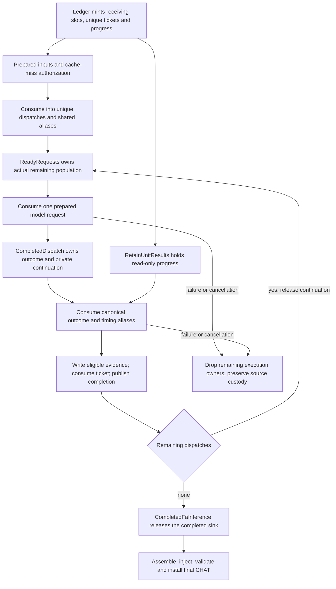

Optional supplied-window recovery uses `SingleFaAuthorization` and
`FaWorkerSingle`: exactly one permitted source and its prepared input move into
execution, which returns one outcome directly. The former batch allocation and
missing-last-result validation branch are removed. `RequireCache` cannot issue
that authorization. Existing raw-evidence, shared-context, cache-policy and
full/incremental controls remain meaningful; a consuming owner does not replace
their admission tests. Managed-model progress and final release qualification
remain separate evidence.

## Terminal recovery within original supplied windows

`MainBulletAuthority` captures input bullets before UTR or other working-model
changes. Only it can admit a `SuppliedRetrySource`: complete original words
paired with a positive, recording-contained supplied window. Neither an empty
bullet, an off-record utterance nor a recovered working bullet can issue this
capability. This source snapshot is separate from grouping's repaired/localized
windows.

`FaApplied::then_impose` consumes primary injection and fits kept words once.
`FaImposed` owns that proof across optional asynchronous recovery. The shared
full/incremental `SuppliedRetrySession` borrows the document exclusively;
the session issues one `PendingSuppliedRetry` for each source with missing
positive word timing. Only missing AST slots receive writing capabilities.
Retained neighbour bounds constrain new timings; accepted primary slots have
no overwrite operation. `PendingSuppliedRetry::start` consumes the pending owner,
transfers its preparation capability once, and returns `AwaitingSuppliedRetry`.
The consuming retry producer requires that awaiting owner; a source reference
alone cannot request another pass. Complete output cannot release preparation,
including with gap healing. Canonical compound-word projection is shared with
primary injection, including excluded tokens and replaced originals.

The preparation registry freezes primary execution owners separately from a
residual book restricted to potential supplied scopes. An unused exact prepared
input can move into recovery. A selected/executed exact scope becomes `Settled`;
an exact refusal remains a refusal. Neither can regain a preparation permit.
The residual book consumes admitted source owners and moves each source together
with its capability; it has no claim-by-key API. Only an unexamined admitted
source receives a fresh permit. Repeated claims and arbitrary scope admission
are no longer representable. Cache-ready preparations own the admitted answer,
removing the former lost-cache-receipt error branch. Unneeded context artifacts
are still dropped. Cache lookup precedes materialization, and each actual retry retains
its own text/window key. An optional `RequireCache` miss is terminal unresolved
output, with no inference capability and no rejection of accepted primary work.

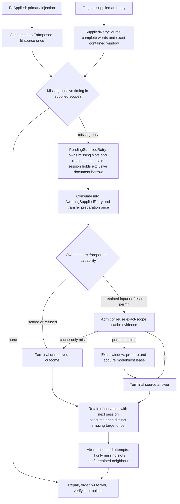

The terminal result has no transition back to a retry. Durable timing-provenance
decisions retain the supplied interval, exact request key when used, source,
refusal/failure and filled slots. Primary group snapshots remain primary
evidence. This change explicitly revises the earlier output-only contract of
`--main-bullets keep` and `exact`; primary grouping and raw cache key semantics
remain unchanged.

Type changes remove the second kept-word fitting pass that an independent
retry/finalization implementation would need, two impossible non-single-scope
checks, the claim-by-key API and its repeat-claim guard, and the lost-cache-receipt
error branch. Repeat-claim tests are obsolete because no such operation is
available. These owners add
no whole-AST clone, reparse, whole-file reinjection or per-utterance timing map.
Keep source-admission, cache-policy and foreign-result boundary tests: these
validate the capability edges rather than constructing illegal internal states.
Real-model recovery and release qualification remain separate from these
deterministic controls.

## Start-order repair owns its mutation targets

`orchestrate/start_order.rs` admits source-bound targets through the imposed
bullet policy. `StartOrderSource::Kept` contains immutable facts and has no
mutation capability. A revisable source alone owns a `StartOrderTarget` with an
exclusive borrow of its actual utterance. Shared `Arc` facts support lookahead
and diagnostics without cloning the mutation owner; line indices remain evidence
addresses, not permission to look up and mutate another document.

Classification consumes the target exactly once. It returns accepted facts,
a `StartRegression` bound to the preceding start, or a `StartYield` bound to
the conflicting next kept start. Accepted facts cannot enter classification
again. Regression and yield resolution consume their targets; their terminal
records cannot repeat mutation or reconstruct a pending target.

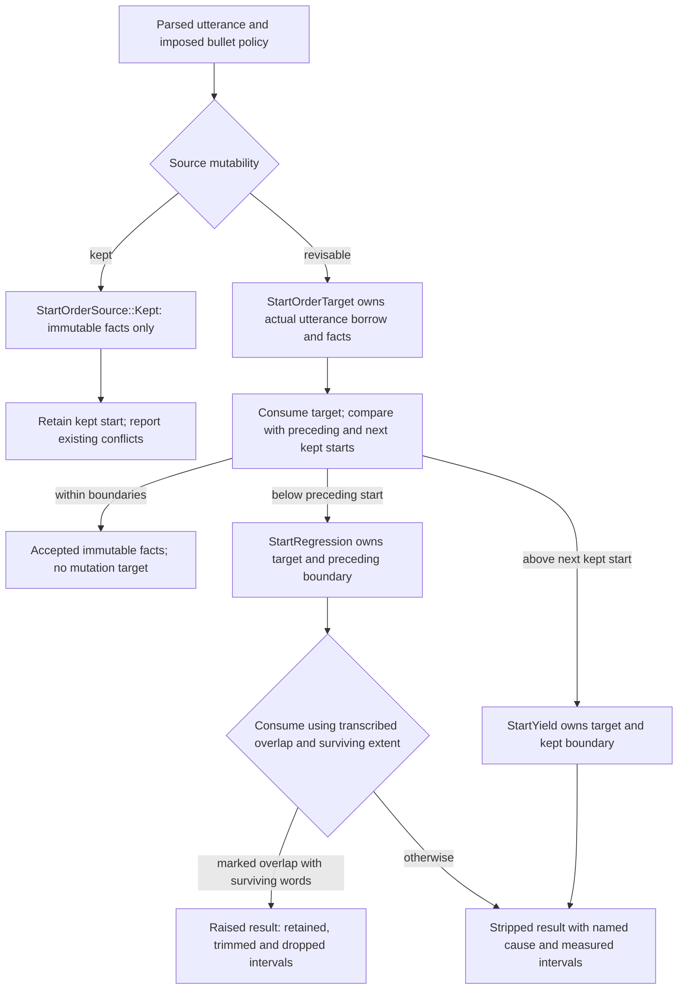

This removes two line-index downcasts, their empty-success fallback records and
the impossible `NoUtteranceLine` cause. The private module exposes only the
source-binding pass; callers cannot assemble its targets. Existing start-order,
kept-bullet, overlap and completion controls exercise the actual policy and
output boundary. The policy is unchanged: stronger ownership alone does not
establish better acoustic timing or justify accepting a rejected interval.

## Loaded facts are retained, request facts are prepared

`load_wave2vec_fa` admits the bundle dictionary once as `MmsAlphabet` and
places it in the frozen `Wave2VecFAHandle`. The alphabet owns an immutable
snapshot; changing the producer dictionary cannot change later target labels.
`MmsTargetSequence.from_words` requires this admitted capability rather than a
raw dictionary. Preparation and native execution therefore share the loaded
alphabet without repeatedly copying or validating the vocabulary.

The matching preparer retains `_LoadedMmsMetadata`: encoder geometry, device,
unique persistent-storage size and the qualified native CTC layout. A failed
load-bound qualification becomes `UnavailableFaPreparation`, retaining its
reason instead of repeating that qualification for every candidate. There is
no default device or invented storage estimate. This retains model facts, not
request authority: every new audio/text binding still needs its own input
constraints, virtual allocation projection and execution lease.

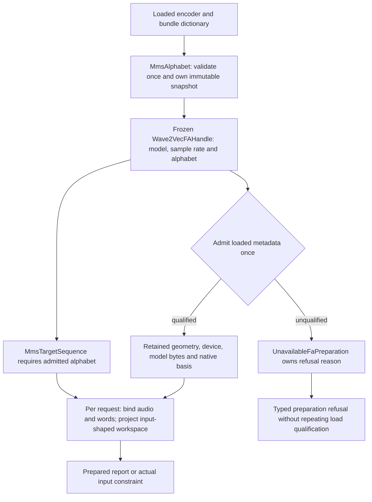

This removes per-request dictionary acquisition, dictionary copying and
vocabulary validation, native-revision qualification, parameter-device lookup
and persistent model-byte calculation. Foreign-vocabulary and target-shape
admission controls remain necessary. Virtual-model isolation and its live-storage
accounting still run per request; retaining fixed metadata does not prove a
native CPU workspace or total resident-memory envelope. Frozen handles retain
references to foreign model objects; they do not freeze the internals of an
upstream neural-network module.

Whisper and Qwen have their own factory-admitted loaded preparation owners.
Whisper retains feature/decoder geometry, selected alignment heads, a validated
prefix and terminal label, device/dtype, persistent model bytes and allocation
basis. Each new text is still tokenized and admitted against that retained
prefix and decoder capacity. A request cannot silently select a different
prefix by changing the producer after admission.

Qwen retains the qualified native model together with its geometry, three
validated time-axis convolution steps, full-chunk token count, persistent model
bytes, engine identity and allocation basis. `QwenPreparedInputs` carries that
single loaded owner instead of independently paired native/geometry fields.
Remainder-frame transformation reads the admitted convolution steps; it cannot
be passed another model. Per-request source segmentation, tokenization, native
processor count comparison, audio/text binding and virtual projection remain.
The direct-library admission route constructs the same loaded owner for its
invocation; managed workers retain it in their preparer factory.

Invalid fixed resource metadata produces a retained `UnavailableFaPreparation`.
A later request does not revalidate mutated producer fields to make that epoch
ready; a new admitted loaded epoch is required. Qwen's existing native/source
qualification still precedes this resource-metadata admission. This removes
per-request geometry/head/device/storage reads, repeated version-basis assembly
and the independently supplied model argument to convolution transformation.
These immutable facts are not shared mutable virtual models: the current
request projection still owns an isolated copy. Frozen references do not
freeze upstream model internals, and this change does not qualify their native
memory envelope.

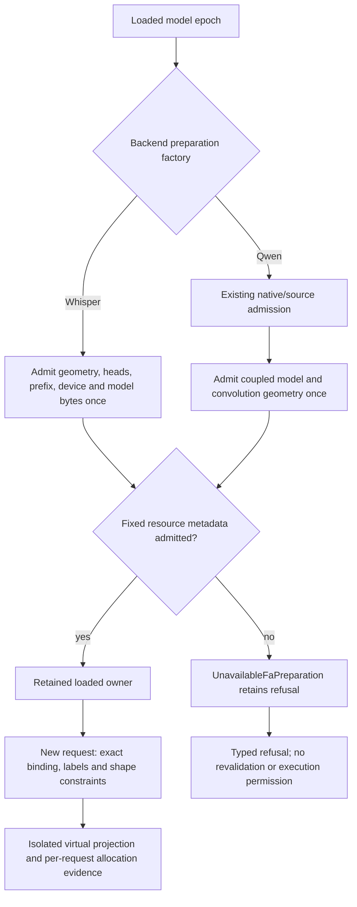

## Native CPU scratch belongs to the observed operation

FakeTensor records tensors returned by an operator; that does not expose every
allocation inside the native kernel. `NativeCpuConvolutionWorkspace` admits an
input-bound receipt for observed virtual `conv1d`, `conv2d` and `convolution`
operations. The loaded Torch source layout and actual operator schemas are
retained once. Schema defaults come from the loaded operator definition, not
from invented model metadata. Real tensor results cannot enter this projection.

The installed shape-based backend selector chooses a closed kernel case.
The audited slow MM path includes its materialized column buffer, required
contiguous copies and grouped-output lifetime. The pointwise alias case does
not allocate columns. Groups run sequentially: scratch is reused, while group
outputs survive until concatenation. The tracker combines the receipt with
its existing live-storage count instead of running the encoder again.

NNPACK uses its documented sizing-only API with no input, weight, bias or output
data pointers. An admitted source-layout capability is required by that query.
Loaded library/export discovery is retained once. The source-pinned native API
selects its actual algorithm and CPU geometry; subsampled batches reuse one
per-image workspace rather than multiplying it by the batch size. Missing
exports, an unknown CPU layout/backend or a native sizing refusal remain named
projection refusals. They cannot become an invented zero-workspace estimate.

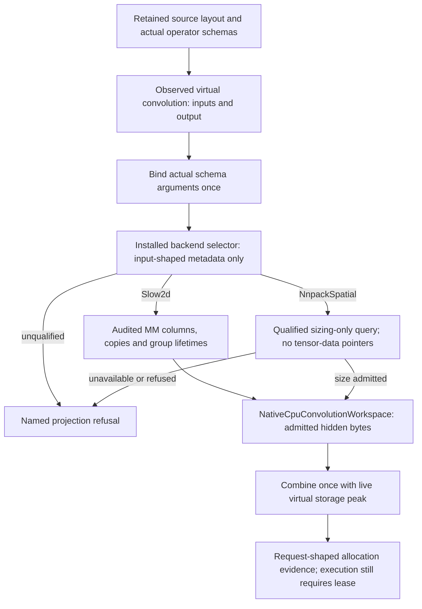

The allocation rules follow the qualified
[Torch convolution implementation](https://github.com/pytorch/pytorch/blob/d0f2af8b66b20da4baa50644c0cd3f887a2eae2e/aten/src/ATen/native/ConvolutionMM2d.cpp),
[NNPACK wrapper](https://github.com/pytorch/pytorch/blob/d0f2af8b66b20da4baa50644c0cd3f887a2eae2e/aten/src/ATen/native/NNPACK.cpp)
and [NNPACK sizing API](https://github.com/Maratyszcza/NNPACK/blob/c07e3a0400713d546e0dea2d5466dd22ea389c73/include/nnpack.h).
A synthetic two-convolution encoder distinguishes the former output-only
undercount from the internal scratch requirement; existing complete-MMS,
Whisper and long-Qwen metadata controls remain required.

This repairs a specific allocation omission, not the complete process-memory
contract. NNPACK's wrapper retains a thread-local workspace after a request;
its retention and shared-host lease lifetime need separate qualification.
Native GPU scratch, other CPU backends, allocator retention and total process
RSS are not certified by this receipt. Managed-model memory qualification is
still required before a release claim.

## Virtual model preparation admits an owned epoch

The shared projector lives in `fa_virtual_resources.py`; MMS, Whisper and Qwen
consume this owner instead of implementing model copying or virtual-mode setup.
`_PreparedVirtualModel.admit` constructs its epoch with numerical fallback
**disabled**. FakeTensor's default permits some unsupported operators to run a
real device kernel on zero tensors to discover output metadata. Such work is not
an admissible preparation estimate: missing metadata support must fail explicitly.
Real parameter metadata may enter FakeCopyMode for conversion; that distinct
conversion permission does not enable numerical fallback.

The factory checks that every copied module is disjoint from the serving tree
and that every parameter/buffer belongs to the same virtual epoch before changing
evaluation or gradient modes. Validation and the persistent-storage census share
one traversal of the copied modules. Copy hooks that reuse the serving root or
a stateless child are rejected before mutation.
`_VirtualAllocations` accepts this admitted owner rather than an independent
model/mode pair. Its observation scope owns the model, mode and ledger together;
final tensor outputs must belong to that epoch. The result remains a workspace
estimate, not a permit for acoustic execution.

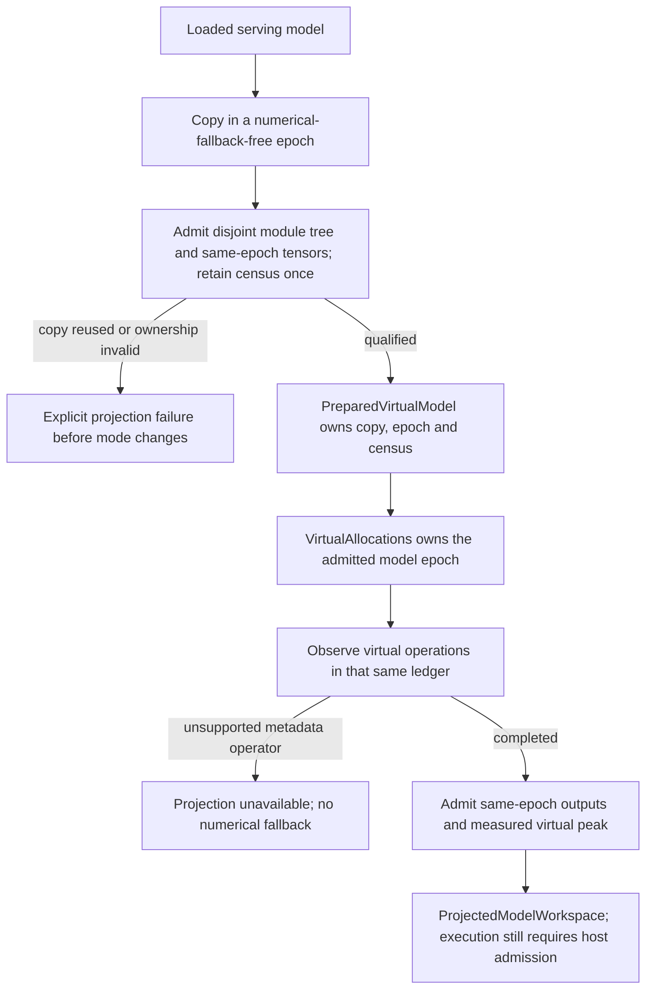

A foreign-boundary control uses an installed core operator with a CPU kernel
and no Meta kernel. It proves rejection before the numerical-fallback port;
a passing output-shape check would miss the forbidden real work. Existing
mode/parameter preservation controls cover copy hooks that return the serving
root or share a stateless serving child. These controls exercise foreign behavior through the production
preparation transition.

## Attention composites expose their internal virtual allocations

Selecting math attention alone is insufficient under FakeTensor: the dispatcher
can return opaque output metadata for `scaled_dot_product_attention` without
showing score matrices, softmax results or masks. Their absence from the returned
value does not mean that the native implementation allocates no storage.

`VirtualAttentionCall` binds the actual registered composite kernel to its
original arguments, immutable keyword mapping and the owning allocation ledger.
That ledger already owns its admitted virtual model epoch.
Its factory rejects real tensors, mixed epochs and unavailable foreign composite
capabilities before invocation. The three retained capabilities are the installed
attention wrapper, math-attention body and explicit safe-softmax composite.
The operator's own schema/defaults and implementation remain authoritative;
there is no separate attention-buffer formula to drift with the library.

The bound call has no independently supplied mode or tracker at invocation.
It re-enters its owning epoch and the **same allocation ledger**
while invoking that composite. Primitive virtual operations expose score,
softmax and mask lifetimes, and storage views remain charged once. A missing
composite yields the existing projection-unavailable refusal; it cannot fall
back to the opaque result that omitted its internal storage. The serving model
is not run again, and numerical kernels do not receive real samples or weights.

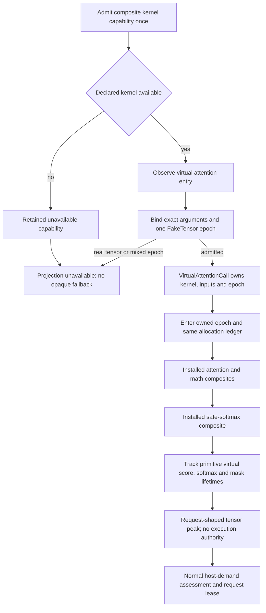

A small synthetic attention model distinguishes the former output-only count
from an independently derived lower bound: Q/K/V remain live while two native
score buffers and the safe-softmax mask coexist. The control also declares an
unavailable foreign composite and verifies explicit refusal, rather than opaque
fallback. Complete MMS, Whisper and Qwen metadata controls exercise the shared
projection path.

The inspected [Torch attention implementation](https://github.com/pytorch/pytorch/blob/d0f2af8b66b20da4baa50644c0cd3f887a2eae2e/aten/src/ATen/native/transformers/attention.cpp)
explains the missing lifetimes; projection invokes the installed composites
instead of copying that implementation. This fixes a demonstrated tensor
allocation omission. It does not certify native BLAS/GPU scratch, allocator
behavior, another backend's exact peak or total process RSS. Math remains a
conservative representation; a bound that exceeds capacity is not by itself
proof that every executable backend is physically impossible. Managed-model
memory qualification and admission/refinement review remain required.

## Compact ownership at asynchronous boundaries

The full and incremental FA producers return `FaExecution`: a pinned,
heap-owned future carrying the complete active input. Both consume
`ActiveFaInput` before issuing that handle. Callers can await or drop the owned
execution; they cannot clone it or choose another document/policy beside it.
The result remains `AdmittedFaResult` or the existing typed error. No new
execution capability or successful result can be manufactured by boxing.

Population preparation, the worker preparation boundary and UTR's ASR fetch
likewise issue boxed futures from their producers. Shared callers embed the
compact handle instead of repeating the full child state-machine layout.
The producer's borrow lifetime bounds the future; dropping it drops the same
candidate, artifact, cache-inference and resource owners as before. Cache
admission, request deduplication, source-slot ownership, progress and atomic
UTR installation keep their existing consuming transitions.

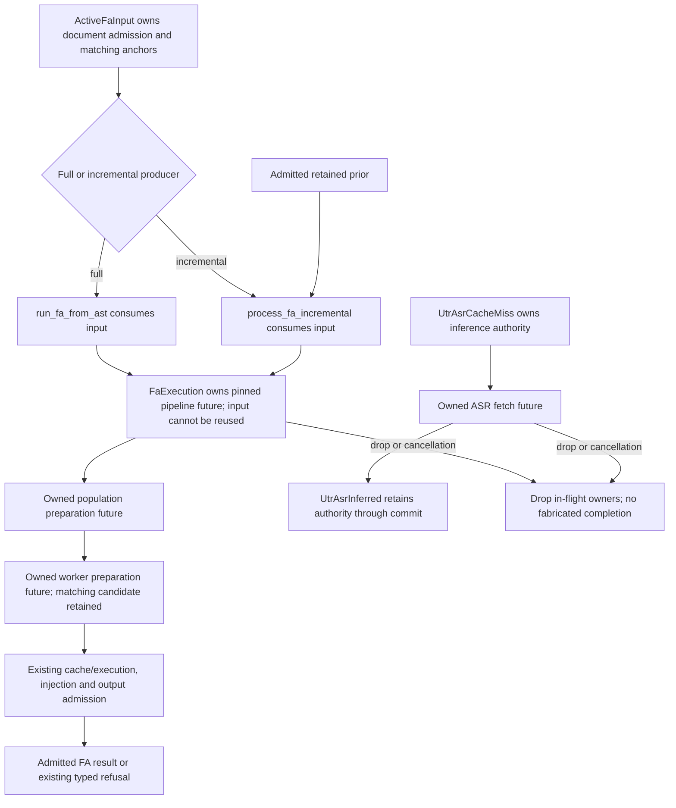

The legacy direct CLI producer also owns its execution future before returning
it; its command pathways and configuration are unchanged. Production model
qualification still uses the managed server. These boundaries remove two
unbounded public-in-crate alignment future types and the caller-specific
retry boxing workaround. Two tests that asserted the standard boxed handle's
size/suspension behavior were removed; the producer signatures already enforce
that ownership, and actual supervisor/cancellation tests remain. Test fixture
producers use the same compact-future boundary. They add no source clone, extra preparation or repeat
inference. No new tests of these impossible inline/clone states are needed;
the return types enforce the physical ownership boundary. Existing semantic,
cache-sharing, cancellation and output controls remain necessary.

Boxing does not prove a smaller total heap allocation or a model-memory
budget. It bounds what parents and supervisors embed and lets child execution
owners end at their actual phase boundary. Run size diagnostics and an
optimized binary build when these boundaries change; the compiler's ordinary
check and a field-count audit do not establish async layout safety.

## Implemented request lifecycle

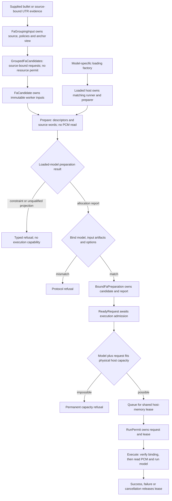

The wire phase is required: `Candidate`, `Prepare`, or `Execute`. The pool accepts
a candidate, performs preparation on the loaded worker, and consumes the bound
reply to make `ReadyRequest`. An arbitrary execute packet cannot construct that
proof. `Loaded::run` requires it and returns the lease-owning `RunPermit`.
Stdio, shared-GPU, TCP and replay use the same transition. A preparation refusal
retains the worker's typed response and measured duration; it never becomes a
successful request containing invented timing.

`prepare_fa_routed` is a separate metadata-only probe on the same transport.
It returns the bound report paired with a physical feasible/limited outcome,
or the original typed preparation refusal. It takes no request workspace lease
and runs no aligner. A test-echo host instead reports its explicit model-free
state. Physical planning and execution use the same `FaProjectedDemand`
calculation. Its refusal says what a smaller request could change
(`FaCapacityRefusal`): `ModelNeverFits` (the model and worker baseline alone
exceed the host) refuses the probe, and so the file, at once;
`RequestTooLarge` returns the limited outcome, which the planner cuts, and
whose smallest cut stays untimed with its numbers. The file fails for host
memory only when the host admitted none of it (`FilePlan::finish`); see
[memory safety](memory-safety.md). A contradictory task/payload packet is
forwarded unchanged for native rejection; preparation cannot silently turn it
into a valid FA request.

Preparation reads the prepared audio descriptor and immutable source-word
artifact. The native bridge binds the loaded engine, backend, request identity,
artifact identities, sample count/rate, text shaping and attention capture.
Execution checks the same binding before reading waveform samples. Preparation
is metadata work, not acoustic inference and not evidence that the requested
words occur in that window.

Python's frozen dataclasses alone do not seal construction: `init=False` still
allows an empty object. Admission proofs inherit `_FactoryAdmission`, whose
ordinary constructor is unavailable to typed callers and rejects at runtime.
The model-specific factories alone assemble the runner, preparer and engine
identity. Tests of the foreign boundary must declare their own doubles rather
than reopening those production constructors.

The source pipeline has a separate consuming boundary: `FaGroupingInput` owns
the prepared document, source obligation, anchor view and exact `FaParams` it
was prepared with. Grouping returns `GroupedFaCandidates`; the downstream
pipeline consumes that owner rather than taking another independently chosen
policy. Declared-capacity controls can therefore exercise partition caching,
assembly and output through that same downstream pipeline without treating a
legacy engine preference as a real model limit. The production resource planner uses that same consuming boundary; its managed-model
qualification remains separate from these deterministic controls.

Grouping also retains each localized utterance's own window and word ownership.
`LocalizedUtterance` is consumed at recording admission to produce
`RecordedUtterance`. `GroupPopulation` consumes that owner, derives its word
range, and translates the range when populations are joined. The utterance list
is derived from those source records; it is no longer a separate mutable list.
Candidate padding changes only the outer window. A planner can therefore inspect
the retained source windows without inferring them from the padded candidate.
These windows describe the prepared source, after any explicitly recorded
localization repair; they do not assert acoustic accuracy.

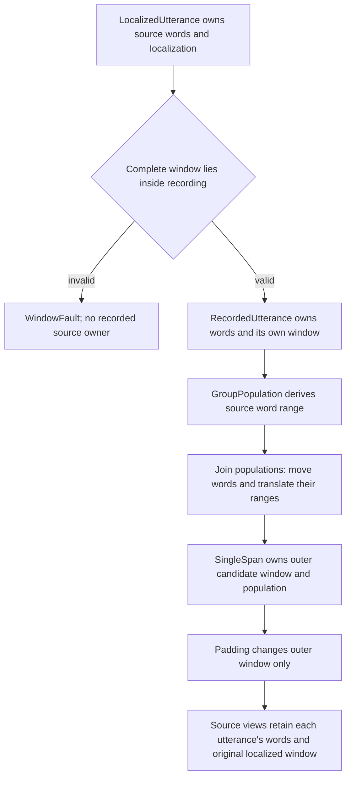

Downstream synthetic fixtures explicitly declare their source windows. Tests of
source retention instead parse CHAT and exercise real grouping, including a
merged candidate whose trailing padding extends beyond both supplied bullets.

## What the loaded backends establish

| Backend | Intrinsic constraints and allocation basis |
| --- | --- |
| MMS and Cantonese MMS | Minimum waveform extent from the loaded convolution chain; actual source-complete model labels; encoded frames and repeated-label CTC feasibility; virtual encoder tensor lifetimes plus source-qualified native CPU CTC workspace. Cantonese preparation and execution share the same romanization verb. |
| Whisper | Actual extractor/encoder input extent, tokenizer labels and decoder positions; virtual encoder, decoder and cross-attention lifetimes; frontend arrays and native DTW workspace. A maximum comes from the loaded configuration, not a universal duration constant. |
| Qwen | Actual processor chunk geometry, convolution output lengths, audio-token population and native text tokenization; virtual CNN, attention, projector, language model and classifier. A RoPE configuration's nominal position count is not treated as a fixed learned-position-table limit. |

The model copy used for projection contains FakeTensors, not copied weights.
Its evaluation and attention modes belong to the copy. The serving model's
parameters, training mode and attention implementation stay unchanged. Storage
views are counted once and temporary tensor lifetimes determine the projected
peak. Source fingerprints qualify native allocation layouts and the Qwen graph;
an unreviewed implementation refuses explicitly instead of guessing its cost.

`ModelLeaseCoverage` is issued by the confirmed `Loaded` state and names the
reservation its model-load lease still holds. It is not post-load resident
memory. The additional-request calculation accepts that distinct type, so an
unrelated RSS measurement cannot be supplied as already-covered reservation.

These are allocation estimates, not measured total RSS. The host retains its
existing allocator/activation margin, charges frontend and alignment work, and
accounts conservatively for weights not yet resident. Managed-model measurements
are still required to qualify those estimates against actual execution.

## Three different resource outcomes

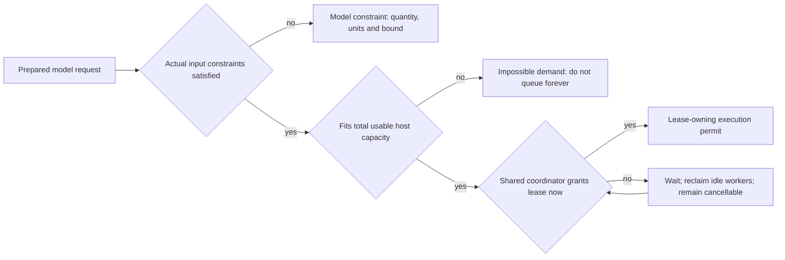

Current memory pressure does not justify different cuts in the transcript.
Congestion queues; intrinsic or physical-capacity failure may justify planning
different source-bound requests. A capacity snapshot cannot mint an execution
permit. Only the coordinator's lease can do that.

## Integrated source-bound adaptive partitioning

Both full and incremental FA now prepare resource geometry before freezing the
final dispatch plan. Complete, version-admitted cache answers and clean reusable
`%wor` skip materialization and model preparation. A candidate cache miss is
recorded once. Child and context proposals check the same cache admission before
materialization, retain that answer and skip both decoding and model preparation
on a hit. The final plan queries only previously unexamined geometry.

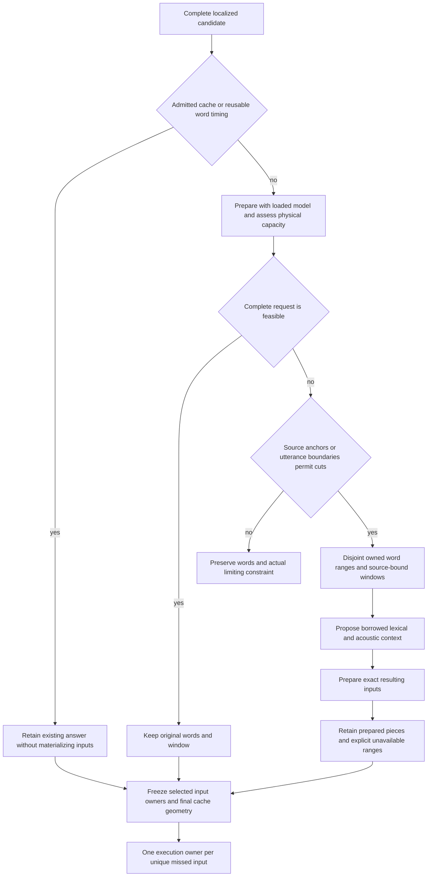

Model constraints and total host capacity can justify cuts; temporary congestion
cannot. Prefix proposals are probed against the actual model, without assuming
that fewer words imply fewer labels or a smaller allocation. An unusable source
atom stays explicitly unavailable while later supported atoms remain eligible.
A short final atom may borrow context to meet the model minimum. An anchored tail
can join its following supported request only while a nonempty unknown prefix
retains the original leading window. A singleton unknown prefix is never cropped
into an invented tail.

Context expansion operates on `SupportedRun`, a nonempty population of prepared
requests. An unavailable range terminates that run; expansion cannot encounter
an unavailable variant or silently accept an empty run. Every proposed context
and trailing extension is model-checked. If an extension is refused, the already
prepared base request remains. Context may overlap; answer ownership cannot.
Every source word remains owned exactly once, including unavailable words.

## Preparation ownership prevents repeated work

An epoch has one `PreparationRegistry` keyed by immutable semantic input and
stable word identity. Only its vacant-entry transition issues the non-cloneable
`PreparationWorkPermit` required by materialization. The registry records a claim
before awaiting work. Repeated proposals reuse settled preparation or the exact
refusal without even constructing another preparation future. An interrupted
claim cannot issue a second permit; its epoch must be abandoned. Read-only
`PreparedInputRef` values select geometry without copying execution authority.

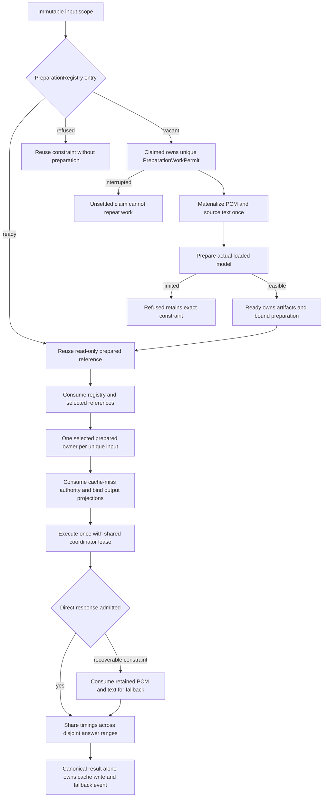

`PreparedFaCandidateV2` contains prepared audio/text descriptors, backend and
options; it has no original media path. Both preparation-time and execution-time
fallback consume and retarget that same materialized owner. They do not reopen
the original source. Only a direct execution retains the capability to try a
fallback; fallback execution cannot issue another. Artifact lifetime extends
through response admission and ends with the final owner.

Distinct output ranges borrowing the same words and window receive one execution
owner plus timing projections. Only the canonical result owns replayable raw
evidence and a fallback event, preventing duplicate cache writes and duplicate
events. The resolved population then owns both source groups and their matching
timing arrays through consuming injection.

The operator sees `Checking cache` before reuse lookup and `Preparing alignment`
while source candidates are being prepared. These counts describe candidates,
not successful model answers. `Aligning` counts the final output projections.

Deterministic controls include a real decoder plus a model-free worker: removing
the original media after preparation cannot prevent repeated-context reuse,
dispatch or fallback. Shared contexts retain one physical input owner. The
partial-output parity control preserves the original seven cache, geometry and
serialized-output expectations under an explicitly declared resource model.
These controls do not establish acoustic quality or measured RSS. Before release,
qualify preserved real inputs through the managed server and compare actual peak
memory with admitted estimates. Structural timing coverage and valid CHAT remain
separate from acoustic accuracy.

## Compatibility

The required FA phases and preparation-result variants change the internal
worker contract. The `model_request` lease kind also changes the shared memory
ledger's reader contract. Server, CLI/replay and workers sharing a host ledger
must be upgraded together; an older reader is not a supported concurrent peer.
Regenerate schemas from the Rust producer. Do not supply missing phases or
allocation reports with defaults to make an older packet look current.

FA evidence schema 11 adds `resource` unavailable-window evidence with the exact
model bound, physical host demand or decoder shortfall. Readers that do not
understand that variant must reject the newer schema explicitly. It does not
invalidate unchanged raw or derived cache geometry by itself. The progress API
also adds `preparing_alignment`; server and generated clients are updated together.
