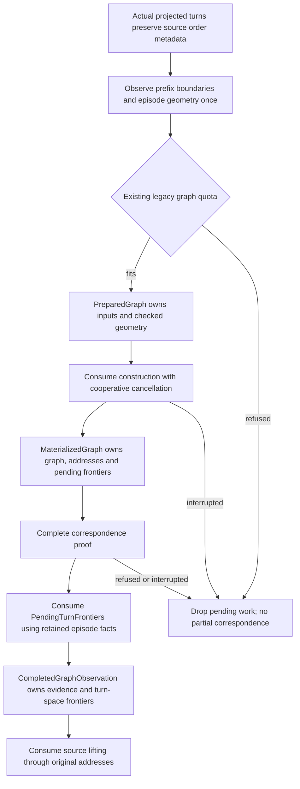
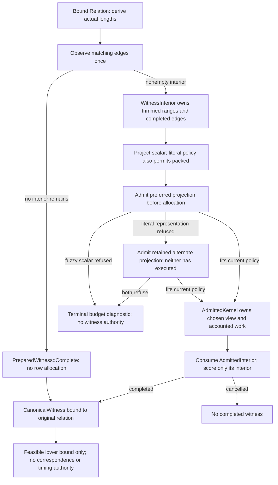
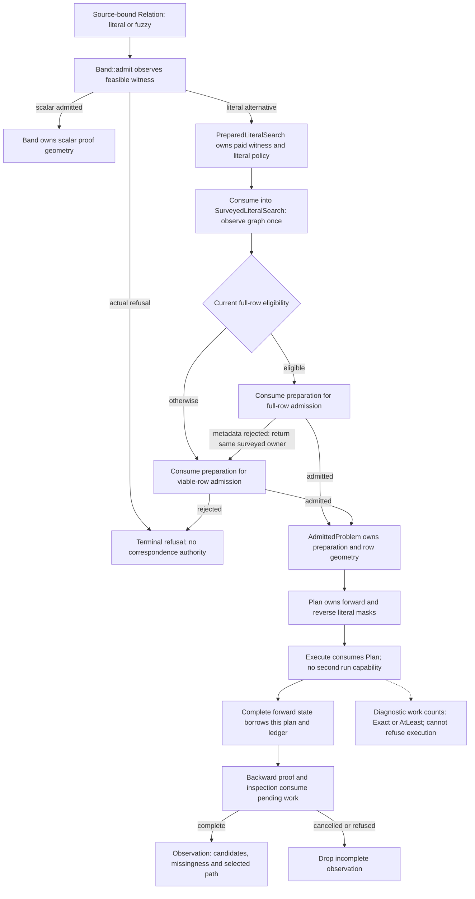
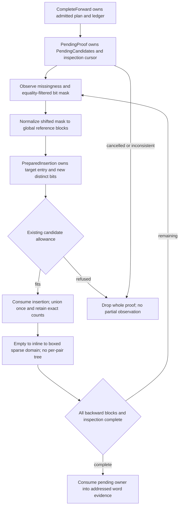
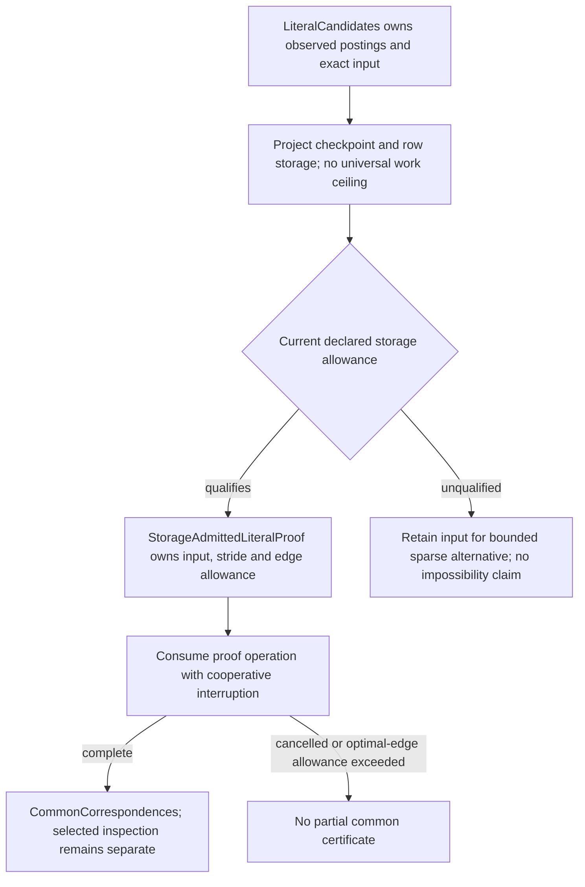
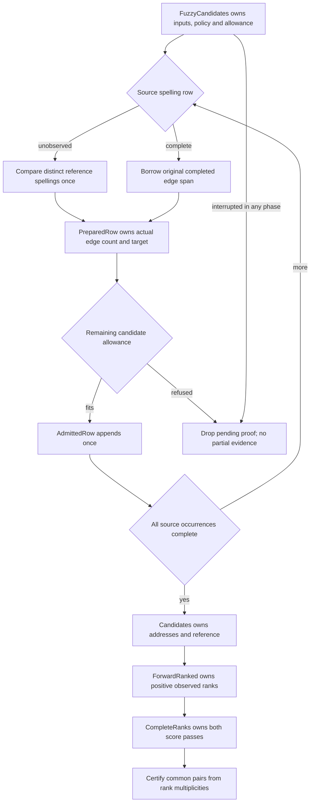
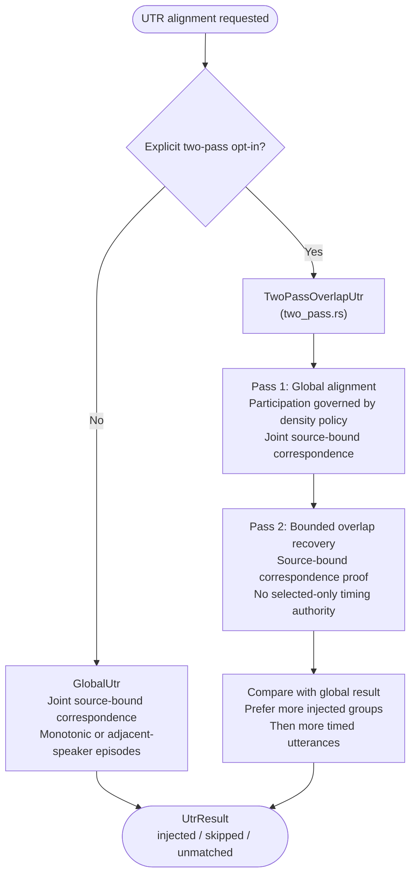

# Overlap-Aware Alignment Improvements

**Status:** Current
**Last modified:** {{git-dates:page}}

This page documents overlap-aware alignment behavior and its known limits.
The preparation-ownership changes below are in development source; adaptive
UTR host-memory admission is still being implemented. Packed execution no longer
stops at a universal operation count; preparation, storage and candidate limits
remain active until their replacement is complete and qualified.

## Architecture and evidence authority

UTR spans two application layers above Chatter, not a second CHAT toolchain.
Chatter owns CHAT parsing, validation and the typed model. The transform layer
owns lexical correspondence over a declared order model. BA3 orchestration
owns provider responses, recording bounds, cache admission and installation.

| Boundary | Owning producer | What the result permits |
| --- | --- | --- |
| Provider response to lexical words | `UtrLexicalStream` and bounded token conversion | Addresses into retained provider evidence; no interpolated word timing |
| Source/lexical words to complete correspondence | Monotonic correspondence or joint speaker-episode search | Common correspondences; joint search also retains all-optimal candidates/missingness; inspection selection alone grants no hint |
| Correspondence to timing proposal | Lexical endpoint admission | A positive bounded hint, or an explicit refusal/interior-only state |
| Plan to CHAT mutation | Source-borrowing `PreparedGlobalUtr` | Projection onto the exact census/document used for planning |
| Pending asynchronous work to installed source | `PendingUtr` / completed private candidate | Installation only after successful completion; abandoned candidates cannot replace source |
| Lexical evidence to acoustic FA | Admitted anchor/search evidence and FA policy | A bounded acoustic search, not automatic final timing acceptance |

The managed runner resolves global versus two-pass policy explicitly. The
compatibility `select_strategy` helper is not its default-selection path, and
`GlobalUtr` is no longer a monotonic-only implementation: its file order model
selects monotonic or joint regional proof.

The joint search has a scalar band and one packed producer with admitted full
and viable row states. These are representations of the same joint problem, not
corpus-specific strategies. Literal packed and fuzzy-capable scalar arithmetic
have different admission requirements; do not erase that distinction to share
code. All producers must expose the same complete-candidate/missingness meaning
and preserve named work, storage, candidate and interruption outcomes.

Packed admission constructs the actual relation, geometry and row/accounting
state together. Full rows use their conservative pre-reservation; viable rows
charge incremental packed work. Both separately bound candidate visits. The
shared complete-forward state borrows its originating ledger, and reconstruction
and proof take no substitute plan or meter. Both representations share frontier
expiry, checkpoints, paired edge observation and live-block inspection. Full-row
admission remains the weak-witness alternative; the scalar/fuzzy band and the
work-refusal-only fallback policy are unchanged. Diagnostics retain their existing
viable-search scope; a full-row reserved pass is not charged twice or reported as
an incremental viable-search sample.

Packed rows retain their producer-owned terminal score. Advancement computes it
during the existing population scan; left trimming transfers an increment into
the base, and right trimming removes a zero increment, so neither changes it.
A pointwise branch merge derives the maximum of its two owned terminal scores.
Consumers have read-only row access and cannot replace the bits independently
of that score. Suffix preparation therefore allocates/reverses bits without
recounting them, removing one actual packed-word pass and its viable-work charge.
The extra scalar fits the existing checkpoint metadata reservation, checked by
a layout boundary test. Full-row conservative reservations are unchanged.

This is a general exact/ASCII packed-kernel reduction, not an input-specific
strategy. Scalar LCS, shifted-domain maxima, trim/word-boundary controls and
whole-graph all-optimal oracles verify it independently of retained transcript
examples. It does not change matching policy, feasible witnesses, candidate
meaning, tie order, caps, wire/cache contracts or acoustic acceptance.

Monotonic consumers that need only common correspondences use
`CorrespondenceAdmission::observe_controlled`: its producer returns completed
proof or the existing named proof refusal, without computing a selected path.
Windowed two-pass overlap recovery uses this route because it has no inspection
consumer. The paired `CorrespondenceAnalysis` first observes common proof, then
consumes input/relation-bound pending inspection. Only completed selection or an
immutable inspection-budget refusal can leave that state; partial selections
never escape. Caller interruption remains an error, not a budget refusal.

Inspection independently caps 64,000,000 scalar work units and 1,048,576 live
score cells. Work includes prepared fuzzy words, prefix/suffix comparisons,
score-cell initialization/evaluation, split scans and emitted/copied alignment
records across every recursive pass. Rows/full tables are reserved before work;
score storage is checked before allocation. Completed forward/reverse rows are
dropped before recursion, so ancestor score buffers do not evade the peak bound.
These units are not wall time, byte memory or a bound on word length. Direct
alignment callers retain their unmetered policy; common proof retains its own
existing edge/comparison caps. Neither cap substitutes for the other.

Inspection refusal preserves completed common proof, admitted anchors, endpoint
proposals and original timing. `matched`/`interior_only` evidence then contains
`inspection_refusal` instead of `matches`. With no admitted common match it is
`uninspected`, never fabricated lexical absence. If both proof and inspection
are refused, evidence records each independently. Ordinary completed selection
keeps its historical tie behavior and wire fields. Offline UTR replay is schema
11; readers must not infer proof refusal or timing failure from missing inspection.

Budget refusals do not authorize a selected-only or monotonic timing fallback.
Stage-cost receipts are diagnostics, not proof or cache capabilities. Raw provider
evidence and derived UTR/FA evidence have separate reuse authorities; an algorithm
change is not permission to reuse a derived result without compatibility review.

## Bounded partial-order correspondence kernel

The alignment library now provides
`dp_align::interleaving::TwoSpeakerAlignment`. It preserves two independently
ordered speaker chains while allowing cross-speaker interleaving. Unlike
running an aligner independently for each speaker, it cannot assign the same
ASR word twice. A forward/backward product-DAG analysis examines all
maximum-match assignments under the existing exact, ASCII-insensitive or fuzzy
relation. Source-bound read-only views expose selected, possible, missing and
common correspondence separately; consumers cannot construct a common match
from a selected index or a certainty flag.

The product size is checked before allocation, with a fixed limit of 1,048,576
cells. Analysis uses two bounded score tables rather than a recording-wide
quadratic matrix. Refusal does not assert either ambiguity or absence.
The offline replay's schema 6 exposes adjacent-speaker controls; see
[UTR evidence](../architecture/observability.md#utr-word-alignment-evidence).

Production uses a separate `LocalInterleaving` composition over the whole source
census. Its source DAG permits singleton turns or disjoint episodes consisting
of one turn and a prefix of the following other-speaker overlap run. The first
adjacent turn may be unmarked; extending its run requires source-observed `+<`
or bottom-CA overlap continuations. Ordinary following monologues do not silently
become a recording-wide overlap hypothesis. Several marked backchannels by that
speaker form one ordered chain, not independent pair matches.
Each path consumes every source word once, preserves
each turn's word order and all same-speaker turn order, and reserves ASR words
jointly across the complete transcript. This is not independent per-speaker
alignment, unrestricted transcript reordering or three-way overlap handling.

Reference-layer checkpoints and one recomputed block avoid a recording-wide
score matrix. A canonical-order feasible alignment supplies a lower bound `L`
using the same matching relation. At reference prefix `k` and consumed-source
depth `d`, no complete path can score above
`min(d,k) + min(m-d,n-k)`, where `m` and `n` are the source and reference lengths.
States below `L` are excluded from storage and traversal. This is an exact
bound, not a heuristic window: every optimal path, candidate and missing-word
possibility survives. A selected witness supplies no timing authority.

For literal bands that would otherwise exceed the work limit, a second safe
bound counts source multiplicities against each reference prefix and suffix.
Let `C(k)` and `D(k)` be those bag-intersection capacities. Any complete path
through depth `d` scores at most `min(d,C(k)) + min(m-d,D(k))`, so only depths
`L-D(k) <= d <= m-L+C(k)` need storage (clamped to the source range). The whole
source is available to each bag independently: this deliberately overestimates
token competition and never chooses a correspondence or assumes source order.
Repeated reference words cannot exceed the source count. Exact and
ASCII-case-insensitive policies retain their respective equality semantics;
fuzzy relations do not use this equivalence-class bound.

`band/capacity.rs::ReferenceCapacity` owns completed counts bound to the actual
relation's literal census and its producer-owned feasible score; depth queries
cannot substitute
another pruning threshold. Interrupted construction returns no capacity.
Construction work and
temporary payload are pre-admitted, and both retained vectors stay charged to
the band's storage reservation through forward/backward recomputation.
Already-admitted bands skip this extra pass. Exhaustive controls compare all
candidate edges and missingness with an unpruned joint graph, not just a selected
path; multiplicity/ASCII controls have an insta snapshot. The limits do not rise,
and a remaining refusal still grants no fallback timing authority.

Scalar admission bounds preliminary witness work plus admitted source-state/reference
cells to 64,000,000 and score storage to 2,097,152 machine-word payload units; possible addressed matches
are separately limited to 1,048,576. Graph/evidence overhead is additional to
score storage. Graph construction also has a pre-allocation node limit.
Exact/ASCII-case-insensitive canonical interiors can use bit-parallel LCS
row differences and sparse equality masks. Scalar rows remain the other literal
representation and the only fuzzy representation. Matching edges are observed
once and retained before either scorer is admitted. Weak lexical agreement
can still leave the admitted graph band too wide to search. Unreachable cells
are distinct from reachable zero scores, and cancellation remains separate from
budget refusal.
A producer-owned `CommonLocalMatch` cannot be constructed from
selection. Only common first/last correspondences authorize UTR hints. When all
of a turn's words are mandatory on every optimum, its complete candidate hull
may authorize FA search without choosing a repeated occurrence.

Original same-speaker non-overlap bullets bound production hints/search and
remain unchanged. Another speaker's provisional crop cannot silently discard
an interleaved candidate. The search corridor for words that were NOT heard is
the exception, by design (2026-11-03): it is bounded by the nearest measured
utterance before and after it in document order, whatever the speaker, because
a turn carrying no overlap marker begins after the turn before it ends; the
episode model's allowance for an unmarked singleton to interleave with its
neighbours shapes the correspondence search, not the corridor an unheard word
is searched in (see the forced-alignment reference). Budget refusal grants no
fallback timing authority.
End-to-end acoustic recovery remains a separate acceptance obligation: lexical
proof alone cannot identify who spoke or prove accurate timing. Repeated words
may remain ambiguous even with complete recovery candidates; neither selecting
the earliest repeat nor abstaining from every difficult case proves correctness.

### Input-owned graph preparation

`PreparedGraph` retains the actual projected turns, checked source boundaries
and episode geometry together. Prefix offsets include the real exclusive end
boundary, so graph construction needs no missing-offset fallback. Episode word
counts use those offsets instead of repeatedly summing following turns. The
legacy graph quota is checked during preparation; this remains an explicit
unfinished storage policy, not a physical-memory certificate or shared lease.

Construction consumes the prepared owner and accepts no replacement inputs or
capacity. It reserves the observed node/address populations and builds each
word address alongside its edge. Empty episodes and nonempty grids are distinct
prepared variants; empty episodes carry no unused grid dimensions. Cancellation
is checked while materializing nodes and edges, and cannot publish a partial
`MaterializedGraph`.

The materialized owner also retains `PendingTurnFrontiers`, carrying the paid
episode classification. Only a completed correspondence observation consumes
it to build turn-space corridor boundaries. `CompletedGraphObservation` alone
can enter source lifting, which releases projected temporary words before
building final evidence through its original addresses. A separate `TurnFrontier`
keeps those turn boundaries distinct from word-space `SearchFrontier` values. Refused or
interrupted proof drops the pending owner without performing an unused sweep.
Episode membership is therefore observed once for budget geometry, graph
construction and final corridors. Literal projection preserves every turn,
speaker and continuation, including turns whose words were all excluded.

This removes the detached turns/count constructor, repeated episode
classification, repeated following-run sums, end-offset fallback, an extra word
enumeration and the unnecessary edge cloning requirement. Existing independent
correspondence, inspection, continuation and cancellation controls remain; the ordinary-turn
control now checks the materialized graph rather than only its budget count.
No new tests of inaccessible preparation states are added. Input-shaped graph
allocation accounting and shared UTR memory admission still need qualification;
the remaining graph, score and candidate quotas are not removed by this change.

### Packed feasible-score producer and ownership

`dp_align/interleaving/episodes/band/witness.rs::CanonicalWitness` constructs a
score on the canonical source order, which is one legal graph path. Its private
fields bind that score and accounted work to the exact `Relation` observed.
`Band::admit` consumes the observation's score and retains its relation; forward,
backward, edge observation and traceback do not accept another matching policy.
The canonical LCS length is only a feasible lower bound on the joint optimum.
It is not an addressed path, common correspondence, acoustic observation or
permission to change a CHAT bullet.

The literal producer uses the
[Allison-Dix bit-string LCS recurrence](https://www.cantab.net/users/mmlist/ll/Publications/1986IPL/):
one bit per reference position records whether its prefix score increases.
For each source word, an equality mask and the previous row produce the next
row with shift/subtraction carry and borrow propagated across `u64` blocks.
Popcount gives the canonical LCS length. Sparse `(block, bits)` postings avoid
allocating a full reference-width mask for every distinct word. The packed
update work is proportional to `m * ceil(n / 64)`; preprocessing and sparse posting scans
are also included in admission. This does not promise a fixed wall-time speedup.

The producer uses ASCII folding only for the existing case-insensitive relation;
it introduces no Unicode normalization or new fuzzy equivalence.
`PreparedWitness::observe` derives both lengths from its bound relation and
observes matching prefixes/suffixes once. A complete witness has no remaining
row-allocation capability. Otherwise, `WitnessInterior` owns the unmatched
ranges and completed edges; admission consumes that owner into an
`AdmittedInterior` whose `AdmittedKernel` carries the exact chosen view and its
accounted work. Callers cannot supply unrelated lengths or repeat edge scans
in a scalar helper. Both scorers consume their views, and execution returns
only its score or caller interruption, with no late budget-refusal route.

Literal admission orders scalar and packed projections by their declared work
for that actual interior, replacing the former 1,000,000-cell selection constant.
It checks work and storage before any row allocation. If the preferred
representation refuses, the other projection remains available; that is a
metadata alternative, not a repeated execution. If both refuse, the preferred
representation's diagnostic is retained. These are algorithmic accounting units,
not a prediction of elapsed time or a proof of physical impossibility. Existing
resource policies still apply while adaptive shared-memory admission is unfinished.
An already affordable dense search may use the zero lower bound rather than pay
for a witness; that separate band-selection policy is unchanged.

Witness and representation admission retain their 64,000,000 prospective-work
policy; score storage remains 2,097,152 units and candidates 1,048,576.
This is distinct from the now diagnostic-only packed execution ledger.
Preparation work counts scalar witness cells or packed-word passes, optional
literal-capacity preparation passes, and admitted graph/reference cells. Complete band admission is counted without
allocating/scoring that band. `interleaving_work` records add `phase`
(`graph_shape`, `feasible_witness`, `banded_search`, `packed_search`) and `required_at_least`;
arithmetic overflow saturates the required count. Other budgets remain separate.
Cooperative checkpoints stop computation without turning cancellation into
ambiguity or constructing a partial timing certificate. Managed CPU search
starts a fresh indeterminate `Recovering utterance timing` update, clearing
the preceding ASR-window counts. ASR completion is not correspondence completion.
The runtime also logs the input-bound packed cost receipt at debug level.

This producer is corpus- and ASR-provider-independent. It applies to the joint
interleaved UTR path, including the default global strategy; it does not change
the separate monotonic correspondence producer, fuzzy matching semantics,
morphotag or acoustic FA inference. No special CLI flag is
needed. Exact score equivalence is checked against an independent scalar oracle,
exhaustive small binary pairs, repeated words, ASCII-policy cases and multi-block
carry/borrow. Separate legal-order oracles check all-optimal correspondence,
while injection controls retain unobserved endpoints and original bullets.

### Optional packed joint proof

If a literal exact/ASCII-case-insensitive band exceeds its work budget,
`episodes/packed.rs` may instead prove the **same complete source DAG** with
node-oriented packed profiles. Affordable dense bands, fuzzy relations and
earlier witness/graph/memory refusals keep their existing paths. This is not
transcript chunking, a new overlap model, or selected-path-only evidence.

`PreparedLiteralSearch` binds the actual graph, source/reference words, literal
policy, feasible score and already-paid preparation. It is neither cloneable
nor copyable. `Relation::Literal` carries `LiteralMatchMode`, whose only variants
are exact and ASCII-insensitive matching; fuzzy semantics cannot enter this
producer. The packed plan owns forward/reverse equality masks,
checkpoint stride and live-row expiry. Forward and backward states are distinct
types; checkpoints and reconstructed blocks retain their plan owner. Only a
completed forward/backward observation can return candidates and missingness.
The shared packed arithmetic does not itself issue a matching certificate.

#### Consuming preparation and representation admission

Scalar band admission returns either its admitted band or `BandAlternative`.
The alternative distinguishes an actual refusal from an owned prepared literal
search. A packed producer therefore accepts preparation directly, rather than
accepting a refusal and checking its phase and matching policy again.
`SurveyedLiteralSearch::observe` consumes that preparation and retains the graph's
liveness/expiry survey. Its constructor is the only production route to those
survey facts. Full-row and viable-row admission reuse this same owner; neither
can rebuild the survey from a borrowed graph. `AdmittedProblem` owns it together
with the admitted row geometry, with no independently replaceable input/policy.
The four stride candidates form a fixed nonempty array, so selection starts with
an actual candidate rather than `usize::MAX` placeholders. The former temporary
stride vector and a second liveness vector allocation on fallback disappear.

The checkpoint schedule owns its graph before the survey. A declared test stride
is a `NonZeroUsize` admitted at this same edge; its real liveness/work/storage are
projected before execution. There is no mutable geometry accessor or fixture
constructor taking unrelated reference dimensions. Checkpoint exactness and
cancellation controls exercise admitted plans, rather than replacing a stride
after its resources were qualified. The memory-refusal control also owns its
actual reference population; the fabricated-dimension work assertion is removed.

Only metadata admission rejection returns preparation for another representation.
Once a plan is admitted, that owner cannot simultaneously prepare another plan.
Execution consumes the plan, so the same admitted work cannot execute twice;
failed or interrupted execution does not issue a fresh preparation capability.
This removes the old broad-policy adapter, repeated refusal-phase/policy checks,
duplicated input fields and tests that constructed fuzzy packed input or reused
already-consumed preparation. The cost-receipt control also no longer executes
one admitted plan twice; independent exactness oracles already cover its proof.
Keep literal-policy/input admission, arithmetic,
cancellation and independent all-optimal correspondence oracles: these exercise
real boundaries rather than transitions no longer expressible in the API.

This is the implemented ownership boundary, not yet a host-memory lease.
The adaptive-admission work must still bind prepared storage demand to the shared
coordinator, replace universal work/storage/candidate policy and preserve the
supported direct-library and legacy CLI routes. Preparation/representation work,
storage and candidate limits remain, but the execution counter cannot issue a
work refusal. A passing small oracle suite does
not establish long-recording recovery, measured memory use or release readiness.

Full-reference profiles are used only when their complete prospective work and
storage fit and the witness is too weak to offer a width advantage. Otherwise,
score-viable profiles retain a contiguous domain of reference prefixes. For
source length `m`, reference length `n` and feasible score `L`, source and
reference gap allowances are `m-L` and `n-L`. At consumed source depth `d`, a
viable prefix must score at least `max(0,d-(m-L))`, and its reference gaps must
not exceed `n-L`. A discarded prefix cannot become viable at a descendant:
a source step can gain at most one match, while consuming a gap cannot restore
the allowance. Every optimum scores at least `L`, so all optimal paths survive.
Unreachable is distinct from score zero. Profiles carry their absolute domain,
score origin and packed unit differences; merges take pointwise maxima, not OR.

Backward observation checks actual DAG edges against the global optimum.
Deletion cuts establish possible missingness; equality-filtered matching cuts
enumerate every possible addressed match. A unique match is common only when
missingness is impossible, as before. Selected traceback is for inspection and
cannot grant common evidence. Projection lifting retains original addresses,
turn boundaries and corridors.

Preparation/representation admission retains its prospective-work limit;
storage remains 2,097,152 machine-word units and distinct addressed candidates
1,048,576. Geometry reserves checkpoint,
reconstruction, live rows, summaries, masks and conservative map payload before
allocation; this is not a process-RSS promise. Full profiles reserve all passes.
Viable profiles retain diagnostic preparation/metadata work and count actual
packed-word passes during cloning, advancement, merging, reconstruction, cut
observation and traceback. Candidate visits are counted, and a new distinct pair
is refused before exceeding its separate cap. Counting an operation returns no
refusal: it cannot stop an admitted proof at 64 million operations. Legacy
`packed_search` work refusals can still arise from prospective geometry admission;
they are not execution-ledger refusals or full elapsed-time estimates. Cancellation or
any refusal discards the incomplete observation and grants no timing authority.

Independent legal-order oracles compare complete candidate sets, missingness,
optima and selected-path legality for all small binary inputs, every feasible
lower bound and multiple checkpoint sizes. Additional tests cover multiword
carry/borrow, signed score origins, ASCII policy, work/memory admission and
cancellation at every cooperative poll in a complete small proof. The existing
partially reordered fixture now completes beyond the former execution cutoff
and checks every expected common pair, rather than expecting a refusal. Wire snapshots
retain the new diagnostic spelling without changing the budget kind.

#### Fused profile and edge passes

Viable row advancement streams window-aligned sparse equality postings directly
into the carry/borrow recurrence, without allocating a dense equality mask.
Branch merging aligns both input profiles while emitting their pointwise maximum,
without allocating and copying two padded parent buffers. The producer still
consumes the owned predecessor transition; interrupted numeric work grants no
reusable partial row. Row advancement reserves three packed passes (recurrence,
score extraction and trimming), and merging reserves two (output storage and
aligned maximum). Predecessor clones remain separately charged. Memory geometry
stays conservative. These arithmetic reductions do not change storage admission;
execution counting is now independent of a stopping policy.

Deletion and matching observation also share one scan. Write `D(k)=F(k)+B(k)-O`
for the joined score relative to the global optimum. If the suffix declines by
`b(k)` (zero or one) at the next reference word, matching requires
`D(k)+1-b(k)=0`. Thus deletion probes `D=0`; matching uses `D=0` when `b=1`
and `D=-1` when `b=0`. A paired numeric observation returns possible missingness
and every matching cut together. It is not a graph-edge or equality certificate:
the graph producer still binds the actual source word and reference posting.

Only the intersection of the actual forward/suffix domains enters the shared
scan. A matching-only cut immediately before the suffix domain is checked
separately and never grants deletion evidence. `MatchCuts::Empty` has no
fabricated coordinate; a nonempty cut domain carries its actual origin. Terminal
matching eligibility is an enum, not an inferred padded bit. Work reserves the
two slices, output allocation and paired scan, with separate score-origin costs
and an extra shift pass when the matching-only boundary is present. Scalar
oracles cover offset alignment, absent masks, padding, signed origins and every
paired cut; complete legal-order oracles still check the finished graph proof.
Preparation, storage and candidate refusals remain possible after these reductions.

#### Stage-bound cost receipts and sparse witness streams

`WorkControl::packed_search_cost` optionally receives one immutable diagnostic
from an admitted viable packed search. The producer alone constructs it from
the actual plan and graph. Typed charge scopes distinguish preparation, initial
forward scoring, proof reconstruction, backward scoring, edge observation and
inspection traceback. A bare ledger cannot charge unclassified work. The plan
owns its admitted geometry rather than duplicating stride/work fields.

Receipts distinguish completion, budget refusal and caller interruption. They
retain per-stage work, the last operation's stage, projected populations, checkpoint/storage geometry
and peak produced-row width. `PackedSearchWork` distinguishes an exact `u128`
count from an explicit lower bound if its numeric range is exceeded. Neither
state can reject execution; overflow cannot wrap, pretend to be exact or become
a false data refusal. The ledger has no duplicate total/denied-floor fields or
work-limit branch. Its old threshold-refusal test is obsolete; numeric overflow
is covered in the existing receipt boundary control. Stage totals include already-paid witness work and
prospective metadata reserves, not just executed instructions; they are not
wall-time profiles or forecasts of the uncompleted search. Denied work is not
charged. The optional observer must not block and cannot grant correspondence,
timing or cache authority. Dense/full-profile/early-admission routes do not
produce these viable-search receipts. No UTR wire schema or CLI flag changes.

The shared owned `PackedRow` also streams sparse postings directly into its
recurrence, eliminating its per-row dense-mask buffer and clear/populate passes.
Checkpoint ownership, reference order and equality policy are unchanged.
Canonical witness work reserves one packed stream per source word instead of
three passes; preprocessing/normalization still count. The monotonic packed
proof's reservation includes three streams, prefix-index scans and checkpoint
copies (six row-width passes instead of twelve). Conservative storage limits
are retained. Scalar score and all-optimal proof oracles, owned interruption
tests and a reproduced witness-admission boundary qualify the shared change.

#### Live-block inspection trace

The packed producer consumes complete forward checkpoints into one private
pending-proof owner with its inspection cursor. During the descending backward
proof, each reconstructed forward block also advances that cursor before the
block is dropped. This removes the separate traceback reconstruction pass,
without retaining additional blocks or changing tie order. Scalar inspection
probes are already reserved in preparation; traceback therefore charges no
second packed pass. Its cooperative checkpoints remain observable for
interruption, so a zero stage charge does not mean the cursor was never visited.

No operation accepts a loose block/cursor pairing, and partial selection cannot
escape. Complete candidates and missingness still require every backward block
and candidate admission; inspection never replaces all-optimal evidence. Any
refusal or interruption drops the whole pending observation. Conservative work
and storage reservations and UTR wire formats remain unchanged. Full rows now
use this same lifecycle while keeping their pre-reserved work policy.
Exhaustive legal-order/checkpoint controls, interruption at every
poll including interleaved inspection, and the reproduced duplicate-pass cost
boundary protect the consuming transition.

#### Proof-owned candidate blocks

The pending proof owns `PendingCandidates`, whose slots come from its admitted
plan's source population. Each word starts with an empty domain; one nonempty
64-position block is stored inline, and a multi-block domain owns a boxed sparse
map. Boxing this uncommon state keeps the per-word census compact. No global
tree of `(source word, reference position)` pairs is built.

Matching cuts arrive as bit masks. Their reference windows may start between
global block boundaries, so observation normalizes a mask into at most two
blocks. `PreparedInsertion` retains the actual empty, inline or sparse-map entry
and its newly observed bit count. Its consuming admission checks the remaining
**distinct** candidate allowance before changing the domain or allocating a new
map. The insertion retains the originating census's allowance and that word's
cardinality together with the target; invocation accepts no substitute counters.
Revisiting a bit changes neither the count nor its address. The operation
does not repeat a lookup after admission, and diagnostic candidate visits are
counted by bounded blocks rather than a per-bit fallible loop.

Missingness observations and candidate domains stay private to the pending proof.
Only successful completion of every backward block and inspection reconstruction
materializes the descending candidate vectors. Each vector reserves its retained
exact distinct count once. Cancellation, inconsistency or candidate refusal
drops the entire owner, so partially collected candidates cannot become lexical
absence or timing authority. Literal policy, tie order, candidate limits and
output schemas are unchanged; this is not yet adaptive host-memory admission.

Independent legal-order oracles still check all candidates and missingness.
The existing word-boundary control additionally checks closed-form repeated-word
domains across shifted masks and both full/viable checkpoint plans. It covers
inline promotion, deduplication and optional versus required words without
adding tests of impossible private constructors. Candidate refusal and every
cooperative cancellation cut remain separate controls.

### Lossless retained checkpoints

`band/checkpoints.rs::ForwardScores` binds retained forward checkpoints to the
admitted band, matching relation and block geometry. Backward observation and
selected traceback reconstruct blocks through this owner; callers cannot pair
checkpoints with a replacement graph or block width.

Working score rows and reconstructed blocks remain dense. Each retained row
uses either its dense scores or equal-score runs, whichever needs less payload.
Runs retain their exclusive end indices and exact scores, including the
distinction between unreachable and reachable zero. Before allocation, an
immutable row observation admits both run indices and scores against the same
2,097,152 machine-word limit, reserving dense block and working-row storage.
Metadata and graph/evidence overhead remain additional to that payload limit.

This changes neither pruning nor the set of optimal paths, correspondences or
missing-word possibilities. It can admit a previously memory-refused search
when checkpoint rows compress; incompressible rows stay dense. It cannot make
a work-refused band or candidate-refused proof pass. Exhaustive small score-row
roundtrips and legal-order correspondence oracles exercise this boundary;
a synthetic long-row regression reproduces the former memory refusal without
raising any limit.

See the [user-facing work/refusal contract](../reference/forced-alignment.md#anchored-regions).

### Lossless literal projection

`episodes/projection.rs::SearchProjection` owns original and projected word
layouts, the equality policy and both lifting maps. Exact and
ASCII-case-insensitive observations omit only words with no possible counterpart
anywhere on the other side. This reduces the computational source graph and
reference, not the transcript or evidence population. Fuzzy matching retains
the identity layout; literal absence is not a fuzzy refusal rule.

Every original turn, speaker and continuation remains, even when no word in a
turn survives. Thus projection cannot merge turns or authorize another overlap
episode. Each removed source/reference word could only be consumed without a
match. Projecting a legal path preserves its score and order; conversely a
projected path lifts by reinserting those words in the same chains. All optimal
matching assignments and missing-word possibilities are therefore preserved.

Only this owner's observation lifts the joint proof. Candidates and selected
matches return to original source/reference indices before any common-match or
search capability is exposed. Omitted source words remain in the evidence
census as definitely missing, with no candidates; they are not silently erased.
The original order corridor uses the original turns and addresses. No guessed
anchor, selected-path timing, normalization or larger search limit is added.

Independent legal-order assignment oracles cover empty projected turns,
same-speaker boundaries, marked continuations and reference gaps. An insta
snapshot makes lifted evidence addresses reviewable; separate assertions retain
ASCII-versus-Unicode and fuzzy policy, cancellation and budget boundaries.

### Packed monotonic common proof

The separate monotonic correspondence producer retains its sparse Fenwick-rank
route for affordable inputs and its existing fuzzy policy. When literal postings
exceed the raw-edge allowance, `correspondence/literal.rs::LiteralCandidates`
can instead admit a checkpointed packed-frontier proof. This is not a monotonic
fallback for the joint source-DAG model.

`packed_literal.rs` owns the shared Allison-Dix row recurrence used by both
this proof and the canonical joint witness. `LiteralReference` owns the exact
reference order, equality masks and literal policy; `PackedCheckpoint::resume`
accepts no replacement reference or width.
Row extension consumes its predecessor and returns a successor only on success;
interruption cannot leave a partly updated row available for later reuse.
The complete proof owns the source, reference, postings and admitted geometry.
Forward checkpoints reconstruct only
one bounded source block, while a reverse row streams the suffix scores.

For a matching edge `(p,r)`, let `F(p,r)` score the prefixes strictly before it
and `B(p+1,r+1)` the suffixes strictly after it. The edge belongs to an optimum
exactly when `F(p,r) + 1 + B(p+1,r+1)` equals the full LCS score. Its rank is
`F(p,r)+1`. Rank populations transition from empty to unique to competing;
only the sole optimal edge at a rank can construct a common pair. A selected
path, identical prefix or first repeated occurrence grants no authority.

`StorageAdmittedLiteralProof` owns the observed literal input, checkpoint stride
and declared candidate allowance. Its consuming operation accepts no replacement
inputs or policy. The former universal 64-million-work ceiling is removed from
this route: a prospective operation count cannot reject a representation whose
storage qualifies. Finite input geometry and cooperative interruption still
bound execution; no larger universal work constant replaces the old one.

The 1,048,576 admitted-edge limit remains. This route counts only edges proved
optimal before admission, not every raw equality pair. It reserves score/index
payload plus the existing conservative map allowance within the former raw-edge
vector's four-machine-word per-edge allowance. This legacy storage policy is not
adaptive host admission, a total RSS bound or proof of physical impossibility.
If the optional workspace cannot qualify, the original bounded sparse route
remains; its raw candidate cap may still refuse. A genuine optimal-edge overflow
also refuses without emitting a partial common certificate. Replacement of the
remaining storage/candidate policies and conservative estimates is still required.

The existing repeated-word control includes a 5,000-word pair with one differing
interior word. Whole-input embedding cannot handle it, yet exactly 4,999 pairs
are common. Its old 77,400,005 prospective work count exceeded the universal
ceiling despite admitted storage. The public producer now completes that proof.
The existing cancellation control interrupts at every cooperative checkpoint of
a small packed proof, including after it has started; test count is unchanged.

Exhaustive chain oracles check the packed proof independently of its selected
path. Scalar prefix oracles cover word boundaries, ASCII/non-ASCII policy,
reverse rows and resumed checkpoints. An insta snapshot distinguishes common
endpoints from competing repeated occurrences. Constructor, cancellation and
genuine cap controls remain. Acoustic inference, output validity, model/cache
selection and final required-word completion are unchanged.

### Owned fuzzy preparation and sparse score phases

Monotonic fuzzy correspondence no longer refuses an input because the product
of its word counts exceeds 64 million. That product is neither retained storage
nor evidence of lexical ambiguity. `FuzzyCandidates` owns its original input
borrows, comparison policy and actual caller's candidate allowance. It interns
exact original spellings across both inputs, preparing each distinct spelling
once. Fuzzy matches are **not** equivalence classes: a threshold relation need
not be transitive, and Unicode lowercasing does not replace the ASCII fast path.

The first occurrence of a source spelling compares against each distinct
reference spelling once. A prepared row retains those completed observations
and its exact addressed edge count. Its consuming admission checks the whole
row against the remaining candidate allowance before appending any edges.
Only a fully appended row becomes reusable. Later identical source words copy
reference addresses from that immutable completed edge span, without retaining
a second per-edge memo or recomputing lexical comparisons. Reference occurrence
order and the full matching relation are preserved. Cancellation drops the
whole pending census; an interrupted row cannot become a completed empty row.

Sparse proof then consumes `Candidates` into `ForwardRanked`, followed by
`CompleteRanks`. A candidate edge carries addresses only; positive ranks are
appended as observed, never initialized to zero as an uncomputed score.
Each phase releases its Fenwick scratch before the next phase allocates it.
Rank multiplicity uses `Empty`, `Unique` and `Competing`, rather than an
unbounded numeric counter. Only both completed score passes can certify common
pairs. A fully observed empty relation needs no Fenwick allocation. The literal
packed route's storage allowance still derives from the address payload plus
both rank representations, so splitting these types does not halve that policy
accidentally.

The existing public-producer boundary control now includes 8,000 versus 8,001
dissimilar repeated words: 64,008,000 occurrence pairs, one distinct lexical
comparison, and no retained candidate edges. Small independent chain oracles
cover repeated and nontransitive fuzzy relations; cancellation is exercised at
every observed checkpoint across preparation, reuse and scoring. These extend
existing tests without increasing test count. Candidate refusal reports the
actual caller's allowance; current native proof cannot emit a fuzzy work-limit
refusal. The historical `fuzzy_comparisons` diagnostic spelling remains in the
evidence model for recorded-result compatibility.

This removes one work cutoff and repeated lexical preparation, not all resource
policy. The candidate cap, independent inspection limits, joint-search admission
and shared host-memory integration remain explicit unfinished work. No new CLI
option, matching threshold, cache identity or timing rule is introduced.

### Chatter ownership boundary

Chatter owns CHAT grammar, lexical structure, overlap markers, source admission
and checked output construction. This matcher consumes that typed structure;
ASR token correspondence, acoustic order hypotheses and model search remain
BA3 concerns. No CHAT text scan, additional parser or validity exemption is
introduced. If a recovery fix reveals missing generic structure or an admission
hole, repair that boundary in Chatter rather than duplicating CHAT semantics
in BA3. Acoustic correspondence does not grant output validity or completion.

## Shipped Features

Two-pass UTR and its tuning require explicit opt-in. The default global
strategy uses case-insensitive exact matching and does not apply two-pass
fuzzy matching, CA window narrowing, density exclusion or tight-buffer tuning.

| Feature | Default | CLI override |
|---------|---------|-------------|
| Two-pass overlap UTR | **Gated**: requires `--utr-strategy two-pass` | `--utr-strategy two-pass` to enable |
| Fuzzy word matching (Jaro-Winkler) | Two-pass only: threshold 0.85 | `--utr-fuzzy 1.0` for exact-only |
| CA marker window narrowing | Enabled (when two-pass active) | `--utr-ca-markers disabled` |
| Density-aware fallback | 30% threshold | `--utr-density-threshold` |
| Tight buffer for pass-2 | 500ms | `--utr-tight-buffer` |
| Same-speaker end-overlap resolution | Always on; cross-speaker overlap preserved by default | `--end-overlap-policy clamp-all-adjacent` additionally clamps cross-speaker file neighbors |
| %wor suppression for CA | Auto when `@Options: CA` | `--nowor` for non-CA |

**Defaults were tuned on:** SBCSAE, Jefferson NB, TaiwanHakka, APROCSA.

**Two-pass is opt-in.** The two-pass UTR strategy is gated behind
`--utr-strategy two-pass` because it can regress alignment on certain
inputs (CA transcripts with two timestamps on a main line; transcripts
with substantial overlap between consecutive utterances). `Auto` always
selects `GlobalUtr`.

**End-time overlap resolution:** finalization resolves same-speaker end overlap
even across intervening other-speaker turns. The production default preserves
cross-speaker overlap; the explicit clamp-all policy additionally resolves
file-adjacent cross-speaker overlap. Original kept bullets remain read-only;
conflicting kept bullets are recorded rather than silently changed.

**Legacy CA word-tier policy:** current code suppresses `%wor` on
`@Options: CA` files. The header is not required for CA notation, and this
policy does not establish that word timing is unsuitable. In-memory intervals
are not automatically serialized inline when the tier is omitted. See the
[Options reference](../reference/chat-options.md) before assessing saved coverage.

---

This page also evaluates *further* improvements to UTR alignment for transcripts
with dense overlapping speech (`&*` markers) and heavily restructured transcripts.

## Why This Matters

The cost of alignment failure is not abstract.  Every untimed utterance that
the aligner could have gotten right but didn't becomes manual labor: a human
must listen to the audio, locate the utterance, and fix the bullet by hand.
For overlap-heavy corpora (aphasia protocols, conversation analysis, any
multi-party recording), this can mean hours per file.  Even a small
improvement in coverage, 5-10% fewer untimed utterances, translates
directly into saved human effort on the last mile of correction.

This makes alignment quality a high-leverage investment.  The algorithms
don't need to be perfect; they need to be measurably better, and the
improvement needs to be validated empirically on real data.

## Strategy Selection and Two-Pass Architecture

Automatic selection retains `GlobalUtr`; two-pass requires explicit opt-in.
Typed overlap markers affect episode continuity and two-pass recovery, not
automatic selection of a different strategy.

Source: `ResolvedUtrStrategy::from_options` in
`crates/batchalign/src/runner/dispatch/options.rs`, production dispatch in
`crates/batchalign/src/chat_ops/fa/utr.rs`, overlap detection in
`chat_ops/fa/utr/overlap_markers.rs`, two-pass logic in
`chat_ops/fa/utr/two_pass.rs`.

## Known limits and acceptance

The joint kernel fixes neither arbitrary transcript reordering nor acoustic
speaker identity. Its legal episodes preserve each turn and same-speaker
order; three-way overlap and within-speaker reorderings are outside that
model. Missing ASR words or repeated vocabulary can leave too little common
evidence for a hint even when a search completes. Long weak-evidence regions
can still exceed work, memory or candidate budgets after the packed witness
removes the preliminary score bottleneck.

These cases remain distinct:

- **Selected only:** one optimal assignment was inspected, not proved common.
- **Common endpoints:** lexical evidence can authorize a bounded UTR hint.
- **Mandatory candidate hull / interior-only evidence:** a search envelope may
  be available without a complete utterance hint; no repeated occurrence is
  chosen as a timing fact.
- **Budget refused:** proof was not completed; this establishes neither
  absence nor ambiguity.
- **Unavailable final timing:** FA left required words unobserved. A valid
  CHAT file, cached provider response or useful UTR hint does not erase that
  deficit.

No order-model change, guessed anchor or corpus-specific override is used to
make an expensive case pass. Improvements to score/checkpoint representation
must preserve every optimum and its missing-word evidence before they can
change production admission.

## Verification boundaries

The reference controls deliberately separate mathematical, mutation and
acoustic claims:

1. Compare packed canonical scores against an independent scalar oracle,
   including exhaustive small sequences, repeated tokens, ASCII policy and
   carry/borrow across machine-word boundaries.
2. Compare joint correspondence against exhaustive legal-order assignments.
   Preserve common, selected, possible and missing evidence separately.
3. Exercise the public injection boundary on synthetic valid CHAT. Missing
   endpoints must not gain hints; existing bullets and source lexical content
   remain unchanged. Admission/refusal and cancellation are checked separately.
4. Validate final output through the owned media and timing transitions.
   A raw pre-FA UTR sidecar may still declare media unlinked after receiving
   hints; it is not the final aligned document.
5. For a controlled acoustic assessment, hold transcript, admitted media,
   ASR observations, model/options and output policy fixed. Report required-word
   timing coverage and adjudicated boundary quality, not just injected counts.
   Do not replace missing word observations with proportional estimates or
   treat a selected lexical path as audio evidence.

CPU search checkpoints cooperate with cancellation. That contract does not
certify provider-job draining, durable in-flight IDs or persistence of a
response interrupted before cache commit; those are separate runtime boundaries.

## Deferred approaches, not current work requirements

Backbone extraction of embedded backchannels and separate per-speaker ASR
remain research possibilities, not shipped recovery paths or promised options.
Removing embedded words changes the source census and cannot silently excuse
required words. Per-speaker inference needs evidence that diarization and
within-speaker order are reliable, accounts for additional provider calls,
and must prevent duplicate claims on the same observations.

Earlier scalar-monotonic-only proposals and speculative coverage percentages
are superseded as descriptions of the current implementation. The current
joint kernel above is not independent per-speaker alignment. No expected
percentage gain, zero-regression claim or real-corpus run is implied by those
proposals. Any future extension needs an authorized controlled assessment and
source-bound proof before production integration.

Incremental `align --before` already preserves admitted reusable timing for
unchanged material; initial recovery and reuse remain different obligations.
See [incremental processing](../architecture/incremental-processing.md) and
[final timing coverage](../reference/forced-alignment.md).
