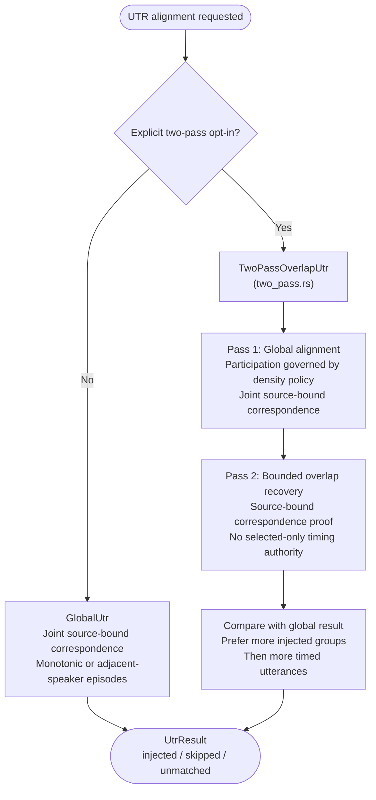

# Overlap-Aware Alignment Improvements

**Status:** Current
**Last updated:** 2026-10-14 11:51 EDT

This page documents overlap-aware alignment improvements: what is shipped
and known limitations.

## Architecture and evidence authority

UTR spans two application layers above Chatter, not a second CHAT toolchain.
Chatter owns CHAT parsing, validation and the typed model. The transform layer
owns lexical correspondence over a declared order model. BA3 orchestration
owns provider responses, recording bounds, cache admission and installation.

| Boundary | Owning producer | What the result permits |
| --- | --- | --- |
| Provider response to lexical words | `UtrLexicalStream` and bounded token conversion | Addresses into retained provider evidence; no interpolated word timing |
| Source/lexical words to complete correspondence | Monotonic correspondence or joint speaker-episode search | Common correspondences; joint search also retains all-optimal candidates/missingness; inspection selection alone grants no hint |
| Correspondence to timing proposal | Lexical endpoint admission | A positive bounded hint, or an explicit refusal/interior-only state |
| Plan to CHAT mutation | Source-borrowing `PreparedGlobalUtr` | Projection onto the exact census/document used for planning |
| Pending asynchronous work to installed source | `PendingUtr` / completed private candidate | Installation only after successful completion; abandoned candidates cannot replace source |
| Lexical evidence to acoustic FA | Admitted anchor/search evidence and FA policy | A bounded acoustic search, not automatic final timing acceptance |

The managed runner resolves global versus two-pass policy explicitly. The
compatibility `select_strategy` helper is not its default-selection path, and
`GlobalUtr` is no longer a monotonic-only implementation: its file order model
selects monotonic or joint regional proof.

The joint search has a scalar band and one packed producer with admitted full
and viable row states. These are representations of the same joint problem, not
corpus-specific strategies. Literal packed and fuzzy-capable scalar arithmetic
have different admission requirements; do not erase that distinction to share
code. All producers must expose the same complete-candidate/missingness meaning
and preserve named work, storage, candidate and interruption outcomes.

Packed admission constructs the actual relation, geometry and row/accounting
state together. Full rows use their conservative pre-reservation; viable rows
charge incremental packed work. Both separately bound candidate visits. The
shared complete-forward state borrows its originating ledger, and reconstruction
and proof take no substitute plan or meter. Both representations share frontier
expiry, checkpoints, paired edge observation and live-block inspection. Full-row
admission remains the weak-witness alternative; the scalar/fuzzy band and the
work-refusal-only fallback policy are unchanged. Diagnostics retain their existing
viable-search scope; a full-row reserved pass is not charged twice or reported as
an incremental viable-search sample.

Packed rows retain their producer-owned terminal score. Advancement computes it
during the existing population scan; left trimming transfers an increment into
the base, and right trimming removes a zero increment, so neither changes it.
A pointwise branch merge derives the maximum of its two owned terminal scores.
Consumers have read-only row access and cannot replace the bits independently
of that score. Suffix preparation therefore allocates/reverses bits without
recounting them, removing one actual packed-word pass and its viable-work charge.
The extra scalar fits the existing checkpoint metadata reservation, checked by
a layout boundary test. Full-row conservative reservations are unchanged.

This is a general exact/ASCII packed-kernel reduction, not an input-specific
strategy. Scalar LCS, shifted-domain maxima, trim/word-boundary controls and
whole-graph all-optimal oracles verify it independently of retained transcript
examples. It does not change matching policy, feasible witnesses, candidate
meaning, tie order, caps, wire/cache contracts or acoustic acceptance.

Monotonic consumers that need only common correspondences use
`CorrespondenceAdmission::observe_controlled`: its producer returns completed
proof or the existing named proof refusal, without computing a selected path.
Windowed two-pass overlap recovery uses this route because it has no inspection
consumer. The paired `CorrespondenceAnalysis` first observes common proof, then
consumes input/relation-bound pending inspection. Only completed selection or an
immutable inspection-budget refusal can leave that state; partial selections
never escape. Caller interruption remains an error, not a budget refusal.

Inspection independently caps 64,000,000 scalar work units and 1,048,576 live
score cells. Work includes prepared fuzzy words, prefix/suffix comparisons,
score-cell initialization/evaluation, split scans and emitted/copied alignment
records across every recursive pass. Rows/full tables are reserved before work;
score storage is checked before allocation. Completed forward/reverse rows are
dropped before recursion, so ancestor score buffers do not evade the peak bound.
These units are not wall time, byte memory or a bound on word length. Direct
alignment callers retain their unmetered policy; common proof retains its own
existing edge/comparison caps. Neither cap substitutes for the other.

Inspection refusal preserves completed common proof, admitted anchors, endpoint
proposals and original timing. `matched`/`interior_only` evidence then contains
`inspection_refusal` instead of `matches`. With no admitted common match it is
`uninspected`, never fabricated lexical absence. If both proof and inspection
are refused, evidence records each independently. Ordinary completed selection
keeps its historical tie behavior and wire fields. Offline UTR replay is schema
11; readers must not infer proof refusal or timing failure from missing inspection.

Budget refusals do not authorize a selected-only or monotonic timing fallback.
Stage-cost receipts are diagnostics, not proof or cache capabilities. Raw provider
evidence and derived UTR/FA evidence have separate reuse authorities; an algorithm
change is not permission to reuse a derived result without compatibility review.

## Bounded partial-order correspondence kernel

The alignment library now provides
`dp_align::interleaving::TwoSpeakerAlignment`. It preserves two independently
ordered speaker chains while allowing cross-speaker interleaving. Unlike
running an aligner independently for each speaker, it cannot assign the same
ASR word twice. A forward/backward product-DAG analysis examines all
maximum-match assignments under the existing exact, ASCII-insensitive or fuzzy
relation. Source-bound read-only views expose selected, possible, missing and
common correspondence separately; consumers cannot construct a common match
from a selected index or a certainty flag.

The product size is checked before allocation, with a fixed limit of 1,048,576
cells. Analysis uses two bounded score tables rather than a recording-wide
quadratic matrix. Refusal does not assert either ambiguity or absence.
The offline replay's schema 6 exposes adjacent-speaker controls; see
[UTR evidence](../architecture/observability.md#utr-word-alignment-evidence).

Production uses a separate `LocalInterleaving` composition over the whole source
census. Its source DAG permits singleton turns or disjoint episodes consisting
of one turn and a prefix of the following other-speaker overlap run. The first
adjacent turn may be unmarked; extending its run requires source-observed `+<`
or bottom-CA overlap continuations. Ordinary following monologues do not silently
become a recording-wide overlap hypothesis. Several marked backchannels by that
speaker form one ordered chain, not independent pair matches.
Each path consumes every source word once, preserves
each turn's word order and all same-speaker turn order, and reserves ASR words
jointly across the complete transcript. This is not independent per-speaker
alignment, unrestricted transcript reordering or three-way overlap handling.

Reference-layer checkpoints and one recomputed block avoid a recording-wide
score matrix. A canonical-order feasible alignment supplies a lower bound `L`
using the same matching relation. At reference prefix `k` and consumed-source
depth `d`, no complete path can score above
`min(d,k) + min(m-d,n-k)`, where `m` and `n` are the source and reference lengths.
States below `L` are excluded from storage and traversal. This is an exact
bound, not a heuristic window: every optimal path, candidate and missing-word
possibility survives. A selected witness supplies no timing authority.

For literal bands that would otherwise exceed the work limit, a second safe
bound counts source multiplicities against each reference prefix and suffix.
Let `C(k)` and `D(k)` be those bag-intersection capacities. Any complete path
through depth `d` scores at most `min(d,C(k)) + min(m-d,D(k))`, so only depths
`L-D(k) <= d <= m-L+C(k)` need storage (clamped to the source range). The whole
source is available to each bag independently: this deliberately overestimates
token competition and never chooses a correspondence or assumes source order.
Repeated reference words cannot exceed the source count. Exact and
ASCII-case-insensitive policies retain their respective equality semantics;
fuzzy relations do not use this equivalence-class bound.

`band/capacity.rs::ReferenceCapacity` owns completed counts bound to the actual
relation's literal census and its producer-owned feasible score; depth queries
cannot substitute
another pruning threshold. Interrupted construction returns no capacity.
Construction work and
temporary payload are pre-admitted, and both retained vectors stay charged to
the band's storage reservation through forward/backward recomputation.
Already-admitted bands skip this extra pass. Exhaustive controls compare all
candidate edges and missingness with an unpruned joint graph, not just a selected
path; multiplicity/ASCII controls have an insta snapshot. The limits do not rise,
and a remaining refusal still grants no fallback timing authority.

Admission bounds preliminary witness work plus admitted source-state/reference
cells to 64,000,000 and score storage to 2,097,152 machine-word payload units; possible addressed matches
are separately limited to 1,048,576. Graph/evidence overhead is additional to
score storage. Graph construction also has a pre-allocation node limit.
Large exact/ASCII-case-insensitive canonical witnesses use bit-parallel LCS
row differences and sparse equality masks. Small witnesses and fuzzy relations
retain scalar rows with matching prefix/suffix stripping. Weak lexical agreement
can still leave the admitted graph band too wide to search. Unreachable cells
are distinct from reachable zero scores, and cancellation remains separate from
budget refusal.
A producer-owned `CommonLocalMatch` cannot be constructed from
selection. Only common first/last correspondences authorize UTR hints. When all
of a turn's words are mandatory on every optimum, its complete candidate hull
may authorize FA search without choosing a repeated occurrence.

Original same-speaker non-overlap bullets bound production hints/search and
remain unchanged. Another speaker's provisional crop cannot silently discard
an interleaved candidate. Budget refusal grants no fallback timing authority.
End-to-end acoustic recovery remains a separate acceptance obligation: lexical
proof alone cannot identify who spoke or prove accurate timing. Repeated words
may remain ambiguous even with complete recovery candidates; neither selecting
the earliest repeat nor abstaining from every difficult case proves correctness.

### Packed feasible-score producer and ownership

`dp_align/interleaving/episodes/band/witness.rs::CanonicalWitness` constructs a
score on the canonical source order, which is one legal graph path. Its private
fields bind that score and accounted work to the exact `Relation` observed.
`Band::admit` consumes the observation's score and retains its relation; forward,
backward, edge observation and traceback do not accept another matching policy.
The canonical LCS length is only a feasible lower bound on the joint optimum.
It is not an addressed path, common correspondence, acoustic observation or
permission to change a CHAT bullet.

The literal producer uses the
[Allison-Dix bit-string LCS recurrence](https://www.cantab.net/users/mmlist/ll/Publications/1986IPL/):
one bit per reference position records whether its prefix score increases.
For each source word, an equality mask and the previous row produce the next
row with shift/subtraction carry and borrow propagated across `u64` blocks.
Popcount gives the canonical LCS length. Sparse `(block, bits)` postings avoid
allocating a full reference-width mask for every distinct word. The packed
update work is proportional to `m * ceil(n / 64)`; preprocessing and sparse posting scans
are also included in admission. This does not promise a fixed wall-time speedup.

The producer uses ASCII folding only for the existing case-insensitive relation;
it introduces no Unicode normalization or new fuzzy equivalence. It selects the
packed path when the unmatched scalar middle would exceed 1,000,000 cells.
Prefix/suffix and small cases keep their existing scalar path. An already
affordable dense search may use the zero lower bound rather than pay for a
witness. These are implementation choices, not word-count acceptance cutoffs.

The existing 64,000,000 work, 2,097,152 score-storage and 1,048,576 candidate
limits remain. Work counts scalar witness cells or packed-word passes, optional
literal-capacity preparation passes, and admitted graph/reference cells. Complete band admission is counted without
allocating/scoring that band. `interleaving_work` records add `phase`
(`graph_shape`, `feasible_witness`, `banded_search`, `packed_search`) and `required_at_least`;
arithmetic overflow saturates the required count. Other budgets remain separate.
Cooperative checkpoints stop computation without turning cancellation into
ambiguity or constructing a partial timing certificate.

This producer is corpus- and ASR-provider-independent. It applies to the joint
interleaved UTR path, including the default global strategy; it does not change
the separate monotonic correspondence producer, small scalar cases, fuzzy
witness computation, morphotag or acoustic FA inference. No special CLI flag is
needed. Exact score equivalence is checked against an independent scalar oracle,
exhaustive small binary pairs, repeated words, ASCII-policy cases and multi-block
carry/borrow. Separate legal-order oracles check all-optimal correspondence,
while injection controls retain unobserved endpoints and original bullets.

### Optional packed joint proof

If a literal exact/ASCII-case-insensitive band exceeds its work budget,
`episodes/packed.rs` may instead prove the **same complete source DAG** with
node-oriented packed profiles. Affordable dense bands, fuzzy relations and
earlier witness/graph/memory refusals keep their existing paths. This is not
transcript chunking, a new overlap model, or selected-path-only evidence.

The refused-band receipt binds the actual graph, relation, feasible score and
already-paid preparation. The packed plan owns forward/reverse equality masks,
checkpoint stride and live-row expiry. Forward and backward states are distinct
types; checkpoints and reconstructed blocks retain their plan owner. Only a
completed forward/backward observation can return candidates and missingness.
The shared packed arithmetic does not itself issue a matching certificate.

Full-reference profiles are used only when their complete prospective work and
storage fit and the witness is too weak to offer a width advantage. Otherwise,
score-viable profiles retain a contiguous domain of reference prefixes. For
source length `m`, reference length `n` and feasible score `L`, source and
reference gap allowances are `m-L` and `n-L`. At consumed source depth `d`, a
viable prefix must score at least `max(0,d-(m-L))`, and its reference gaps must
not exceed `n-L`. A discarded prefix cannot become viable at a descendant:
a source step can gain at most one match, while consuming a gap cannot restore
the allowance. Every optimum scores at least `L`, so all optimal paths survive.
Unreachable is distinct from score zero. Profiles carry their absolute domain,
score origin and packed unit differences; merges take pointwise maxima, not OR.

Backward observation checks actual DAG edges against the global optimum.
Deletion cuts establish possible missingness; equality-filtered matching cuts
enumerate every possible addressed match. A unique match is common only when
missingness is impossible, as before. Selected traceback is for inspection and
cannot grant common evidence. Projection lifting retains original addresses,
turn boundaries and corridors.

Limits stay at 64,000,000 work units, 2,097,152 machine-word score-storage units
and 1,048,576 distinct addressed candidates. Geometry reserves checkpoint,
reconstruction, live rows, summaries, masks and conservative map payload before
allocation; this is not a process-RSS promise. Full profiles reserve all passes.
Viable profiles reserve preparation/metadata work and charge actual packed-word
passes **before** cloning, advancement, merging, reconstruction, cut observation
and traceback. Candidate visits are also charged, and a new distinct pair is
refused before exceeding its cap. A `packed_search` refusal's
`required_at_least` is the known work floor plus the next required operation,
not an estimate of the eventual full search or elapsed time. Cancellation or
any refusal discards the incomplete observation and grants no timing authority.

Independent legal-order oracles compare complete candidate sets, missingness,
optima and selected-path legality for all small binary inputs, every feasible
lower bound and multiple checkpoint sizes. Additional tests cover multiword
carry/borrow, signed score origins, ASCII policy, work/memory admission and
cancellation at every cooperative poll in a complete small proof. Wire snapshots
retain the new diagnostic spelling without changing the budget kind.

#### Fused profile and edge passes

Viable row advancement streams window-aligned sparse equality postings directly
into the carry/borrow recurrence, without allocating a dense equality mask.
Branch merging aligns both input profiles while emitting their pointwise maximum,
without allocating and copying two padded parent buffers. The producer still
consumes the owned predecessor transition; interrupted numeric work grants no
reusable partial row. Row advancement reserves three packed passes (recurrence,
score extraction and trimming), and merging reserves two (output storage and
aligned maximum). Predecessor clones remain separately charged. Memory geometry
stays conservative; no storage or work limit is relaxed.

Deletion and matching observation also share one scan. Write `D(k)=F(k)+B(k)-O`
for the joined score relative to the global optimum. If the suffix declines by
`b(k)` (zero or one) at the next reference word, matching requires
`D(k)+1-b(k)=0`. Thus deletion probes `D=0`; matching uses `D=0` when `b=1`
and `D=-1` when `b=0`. A paired numeric observation returns possible missingness
and every matching cut together. It is not a graph-edge or equality certificate:
the graph producer still binds the actual source word and reference posting.

Only the intersection of the actual forward/suffix domains enters the shared
scan. A matching-only cut immediately before the suffix domain is checked
separately and never grants deletion evidence. `MatchCuts::Empty` has no
fabricated coordinate; a nonempty cut domain carries its actual origin. Terminal
matching eligibility is an enum, not an inferred padded bit. Work reserves the
two slices, output allocation and paired scan, with separate score-origin costs
and an extra shift pass when the matching-only boundary is present. Scalar
oracles cover offset alignment, absent masks, padding, signed origins and every
paired cut; complete legal-order oracles still check the finished graph proof.
Finite-budget refusals remain valid outcomes even after these reductions.

#### Stage-bound cost receipts and sparse witness streams

`WorkControl::packed_search_cost` optionally receives one immutable diagnostic
from an admitted viable packed search. The producer alone constructs it from
the actual plan and graph. Typed charge scopes distinguish preparation, initial
forward scoring, proof reconstruction, backward scoring, edge observation and
inspection traceback. A bare ledger cannot charge unclassified work. The plan
owns its admitted geometry rather than duplicating stride/work fields.

Receipts distinguish completion, budget refusal and caller interruption. They
retain per-stage charged work, the last operation's stage, the next denied
operation's required floor, projected populations, checkpoint/storage geometry
and peak produced-row width. Stage totals include already-paid witness work and
prospective metadata reserves, not just executed instructions; they are not
wall-time profiles or forecasts of the uncompleted search. Denied work is not
charged. The optional observer must not block and cannot grant correspondence,
timing or cache authority. Dense/full-profile/early-admission routes do not
produce these viable-search receipts. No UTR wire schema or CLI flag changes.

The shared owned `PackedRow` also streams sparse postings directly into its
recurrence, eliminating its per-row dense-mask buffer and clear/populate passes.
Checkpoint ownership, reference order and equality policy are unchanged.
Canonical witness work reserves one packed stream per source word instead of
three passes; preprocessing/normalization still count. The monotonic packed
proof's reservation includes three streams, prefix-index scans and checkpoint
copies (six row-width passes instead of twelve). Conservative storage limits
are retained. Scalar score and all-optimal proof oracles, owned interruption
tests and a reproduced witness-admission boundary qualify the shared change.

#### Live-block inspection trace

The packed producer consumes complete forward checkpoints into one private
pending-proof owner with its inspection cursor. During the descending backward
proof, each reconstructed forward block also advances that cursor before the
block is dropped. This removes the separate traceback reconstruction pass,
without retaining additional blocks or changing tie order. Scalar inspection
probes are already reserved in preparation; traceback therefore charges no
second packed pass. Its cooperative checkpoints remain observable for
interruption, so a zero stage charge does not mean the cursor was never visited.

No operation accepts a loose block/cursor pairing, and partial selection cannot
escape. Complete candidates and missingness still require every backward block
and candidate admission; inspection never replaces all-optimal evidence. Any
refusal or interruption drops the whole pending observation. Conservative work
and storage reservations and UTR wire formats remain unchanged. Full rows now
use this same lifecycle while keeping their pre-reserved work policy.
Exhaustive legal-order/checkpoint controls, interruption at every
poll including interleaved inspection, and the reproduced duplicate-pass cost
boundary protect the consuming transition.

### Lossless retained checkpoints

`band/checkpoints.rs::ForwardScores` binds retained forward checkpoints to the
admitted band, matching relation and block geometry. Backward observation and
selected traceback reconstruct blocks through this owner; callers cannot pair
checkpoints with a replacement graph or block width.

Working score rows and reconstructed blocks remain dense. Each retained row
uses either its dense scores or equal-score runs, whichever needs less payload.
Runs retain their exclusive end indices and exact scores, including the
distinction between unreachable and reachable zero. Before allocation, an
immutable row observation admits both run indices and scores against the same
2,097,152 machine-word limit, reserving dense block and working-row storage.
Metadata and graph/evidence overhead remain additional to that payload limit.

This changes neither pruning nor the set of optimal paths, correspondences or
missing-word possibilities. It can admit a previously memory-refused search
when checkpoint rows compress; incompressible rows stay dense. It cannot make
a work-refused band or candidate-refused proof pass. Exhaustive small score-row
roundtrips and legal-order correspondence oracles exercise this boundary;
a synthetic long-row regression reproduces the former memory refusal without
raising any limit.

See the [user-facing work/refusal contract](../reference/forced-alignment.md#anchored-regions).

### Lossless literal projection

`episodes/projection.rs::SearchProjection` owns original and projected word
layouts, the equality policy and both lifting maps. Exact and
ASCII-case-insensitive observations omit only words with no possible counterpart
anywhere on the other side. This reduces the computational source graph and
reference, not the transcript or evidence population. Fuzzy matching retains
the identity layout; literal absence is not a fuzzy refusal rule.

Every original turn, speaker and continuation remains, even when no word in a
turn survives. Thus projection cannot merge turns or authorize another overlap
episode. Each removed source/reference word could only be consumed without a
match. Projecting a legal path preserves its score and order; conversely a
projected path lifts by reinserting those words in the same chains. All optimal
matching assignments and missing-word possibilities are therefore preserved.

Only this owner's observation lifts the joint proof. Candidates and selected
matches return to original source/reference indices before any common-match or
search capability is exposed. Omitted source words remain in the evidence
census as definitely missing, with no candidates; they are not silently erased.
The original order corridor uses the original turns and addresses. No guessed
anchor, selected-path timing, normalization or larger search limit is added.

Independent legal-order assignment oracles cover empty projected turns,
same-speaker boundaries, marked continuations and reference gaps. An insta
snapshot makes lifted evidence addresses reviewable; separate assertions retain
ASCII-versus-Unicode and fuzzy policy, cancellation and budget boundaries.

### Packed monotonic common proof

The separate monotonic correspondence producer retains its sparse Fenwick-rank
route for affordable inputs and its existing fuzzy policy. When literal postings
exceed the raw-edge allowance, `correspondence/literal.rs::LiteralCandidates`
can instead admit a checkpointed packed-frontier proof. This is not a monotonic
fallback for the joint source-DAG model.

`packed_literal.rs` owns the shared Allison-Dix row recurrence used by both
this proof and the canonical joint witness. `LiteralReference` owns the exact
reference order, equality masks and literal policy; `PackedCheckpoint::resume`
accepts no replacement reference or width.
Row extension consumes its predecessor and returns a successor only on success;
interruption cannot leave a partly updated row available for later reuse.
The complete proof owns the source, reference, postings and admitted geometry.
Forward checkpoints reconstruct only
one bounded source block, while a reverse row streams the suffix scores.

For a matching edge `(p,r)`, let `F(p,r)` score the prefixes strictly before it
and `B(p+1,r+1)` the suffixes strictly after it. The edge belongs to an optimum
exactly when `F(p,r) + 1 + B(p+1,r+1)` equals the full LCS score. Its rank is
`F(p,r)+1`. Rank populations transition from empty to unique to competing;
only the sole optimal edge at a rank can construct a common pair. A selected
path, identical prefix or first repeated occurrence grants no authority.

The 1,048,576 admitted-edge limit remains. This route counts only edges proved
optimal before admission, not every raw equality pair. It preadmits at most
64,000,000 packed passes/prefix probes and reserves score/index payload plus a
conservative map allowance within the former raw-edge vector's four-machine-word
per-edge allowance. This is not a total RSS or allocator guarantee. If that
optional workspace/work reservation cannot be admitted, the original bounded
sparse route remains; its raw candidate cap may still refuse. A genuine optimal
edge overflow also refuses without emitting a partial common certificate.

Exhaustive chain oracles check the packed proof independently of its selected
path. Scalar prefix oracles cover word boundaries, ASCII/non-ASCII policy,
reverse rows and resumed checkpoints. An insta snapshot distinguishes common
endpoints from competing repeated occurrences. Constructor, cancellation and
genuine cap controls remain. Acoustic inference, output validity, model/cache
selection and final required-word completion are unchanged.

### Chatter ownership boundary

Chatter owns CHAT grammar, lexical structure, overlap markers, source admission
and checked output construction. This matcher consumes that typed structure;
ASR token correspondence, acoustic order hypotheses and model search remain
BA3 concerns. No CHAT text scan, additional parser or validity exemption is
introduced. If a recovery fix reveals missing generic structure or an admission
hole, repair that boundary in Chatter rather than duplicating CHAT semantics
in BA3. Acoustic correspondence does not grant output validity or completion.

## Shipped Features

Two-pass UTR and its tuning require explicit opt-in. The default global
strategy uses case-insensitive exact matching and does not apply two-pass
fuzzy matching, CA window narrowing, density exclusion or tight-buffer tuning.

| Feature | Default | CLI override |
|---------|---------|-------------|
| Two-pass overlap UTR | **Gated**: requires `--utr-strategy two-pass` | `--utr-strategy two-pass` to enable |
| Fuzzy word matching (Jaro-Winkler) | Two-pass only: threshold 0.85 | `--utr-fuzzy 1.0` for exact-only |
| CA marker window narrowing | Enabled (when two-pass active) | `--utr-ca-markers disabled` |
| Density-aware fallback | 30% threshold | `--utr-density-threshold` |
| Tight buffer for pass-2 | 500ms | `--utr-tight-buffer` |
| Same-speaker end-overlap resolution | Always on; cross-speaker overlap preserved by default | `--end-overlap-policy clamp-all-adjacent` additionally clamps cross-speaker file neighbors |
| %wor suppression for CA | Auto when `@Options: CA` | `--nowor` for non-CA |

**Defaults were tuned on:** SBCSAE, Jefferson NB, TaiwanHakka, APROCSA.

**Two-pass is opt-in.** The two-pass UTR strategy is gated behind
`--utr-strategy two-pass` because it can regress alignment on certain
inputs (CA transcripts with two timestamps on a main line; transcripts
with substantial overlap between consecutive utterances). `Auto` always
selects `GlobalUtr`.

**End-time overlap resolution:** finalization resolves same-speaker end overlap
even across intervening other-speaker turns. The production default preserves
cross-speaker overlap; the explicit clamp-all policy additionally resolves
file-adjacent cross-speaker overlap. Original kept bullets remain read-only;
conflicting kept bullets are recorded rather than silently changed.

**CA %wor suppression:** `@Options: CA` files automatically skip %wor
generation, CA prosodic notation cannot be represented in %wor.

---

This page also evaluates *further* improvements to UTR alignment for transcripts
with dense overlapping speech (`&*` markers) and heavily restructured transcripts.

## Why This Matters

The cost of alignment failure is not abstract.  Every untimed utterance that
the aligner could have gotten right but didn't becomes manual labor: a human
must listen to the audio, locate the utterance, and fix the bullet by hand.
For overlap-heavy corpora (aphasia protocols, conversation analysis, any
multi-party recording), this can mean hours per file.  Even a small
improvement in coverage, 5-10% fewer untimed utterances, translates
directly into saved human effort on the last mile of correction.

This makes alignment quality a high-leverage investment.  The algorithms
don't need to be perfect; they need to be measurably better, and the
improvement needs to be validated empirically on real data.

## Strategy Selection and Two-Pass Architecture

Automatic selection retains `GlobalUtr`; two-pass requires explicit opt-in.
Typed overlap markers affect episode continuity and two-pass recovery, not
automatic selection of a different strategy.

Source: `ResolvedUtrStrategy::from_options` in
`crates/batchalign/src/runner/dispatch/options.rs`, production dispatch in
`crates/batchalign/src/chat_ops/fa/utr.rs`, overlap detection in
`chat_ops/fa/utr/overlap_markers.rs`, two-pass logic in
`chat_ops/fa/utr/two_pass.rs`.

## Known limits and acceptance

The joint kernel fixes neither arbitrary transcript reordering nor acoustic
speaker identity. Its legal episodes preserve each turn and same-speaker
order; three-way overlap and within-speaker reorderings are outside that
model. Missing ASR words or repeated vocabulary can leave too little common
evidence for a hint even when a search completes. Long weak-evidence regions
can still exceed work, memory or candidate budgets after the packed witness
removes the preliminary score bottleneck.

These cases remain distinct:

- **Selected only:** one optimal assignment was inspected, not proved common.
- **Common endpoints:** lexical evidence can authorize a bounded UTR hint.
- **Mandatory candidate hull / interior-only evidence:** a search envelope may
  be available without a complete utterance hint; no repeated occurrence is
  chosen as a timing fact.
- **Budget refused:** proof was not completed; this establishes neither
  absence nor ambiguity.
- **Unavailable final timing:** FA left required words unobserved. A valid
  CHAT file, cached provider response or useful UTR hint does not erase that
  deficit.

No order-model change, guessed anchor or corpus-specific override is used to
make an expensive case pass. Improvements to score/checkpoint representation
must preserve every optimum and its missing-word evidence before they can
change production admission.

## Verification boundaries

The reference controls deliberately separate mathematical, mutation and
acoustic claims:

1. Compare packed canonical scores against an independent scalar oracle,
   including exhaustive small sequences, repeated tokens, ASCII policy and
   carry/borrow across machine-word boundaries.
2. Compare joint correspondence against exhaustive legal-order assignments.
   Preserve common, selected, possible and missing evidence separately.
3. Exercise the public injection boundary on synthetic valid CHAT. Missing
   endpoints must not gain hints; existing bullets and source lexical content
   remain unchanged. Admission/refusal and cancellation are checked separately.
4. Validate final output through the owned media and timing transitions.
   A raw pre-FA UTR sidecar may still declare media unlinked after receiving
   hints; it is not the final aligned document.
5. For a controlled acoustic assessment, hold transcript, admitted media,
   ASR observations, model/options and output policy fixed. Report required-word
   timing coverage and adjudicated boundary quality, not just injected counts.
   Do not replace missing word observations with proportional estimates or
   treat a selected lexical path as audio evidence.

CPU search checkpoints cooperate with cancellation. That contract does not
certify provider-job draining, durable in-flight IDs or persistence of a
response interrupted before cache commit; those are separate runtime boundaries.

## Deferred approaches, not current work requirements

Backbone extraction of embedded backchannels and separate per-speaker ASR
remain research possibilities, not shipped recovery paths or promised options.
Removing embedded words changes the source census and cannot silently excuse
required words. Per-speaker inference needs evidence that diarization and
within-speaker order are reliable, accounts for additional provider calls,
and must prevent duplicate claims on the same observations.

Earlier scalar-monotonic-only proposals and speculative coverage percentages
are superseded as descriptions of the current implementation. The current
joint kernel above is not independent per-speaker alignment. No expected
percentage gain, zero-regression claim or real-corpus run is implied by those
proposals. Any future extension needs an authorized controlled assessment and
source-bound proof before production integration.

Incremental `align --before` already preserves admitted reusable timing for
unchanged material; initial recovery and reuse remain different obligations.
See [incremental processing](../architecture/incremental-processing.md) and
[final timing coverage](../reference/forced-alignment.md).
