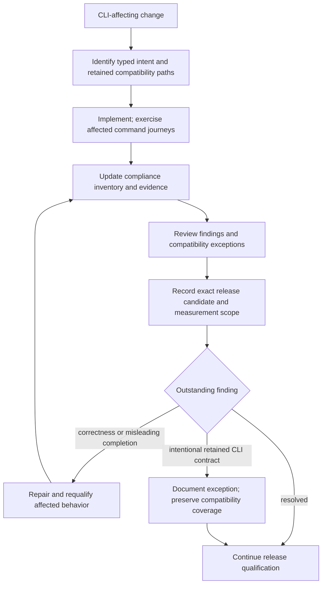

# CLIARE readiness and CLI compatibility

**Status:** Required development-review record; CLI measurement recorded below.
Final candidate checks, model quality and deployment remain separate.
**Last modified:** {{git-dates:page}}

Maintain this record whenever a change affects command discovery, arguments,
output, errors, progress, side effects, job control or CLI compatibility.
[CLIARE](https://github.com/modiqo/cliare) measurement complements source review
and real command journeys. A score does not certify model quality, valid CHAT,
successful output delivery or a deployed build. Do not claim a BA3 score from
measurements of another tool or an earlier candidate.

## Required development process

Registry-adoption review (2026-11-17) carries one lifetime claim and the actual
probed connection through discovery and pool integration. A repeat scan skips
an already adopted daemon before another health exchange. The native discovery journey exercises concurrent and repeated scans and uses
the retained connection for a request. A loopback control observes cancellation,
readmission and retirement on a foreign reply. Discovery counts actual
integrations. Candidate CLIARE
measurement and combined release qualification remain pending. See the
[adoption graph](../../architecture/runtime/batchalign-workers.md#lifetime-owned-registry-adoption).

Response-budget ownership review (2026-11-17) carries fixed budgets and renewable
loading windows in distinct private owners. Actual timed effects issue their own
operation-bound expiration errors. Startup, sequential and shared control paths
propagate that outcome. Existing wait durations, progress policy, Timeout/Stalled
categories and legacy infer/batch-infer routes retain their supported behavior.
The focused review uses compiler exclusions and native transport/timer contracts.
Candidate CLIARE measurement and combined release qualification remain pending.
See the [deadline graph](worker-protocol-v2.md#deadline-ownership).

Queue and observation review (2026-11-17) removes independent idle-availability
permits and repeated accounting reconciliation. Actual owner publication wakes
registered waiters. Consuming exchange completion binds its real result to
same-queue return. Unfinished cancellation retires the actual handle and original
capacity. Invalid native PID targets are rejected before process/group effects.
Pressure relief now follows twice the current host tier's admission floor.
Registry metadata preparation retains its classified source and computed fields.
Focused native and compiler qualification covers these boundaries. The existing
legacy command and infer/batch-infer routes retain their supported contracts.
Candidate CLIARE measurement and combined release qualification remain pending.
See the [queue and observation graphs](../../architecture/runtime/batchalign-workers.md#safeguard-1--idle-eviction-and-an-observable-wait).

Control and text graph review (2026-11-17) binds sequential completion to the
actual operation and derives wait policy from that operation. A foreign reply
retains incomplete-flight ownership. Text entry paths now refuse missing and
extra result populations as worker-protocol failures before application.
Source refusals and no-work bytes retain their original outcomes. Worker plans
carry source-derived load and key facts through checkout. The existing CLI
commands, legacy infer/batch-infer wire pathways and managed-server dispatch
remain supported. This source review adds no new executable CLIARE measurement.
See the [control and preparation graphs](../../architecture/runtime/batchalign-workers.md#operation-bound-control-exchanges)
and [text admission graph](../architecture/type-driven-design.md#collected-text-and-admitted-response-populations).

Owned-invocation review (2026-11-17) moves request/model facts through the
actual transport's consuming load and submission path. Shared pending work
retains memory, executor capacity and its cancellation registration after the
caller leaves. An identical retry rejoins detached work before another grant.
Sequential terminal admission binds the actual request ID and result task.
Startup and native fixtures share affirmative transport admission. Focused
qualification covers external bytes, leases, cancellation, timeout, rejoin and
uncertain writes. Current-candidate CLIARE, combined release qualification and
deployment remain pending. See the
[invocation graph](../../architecture/runtime/batchalign-workers.md#admitted-startup-and-submitted-work).

Lifetime worker-capacity review (2026-11-17) carries the original admitted slot
through startup, publication, stdio/TCP checkout, health checking and retirement.
The captured startup task owns its reservation until task cleanup or a
capacity-owning StartedWorker result. Cancelled startup releases both counts. Health checks consume real idle
availability, and own-group waiters observe released capacity immediately.
Global reservations also carry their own refund notification. SpawnOutcome
retains a closed admission-deferral cause, and each waiter observes its relevant
event. Focused contracts qualify cancellation, failure, speculative refund,
wakeup and raw transport outcomes. The retained legacy CLI pathways keep their compatibility contracts.
Current-candidate CLIARE measurement and release qualification remain pending.
See the [capacity graph](../../architecture/runtime/batchalign-workers.md#capacity-retained-through-the-worker-lifetime).

Invocation-owned cancellation review (2026-11-17) retains each shared-worker
request independently. A finishing request releases its own registration, and
cancellation projects each still-active process once. Stdio and TCP checkout
producers carry that registration, including fresh retry checkouts. Shared
worker operations retain it through preparation and execution. The focused
registration contract and real signal adapter qualify overlap, detach, later
reuse and process exit. The book records hundred-test graph review as part of
the development process. Current-candidate CLIARE and release qualification
remain part of the final candidate review. See the
[cancellation flow](../architecture/job-state-machine.md#invocation-owned-cancellation-targets).

Producer-owned text preparation review (2026-11-16) covers progress,
resource admission, output and file-error behavior. Morphotag and Utseg admit
file reads under the existing adaptive worker grant. Translation publishes each
source before reading the next, while coreference retains its cross-file batch.
Command-specific preparation states retain actual options and constrain
concurrent or batch dispatch. The producer carries the source, completed output
layout and run sink through consuming read and publication transitions. A failed declared prior read now
refuses that morphology file with its actual IO error. Gateway correspondence
admission refuses missing, repeated and foreign responses before publication.
Focused source-read, scheduler, output and restart contracts qualify these
boundaries. CLI spellings, wire schemas and retained direct CLI pathways keep
their existing compatibility contracts. Current-candidate CLIARE measurement
remains part of final release qualification. See the
[file preparation graph](../../architecture/runtime/dispatch.md#producer-owned-file-preparation).

Text-worker capability review (2026-11-16) gives each command its own worker
interface. Segmentation accepts a singular source with its admitted route.
Focused contracts observe exact source scheduling, carried routes, coreference
batch membership and output bytes through the normal dispatchers. Constructor
contracts retain language/model policy and the CLI/request-field refusal
diagnostic. The removed payload-independence check is enforced by the route
constructor's language/policy signature. Candidate CLIARE measurement remains
pending release qualification. See the
[capability graph](../../architecture/runtime/dispatch.md#worker-capabilities).

Compare's consuming-phase review (2026-11-16) removes optional stage payloads
and dynamic stage ordering. Reference admission precedes morphology by
construction. The output owner retains its original execution context through
required writes and completion, and only that completion releases a consolidated
metrics row. Focused contracts exercise external reference bytes, filesystem
selection, both output modes and write failures through `dispatch_compare_job`.
The compatibility review covers the CLI argument and output schemas.
Current-candidate CLIARE measurement remains pending release qualification.

Output-layout and target review (2026-11-16) carries each catalog-derived primary or named
CHAT/CSV pair through its writers. Compare selects its pair before inference.
Benchmark persistence consumes the output plan, and successful completion
requires every staged and requested artifact write. The transport projection
keeps primary-first ordering and derives roles from distinct artifact types.
Source admission binds pending input observations and the selected layout to
the filesystem. A mismatch is a planning failure before output publication.
Audio plans retain naming through attempts, and consuming written receipts
complete the carried input name. Leaf writers consume their prepared targets.
Focused filename, CSV, write-failure, native-export and restart contracts
qualify these boundaries. Existing command spellings and retained direct CLI
pathways keep their compatibility contracts. Current-candidate CLIARE
measurement remains part of release qualification. See the
[output ownership graph](../architecture/server-architecture.md#source-bound-output-layouts).

Preflight ownership review (2026-11-16) includes the file-error surface.
Metadata failures retain their actual filesystem reason, so denied access is
reported as `Cannot inspect media file` with that reason. Source-bound
rejection recording writes setup-attempt and file-status fields
through the run's admitted sink. Focused filesystem, SQLite and restart
contracts qualify those effects. Current-candidate release and CLIARE
measurement belong to the final release qualification recorded below.

Job-control review includes admission before the first file: the consuming run
scope now owns job-slot and host-memory waits as well as worker preparation.
Cancellation during those waits closes unfinished files without waiting for
capacity. Cancellation accepted before claim creation grants completion-only
authority; a delayed task for another terminal job cannot acquire resources.
Shutdown supersedes the old run so its cleanup preserves resumable work.
These changes preserve CLI spellings, wire schemas and legacy pathways. The
HTTP capacity-wait control and persistent shutdown/recovery control qualify
those boundaries separately from current-candidate CLIARE measurement. See
the [run ownership flow](../architecture/job-state-machine.md#what-a-cancel-stops).

Network exposure and submission admission (2026-11-12) are deliberate behavior
changes with unchanged spellings. `serve start --host` and `server.yaml`'s
`host` keep their forms, and an explicit `0.0.0.0` still serves every
interface; only the default moved from `0.0.0.0` to `127.0.0.1`, because the
server has no authentication and accepts server-side paths. Every local
client already reaches its server at `127.0.0.1`. `POST /jobs` (and the direct
CLI path) now refuses a content-mode file name that is absolute, contains `.`
or `..`, repeats another, or needs another file's name to be a folder, with a
validation error before any staging; ordinary and nested relative names are
admitted as before. Validation also refuses duplicate output paths, a
`display_names` list of another length than `source_paths`, and paths-mode
fields in a content-mode request, and resolves `utseg`'s route itself, so a
language with no route is refused on every path, not only once a worker
catalog exists.

Paths-mode admission (2026-11-12) is a deliberate behavior change with
unchanged spellings. No public flag or argument changed; the submit and
restart requests gain an optional `x-batchalign-same-user` proof header, the
server a `POST /same-user/nonce` route, and the CLI a hidden `serve
sign-request` subcommand for the desktop app. A server admits any path for its
own account (the CLI and desktop app prove each request with the key in its
handshake; the key is never sent), and for anyone else only inside
`server.yaml`'s new `paths_mode_roots` folders; without a proof and with none
listed, a command is refused at submission with a validation error naming the
setting, and a proof that does not hold is refused with a 403 naming the
cause. A real binary run (no folders configured) showed the CLI's `morphotag`
through a loopback `--server` completing, an unproved request refused, a
forged proof refused, a proof signed by `serve sign-request` accepted, and its
replay refused. `--no-server` and `--sequential`
(direct execution, the user's own process) are unaffected and remain the
supported legacy pathways. Paths-mode job listings name files relative to the
submitted folder, and two inputs with one display name are refused. Evidence
is source review and the library and integration suites on the candidate;
no CLIARE measurement of this candidate exists yet.

1. Identify the affected CLI contract and its owning types before implementation.
   Decode retained spellings at the boundary into the same typed command intent;
   do not duplicate runtime policy behind an alias.
2. Update the inventory below with the implemented behavior, focused evidence,
   remaining gaps and any intentional compatibility exception. Distinguish
   source inspection, deterministic command journeys, external measurement and
   real-model qualification.
3. Preserve retained legacy pathways. Review their producers and callers before
   removing an internal state or its tests. Remove tests of internal states the
   new types make unreachable; keep external admission and compatibility tests.
4. Review human and machine-visible completion, diagnostics and recovery for the
   affected command. A terminal job may contain unavailable or diagnosed files;
   the CLI must not imply every requested result was produced.
   Update the owning user/developer explanations in the same coherent batch.
   When ownership, admission or recovery changes, update its Mermaid flow and
   check actual rendered labels and edges; a book build alone does not qualify
   the diagram. Distinguish implemented transitions from approved future work.
5. At release review, record the exact candidate and CLIARE tool identity, scope,
   findings and dispositions. An unavailable or omitted measurement remains
   explicitly pending. Use controlled, disposable inputs and isolated probing;
   untrusted command enumeration must not access real credentials or submit
   provider work. This review requirement adds no automatic probing or CI gate.

## Model-fixture ownership review, November 16, 2026

The consuming fixture graph uses current lease, dispatch, file-outcome and
failure operations. It removes arbitrary lifecycle setters, derives file state
from retained inputs and prevents consumed preparation from running again.
Restart fixture admission withholds start until the old claim is released.
Current startup contracts retain their real SQLite boundary. This is an
internal fixture change with no CLI grammar change. The documented retained
CLI pathways continue to apply. Candidate-wide CLIARE measurement remains part
of release qualification.

## Typed planning-request review, November 16, 2026

Dispatch planning consumes a selected option-family request. The request retains
its workload and borrowed configuration, and executable plans carry completed
engine, cache, speaker and host-policy decisions forward. Policy fixtures use
that admission path without manufacturing a job or filesystem. Concrete
extractor arguments prevent cross-command calls and remove repeated family
checks. The CLI grammar and retained compatibility pathways use their existing
contracts. Candidate-wide CLIARE measurement remains part of release
qualification. Focused compiler, wire-policy and native-flow observations are
recorded separately from release qualification.

## Actual-container admission review

Media preparation now inspects ffprobe's container result before selecting
passthrough or conversion. A QuickTime recording named `.mp3` enters the
content-addressed PCM cache before native decoding. The private consuming
preparation states replace extension-based permission. Unreadable or unknown
media fails during preparation with the probe diagnostic. CLI spellings and
the retained direct pathways use the same helper.

A synthetic QuickTime/MP3 contract failed under the previous implementation
and passes under container admission, covering misleading suffixes, native
MPEG passthrough, shared cache identity and source preservation. Real managed
command qualification and decoder results are recorded separately with the
candidate evidence. CLIARE measurement remains separate release evidence.

## Stanza 1.15.1 review

The dependency update affects model-derived morphotag content and provenance.
Qualification exercises the ordinary managed HTTP route and the CLI's existing
same-user path admission. The shared golden-session type owns an admitted HTTP
session, while the Python CLI fixture admits an explicitly selected local
endpoint and executable. Individual jobs keep private staging paths and the
server owns model preparation and scheduling. Source words and selected model
identities remain associated with the recorded output comparisons.

The command spellings and retained legacy direct CLI pathways keep their
compatibility contracts. Local qualification uses managed execution. A
package-version change can retain earlier Stanza model weights because the
resource namespace remains 1.15.0, so release evidence must name the actual
catalog and model files used. This is a dependency and real-model review.
A new CLIARE measurement has not been performed for this candidate.

## Timestamp dependency review, November 15, 2026

Jiff 1.0 uses `ZonedDateTime` and `to_zoned_datetime` at the existing typed
time boundaries. `MachineTime` continues to admit offset-bearing instants and
carry normalized millisecond UTC values through storage and JSON. Local
cancellation displays and provenance formatting consume those typed instants
and zones. Qualification includes the timestamp, SQLite, provenance and
local-day audit contracts, plus an optimized CLI build. The dependency review
uses the existing CLI grammar and retained compatibility pathways. Current
CLIARE measurement remains a separate release observation.

## Retained legacy pathways

Compatibility is a product requirement, not an automatic compliance failure.
These are verified examples from the current argument model, not a claim of a
complete compatibility audit:

| Pathway | Required disposition |
| --- | --- |
| Hidden alignment aliases `--whisper-fa` and `--wav2vec` | Keep accepted aliases and normalize them to the typed FA engine selection. Prefer the current engine option in new examples. |
| Alignment `--pauses` | Retain its legacy Whisper text-shaping meaning. Do not conflate it with word-gap projection policy. |
| Alignment `--review-level` | Keep argument compatibility. It does not restore `%xalign` or `%xrev`; decisions remain structured run evidence. |
| Positional `jobs <id>` and the existing flag-driven jobs form | Preserve existing job-inspection callers while extending the command family. |
| Existing direct-host CLI pathways, including `--no-server` and `--sequential` | Keep supported CLI compatibility. Assess their admission, output and recovery contracts explicitly; do not delete them to improve a measurement score. Runtime qualification follows the authorized execution environment. |

A compatibility exception must name the exact syntax, current typed destination,
reason it remains, behavior preserved, and qualification evidence. A deliberate
removal needs an explicit product decision and migration guidance; tool feedback
alone does not authorize it.

## Release review, November 7, 2026

The measured CLI source is `a8716f5443bf9143f7d53e535b4bb87532a41343`,
build `0.8.8-v0.8.8-54-ga8716f54-1794054772`. CLIARE0.1.9 binary SHA256:
`a44351b2544dc047b2c91f0c4d68eb0eeda6966c47dee577caa98e4d47044466`.
The launcher SHA256 is
`80d566554223bf44f7c58f21bebcb6716d01c0f2ca2278be6a52373e77b0d68b`;
this identifies the launcher, not its installed implementation. The producing
wheel SHA256 is
`6e63bc7233c8a0db98b3b1e3ea7246c2295028f4af750ab82d19c348d17a50e1`.

The existing isolated deep-profile harness used an empty home, cleared environment
and operating-system network denial. All202 probes completed without timeout or
spawn failure;62 discovered commands were runtime-confirmed. Traversal converged
with no pending frontier, depth/probe-budget skips or exhausted budget. No
persistent filesystem changes were observed in the registered sandbox regions.
This is the first BA3 measurement in this record: **80/100**, labelled
`experimental_partial`, is a diagnostic baseline, not a release-quality score.

| Finding | Evidence and disposition |
| --- | --- |
| `issue.precondition_blocked`, `models train` | Misclassification. The cited probe supplied an unknown flag; the retained Python training CLI explicitly rejected it with `No such option` and exit2. This is not evidence of a missing runtime precondition. Direct training help also succeeded. Preserve the legacy route. |
| `finding.output.no_machine_readable_mode` | Discovery limitation. The run discovered zero flags/output modes. `jobs --help` advertises `--json`; a separate read-only `jobs <id> --json --server <url>` journey parsed the existing native job successfully. Do not describe the CLI as lacking JSON, or claim every command has a machine-readable contract. |
| `issue.alternate_help_form_unavailable`, `help` | Optional compatibility advisory for `help --help`. Canonical direct command help remains available; this does not block alignment. |
| `issue.invalid_flag_diagnostics_unknown`, `models train` | The same cited unknown-flag probe already has an explicit diagnostic and nonzero exit2 from the retained training CLI. No repeated parser or new test is needed to change this measurement classification. |

A subsequent CI-fixture repair changes no CLI or runtime inference contract:
worker-dependent library controls run with the required worker environment,
and synthetic loaded hosts declare their complete interface and kernel route.
The measured executable behavior remains applicable; the follow-up source still
requires its own gate and hosted CI results.

All four findings are dispositioned above. No finding establishes an alignment
correctness defect; no legacy pathway was removed to improve the score. Full
raw evidence and producer identities are retained with the release qualification.
A later CLI-affecting implementation requires new review; documentation-only
recording does not rerun unchanged executable probes. Broader resource work
remains follow-up unless an observed functional failure requires it.

## Current change inventory

| Area | Source status | Qualification still required |
| --- | --- | --- |
| FA model preparation and memory waiting | Typed preparation and lease-owning execution are implemented; `preparing_alignment` distinguishes candidate work from final inference, alongside startup/download/wait progress. | Integrated managed execution and visible CLI progress for the final candidate. |
| Cancellation and file completion | A linear `AdmittedRun` binds the actual store, generation, snapshot and cancellation. Consuming `RunScope` supervises preparation, worker warmup and file dispatch; children inherit context without dispatch authority. Completion consumes the claim and admits generation, file cleanup and derived job status in one registry mutation. | Model-free HTTP failure/restart/cancel controls cover advancing capability loads and pre-scaling before any file starts. Whole-candidate CLI measurement and real-model qualification remain separate; no grammar or legacy route was removed. |
| Resource-constrained alignment | Adaptive source-bound partitioning is integrated in full and incremental FA; exact unavailable constraints are retained in evidence schema 11. Cache-first preparation, unique input owners and retained-input fallback prevent repeated work. | Deterministic cache and seven-case partial-output parity controls pass; final candidate command journeys and managed-model qualification remain pending. |
| UTR search admission | Development source consumes literal preparation into one retained graph survey and its row plan; representation rejection returns that surveyed owner. Execution consumes its plan. The execution work counter can no longer refuse at 64 million operations; preparation/representation work, storage and candidate limits remain. CPU search clears preceding ASR-window counts to show indeterminate recovery. Shared host-memory admission is unfinished; no new CLI switch or compatibility removal is implemented. | Existing correspondence oracles include complete common-pair recovery beyond the former execution cutoff. Qualify prepared-demand admission, cancellable waiting, resource refusals, long-input recovery and visible progress on the final candidate; retain direct-library and legacy CLI routes. |
| Supplied-window recovery under `--main-bullets keep` / `exact` | Actual missing slots after primary projection and kept-bullet imposition grant one consuming exact-window attempt. Complete output cannot trigger retry preparation or inference, including under gap healing. Accepted primary slots remain untouched. Normal cache identity/resource admission apply; optional `RequireCache` misses preserve partial output and never infer. Full/incremental share the exclusive session. Legacy spellings remain accepted. | Complete-output/no-retry, missing-slot recovery, neighbour, preparation-ownership and cache-only controls; final managed-model recovery and candidate measurement remain separate. |
| Recovery fault outcomes | Source-binding and requested-evidence retention faults enter `UtrRecoveryStop::Failed`, preserving their typed cause and preventing output/retry. Provider unavailability remains a recorded shortfall; no CLI spelling changes. | Extend existing source-identity and real writeback policy controls; verify initial and fallback handling. Candidate-wide measurement remains separate. |
| Localized morphotag failures | A worker failure for one item (`UdAnalysis::WorkerFailed`) or one sentence the realigner cannot bind (`RealignRefused`) declines only that utterance; the file is written with diagnostics, not failed. Each declined utterance carries a `%xbatchalign` note built from the same list as the job record's shortfall, replaced on every run. No CLI spelling or exit-code meaning changes; a file that used to fail now exits as written with diagnostics. | Boundary tests cover the worker-failed decline, the per-sentence refusal and note replacement; a managed morphotag run over a file with a known unbindable utterance remains to be shown on the final candidate. |
| FA cache retention | The storage owner derives disjoint raw/derived addresses from admitted evidence. Writers cannot supply a separate request key or engine namespace. Older raw and timing-only entries remain readable; raw-first replay and CLI cache policy are unchanged. | Actual SQLite retention, derived fallback and legacy-cache controls; final candidate measurement remains separate. |
| Speaker invocation and cache evidence | The existing `diarize` and `transcribe` debug option publishes a schema-2 speaker-stage receipt. It retains the original worker and observed model evidence across raw and derived cache hits, with explicit evidence gaps for older rows. Existing command forms and cache identities are preserved. | Focused worker-wire, SQLite replay and debug-writer contracts cover the changed boundary. Managed-model command journeys and candidate-wide CLI measurements remain separate. |
| Worker launch admission | Internal worker argv rejects ambiguous targets and invalid transport parameters before startup. Supported Rust-generated launches, targetless echo, TCP automatic port selection and the ready envelope retain their existing forms. | Qualify with native argv refusals, model-free stdio/TCP launches and the startup identity contract. The worker checks do not produce a CLIARE score. |
| `doctor` worker checks | `doctor` starts its workers through the pool's own launch path (`PoolConfig::spawn_standalone`: the worker key and config a pool derives for the morphotag request), sends the `execute_v2` request a morphotag job sends, and admits the reply with the job's decoder (`admit_morphosyntax_result`). Before this, the worker refused doctor's launch (no `--serving`), the smoke check could pass with "0 words", and it sent `batch_infer`, which jobs no longer send. Command form and exit-code meaning are unchanged. Two visible differences: a broken worker fails the check instead of passing it, and on a busy host the morphosyntax check waits for memory as a job would, instead of starting a worker regardless. A silent worker now times out at the configured stall windows instead of hanging doctor. | A real `batchalign3 doctor` run passes every check with a non-zero word count; `doctor --lang qaa` fails the morphosyntax check with the Stanza catalog's refusal; a pure verdict test covers analyzed, failed, wordless and empty replies. |
| Media lookup, export and speaker turns | Lookup skips non-files and reused directory observations. Export binds its primary and optional staged roles before encoding and retains the encoded header for duration measurement. Speaker turns carry admitted intervals into the existing JSON format. Existing command forms are retained. | Native lookup, export, publication and JSON contracts qualify these boundaries. Candidate-wide CLI measurements remain a separate step. |
| Alignment media measurement | Native preparation consumes the admitted header for duration. Every conversion reads its produced WAV's length before publication and carries it across. Initial and fallback UTR and FA reuse the prepared timeline or its original probe refusal. Timing-only output and existing command forms are retained. | Native header reuse, converted PCM duration, damaged decode, MPEG packet bounds and retained-refusal controls cover the changed boundaries. Managed-model and candidate-wide CLI measurements remain separate. |
| Text worker submission | Prepared reads transfer single-use authority to the command gateway. The original source retains publication ownership. The worker retry loop owns its packet and observes pre-cancellation before creating an attempt. Existing command forms and batching policies are retained. | Compiler admission, model-free gateway and publication journeys, and the cold-cancellation control cover this boundary. Managed-model and candidate-wide CLI measurements remain separate. |
| Translation source admission | The named CHAT parse and diagnostics reach complete validation before language routing. Collection consumes the admitted model. Invalid sources report a located refusal before gateway submission, and valid sources without translatable items retain their original bytes. | Model-free dispatch and publication cover corrupt tiers, a missing language header, filename mismatch and bilingual routing. Managed-model and candidate-wide CLI measurements remain separate. |
| Retained command forms | Examples above were checked against the current argument definitions and CLI reference. | Full compatibility inventory and affected command journeys; no BA3-wide compliance claim. |
| CLIARE measurement | No current-candidate BA3 score is recorded here. | Pinned tool and exact candidate identities, bounded scope, retained findings and reviewed dispositions. |

FA dispatch now consumes each completed request into its cache/ledger sink
before releasing the next request. Each awaited slot has one non-cloneable
reply ticket; cache lookup, inference authorization and preparation carry that
same capability. The producer uses the ticket's request, and retention consumes
the ticket, so consumers cannot choose another ledger or complete twice.
Reused and unavailable populations mint no ticket. Actual missing replies and
malformed model populations remain boundary failures; loss of the receiving
owner is an internal failure, never a fabricated cancellation.
Progress derives from those slots and advances as each canonical or shared
projection completes its ticket. Completed raw
results are no longer collected for the entire batch. Optional supplied recovery
has one authorized input and one direct result, removing the impossible empty
batch branch. Command forms, progress schema, cache identity and retained legacy
routes are unchanged; completion counts describe handled output units, including
unaligned outcomes. Existing boundary controls and final managed-model progress
qualification remain distinct from candidate CLIARE measurement, which is
pending. See [completion ownership](adaptive-fa-admission.md#each-completion-owns-the-next-dispatch).

Canonical UTR witness preparation now consumes the observed matching edges and
trimmed interior into a resource-admitted scorer. Empty interiors cannot allocate
a score row. Literal representation refusal retains the alternate projection
before either executes; the one-million-cell selection constant is removed.
This changes internal preparation/refusal behavior without adding CLI switches,
removing legacy paths, or completing adaptive shared-memory admission. Independent
exactness, cancellation and admission controls cover this boundary; final
candidate command journeys and CLIARE measurement remain pending. See the
[witness ownership flow](backchannel-aware-alignment.md#packed-feasible-score-producer-and-ownership).

UTR graph preparation now owns its actual turns, prefix boundaries and observed
episode geometry. Construction consumes that owner; completed proof alone
consumes the retained turn-frontier preparation. Detached input/count arguments,
repeated classification and the missing-end-offset fallback are removed. Existing
numerical, source-order, policy and cancellation controls remain; no new trivial
state tests or CLI switches. Matching policy, output schemas, cache identity and
legacy command paths are unchanged. The legacy graph quota and shared host-memory
admission remain unfinished; current-candidate command journeys and CLIARE
measurement remain pending. See [graph preparation ownership](backchannel-aware-alignment.md#input-owned-graph-preparation).

Packed UTR proof now owns compressed per-word candidate domains and admits newly
observed bits before mutation. Partial candidates cannot escape the pending
proof, and checkpoint fixtures use real input-bound admission instead of mutable
post-admission geometry or fabricated dimensions. Exactness, candidate refusal
and cancellation controls remain; the word-boundary oracle is extended without
increasing test count. CLI spellings, output/cache schemas, matching policy and
retained legacy routes are unchanged. Existing UTR resource caps remain pending
adaptive admission; current-candidate CLIARE measurement is still required at
release review. See [candidate ownership](backchannel-aware-alignment.md#proof-owned-candidate-blocks).

The monotonic literal proof also removes its universal 64-million prospective
work ceiling. A consuming storage-admitted operation retains the exact input,
checkpoint stride and candidate allowance; CPU estimates cannot become a data
refusal. The reproduced 5,000-word boundary and every-checkpoint cancellation
control extend existing tests. Legacy storage/candidate and independent inspection
policies remain explicit unfinished adaptive-admission work. Command forms,
wire/cache schemas and retained legacy routes are unchanged; final candidate
measurement remains pending. See [monotonic proof ownership](backchannel-aware-alignment.md#packed-monotonic-common-proof).

Monotonic fuzzy proof also removes its universal word-pair work cutoff. One
input-owned preparation retains exact spelling classes, policy and candidate
allowance; only completed rows can supply reusable reference addresses. Sparse
forward and backward scores have separate consuming states, with no uncomputed
rank sentinels or simultaneously retained Fenwick scratch. Genuine candidate
refusal reports the actual caller's allowance. The historical
`fuzzy_comparisons` diagnostic variant remains for recorded-result compatibility;
current native proof cannot emit it. The large empty-relation boundary,
nontransitive fuzzy relation controls and every-checkpoint cancellation extend
existing tests without increasing test count. Command forms, matching policy,
cache schemas and legacy routes are unchanged. Candidate/storage policies and
shared-memory admission remain unfinished; final candidate command journeys and
CLIARE measurement are pending. See [fuzzy and sparse ownership](backchannel-aware-alignment.md#owned-fuzzy-preparation-and-sparse-score-phases).

MMS loaded-fact ownership is an internal preparation change: the loaded handle
owns its admitted alphabet, and the preparer retains fixed model metadata or a
qualification refusal. Request-shaped projection and memory admission remain
required. No command spelling, option, output schema or legacy pathway changes;
this source change does not supply a new CLIARE measurement or memory-envelope
qualification. See [loaded facts and request facts](adaptive-fa-admission.md#loaded-facts-are-retained-request-facts-are-prepared).

Native CPU convolution preparation now includes source-qualified hidden scratch
in addition to virtual output tensors. The actual selected backend supplies
its matching MM allocation rule or NNPACK sizing-only query. Unqualified layouts,
exports and sizing outcomes use the existing projection-unavailable refusal;
command spelling, wire schema and legacy routes are unchanged. Native retained
workspace and full model/host memory qualification remain open. See
[native scratch ownership](adaptive-fa-admission.md#native-cpu-scratch-belongs-to-the-observed-operation).

Shared virtual preparation now admits the copied model, numerical-fallback-free
epoch and storage census together. Unsupported metadata cannot run a numerical
kernel to discover shapes. Copy rejection precedes serving-mode changes, and
attention calls retain their actual ledger instead of accepting a substitute
tracker. This internal boundary changes explicit preparation failure behavior;
CLI forms, output schemas and retained legacy routes are unchanged. Foreign
kernel/copy controls and final candidate measurement remain separate evidence.
See [owned virtual epochs](adaptive-fa-admission.md#virtual-model-preparation-admits-an-owned-epoch).

Attention projection now binds registered foreign composite capabilities to
one virtual epoch and the original inputs. The same allocation ledger observes
internal score/softmax/mask lifetimes; unavailable composites refuse rather than
reuse an opaque output-only estimate. Request-shaped demand can therefore grow
through the existing admission/partition path. Command forms, cache identities,
wire schemas and legacy routes are unchanged. Final candidate measurement,
backend-specific refinement and managed-memory qualification remain pending.
See [attention projection ownership](adaptive-fa-admission.md#attention-composites-expose-their-internal-virtual-allocations).

FA full/incremental execution, population/worker preparation, UTR ASR fetch and
legacy direct CLI execution now issue compact heap-owned futures at their
producers. This changes ownership/layout, not command syntax, output schemas,
cache identities or compatibility routes. Size diagnostics, existing functional
controls and optimized-build qualification are recorded separately from CLIARE
measurement. See [asynchronous ownership](adaptive-fa-admission.md#compact-ownership-at-asynchronous-boundaries).

Whisper and Qwen preparation now retain admitted fixed model facts at load
alongside MMS. Qwen's prepared input owns the coupled native model/geometry;
fixed metadata refusal remains unavailable for that epoch. Per-request
constraints, tokenization and isolated projection still run. No command form,
wire schema, cache identity or legacy pathway changes; this is not a new CLIARE
measurement or managed-model memory qualification. See
[loaded preparation facts](adaptive-fa-admission.md#loaded-facts-are-retained-request-facts-are-prepared).

Runner admission now binds the granting store and raw registry claim together.
Only the resulting `AdmittedRun` can derive execution contexts or consume
completion, failure and release. A stopped admission can only complete.
The shared event recorder replaces empty-store policy fixtures. This refines
internal ownership and keeps the existing current-generation checks at mutable
registry boundaries. Final-candidate CLI journeys and CLIARE measurement remain
pending. See the [runner boundary](../architecture/server-architecture.md#runner-boundary).

Input fixture construction now uses complete per-file records and real path-set
admission. The unused copied I/O-mode field leaves the internal job plan.
Native writer proofs, explicit clock advancement and the completed backend echo
journey strengthen local qualification. The actual input-mode variants continue
to determine file resolution and publication. Current-candidate CLI measurement
remains pending. See [input fixture ownership](testing.md#complete-per-file-input-fixtures).

Update this table as work lands; do not leave completed or changed behavior
described as pending, or promote a source implementation to runtime-qualified
status without its evidence. See [adaptive FA admission](adaptive-fa-admission.md),
the [contributor workflow](workflow-contributor-guide.md), and the
[release checklist](release-checklist.md).
