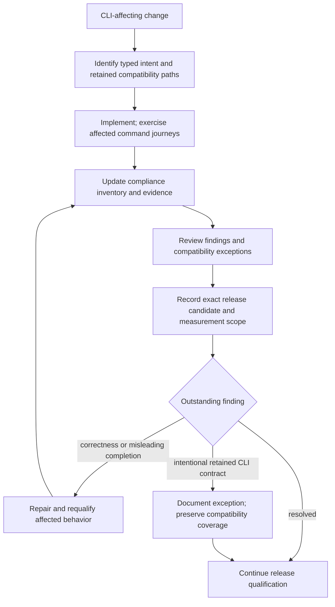

# CLIARE readiness and CLI compatibility

**Status:** Required development-review record; CLI measurement recorded below.
Final candidate checks, model quality and deployment remain separate.
**Last modified:** {{git-dates:page}}

Maintain this record whenever a change affects command discovery, arguments,
output, errors, progress, side effects, job control or CLI compatibility.
[CLIARE](https://github.com/modiqo/cliare) measurement complements source review
and real command journeys. A score does not certify model quality, valid CHAT,
successful output delivery or a deployed build. Do not claim a BA3 score from
measurements of another tool or an earlier candidate.

## Required development process

Job-control review includes admission before the first file: the consuming run
scope now owns job-slot and host-memory waits as well as worker preparation.
Cancellation during those waits closes unfinished files without waiting for
capacity. Cancellation accepted before claim creation grants completion-only
authority; a delayed task for another terminal job cannot acquire resources.
Shutdown supersedes the old run so its cleanup preserves resumable work.
These changes preserve CLI spellings, wire schemas and legacy pathways. The
HTTP capacity-wait control and persistent shutdown/recovery control qualify
those boundaries separately from current-candidate CLIARE measurement. See
the [run ownership flow](../architecture/job-state-machine.md#what-a-cancel-stops).

Network exposure and submission admission (2026-11-12) are deliberate behavior
changes with unchanged spellings. `serve start --host` and `server.yaml`'s
`host` keep their forms, and an explicit `0.0.0.0` still serves every
interface; only the default moved from `0.0.0.0` to `127.0.0.1`, because the
server has no authentication and accepts server-side paths. Every local
client already reaches its server at `127.0.0.1`. `POST /jobs` (and the direct
CLI path) now refuses a content-mode file name that is absolute, contains `.`
or `..`, repeats another, or needs another file's name to be a folder, with a
validation error before any staging; ordinary and nested relative names are
admitted as before. Validation also refuses duplicate output paths, a
`display_names` list of another length than `source_paths`, and paths-mode
fields in a content-mode request, and resolves `utseg`'s route itself, so a
language with no route is refused on every path, not only once a worker
catalog exists.

Paths-mode admission (2026-11-12) is a deliberate behavior change with
unchanged spellings. No public flag or argument changed; the submit and
restart requests gain an optional `x-batchalign-same-user` proof header, the
server a `POST /same-user/nonce` route, and the CLI a hidden `serve
sign-request` subcommand for the desktop app. A server admits any path for its
own account (the CLI and desktop app prove each request with the key in its
handshake; the key is never sent), and for anyone else only inside
`server.yaml`'s new `paths_mode_roots` folders; without a proof and with none
listed, a command is refused at submission with a validation error naming the
setting, and a proof that does not hold is refused with a 403 naming the
cause. A real binary run (no folders configured) showed the CLI's `morphotag`
through a loopback `--server` completing, an unproved request refused, a
forged proof refused, a proof signed by `serve sign-request` accepted, and its
replay refused. `--no-server` and `--sequential`
(direct execution, the user's own process) are unaffected and remain the
supported legacy pathways. Paths-mode job listings name files relative to the
submitted folder, and two inputs with one display name are refused. Evidence
is source review and the library and integration suites on the candidate;
no CLIARE measurement of this candidate exists yet.

1. Identify the affected CLI contract and its owning types before implementation.
   Decode retained spellings at the boundary into the same typed command intent;
   do not duplicate runtime policy behind an alias.
2. Update the inventory below with the implemented behavior, focused evidence,
   remaining gaps and any intentional compatibility exception. Distinguish
   source inspection, deterministic command journeys, external measurement and
   real-model qualification.
3. Preserve retained legacy pathways. Review their producers and callers before
   removing an internal state or its tests. Remove tests of internal states the
   new types make unreachable; keep external admission and compatibility tests.
4. Review human and machine-visible completion, diagnostics and recovery for the
   affected command. A terminal job may contain unavailable or diagnosed files;
   the CLI must not imply every requested result was produced.
   Update the owning user/developer explanations in the same coherent batch.
   When ownership, admission or recovery changes, update its Mermaid flow and
   check actual rendered labels and edges; a book build alone does not qualify
   the diagram. Distinguish implemented transitions from approved future work.
5. At release review, record the exact candidate and CLIARE tool identity, scope,
   findings and dispositions. An unavailable or omitted measurement remains
   explicitly pending. Use controlled, disposable inputs and isolated probing;
   untrusted command enumeration must not access real credentials or submit
   provider work. This review requirement adds no automatic probing or CI gate.

## Retained legacy pathways

Compatibility is a product requirement, not an automatic compliance failure.
These are verified examples from the current argument model, not a claim of a
complete compatibility audit:

| Pathway | Required disposition |
| --- | --- |
| Hidden alignment aliases `--whisper-fa` and `--wav2vec` | Keep accepted aliases and normalize them to the typed FA engine selection. Prefer the current engine option in new examples. |
| Alignment `--pauses` | Retain its legacy Whisper text-shaping meaning. Do not conflate it with word-gap projection policy. |
| Alignment `--review-level` | Keep argument compatibility. It does not restore `%xalign` or `%xrev`; decisions remain structured run evidence. |
| Positional `jobs <id>` and the existing flag-driven jobs form | Preserve existing job-inspection callers while extending the command family. |
| Existing direct-host CLI pathways, including `--no-server` and `--sequential` | Keep supported CLI compatibility. Assess their admission, output and recovery contracts explicitly; do not delete them to improve a measurement score. Runtime qualification follows the authorized execution environment. |

A compatibility exception must name the exact syntax, current typed destination,
reason it remains, behavior preserved, and qualification evidence. A deliberate
removal needs an explicit product decision and migration guidance; tool feedback
alone does not authorize it.

## Release review, November 7, 2026

The measured CLI source is `a8716f5443bf9143f7d53e535b4bb87532a41343`,
build `0.8.8-v0.8.8-54-ga8716f54-1794054772`. CLIARE0.1.9 binary SHA256:
`a44351b2544dc047b2c91f0c4d68eb0eeda6966c47dee577caa98e4d47044466`.
The launcher SHA256 is
`80d566554223bf44f7c58f21bebcb6716d01c0f2ca2278be6a52373e77b0d68b`;
this identifies the launcher, not its installed implementation. The producing
wheel SHA256 is
`6e63bc7233c8a0db98b3b1e3ea7246c2295028f4af750ab82d19c348d17a50e1`.

The existing isolated deep-profile harness used an empty home, cleared environment
and operating-system network denial. All202 probes completed without timeout or
spawn failure;62 discovered commands were runtime-confirmed. Traversal converged
with no pending frontier, depth/probe-budget skips or exhausted budget. No
persistent filesystem changes were observed in the registered sandbox regions.
This is the first BA3 measurement in this record: **80/100**, labelled
`experimental_partial`, is a diagnostic baseline, not a release-quality score.

| Finding | Evidence and disposition |
| --- | --- |
| `issue.precondition_blocked`, `models train` | Misclassification. The cited probe supplied an unknown flag; the retained Python training CLI explicitly rejected it with `No such option` and exit2. This is not evidence of a missing runtime precondition. Direct training help also succeeded. Preserve the legacy route. |
| `finding.output.no_machine_readable_mode` | Discovery limitation. The run discovered zero flags/output modes. `jobs --help` advertises `--json`; a separate read-only `jobs <id> --json --server <url>` journey parsed the existing native job successfully. Do not describe the CLI as lacking JSON, or claim every command has a machine-readable contract. |
| `issue.alternate_help_form_unavailable`, `help` | Optional compatibility advisory for `help --help`. Canonical direct command help remains available; this does not block alignment. |
| `issue.invalid_flag_diagnostics_unknown`, `models train` | The same cited unknown-flag probe already has an explicit diagnostic and nonzero exit2 from the retained training CLI. No repeated parser or new test is needed to change this measurement classification. |

A subsequent CI-fixture repair changes no CLI or runtime inference contract:
worker-dependent library controls run with the required worker environment,
and synthetic loaded hosts declare their complete interface and kernel route.
The measured executable behavior remains applicable; the follow-up source still
requires its own gate and hosted CI results.

All four findings are dispositioned above. No finding establishes an alignment
correctness defect; no legacy pathway was removed to improve the score. Full
raw evidence and producer identities are retained with the release qualification.
A later CLI-affecting implementation requires new review; documentation-only
recording does not rerun unchanged executable probes. Broader resource work
remains follow-up unless an observed functional failure requires it.

## Current change inventory

| Area | Source status | Qualification still required |
| --- | --- | --- |
| FA model preparation and memory waiting | Typed preparation and lease-owning execution are implemented; `preparing_alignment` distinguishes candidate work from final inference, alongside startup/download/wait progress. | Integrated managed execution and visible CLI progress for the final candidate. |
| Cancellation and file completion | A linear `RunnerClaim` binds generation, snapshot and cancellation. Consuming `RunScope` supervises preparation, worker warmup and file dispatch; children inherit context without dispatch authority. Completion consumes the claim and admits generation, file cleanup and derived job status in one registry mutation. | Model-free HTTP failure/restart/cancel controls cover advancing capability loads and pre-scaling before any file starts. Whole-candidate CLI measurement and real-model qualification remain separate; no grammar or legacy route was removed. |
| Resource-constrained alignment | Adaptive source-bound partitioning is integrated in full and incremental FA; exact unavailable constraints are retained in evidence schema 11. Cache-first preparation, unique input owners and retained-input fallback prevent repeated work. | Deterministic cache and seven-case partial-output parity controls pass; final candidate command journeys and managed-model qualification remain pending. |
| UTR search admission | Development source consumes literal preparation into one retained graph survey and its row plan; representation rejection returns that surveyed owner. Execution consumes its plan. The execution work counter can no longer refuse at 64 million operations; preparation/representation work, storage and candidate limits remain. CPU search clears preceding ASR-window counts to show indeterminate recovery. Shared host-memory admission is unfinished; no new CLI switch or compatibility removal is implemented. | Existing correspondence oracles include complete common-pair recovery beyond the former execution cutoff. Qualify prepared-demand admission, cancellable waiting, resource refusals, long-input recovery and visible progress on the final candidate; retain direct-library and legacy CLI routes. |
| Supplied-window recovery under `--main-bullets keep` / `exact` | Actual missing slots after primary projection and kept-bullet imposition grant one consuming exact-window attempt. Complete output cannot trigger retry preparation or inference, including under gap healing. Accepted primary slots remain untouched. Normal cache identity/resource admission apply; optional `RequireCache` misses preserve partial output and never infer. Full/incremental share the exclusive session. Legacy spellings remain accepted. | Complete-output/no-retry, missing-slot recovery, neighbour, preparation-ownership and cache-only controls; final managed-model recovery and candidate measurement remain separate. |
| Recovery fault outcomes | Source-binding and requested-evidence retention faults enter `UtrRecoveryStop::Failed`, preserving their typed cause and preventing output/retry. Provider unavailability remains a recorded shortfall; no CLI spelling changes. | Extend existing source-identity and real writeback policy controls; verify initial and fallback handling. Candidate-wide measurement remains separate. |
| FA cache retention | The storage owner derives disjoint raw/derived addresses from admitted evidence. Writers cannot supply a separate request key or engine namespace. Older raw and timing-only entries remain readable; raw-first replay and CLI cache policy are unchanged. | Actual SQLite retention, derived fallback and legacy-cache controls; final candidate measurement remains separate. |
| Retained command forms | Examples above were checked against the current argument definitions and CLI reference. | Full compatibility inventory and affected command journeys; no BA3-wide compliance claim. |
| CLIARE measurement | No current-candidate BA3 score is recorded here. | Pinned tool and exact candidate identities, bounded scope, retained findings and reviewed dispositions. |

FA dispatch now consumes each completed request into its cache/ledger sink
before releasing the next request. Each awaited slot has one non-cloneable
reply ticket; cache lookup, inference authorization and preparation carry that
same capability. The producer uses the ticket's request, and retention consumes
the ticket, so consumers cannot choose another ledger or complete twice.
Reused and unavailable populations mint no ticket. Actual missing replies and
malformed model populations remain boundary failures; loss of the receiving
owner is an internal failure, never a fabricated cancellation.
Progress derives from those slots and advances as each canonical or shared
projection completes its ticket. Completed raw
results are no longer collected for the entire batch. Optional supplied recovery
has one authorized input and one direct result, removing the impossible empty
batch branch. Command forms, progress schema, cache identity and retained legacy
routes are unchanged; completion counts describe handled output units, including
unaligned outcomes. Existing boundary controls and final managed-model progress
qualification remain distinct from candidate CLIARE measurement, which is
pending. See [completion ownership](adaptive-fa-admission.md#each-completion-owns-the-next-dispatch).

Canonical UTR witness preparation now consumes the observed matching edges and
trimmed interior into a resource-admitted scorer. Empty interiors cannot allocate
a score row. Literal representation refusal retains the alternate projection
before either executes; the one-million-cell selection constant is removed.
This changes internal preparation/refusal behavior without adding CLI switches,
removing legacy paths, or completing adaptive shared-memory admission. Independent
exactness, cancellation and admission controls cover this boundary; final
candidate command journeys and CLIARE measurement remain pending. See the
[witness ownership flow](backchannel-aware-alignment.md#packed-feasible-score-producer-and-ownership).

UTR graph preparation now owns its actual turns, prefix boundaries and observed
episode geometry. Construction consumes that owner; completed proof alone
consumes the retained turn-frontier preparation. Detached input/count arguments,
repeated classification and the missing-end-offset fallback are removed. Existing
numerical, source-order, policy and cancellation controls remain; no new trivial
state tests or CLI switches. Matching policy, output schemas, cache identity and
legacy command paths are unchanged. The legacy graph quota and shared host-memory
admission remain unfinished; current-candidate command journeys and CLIARE
measurement remain pending. See [graph preparation ownership](backchannel-aware-alignment.md#input-owned-graph-preparation).

Packed UTR proof now owns compressed per-word candidate domains and admits newly
observed bits before mutation. Partial candidates cannot escape the pending
proof, and checkpoint fixtures use real input-bound admission instead of mutable
post-admission geometry or fabricated dimensions. Exactness, candidate refusal
and cancellation controls remain; the word-boundary oracle is extended without
increasing test count. CLI spellings, output/cache schemas, matching policy and
retained legacy routes are unchanged. Existing UTR resource caps remain pending
adaptive admission; current-candidate CLIARE measurement is still required at
release review. See [candidate ownership](backchannel-aware-alignment.md#proof-owned-candidate-blocks).

The monotonic literal proof also removes its universal 64-million prospective
work ceiling. A consuming storage-admitted operation retains the exact input,
checkpoint stride and candidate allowance; CPU estimates cannot become a data
refusal. The reproduced 5,000-word boundary and every-checkpoint cancellation
control extend existing tests. Legacy storage/candidate and independent inspection
policies remain explicit unfinished adaptive-admission work. Command forms,
wire/cache schemas and retained legacy routes are unchanged; final candidate
measurement remains pending. See [monotonic proof ownership](backchannel-aware-alignment.md#packed-monotonic-common-proof).

Monotonic fuzzy proof also removes its universal word-pair work cutoff. One
input-owned preparation retains exact spelling classes, policy and candidate
allowance; only completed rows can supply reusable reference addresses. Sparse
forward and backward scores have separate consuming states, with no uncomputed
rank sentinels or simultaneously retained Fenwick scratch. Genuine candidate
refusal reports the actual caller's allowance. The historical
`fuzzy_comparisons` diagnostic variant remains for recorded-result compatibility;
current native proof cannot emit it. The large empty-relation boundary,
nontransitive fuzzy relation controls and every-checkpoint cancellation extend
existing tests without increasing test count. Command forms, matching policy,
cache schemas and legacy routes are unchanged. Candidate/storage policies and
shared-memory admission remain unfinished; final candidate command journeys and
CLIARE measurement are pending. See [fuzzy and sparse ownership](backchannel-aware-alignment.md#owned-fuzzy-preparation-and-sparse-score-phases).

MMS loaded-fact ownership is an internal preparation change: the loaded handle
owns its admitted alphabet, and the preparer retains fixed model metadata or a
qualification refusal. Request-shaped projection and memory admission remain
required. No command spelling, option, output schema or legacy pathway changes;
this source change does not supply a new CLIARE measurement or memory-envelope
qualification. See [loaded facts and request facts](adaptive-fa-admission.md#loaded-facts-are-retained-request-facts-are-prepared).

Native CPU convolution preparation now includes source-qualified hidden scratch
in addition to virtual output tensors. The actual selected backend supplies
its matching MM allocation rule or NNPACK sizing-only query. Unqualified layouts,
exports and sizing outcomes use the existing projection-unavailable refusal;
command spelling, wire schema and legacy routes are unchanged. Native retained
workspace and full model/host memory qualification remain open. See
[native scratch ownership](adaptive-fa-admission.md#native-cpu-scratch-belongs-to-the-observed-operation).

Shared virtual preparation now admits the copied model, numerical-fallback-free
epoch and storage census together. Unsupported metadata cannot run a numerical
kernel to discover shapes. Copy rejection precedes serving-mode changes, and
attention calls retain their actual ledger instead of accepting a substitute
tracker. This internal boundary changes explicit preparation failure behavior;
CLI forms, output schemas and retained legacy routes are unchanged. Foreign
kernel/copy controls and final candidate measurement remain separate evidence.
See [owned virtual epochs](adaptive-fa-admission.md#virtual-model-preparation-admits-an-owned-epoch).

Attention projection now binds registered foreign composite capabilities to
one virtual epoch and the original inputs. The same allocation ledger observes
internal score/softmax/mask lifetimes; unavailable composites refuse rather than
reuse an opaque output-only estimate. Request-shaped demand can therefore grow
through the existing admission/partition path. Command forms, cache identities,
wire schemas and legacy routes are unchanged. Final candidate measurement,
backend-specific refinement and managed-memory qualification remain pending.
See [attention projection ownership](adaptive-fa-admission.md#attention-composites-expose-their-internal-virtual-allocations).

FA full/incremental execution, population/worker preparation, UTR ASR fetch and
legacy direct CLI execution now issue compact heap-owned futures at their
producers. This changes ownership/layout, not command syntax, output schemas,
cache identities or compatibility routes. Size diagnostics, existing functional
controls and optimized-build qualification are recorded separately from CLIARE
measurement. See [asynchronous ownership](adaptive-fa-admission.md#compact-ownership-at-asynchronous-boundaries).

Whisper and Qwen preparation now retain admitted fixed model facts at load
alongside MMS. Qwen's prepared input owns the coupled native model/geometry;
fixed metadata refusal remains unavailable for that epoch. Per-request
constraints, tokenization and isolated projection still run. No command form,
wire schema, cache identity or legacy pathway changes; this is not a new CLIARE
measurement or managed-model memory qualification. See
[loaded preparation facts](adaptive-fa-admission.md#loaded-facts-are-retained-request-facts-are-prepared).

Update this table as work lands; do not leave completed or changed behavior
described as pending, or promote a source implementation to runtime-qualified
status without its evidence. See [adaptive FA admission](adaptive-fa-admission.md),
the [contributor workflow](workflow-contributor-guide.md), and the
[release checklist](release-checklist.md).
