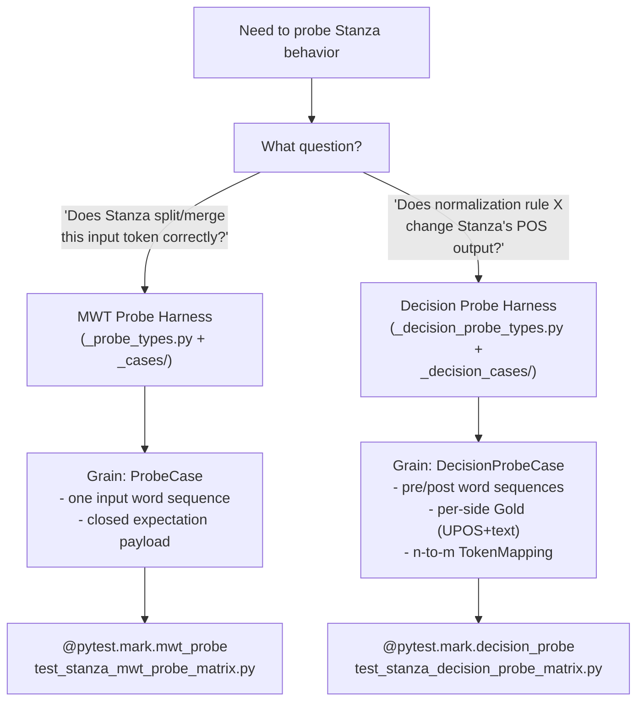
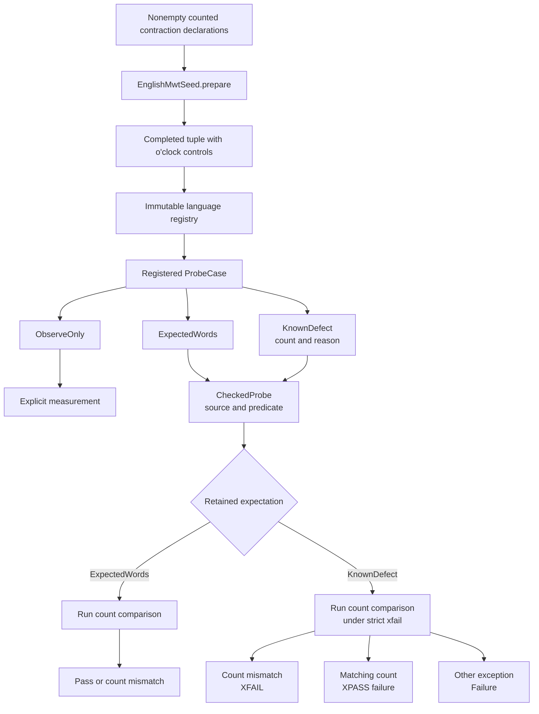
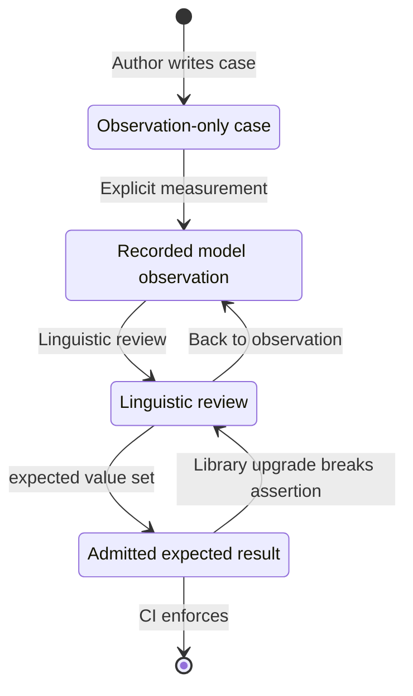
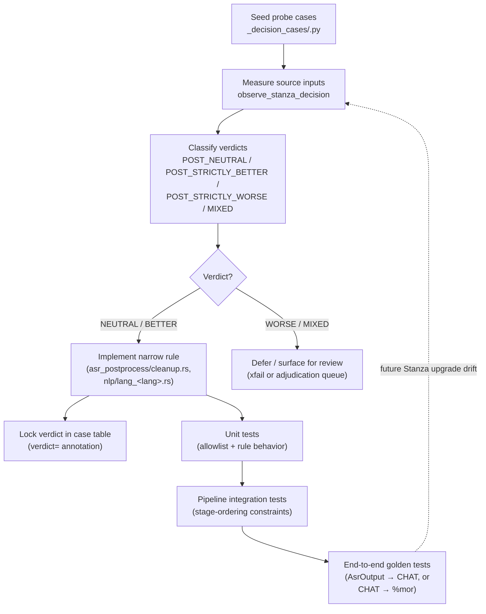

# Investigation Probe Harnesses

**Status:** Current
**Last updated:** 2026-11-15 EST

batchalign3 uses Stanza as an oracle for investigation tests,
small, per-case probes that pin Stanza's current behavior so a
future upgrade or regression surfaces as a test failure. This
page is the developer reference for the two probe harnesses,
when to use each, how cases are organized, how to run them, and
how verdicts get locked.

## Why probes, not assertions?

Traditional unit tests assert what code *should* do. Probe tests
assert what an external library (Stanza) *does*, the probe's
job is to bind our pipeline's expectations to the library's
current behavior. If Stanza changes, probes fail in a way that
surfaces the change for re-review.

This pattern matters for batchalign3 because:

1. Stanza's MWT expansion varies per language, per token, per
   version. Hardcoding "Stanza will produce 2 UD words for
   `don't`" in a normal test is fragile, and wrong for
   languages where Stanza's MWT model doesn't fire.
2. Author-written expected POS / count values are biased. The
   author writes the test mirroring their expectation; the test
   passes trivially when code matches intent rather than reality.
3. Stanza drift is invisible. Without probes, a Stanza model
   upgrade that changes tokenization on 5% of Italian inputs
   would be noticed only by users in production, not CI.

The [upstream defect policy](upstream-defect-policy.md) records the required
source-bound observations and expectation adjudication.

## Two harnesses, two purposes



### MWT probe harness

Lives at:

- `batchalign/tests/investigations/_probe_types.py`: types
  (`ProbeCase`, `ObserveOnly`, `ExpectedWords`, `KnownDefect`,
  `CheckedProbe`, `Phenomenon`, `XfailMark`).
- `batchalign/tests/investigations/_cases/<lang>.py`: per-language
  case tables.
- `batchalign/tests/investigations/_cases/__init__.py`: the
  `LANGUAGE_MATRIX` registry.
- `batchalign/tests/investigations/test_stanza_mwt_probe_matrix.py`
 , runner for admitted with-postprocessor count checks and explicit paired measurements.

**Use when**: you need to know "how many UD words does Stanza
produce for this input token sequence?" Typical questions:

- Does Stanza MWT-expand `don't` into two words?
- Does our postprocessor suppress the expansion for Catalan
  `l'home`?
- Does Stanza's Italian tokenizer keep `arancione` as one word
  or mis-split it?

Case shape:

```python
ProbeCase(
    label="dont_alone",
    words=("don't",),
    phenomenon=Phenomenon.CONTRACTION,
    expected_post_mwt_count=2,  # None = observe-only
    xfail=None,                  # a defect mark requires a count
)
```

The constructor admits the established case notation into one closed payload.
Its overloads reject a known defect without an expected count. `ObserveOnly`
has no predicate, `ExpectedWords` owns its count, and `KnownDefect` owns both
an `ExpectedWords` predicate and its defect record. `CheckedProbe.admit` issues an immutable source-bound check only for
`ExpectedWords` or `KnownDefect`. Observation-only cases cannot inhabit the
pytest parameter type. Runners match the admitted payload exhaustively. A known defect executes its count check under a strict pytest
xfail mark. Only `StanzaCountMismatch` is expected. Model-loading errors and
unrelated assertion failures remain failures. An upstream fix produces strict
XPASS and requires adjudication.

The English fixtures declare contractions through `ContractionProbe`, whose
admission requires a count and fixes the phenomenon. `EnglishMwtSeed.prepare`
requires a nonempty tuple of those declarations and constructs both o'clock
controls itself. It retains the completed case tuple. The registry constructor
requires that prepared seed and returns an immutable mapping. A caller cannot
omit English preparation, mutate the registered population or construct an
empty seed through the typed API.

The shared Python typecheck target covers these fixture and runner modules in
both the local gate and hosted CI. The four former seed-metadata tests are
retired. Their arbitrary minimum case count and label scans supplied no model
observation. The existing golden predicates retain the exact lexical inputs and
their external Stanza count obligations.



### Decision probe harness

Lives at:

- `batchalign/tests/investigations/_decision_probe_types.py`,
  types (`DecisionProbeCase`, `Gold`, `TokenMapping`,
  `DecisionOutcome`, `CandidateClass`, `StanzaTokenOutput`,
  `compare_stanza_outputs`).
- `batchalign/tests/investigations/_decision_cases/<lang>.py`,
  per-language case tables (1 file today: `english.py`).
- `batchalign/tests/investigations/test_stanza_decision_probe_matrix.py`
 , runner.

**Use when**: you need to compare Stanza's output on a
*pre-normalization* form against its output on a
*post-normalization* form, to decide whether a proposed rule
helps, hurts, or is neutral. Typical questions:

- Does capitalizing bare `i` → `I` change Stanza's POS for that
  word? (Answer: no, both tag as PRON.)
- Does stripping the period from `Dr.` → `Dr` produce a
  different POS? (Answer: no, both tag as PROPN.)
- Does stripping the period from `3.14` → `3` change the
  text? (Answer: yes, catches the decimal semantic loss.)

Case shape (v2):

```python
DecisionProbeCase(
    label="dr_before_name",
    utterance_prose="Dr. Matthews is here.",
    pre_words=("Dr.", "Matthews", "is", "here"),
    post_words=("Dr", "Matthews", "is", "here"),
    affected_mappings=(
        TokenMapping(
            pre_token_indices=(0,),
            post_token_indices=(0,),
            gold=Gold(pre_upos=("PROPN",), post_upos=("PROPN",)),
        ),
    ),
    expected_outcome=DecisionOutcome.POST_NEUTRAL,
    rationale="Stanza PROPN both sides.",
    candidate_class=CandidateClass.TITLE_PERIOD,
)
```

`CheckedDecisionProbe` admits only the four adjudicated verdicts. The
observation-only `letter_i_in_alphabet` case uses `observe_stanza_decision`
explicitly. Its `DecisionObservation` retains both completed token projections,
the source and the comparison. Thirty adjudicated cases enter pytest. The
unused nullable xfail field and unconditional xfail path were removed.

## Lifecycle of a probe case



## Running probes

Probes are all `@pytest.mark.golden` so they do NOT run in
default CI. Sub-markers allow fine-grained selection:

| Command | Runs |
|---------|------|
| `uv run pytest` | Fast tests only, no probes |
| `uv run pytest -m "golden and mwt_probe"` | All MWT probes (~45s on a development machine) |
| `uv run pytest -m "golden and decision_probe"` | All decision probes (~4s) |
| `uv run pytest -m "golden and mwt_probe" -k "fra or ita"` | French + Italian MWT only |
| `uv run pytest -m golden` | All golden tests (includes probe matrices + other ML goldens) |

Use `-n0 -s` to serialize and retain the checked probes' observations.
Free-tokenize measurements and the 57 observation-only postprocessor cases
have no count assertion, so they run explicitly when investigating a question.
The former 279 free-tokenize pytest cases, 57 assertion-free postprocessor
cases and one undecided pre/post case were removed from the suite. Their
measurement functions remain callable. `ProbeObservation` retains the source,
language and completed token
projection. The word count uses that projection's length, avoiding a second
walk over the Stanza document.

For example, record the Italian cases with both configurations into a log.
Use the intended environment and `STANZA_RESOURCES_DIR` for reproducibility.

```bash
python - <<'PYPROBE' > italian-probes.log
from batchalign.tests.investigations._cases import all_cases
from batchalign.tests.investigations.conftest import (
    _pipeline_free, _pipeline_with_postprocessor,
)
from batchalign.tests.investigations.test_stanza_mwt_probe_matrix import (
    observe_stanza_mwt_free_tokenize, observe_stanza_mwt_with_postprocessor,
)

free = _pipeline_free("it")
post = _pipeline_with_postprocessor("it")
for language, case in all_cases():
    if language.alpha3 == "ita":
        observe_stanza_mwt_free_tokenize((language, case), free)
        observe_stanza_mwt_with_postprocessor((language, case), lambda _: post)
PYPROBE
```

The five remaining Italian expected failures execute their exact count
predicates. Three obsolete marks were retired after strict XPASS on both
1.15.0 and 1.15.1. Their checks now run normally.

## Adding a new language to the MWT matrix

1. Add the language key in `_cases/__init__.py`.

   ```python
   CAT = LanguageKey(alpha2="ca", alpha3="cat")
   ```

2. Write `_cases/<lang>.py` with a tuple of `ProbeCase`. Start with
   `ObserveOnly` through the constructor's omitted count, measure the output,
   then adjudicate the expected counts.

3. Register the language and its cases in `LANGUAGE_MATRIX`.

   ```python
   LANGUAGE_MATRIX = {
       ...,
       CAT: catalan.CASES,
   }
   ```

`post_pipeline_for` creates and caches the pipeline from the language key's
`alpha2`. It requires no per-language fixture or resolver entry. Explicit free
measurements use `_pipeline_free(alpha2)`. Both builders query Stanza's runtime
resources through `_processors_for` and select `mwt` when the language has a model.

Use the explicit measurement example above to observe new cases, then lock
their expected counts. Run `uv run pytest -m "golden and mwt_probe" -k <alpha3>`
to check the admitted expectations.

## Parity-audit pattern

The probe harness has a second lifecycle: comparing BA3 output
against a reference system (e.g., BA2-jan9) to establish parity.
Pattern:

1. Enumerate every rule in the reference system.
2. For each, identify a probe in BA3 that exercises the same
   behavior.
3. If no probe exists, add one.
4. Run the golden matrix. Observe per-rule outcomes.
5. Classify each rule: **full parity**, **parity via alternative
   mechanism**, **rule retired with evidence** (reference rule
   is obsolete, new system handles natively), or **active gap**
   (reference handled; new system doesn't).

The retokenization parity audit applies this pattern across the
morphology tables, tokenization rule families, and native-MWT drift
sentinels. All probed rules achieve parity except one active gap
(Italian Defect 6 family), documented separately.

Use this pattern whenever you need to convince yourself that a
rewrite preserves semantics, don't rely on reading both codebases
side-by-side; probe them both and compare.

## Relation to production

Probe harnesses test **raw Stanza output**: what Stanza's Python
pipeline produces when called directly. Production batchalign3
has additional layers downstream (Rust-side Range reassembly,
`map_ud_sentence` merging MWT components into single `%mor`
entries, etc.) that shape the final CHAT output.

This means:

- Probe `expected_post_mwt_count=2` for `don't` asserts Stanza
  emits 2 UD words, not that the final CHAT %mor has 2 entries.
  (Final CHAT has 1 entry: `verb|do~part|not`.)
- Probe-level regression does not necessarily mean user-visible
  regression, the downstream layers may absorb the change. But
  probe-level regression signals that *something* at the Stanza
  boundary shifted, which warrants investigation.

For end-to-end production behavior, see the `%mor` integration
tests under `crates/batchalign-transform/src/morphosyntax/tests.rs`
and the ML golden tests under `crates/batchalign/tests/ml_golden/`. Those
exercise the full pipeline including reassembly.

## The probe-to-ship feedback loop

Probes are not an end in themselves; they feed a closed loop that
turns empirical Stanza behavior into shipped Rust rules with
regression coverage at every layer. The English transcribe
corrections and the Italian Defect 6/7/8 reconciler both
travelled this loop:



Two concrete instances of this loop:

- **English transcribe rules.** 29 English
  decision-probe cases covered TITLE, PLACE, TIME, INITIALISM,
  DEGREE, TECHNICAL, PRONOUN_I, I_CONTRACTION, UTTERANCE_INITIAL,
  SENTENCE_PERIOD, DECIMAL_CONTROL families. 22 locked
  POST_NEUTRAL, 2 POST_STRICTLY_WORSE (the DECIMAL_CONTROL / period
  exclusions that prove the allowlist design), and the
  `etc.`/`eg`/`ie`/`M.D.` family was Q-B-adjudicated (Stanza POS
  preferred over hand-gold). The rules ship in
  `asr_postprocess/cleanup.rs`; verdicts stay locked in
  `_decision_cases/english.py`.
- **Italian Defect 6/7/8.** Probe matrix
  surfaced `parla → par + la`, `arancione → arancio + ne`, and
  the compound-imperative family (`dammela`, `prendilo`, …). The
  adjudication routed to a Rust-side reconciler in
  `crates/batchalign-transform/src/morphosyntax/lang_it.rs`
  (two allowlists + `map_ud_sentence` plumbing), with synthetic-UD
  tests in `crates/batchalign/src/chat_ops/nlp/mapping/mod.rs` and
  end-to-end golden coverage in
  `batchalign/tests/pipelines/morphosyntax/test_italian_defect6_end_to_end.py`.

The feedback direction matters: **probes lead, code follows**. We
do not write a rule and then probe to "confirm" it; we probe
first, classify, then ship only when the verdict warrants it. A
future Stanza upgrade that invalidates a locked verdict will
surface as a probe diff, which re-enters the loop at the Classify
node.

## Related docs

- `reference/stanza-limitations.md`: pinned Stanza defects
  (Defect 6, 7, etc.) cross-referenced from probe xfails.
- `reference/retokenization-overview.md`: per-language
  retokenization behavior summary; probe findings drive this doc.
- `reference/languages/<lang>.md`: per-language special
  treatment, with probe citations.
