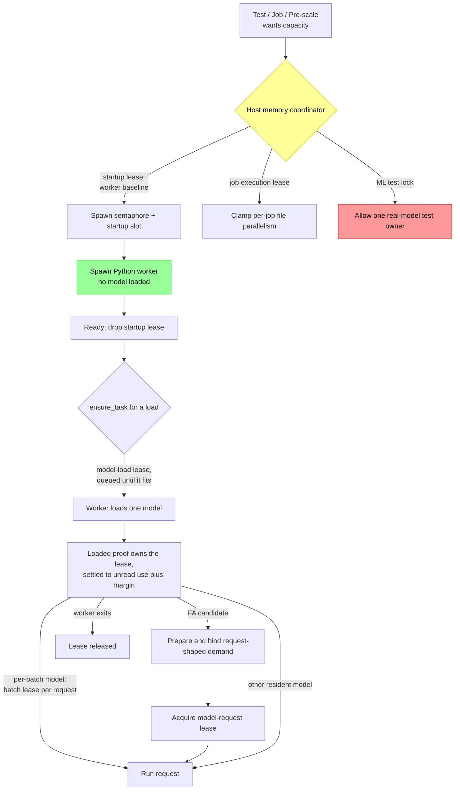
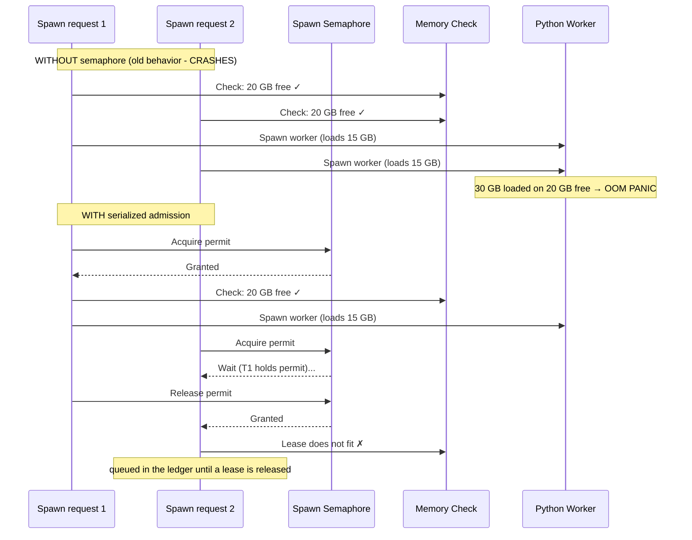
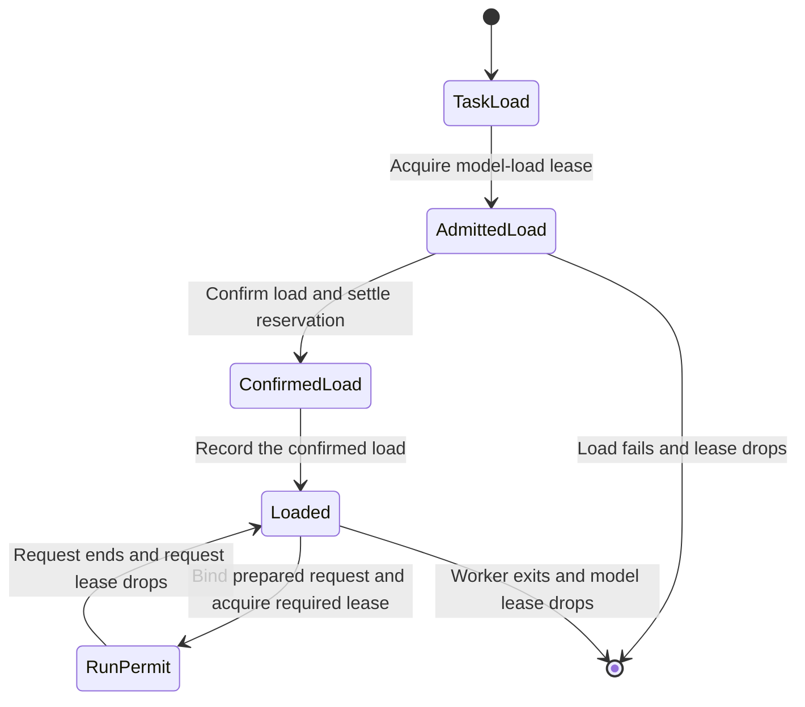

# Memory Safety: Preventing Kernel OOM Crashes

**Status:** Current
**Last updated:** 2026-11-06 11:56 EST

## The Problem

Each Python ML worker can hold gigabytes of models (Whisper, Stanza, etc.).
When several workers start or load at once, from parallel test binaries,
per-job pre-scaling, or job dispatch, they collectively exceed physical RAM
and trigger a **kernel-level OOM panic** that crashes the entire machine. This is not a process-level OOM
kill; it is a Jetsam-triggered kernel panic that requires a hard reboot.

**Sample observed failure modes:**
- 5 python3.12 workers × ~13-15 GB each = ~70 GB on a 64 GB machine
- A multi-file transcription run with the default auto-tuner exhausted
  the machine's 64 GB

## Architecture



## Defense Layers

### Layer 0: Live admission gates at the worker-pool spawn seam

`worker/pool/{cpu_gate,memory_gate}.rs` are the cheapest, earliest
admission predicates. They run inside `try_claim_spawn_slot` before
any permit acquisition or lease reservation, so a saturated host
doesn't burn through the global-permit semaphore on doomed spawns.

The gates run two distinct policies, named explicitly per
`PoolGateState` (derived in `worker/pool/lifecycle.rs`):

- **ColdStart**: first worker for a `(profile, lang, engine)`
  class. Both gates **bypass** unconditionally: back-pressure has
  nothing to push against on an empty pool, and refusing here
  leaves the pool dead-on-arrival on memory-tight hosts (the
  laptop-class failure mode that motivated the split).
- **Warm**: N+1 worker for a class with existing workers. Both
  gates run their projection.

| Gate | Warm predicate | Source |
|---|---|---|
| CPU loadavg | `getloadavg(3).one < available_parallelism()` | `cpu_gate.rs` |
| Memory floor + projection | `available_mb − new_worker_estimate_mb > host_min_free_mb_threshold_for_tier(tier)` | `memory_gate.rs` |

The Warm-gate floor is **tier-scaled**: 1024 MB Small / 2048 MB
Medium / 4096 MB Large / 4096 MB Fleet. The historical fixed
`MIN_FREE_MEMORY_MB = 2048` constant is now the Medium-tier value
and the JobStore-level gate's default; it is no longer the single
admission floor.

The `new_worker_estimate_mb` is the average RSS of same-profile
idle peers (Mode B, `rss_observer.rs`) when peers exist; otherwise
falls back to the canonical per-tier `MemoryTier::*_startup_mb`
(Mode A fallback), `tier.gpu_startup_mb`, `tier.stanza_startup_mb`,
`tier.io_startup_mb`. By design (Principle 1), `MemoryTier` is the sole
canonical source of these
values; an architectural-invariant test in `types/runtime.rs`
prevents reintroduction of parallel constants.

The Mode-A fallback is further **engine-aware** for the IO profile,
via `memory_gate::engine_aware_startup_reservation_mb`. The IO
baseline (`tier.io_startup_mb`: 2 GB Small/Medium, 4 GB Large/Fleet)
is correct for engines that are thin API clients (Google Translate
via `googletrans`) but under-reserves for engines that load large
local models in the worker process, SeamlessM4T (~2.4 GB resident)
and NLLB-200-distilled-1.3B (~5 GB resident). The helper takes the
MAX of the profile baseline and the engine's resident footprint as
declared by `TranslateEngineName::resident_memory_mb`, so the
admission gate refuses to spawn an NLLB worker on a Medium-tier
host that doesn't have ~5 GB of headroom. Workers running the
lightweight Google engine continue to pay the IO baseline.

Admission is back-pressure, not safety (Principle 5). The
correctness floor is `worker/memory_guard.rs` (per-spawn host-memory
reservation + RSS observation + kill on overrun) plus the OS OOM
killer. An over-permissive admission means a worker may die at
spawn, bounded cost. An over-strict admission means the host
can't run at all, unbounded cost (jobs queue forever). The bias
is toward over-permissive; ColdStart bypass implements the bias.

The eviction-side counterpart: `worker/pool/idle_eviction.rs` runs as
a pre-pass in `run_health_check` and evicts idle workers
largest-RSS first when `available_mb` falls at or below
`EVICTION_PRESSURE_THRESHOLD_MB = 4096` MB (= 2× the admission
floor). There is no `idle_timeout_s` knob, eviction is purely
pressure-driven. A request queued for host memory also asks for room
directly (see **Queued waits** below), retiring idle workers one at a time
through the same teardown (`idle_eviction::retire_sampled`).

The host's available-memory reading is shared across all five
sysinfo-touching paths (admission gate, eviction pre-pass, in-spawn
guard, host-facts probes, info logs) via the TTL-cached
`host_memory::system_memory_snapshot`: at most one
`/proc/meminfo` (Linux) / `host_statistics64` (macOS) read per
second across the whole pool.

### Layer 1: Host-wide coordinator (prevents cross-process overcommit)

A machine-local JSON ledger guarded by an exclusive file lock coordinates memory
across local `batchalign3` processes on the same host. This covers:

- multiple server ports,
- CLI auto-daemons,
- pre-scaled vs foreground jobs,
- independent Rust test binaries.

The coordinator tracks these lease kinds (`MemoryLeaseKind`):

- **worker startup leases** for a starting worker's baseline, until it
  reports ready,
- **model-load leases**, one per model a worker loads, for as long as the
  worker holds it (see "Every model a worker holds is leased" below),
- **model-batch leases**, one per batch of a model built per batch
  (coreference), for the batch,
- **model-request leases**, request-shaped FA workspace held by the execution
  permit until success, failure or cancellation,
- **job execution leases** for in-flight file parallelism,
- **machine-wide ML test locks** so real-model test runs do not stampede the host.

**What a lease counts.** Admission compares the reservations against the
memory the operating system reports available now, so a lease counts only
what its holder has not yet taken. A startup lease is dropped once the worker
is ready (its baseline is then in the reading). A model-load lease counts the
model in full while it loads and, once the worker confirms the load,
`AdmittedLoad::confirm` (through `HostMemoryLease::settler`) rewrites it to the
unread in-use memory plus the activation margin. Already resident memory is
in the operating system's reading; counting it again would count it twice,
and a load queued behind that phantom would wait for memory the host has.

**Sub-allocations.** An owner's demand is the larger of its job side (job
execution leases) and its worker side (startup, model-load, model-batch and model-request
leases), never the sum (Contract D): a job's reservation already covers the
workers serving it. A request that adds nothing to its owner's projected
demand is admitted even when the host reads as over-committed: a model
loaded inside its job's lease was promised when that lease was granted, and
refusing it would make the job wait on its own reservation.

**Queued waits.** A worker startup or a model load the host cannot fit now
queues (`HostMemoryCoordinator::queue_for_lease`): no deadline, one log line
when it queues, a warning every minute (`QUEUED_LEASE_REPORT_INTERVAL`)
naming the lease, how long it has waited and the host's last refusal, and the
file it serves shows "Waiting for host memory" (`waiting_for_host_memory`,
through the same task-local observer that shows a saturated pool). Dropping
the wait (a cancelled job) ends it and takes no lease. After each refusal the
wait asks its `MemoryReclaim` for room: the pool's
(`idle_eviction::IdleWorkers`) retires its largest idle worker, whose leases
and memory go with it, and the request is tried again at once; when nothing
is idle it polls. A process with no pool (a one-off `replay`) passes
`NoIdleWorkers`. Every route to a queued wait names its reclaim: the model
load through `LoadAdmission`, the startup lease through
`WorkerHandle::spawn` and `spawn_tcp_daemon`. Only a request larger
than the host can ever grant (its total less `memory_gate_mb`) is refused,
at once, as `MemoryGuardError::ExceedsHost`, which is final (classified as a
bootstrap failure, never retried). Job execution plans and the test lock
keep a bounded wait (`LeaseWait::Bounded`); a job that cannot fit is
re-queued by the runner.

**File progress.** Worker preparation is a scoped observation, separate from
the pipeline's stage and item counts. Startup on the pool's runtime captures
a file observer and owns its child task with abort-on-drop. Cancelling startup
therefore closes its observations and reaps a not-yet-ready process, instead
of detaching it with a wait still open. Startup memory waits and measured
download growth reach the file. The same preparation guard observes on-demand loading through stdio,
TCP and shared-GPU control replies. Only loading evidence reaches that guard;
request progress cannot become model-download progress. Its drop closes the
observation on return, refusal or cancellation. While active, a host-memory
wait takes display priority, followed by pool congestion and preparation;
afterward the file shows its pipeline's current stage and counts. Download
growth is displayed in KiB received, without inventing a total or percentage.
These observations take no model-memory lease and alter no admission policy.

**FA request preparation.** Loaded-model preparation reports actual input
constraints and allocation estimates before execution. A bound `ReadyRequest`
can advance to a `RunPermit` only after the coordinator grants its request
lease. Impossible physical demand refuses rather than queueing indefinitely;
temporary pressure remains a cancellable wait. Virtual tensor projection is
not a measurement of total RSS. The backend derivations, margin, state diagrams
and open qualification work are described in
[FA preparation and adaptive admission](adaptive-fa-admission.md).

**Ledger compatibility.** Model-load, model-batch and model-request are values of the ledger's
`kind` field. A daemon of an older build sharing the ledger file cannot read
them and reports the ledger corrupt; every batchalign3 process on a host must
run a build with all model kinds, including `model_request`.

Only a worker-startup lease occupies one of the host's startup slots
(`max_concurrent_worker_startups`), and the record says so through its kind
(`MemoryLeaseKind::holds_startup_slot`), not a second field. A model load
holds no slot: its memory is reserved by its own lease, and a slot held
through a fourteen-minute first download would stall every other startup on
the host for its length. The ledger file
keeps its form across builds: `startup_slot` is still written, from the kind,
because older builds count slots by it, and is ignored on read. Owner and
worker PIDs are `WorkerPid` and reservations are `MemoryMb` in memory; the
JSON is unchanged. Admission projects the total with a requested lease by
chaining the request's reservation onto the ledger's, rather than building a
placeholder record.

The ledger's lease ages are read from the host wall clock (`ledger_now`), on
purpose, not from the job store's injected `Clock`: the file is shared by
every batchalign3 process on the host, each with its own store clock, so an
injected clock would let one process's test clock decide whether another
process's lease had gone stale.

The reserve/headroom policy comes from `ServerConfig.memory_gate_mb`, which now
means "keep at least this much RAM free after reservations" rather than a
standalone job gate. The default is `MIN_FREE_MEMORY_MB = 2048` (the
JobStore-gate constant). The previous tier-derived per-host default
(Small=2 GB, Medium=4 GB, Large/Fleet=8 GB) was retired on 2026-05-08
for this knob; workload-sized headroom now comes from Layer 0's
per-process RSS observation. Note: this is independent of the
Layer-0 Warm-gate floor `host_min_free_mb_threshold_for_tier`, which
**is** tier-scaled (1024/2048/4096/4096) and protects the per-spawn
admission decision rather than the per-job admission decision.

### Layer 2: Spawn semaphore (prevents in-process TOCTOU race)

A process-global `tokio::sync::Semaphore` serializes all worker spawns. This
still matters even with the host-wide coordinator because one server process can
otherwise race with itself:

The sequence illustrates the historical startup race, when starting a worker
also loaded its model. Both spawn requests belong to one process; this semaphore
does not coordinate separate test binaries. Current startup reserves only the
worker baseline, and each model takes its own load lease as described below.



**Location:** `crates/batchalign/src/worker/memory_guard.rs`

### Layer 3: Explicit startup reservations (before every worker spawn)

A spawn's startup lease reserves the **worker baseline** only
(`WORKER_BASELINE` in `worker/residency.rs`: 275 MiB measured, 344 MiB with
its margin), the same on every profile and tier, because no worker loads a
model at startup any more. Each model is reserved by its own load (below).

The per-profile, **tier-adaptive** envelopes below, scaled by a `MemoryTier`
derived from total system RAM, no longer size the spawn's lease. They remain
the Layer 0 admission projection's fallback estimate (Mode A) and the clamp
on a job's per-worker execution budget:

| Tier | Total RAM | GPU Startup | Stanza Startup | IO Startup | Headroom |
|------|-----------|-------------|----------------|------------|----------|
| Small | < 24 GB | 6 GB | 3 GB | 2 GB | 2 GB |
| Medium | 24-48 GB | 3 GB (LazyProfile) | 6 GB | 3 GB | 4 GB |
| Large | 48-128 GB | 16 GB | 12 GB | 4 GB | 8 GB |
| Fleet | ≥ 128 GB | 16 GB | 12 GB | 4 GB | 8 GB |

These values are defined exactly once in
`MemoryTier::from_total_mb()` in `crates/batchalign/src/types/runtime.rs`
, the sole canonical source per Principle 1. Operator overrides
flow in via `RuntimeOverridesConfig.{gpu,stanza,io}_startup_mb`,
which override the tier-derived values. Every tier now starts workers with
only process overhead and loads model weights on demand. A lazy worker key still includes
the selected engine recipe; two engines cannot share one task-only process.
The host permit gate and idle-worker eviction bound how many recipe-specific
workers remain resident. This trades a small amount of process overhead for a
hard correctness guarantee: an already-loaded model cannot silently satisfy a
request for another engine. The startup reservations are intentionally
more conservative than the per-command execution budgets. They
protect the model-loading spike where Whisper, Stanza, or related
engines can temporarily consume far more memory than steady-state
request handling.

The local free-memory floor the spawn guard used to apply on top
(`BATCHALIGN_SPAWN_MIN_MEMORY_MB`, 4096 MB) is gone: it refused a spawn at
once where the ledger now queues it, and it ignored the reservations other
processes held, which the ledger counts.

**Note:** On macOS, `sysinfo::available_memory()` undercounts because it only
reports free + purgeable pages, not inactive pages. The kernel can reclaim
inactive pages, so the real headroom is larger. We use the conservative number.

### Layer 4: Job execution reservations (before a job starts running)

The runner no longer uses a separate `memory_gate()` plus independent
memory-based auto-tune formula. Instead it:

1. computes a **requested** worker count from file count, CPU, and category caps,
2. asks the host coordinator for a **job execution plan**,
3. receives a granted worker count plus a lease held for the job lifetime,
4. re-queues the job if the host cannot safely fit that plan.

This makes worker startup and job execution share one memory story instead of
two unrelated heuristics.

### Every model a worker holds is leased

No worker loads a model at startup, on any tier or in any bootstrap mode.
Every model loads inside `ensure_task`, which the pool sends before a
worker's first request for a load (`TaskLoad`: the request's task and the
engines its load reads). Each load takes its own lease, sized from the
residency table, and the lease order is a typestate
(`worker/pool/task_load.rs`):



- `LoadAdmission::admit` is the only route to an `AdmittedLoad`, and it takes
  the lease before the worker is asked. `AdmittedLoad::confirm` settles it
  once the worker answers (before any lock is taken to record it), and
  `TaskLoads::record` is the only constructor of `Loaded` and consumes the
  `ConfirmedLoad`, so no route
  records a load without its lease, and a load that fails drops the
  `AdmittedLoad` and its lease with it.
- `Loaded::run` is the only route to the `RunPermit` every transport's
  execute takes: it pairs the prepared request with its own load and owns any
  request-scoped lease, including a coreference batch or FA workspace, for the
  request's life.
- A model lease names its worker's PID from the start, so it is reclaimed
  when the worker dies (and is never mistaken for a pre-spawn intent).
- A test-echo pool's workers build nothing and take no lease
  (`ModelHosting::TestEcho`).
- A TCP daemon's lease lives with the connection's proof, not with the
  daemon: a reconnection asks again, the daemon answers at once, and the new
  proof takes a new lease.

#### The residency table

`Residency::of(task, engines)` (`worker/residency.rs`) is the one table.
Measurements were taken on an Apple Silicon Mac (macOS, CPU) with
`scripts/measure_model_residency.py`, which builds one model in a fresh
process after importing the worker's libraries, runs one request-shaped
inference on it (`--input-scale` enlarges the input), and reports two
figures over the baseline: what building the model added, and the peak while
it ran. They differ by far more than activations. Building a model leaves
most of its weights unread, and they become resident only when the first
request reads them: built-only figures, which this table held until
2026-11-06, under-reserved pyannote by a factor of six and coreference by
five.

A `Footprint` is therefore either `Measured { built, in_use }` or
`Estimated(figure)`. A lease reserves the in-use figure plus a 25% margin
(`ACTIVATION_MARGIN_PERCENT`), for a larger input or another platform's
allocator than the one measured. Once the worker confirms the load, the lease
is settled to `Footprint::settled`: the unread part (in use less built),
which the host's reading of used memory does not yet show, plus the margin.
After the first request the reading shows it too, so a settled lease
over-reserves by the unread part, the safe direction.

| Load | Residency | Built / in use (MiB) | Basis | Lease while loading (MiB) | Settled (MiB) |
|---|---|---|---|---|---|
| worker baseline (the startup lease) | until ready | 275 / 275 | measured | 344 | dropped at ready |
| morphosyntax | worker's life | 1504 | estimated: 2 pipelines (the worker's Stanza cache capacity) x 752 in use measured for English | 1880 | 376 |
| utseg | worker's life | 1212 | estimated: a constituency pipeline (as the morphosyntax one) + 460 for the BERT-base boundary model | 1515 | 303 |
| coreference | per batch | 519 / 2568 | measured on a 27-word document; **undersized for real documents**, see below | 3210, and 3210 per batch | 0 |
| local pyannote diarization | worker's life | 378 / 2274 | measured on one hour of audio (30 s: 1053; 10 min: 1843); a release returns nothing | 2843 | 2465 |
| speaker embedding | worker's life | 381 / 514 | measured on a 30-second window; a release returns nothing | 643 | 262 |
| ASR (worker-hosted engine) | worker's life | the engine's `resident_memory_mb` | estimated (engine table; includes the runtime, so it over-reserves by about the baseline) | + 25% | 25% |
| forced alignment | worker's life | the engine's `resident_memory_mb` | estimated (engine table) | + 25% | 25% |
| translation | worker's life | the engine's `resident_memory_mb`, Google when none is named | estimated (engine table) | + 25% | 25% |
| pyannoteAI, an ASR engine that runs in Rust, FA with no engine, openSMILE, AVQI, word segmentation | nothing | 0 | (no model; libraries are in the baseline) | no lease | no lease |

**Coreference is an open decision.** Its in-use peak grows faster than the
document it resolves, and a coref batch is one whole transcript. Measured on
one English paragraph repeated (2026-11-06; repeated text makes unusually
long coreference chains, so these may overstate real transcripts):

| Document | In use after the batch (MiB) | Peak during it (MiB) |
|---|---|---|
| 27 words | 2568 | 2846 |
| about 540 words | 2077 | 4305 |
| about 2,700 words | 2838 | 11005 |
| about 10,800 words | 4866 | 39270 |

No fixed lease covers that, and a transcript of ordinary length could exhaust
a 16 GB laptop whatever its lease says. The table keeps the small-document
figure until it is decided whether the lease is sized from the document, the
document is resolved in bounded windows, or both. A release after a batch
returns about 1.6 GB of the peak, so per-batch residency stays: coreference
shares the Stanza worker with morphosyntax and utseg, and holding it for the
worker's life would keep about 2.5 GB that most of that worker's requests do
not need.

#### Per-tier behaviour

The leases are the same on every tier: a model's size does not depend on the
host. What the tier changes is around them:

- **Small (< 24 GB)**: the 2048 MB reserve leaves about 14 GB on a 16 GB
  laptop; the largest single load (NLLB, 6875 MiB with margin) fits, and two
  heavy models queue behind each other instead of overcommitting, retiring
  idle workers to make room first. Coreference on a long transcript is the
  exception, above. Layer 0's
  Warm floor is 1024 MB.
- **Medium (24-48 GB)** and **Large (48-128 GB)**: several heavy models fit at
  once; a full host queues the next load. Layer 0's Warm floor is 2048 /
  4096 MB.
- **Fleet (>= 128 GB)**: in practice nothing queues for memory; the leases
  still name every model a worker holds in the ledger's labels.
- On every tier a load larger than total memory less `memory_gate_mb` is
  refused at once, never queued.

Layer 0's Mode A projection (`engine_aware_startup_reservation_mb`, the tier
envelope or the engine's footprint) is unchanged: it is back-pressure for an
(N+1)th worker of a key whose peers already hold their models, so routing to
a peer beats spawning a worker whose load would then queue.

### Layer 5: Machine-wide ML test lock

The live ML fixture now acquires a machine-wide test lock before preparing warm
workers. This prevents concurrent `cargo test` or IDE runs from each
building their own model pool on the same machine.

This lock complements, rather than replaces:

- `RUST_TEST_THREADS=1`,
- the ML golden suite,
- the single-binary `ml_golden` layout.

### Layer 6: SIGKILL Follow-Through in Drop

Both `WorkerHandle::Drop` and `SharedGpuWorker::Drop` now send SIGTERM, wait
200ms, then send SIGKILL if the worker is still alive. This prevents zombie
Python processes when the worker is stuck in a C extension (PyTorch, NumPy)
that ignores SIGTERM.

### Layer 7: Periodic Orphan Reaping

The health check background task now calls `reap_orphaned_workers()` on every
tick (default: 30s). This catches orphaned workers from server crashes without
waiting for the next server restart. Previously, orphans only got cleaned up
when a new server instance started.

### Layer 8: Test prerequisites fail, never skip

Every test that spawns workers calls
`crate::prerequisite::worker_test_python()` (`crates/batchalign/tests/prerequisite.rs`)
before any setup. It isolates the binary's host-memory ledger, requires
4096 MB free (`require_free_memory`, reading `host_memory::read_system_memory`),
and requires the Python worker environment: the checkout's `.venv`
interpreter, importing `batchalign.worker`, with a compiled extension built
from this checkout's sources (the same evidence check `make` runs).

A test with an unmet prerequisite **fails** with a `PREREQUISITE MISSING`
message naming the remedy. It does not print a skip and return: a Rust test
that returns reports `ok`, so a skipping test is indistinguishable from a
passing one, and the worker suites once "passed" for months on machines and
runners that could not run them.

### Layer 9: Test isolation and explicit ML opt-in

The default Rust suite includes test-echo integration tests, which may spawn
lightweight Python workers but do not load ML models. Related tests share a
small number of executables and warmed fixtures. ML model tests are gated
behind their own per-host opt-in feature and must only be run on a
Fleet/Large-tier host with ≥ 256 GB RAM:

```bash
make test                                            # Default suite, no ML models
cargo test -p batchalign --test worker_integration_suite worker_integration:: -- --test-threads=1
# ML golden tests: Fleet/Large-tier hosts only
```

## Environment Variables

| Variable | Default | What it does |
|----------|---------|--------------|
| `BATCHALIGN_MAX_CONCURRENT_SPAWNS` | `1` | Max concurrent worker spawns (semaphore size) |
| `BATCHALIGN_HOST_MEMORY_LEDGER` (`HOST_MEMORY_LEDGER_ENV`) | temp-dir path | Override the shared host-memory ledger path. Test harnesses set it only on a child `batchalign3` command, to that test process's private ledger; nothing sets it on its own process |
| `RUST_TEST_THREADS` | Rust harness default | Optional cap on parallel test functions; pass `--test-threads=1` for isolated worker probes |

## Key config knobs

| Setting | Default | What it does |
|---------|---------|--------------|
| `memory_gate_mb` | 2048 MB | Host reserve/headroom preserved after reservations. Same constant the worker-pool admission gate enforces; operator override accepted but rarely needed. |
| `max_concurrent_worker_startups` | `1` | Host-wide limit for simultaneous worker startups (a model load holds no slot) |
| `gpu_thread_pool_size` | `4` | In-process GPU request concurrency, now forwarded into Python |

## How to Run Tests Safely

### On a developer machine (≤ 64 GB)

```bash
# Default suite: Rust plus test-echo workers, no ML models
make test

# Worker integration tests (test-echo mode, no ML models): safe with
# the memory guard; spawn real Python workers in test-echo mode
# without model loading
cargo test -p batchalign --test worker_integration_suite worker_integration:: -- --test-threads=1

# NEVER run ML golden tests on a 64 GB machine; they will OOM.
```

### On a Fleet/Large-tier host (≥ 256 GB RAM, e.g. an M3 Ultra Mac Studio)

```bash
# Default suite + focused worker integration + ML golden tests
make test
cargo test -p batchalign --test worker_integration_suite worker_integration:: -- --test-threads=1
cargo test -p batchalign --test ml_golden -- --test-threads=1
```

### Running a specific integration test

```bash
# One module within the shared worker suite, single thread, memory guard active
cargo test -p batchalign --test worker_integration_suite worker_integration:: -- --test-threads=1

# Run only ignored tests (if any)
cargo test -p batchalign --test worker_integration_suite worker_integration:: -- --ignored --test-threads=1
```

## What requires explicit opt-in

```bash
# Loads real ML models and may use hosted services; large hosts only
cargo test -p batchalign --features ml-golden --test ml_golden -- --test-threads=1
```

Plain Cargo runs integration executables sequentially; each executable's Rust
test harness may run its test functions concurrently. The shared fixtures and
memory gates make the default suite safe without depending on a third-party
runner. Use a focused module filter and `--test-threads=1` when diagnosing
ordering or resource-admission behavior.

## Implementation Files

| File | What |
|------|------|
| `crates/batchalign/src/worker/pool/cpu_gate.rs` | Layer 0 admission: `getloadavg(3)` vs `available_parallelism()` |
| `crates/batchalign/src/worker/pool/memory_gate.rs` | Layer 0 admission: `available − reservation > host_min_free_mb_threshold_for_tier(tier)` (Warm); ColdStart bypasses. Tier-scaled floor: 1024/2048/4096/4096 by tier |
| `crates/batchalign/src/worker/pool/rss_observer.rs` | Per-process RSS sampling for the Mode B admission estimate |
| `crates/batchalign/src/worker/pool/idle_eviction.rs` | Pressure-driven idle-worker eviction (largest-RSS first when `available <= 4096 MB`), and `IdleWorkers`, the reclaim a queued host-memory request asks for room |
| `crates/batchalign/src/host_memory.rs` | Host-wide ledger, lease kinds including model-request workspace, queued waits (`queue_for_lease`), settling a resident model's lease, job execution leases, ML test lock; TTL-cached `read_system_memory` shared by every memory poll |
| `crates/batchalign/src/worker/residency.rs` | The residency table (`Residency::of`), the worker baseline, the activation margin |
| `crates/batchalign/src/worker/pool/task_load.rs` | The lease order as states: `LoadAdmission`, `AdmittedLoad`, `Loaded`, `RunPermit` |
| `crates/batchalign/src/worker/memory_guard.rs` | Local spawn semaphore plus the baseline startup lease; `MemoryGuardError`, the typed refusals of every worker reservation |
| `crates/batchalign/src/worker/handle/mod.rs` and `crates/batchalign/src/worker/handle/spawn.rs` | `WorkerHandle::spawn()` and `spawn_tcp_daemon()` both call `acquire_spawn_permit()` |
| `crates/batchalign/src/runner/mod.rs` | Coordinator-backed job execution planning and requeue |
| `crates/batchalign/tests/common/mod.rs` | Machine-wide ML fixture lock |
| `crates/batchalign/tests/prerequisite.rs` | Test prerequisites (worker environment, extension freshness, free memory) that fail rather than skip |
| `.cargo/config.toml` | `RUST_TEST_THREADS = "1"` |
| `Makefile` | Tiered test targets: `test-rust`, `test-workers`, `test-ml` |
