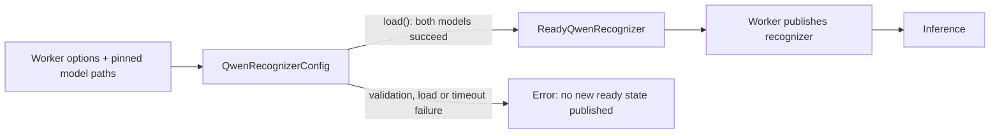
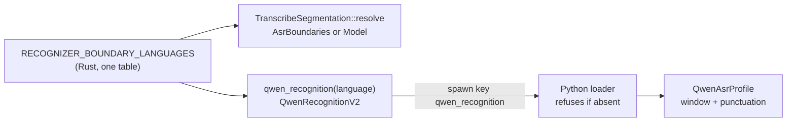

# Qwen recognition: states, language profiles, and timing

Qwen recognition separates configuration, loaded inference capability, and
validated alignment. Extend these boundaries rather than adding readiness flags
or changing the request language to satisfy a model's language vocabulary.
For CLI options and supported command scope, see
[Language Code Resolution](../reference/language-code-resolution.md#taiwanese-transcription-nan).

## Ownership and loading

The implementation still lives under `inference/languages/cantonese/` for
historical reasons; that directory name does not restrict Qwen to Cantonese.
Paths below are relative to the repository root.

| Owner | Responsibility |
| --- | --- |
| `crates/batchalign/src/transcribe/segmentation.rs` (`qwen_recognition`) | Decide each language's recognition policy (decoding window, punctuation fate) from the one table of recognizer-boundary languages. |
| `batchalign/inference/qwen_asr_profile.py` | Resolve the recognition and companion alignment labels (`QWEN_RECOGNITION_LABELS`), admit optional context, and translate the received policy into recognizer terms. |
| `batchalign/worker/_model_loading/asr.py` (`qwen_recognition`) | Parse the spawn policy at the worker boundary; refuse a Qwen worker spawned without it. |
| `batchalign/inference/languages/cantonese/_qwen_common.py` | Validate configuration, load both models, decode bounded chunks and convert aligned times to recording coordinates. |
| `batchalign/inference/languages/cantonese/_qwen_asr.py` | Resolve worker options, enforce the loading timeout and publish the ready recognizer. |
| `batchalign/inference/qwen_forced_alignment.py` | Shared aligner adapter and window-relative alignment types; standalone FA language admission. |
| `batchalign/inference/qwen_punctuation.py` | Validate lexical correspondence and retain punctuation with the original timed units. |
| `crates/batchalign/src/transcribe/segmentation.rs` (`TranscribeSegmentation`) | Admit a transcription route with either a text-model capability or ASR boundaries, from the same table. |



`QwenRecognizerConfig` is frozen and validates the native checkpoint spelling
and language profile in construction. It has a `load()` operation, but no
`transcribe()` operation or partially loaded model field. The worker supplies
resolved snapshot paths separately from model identifiers: loading uses the
pinned paths while checkpoint validation retains the requested identity.

`load()` returns `ReadyQwenRecognizer`, which owns that configuration and a
`LoadedQwen` containing the processor, recognition model and forced aligner.
Inference methods belong to this ready state. Do not restore a lazy `_get_model`
method, mutable language aliases, or a `warm()` call whose ordering every caller
must remember. Frozen Python dataclasses prevent field reassignment; they do
not make the underlying model objects deeply immutable or prevent deliberate
manual construction. Production readiness comes from the loader transition.

The worker brackets `config.load()` with its timeout and restores the previous
signal handler in `finally`. It assigns the module's `_recognizer` only after
loading completes. The optional worker slot means “not published yet”; it is
not a recognizer with optional internal models. Tests may construct a ready
recognizer with fake loaded components to exercise inference boundaries.

## Keep three language decisions separate

For `nan`, the request and CHAT language remain `nan`. The profile selects
`Chinese` for Qwen recognition and its Chinese timestamp companion. Those
model labels do not change the recording's language and do not qualify a
separate Taiwanese forced aligner.

The decoding window and the fate of recognized punctuation are decided in
Rust, once, by `qwen_recognition` in `transcribe/segmentation.rs`. It reads the
same table of recognizer-boundary languages that `TranscribeSegmentation` reads
to choose the ASR-boundaries route, so a route that relies on recognizer
punctuation always gets a recognizer told to restore it. The worker pool sends
the decision to every Qwen worker at spawn as `QwenRecognitionV2` JSON under
`QWEN_RECOGNITION_KEY` (`qwen_recognition`). The Python loader refuses to
load without it and never decides it from the language code.

Today Taiwanese gets 30-second windows and restored punctuation
(`RecognitionPunctuationV2.RESTORE`); every other language gets the chunker's
default window and discarded punctuation, because a segmentation model
supplies their boundaries. The recognizer reads the profile with an
exhaustive `match`. Adding a recognizer-boundary language is one entry in the
Rust table, from which the route, the policy and the worker follow, plus a
Qwen recognition label in `QWEN_RECOGNITION_LABELS`
(`batchalign/inference/qwen_forced_alignment.py`) if the language is new to
Qwen. That label table is separate from the aligner's `QWEN_LANG_LABELS`, which
also decides standalone forced-alignment admission.



`qwen_context` is optional text admitted into the
configuration before loading; absent or empty context supplies no prompt.
The worker passes a nonempty context through the processor's `prompt` argument.
Context can be emitted as invented speech, so dialect instructions are not
injected automatically. Keep explicit overrides in the submitted job options
so comparisons can identify the actual context used.

Rust keeps transcription routing separate from standalone utterance
segmentation. `TranscribeSegmentation` wraps a private `SegmentationRoute`:

- `Model(UtsegRoute)` carries a resolved text-model route.
- `AsrBoundaries { language }` preserves recognition and speaker boundaries
  without claiming a text model.

The wrapper exposes `model() -> Option<&UtsegRoute>`. Model-consuming code
must narrow to that capability before calling model operations. A boolean
such as “uses a model” followed by unrelated fallback getters would lose this
relationship. The `nan` route takes ASR boundaries and skips the corresponding
text-model inference. Standalone `UtsegRoute::resolve` remains unchanged.
Engine-specific request validation is also independent: admitting native
transcription boundaries does not grant another ASR engine language support.

Adding a recognition profile therefore does not automatically add standalone
`align`, `utseg`, or morphology support. Review each command's admission
boundary separately; see [Adding Language Support](adding-language-support.md).

## Pair punctuation with alignment evidence

Recognition and forced alignment have different output units. The aligner can
return character-sized units and omit punctuation. The ASR adapter handles
that difference through this sequence:

```text
PairedWindowAlignment (model units and reported times, arity checked)
  -> WindowAlignment + AudioWindow (bounded observed spans or unavailable timing)
  -> SpokenWindowWords (spoken units for ASR)
  -> PunctuatedAlignment (profile RESTORE only; validated lexical correspondence)
  -> RecordingChunkSpeech (place the bounded speech at its recording offset)
  -> RecordingStart / RecordingPrefix (admit the next disjoint window)
  -> CompletedRecording (publish immutable recording chunks)
```

`PairedWindowAlignment` snapshots both sequences and admits their arity.
Both ASR and standalone FA must then construct `WindowAlignment` with the
actual audio duration. Every interval must be finite, nonnegative, forward
and contained in that audio; nonblank positive-duration units must have
nondecreasing starts and ends. Ordinary overlap is permitted when both
boundaries advance. `ObservedWindowSpan` and `UnavailableWindowTiming` are
distinct states. Zero-width units retain their fold positions as unavailable
evidence and cannot supply observed word endpoints. The FA fold leaves a word
untimed if any constituent is unavailable, or if its interval disappears when
rounded to milliseconds. No neighboring interval supplies the missing times.

Recording placement adds the offset once. An immutable recording prefix accepts
only a subsequent disjoint window; containment plus ordered windows prevents
cross-chunk time reversal. Publication consumes that prefix, so the ASR result
cannot publish a bare, unchecked list of chunk timestamps. Unavailable words
retain their text with absent timestamps on the ASR wire.

An inadmissible interval raises `QwenTimingInvalid`, a
`ModelOutputInvalidError`, before conversion or CHAT construction. It reports
the offending unit and original times, the preceding unit for backwards
timing, and whether the start or end moved backwards. `_align_chunk` adds
the recording window while preserving the relative coordinate labels.
The worker reports `model_output_invalid`; the identical request is not
automatically retried. Do not sort or clamp these times to manufacture an
apparently valid alignment.

`PunctuatedAlignment(text, spoken)` compares the complete lexical sequence of
the recognition text with the concatenated alignment units. Letters, numbers,
Unicode combining marks and the ASCII apostrophe count as lexical characters.
This preserves tone marks as evidence: dropping a combining mark is a mismatch,
not punctuation normalization. Changed, missing or additional lexical text
raises `ValueError`, as does a nonlexical aligned unit. There is no fuzzy match.

On success, the constructor returns one owned tuple of `AlignedWindowWord`
values. It appends supported sentence/clause punctuation to the preceding unit
and preserves the same immutable timing evidence. Quotes and arbitrary symbols
are not restored. Do not return a separate spelling list and zip it onto times:
that permits changed text and timing evidence to diverge after validation.

Window-to-recording conversion belongs in `_align_chunk`, where the audio
chunk offset is available. The shared forced aligner must continue returning
window-relative times; adding an offset there would affect standalone FA too.
Likewise, the ASR-specific spoken-unit filtering does not belong in the shared
aligner, whose standalone fold needs every unit's position.

## Replay compatibility

The ready standalone FA host reports a `QwenFaCacheIdentity`: model ID plus
`QwenFaAdmissionRevision.BOUNDED_UNIT_EVIDENCE_V1`. The wire name ends in
`@bounded-unit-evidence-v1`. Both raw and derived FA cache envelopes are admitted
against this name. Earlier model-only namespaces cannot authorize replay under
the new timing rules; the cached rows no longer contain the unit evidence
needed to prove those rules retroactively. Existing cache bytes are retained.
This changes replay compatibility without renaming the selected model.

The shared identity fixture is consumed by the Python loader test and the
Rust raw/derived replay test, including acceptance of current evidence. A
revision is an admission compatibility statement, not a model-quality score.

These types establish correspondence and coordinate ownership, not acoustic
accuracy. A lexically consistent alignment can still contain zero-duration or
misplaced intervals. Restored punctuation also creates nonlexical slots in
later speaker projection, so aggregate inferred-speaker counts are not a
lexical speaker-error rate.

## Extension and verification

For a change to this route, inspect the profile, worker publication, ready
inference methods, Rust request admission and segmentation consumers together.
Keep the following regression boundaries:

| Boundary | Existing coverage |
| --- | --- |
| Default/explicit context, failed load, publication of a ready recognizer, frozen configuration, restore versus discard punctuation | `batchalign/tests/pipelines/asr/test_qwen_taiwanese.py` |
| Exact punctuation pairing, lexical drift, combining marks, nonzero chunk offset | `batchalign/tests/pipelines/asr/test_qwen_taiwanese.py` |
| Checkpoint spelling and explicit model choice | `batchalign/tests/pipelines/asr/test_qwen_checkpoint_ids.py` |
| Bounded decoding and classification before blank-text handling | `batchalign/tests/pipelines/asr/test_qwen_transcribe_chunk_bounds.py`, `test_qwen_run_model_ordering.py` in the same directory |
| Loader timeout | `test_load_qwen_asr_times_out_on_hang` in `batchalign/tests/pipelines/asr/test_asr_model_loading.py` |
| Shared alignment adapter contracts | `batchalign/tests/pipelines/fa/test_qwen_forced_alignment.py` |
| Real-model word timestamps (golden test; requires weights) | `batchalign/tests/pipelines/asr/test_qwen_asr_forced_aligner.py` |
| Native boundaries without standalone utseg support; route and Qwen policy agree per language | Tests in `crates/batchalign/src/transcribe/segmentation.rs` |
| Every Qwen worker spawns with its language's policy | `a_qwen_worker_spawns_with_its_language_recognition_policy` in `crates/batchalign/src/worker/pool/execute_v2.rs` |
| Policy wire shape on both sides; loader refusal without a policy | `crates/batchalign-types/src/worker_v2/qwen_recognition.rs`, `test_qwen_recognition_policy` in `batchalign/tests/test_ipc_type_conformance.py`, `test_qwen_taiwanese.py` |
| Qwen transcription admission without granting Rev.AI support | `transcribe_taiwanese_qwen_preserves_its_language` in `crates/batchalign/src/types/request.rs` |

A focused profile/worker regression command is:

```bash
uv run pytest batchalign/tests/pipelines/asr/test_qwen_taiwanese.py -q
```

Select the other affected boundary tests when changing their implementation;
this one command is not full engine qualification. Test doubles establish
state transitions and failures without loading weights. Real-model evaluation
must separately retain the input identity, runtime build, both model revisions,
submitted options, raw ASR evidence and resulting CHAT. Change one relevant
setting at a time when attributing a quality difference. CHAT validation,
interval diagnostics, lexical accuracy and acoustic review answer different
questions; record each result at its actual scope.
