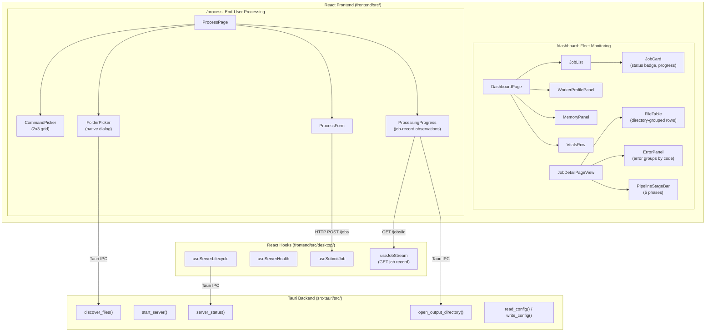

# Tauri + React Dashboard

**Status:** Current
**Last updated:** 2026-11-01

## Overview

Batchalign3 dashboard delivery uses:

1. `frontend/` as the canonical React UI.
2. `apps/dashboard-desktop/` as the Tauri desktop shell.

The frontend serves two surfaces:

- **`/process`**: End-user processing flow. Researchers pick a command, choose
  files via native folder picker, and watch observed job progress. Default landing
  page in desktop mode.
- **`/dashboard`**: Fleet monitoring for power users. Real-time job status,
  file progress, error grouping, algorithm visualizations.

The Tauri shell stays thin: a small set of custom commands for file discovery,
config I/O, output-directory opening and managed-service discovery, plus the
`dialog` plugin for file pickers. All shared UI logic lives in the React
frontend, which now consumes shell-only capabilities through an explicit
desktop runtime seam instead of scattering raw Tauri imports across hooks and
components.

The following diagram shows the component hierarchy across both surfaces
and the Tauri backend IPC boundary.



## Web Dashboard Development

The dashboard is a React SPA that proxies API calls to a running batchalign3
server. You need **two terminals**: one for the Rust server, one for the Vite
dev server.

### Terminal 1: Start the Rust server

```bash
# Debug build (faster compile, slower runtime: fine for dashboard dev)
cargo run -p batchalign -- serve start --foreground --port 8000
```

Or if you already have a release binary:

```bash
./target/release/batchalign3 serve start --foreground --port 8000
```

The server must be on port 8000, the Vite dev config in `frontend/vite.config.ts`
proxies `/jobs`, `/health`, and `/ws` to `localhost:8000`.

### Terminal 2: Start the Vite dev server

```bash
cd frontend
npm ci          # first time only
npm run dev
```

Vite starts on `http://localhost:5173`. Open:

- **`http://localhost:5173/dashboard`**: fleet monitoring (job list, workers,
  memory, pipeline stages)
- **`http://localhost:5173/dashboard/jobs/<id>`**: job detail with file-level
  progress
- **`http://localhost:5173/dashboard/visualizations`**: algorithm trace
  visualizations (DP alignment, retokenization, FA timeline, ASR pipeline)
- **`http://localhost:5173/process`**: end-user processing flow (desktop-oriented,
  but works in browser for layout testing)

Changes to `frontend/src/` hot-reload instantly. Changes to Rust types require
rebuilding the server and regenerating OpenAPI types
(`bash scripts/generate_dashboard_api_types.sh`).

### Production mode (no dev server)

In production, the built SPA is served directly by the Rust server via
`ServeDir` with SPA fallback. After building:

```bash
scripts/build_react_dashboard.sh    # builds to ~/.batchalign3/dashboard/
```

The dashboard is then available at `http://localhost:8000/dashboard` (same
origin as the API, no proxy needed).

### Build production artifact:

```bash
scripts/build_react_dashboard.sh
```

By default, artifacts are copied to:

`~/.batchalign3/dashboard/`

Override target path:

```bash
scripts/build_react_dashboard.sh /tmp/batchalign-dashboard
```

## Desktop Dashboard (Tauri)

The native shell stays deliberately small. See the
[desktop user guide](../user-guide/desktop-app.md) for the processing flow and
`apps/dashboard-desktop/README.md` for build, qualification and coordinated
CLI/app deployment requirements.

### Runtime and ownership

`DesktopBootstrap` completes native service discovery before server consumers
mount. The shell invokes the installed CLI's `serve status --format json` and
admits only complete local observations. A stopped service may transition
through `serve start` to another observation. Missing, refused and failed
observations are visible; no default endpoint is substituted. The app owns no
service PID, has no stop command and does not stop shared work on exit.

`DesktopEndpoint` owns the admitted native origin independently of the route
URL. The bootstrap binds it before mounting queries. Redirecting `/` to
`/process`, following a navigation link or dropping query parameters cannot
substitute another origin. An unadmitted native runtime has no endpoint; there
is no guessed-port fallback. Browser query overrides remain a web-only path.

The native command inventory includes `discover_files`, `admit_job_paths`, `open_output_directory`,
`server_status`, `start_server`, `is_first_launch`, `read_config` and
`write_config`. `desktop/protocol.ts` pairs command names with their request and
response types. `DesktopContext.tsx` exposes focused capabilities; `lib/tauri.ts`
owns the dynamic native adapter. Only the dialog plugin is needed. Opening
output consumes a native-admitted existing directory.

Settings and CLI setup share `batchalign_types::asr_preferences::PreferenceEdit`.
A validated edit owns only the selected engine and an explicitly supplied Rev
key. Other configuration bytes survive an atomic publication; malformed or
unreadable configuration is refused rather than overwritten.

The frontend config capability returns admitted `PreferenceDraft`, accepts
nominal `PreferenceEdit`, and returns validated `SavedPreferences`. Raw native
DTOs stay at the adapter. A draft records retain/replace credential intent;
the old read key is reduced to availability and never replayed on Save.
Acknowledgement retires replacement intent and clears the editor. The native
writer still resolves retain against the current INI bytes at write time.

`SettingsSession` owns loading, load failure, editing and saving. A synchronous
operation claim blocks duplicate reads/writes; closing retires pending reads,
while an in-flight save keeps editing and close actions disabled. Reopening
mounts a fresh owner. Saved notices carry receipts and retire when editing.
The first-run wizard has separate engine, Rev.AI credential, saving and receipt
states; credential data cannot accompany a Whisper choice or fabricate Done.
Read failures and setup saves have visible retry paths. The first-launch check
admits an actual boolean; transport failure cannot manufacture file absence.

### Processing states

`ProcessForm` owns choosing, configuring, picking a folder, scanning inputs and
the accepted/unconfirmed result views. `JobLaunch` owns preparation and sending;
there is no parallel mutation busy flag or form admission/submission state.
A selection attempt owns
its configuration and is claimed synchronously before opening a dialog.
Only an input attempt can enter scanning. Pending selection disables the
configuration fieldset and cannot start admission. Cancel restores the earlier
configuration; input failure clears its input; Back or unmount withdraws the
owner before delayed results can settle. `FolderPicker` only presents this
form-owned state and has no independent busy state or async selection callback.

Native discovery enters `DiscoveredInput`: either a genuine empty folder or
immutable nonempty `SelectedInputs`. `PreparedJob.prepare` requires the latter,
so it has no empty-list fallback. `CommandDef` fixes each command's input kind;
one policy supplies both native discovery extensions and displayed guidance.
`InputFilePage` admits bounded pages belonging to that selected population;
rediscovery retires the previous page, and reviewing never filters submission.

`PreparedJob` captures immutable paths and validated scalar
choices before any await. Native `PathProposal::admit` is the only producer of
`AdmittedPathPlan`: it resolves directory aliases, checks source/output file
identities and admits disjoint separate roots and unique portable output names.
Only its complete receipt can create the private `JobPlan` accepted by HTTP
submission. This is read-only filesystem observation, not a file reservation.
A synchronous available-state claim prevents duplicate submissions throughout
admission and settings reads. `JobLaunchState` offers Start only when available;
checking-paths, reading-preferences, sending, finished and retired states carry
no launch action. `PreparingLaunch` is the only predecessor accepted by the
private sending edge. `LaunchRequest` distinguishes commands with explicit ASR
selection from those without it. Discovery skips nested links
and special files rather than following them beyond the selected tree.

`SubmissionOutcome` separates accepted, refused and unconfirmed HTTP results.
Only a validated `SubmittedJob` supplies the identifier used to open progress;
its receipt does not pretend to contain the full `JobInfo`. Known request and
admission refusals restore configuration, while transport loss, timeouts, server
failures, malformed JSON and unusable identifiers retain the admitted plan in
an unconfirmed state. Unexpected post-attempt failures take that same edge.
Native/preferences failures before the POST remain correctable configuration
errors. No automatic POST retry is offered; list refresh performs reads only. Recovery
offers inspection and deliberate fresh configuration, not replay of the plan.
This does not add server idempotency or persist a deduplication record across
navigation, app restarts or other clients.

`useSubmitJob` attaches the launch owner through a layout effect, so unmount
retires it at commit rather than waiting for passive cleanup. Each reply must
still own its exact phase before another native operation or the POST can begin;
a later attachment cannot revive an old snapshot. Claiming and initiating HTTP
are synchronous before notification. After sending, unmount only retires the
view: it does not cancel the server job or retry the request. Even a retired
launch refreshes job discovery after its HTTP outcome; it cannot publish into
the replacement launcher's configuration. Browser boundary tests hold native
admission and preference replies across router unmounts, and hold a real mock
HTTP reply after its job record exists. These prove transport ownership, not
packaged OS permission or model behavior.

`useJobStream` polls the authoritative job record; its historical name does not
imply an SSE completion signal. `ObservedProgress` admits the job identity,
closed status set, file identities and counts. A failed observation is distinct
from a terminal job and never triggers submission. Success requires the full
expected file population to be present and cleanly completed; diagnosed,
interrupted and writeback-failed outcomes remain visible.

`useJobCancellation` retains one `CancellationAction` per job and service origin
above the transient observation view. Available/failed states expose request or
retry; requesting and acknowledged states expose neither. Synchronous state
publication owns the double-click boundary without a separate boolean latch.
`CancellationReceipt` admits only the route's cancelled/completed/failed outcome
and its explanation. This receipt is not `ObservedProgress`; the complete job
record still owns terminal presentation. A progress outage does not reopen an
acknowledged action, and a retry retires the previous cancellation error.

### Reopened job output access

The job-page controller projects a closed loading/unavailable/ready state. Only
ready carries detail and its server/action scope. A resolved record wins over
a pending background owner lookup, so late REST/WebSocket discovery cannot
unmount that scope and implicitly retry an errored folder query. Route absence
creates no query scope; a selected job owns a keyed controller rather than
passing an empty-string job sentinel through the hooks. Controlled browser
coverage holds both initial delivery paths and the later owner lookup reply.
A failed discovery offers an explicit read retry; it cannot certify job absence
or resubmit processing work.

The loopback-only `GET /jobs/{job_id}/output-folders` projection reads the
persisted paths-mode mapping through the existing store/backend. It does not
change the database schema, reconstruct destinations from `source_dir`, or
add a second client-side job store. `LocalOutputRequest` admits peer locality
before the route can look up a job. `LocalOutputAccess` distinguishes content
mode, absent evidence, malformed records and a nonempty set of recorded folder
parents. Distinct destinations stay distinct; there is no guessed common root.
The store projects the record's identity and output evidence together as
`JobOutputFolders`; the route emits that snapshot without attaching a separately
supplied identity to its folders.

`desktopEndpointForServer` gives `LocalJobOutputRequest` the native discovery
capability only when the viewed job belongs to that exact managed origin.
`RecordedOutputFolder` requires that local request capability, rather than a
bare job-id string, to admit the response's job identity and wire states before
exposing an open action. `OutputFolderAction` owns idle/opening/failed
transitions; query and action owners are scoped to `(server, job_id)`, so stale
replies cannot settle another route. The existing native directory constructor
checks actual filesystem existence when clicked. A recorded folder is neither
a completion certificate nor a filesystem permission guarantee. Browser and
remote-job views do not borrow the local native opener.

### Verification boundaries

Run native shell tests with
`cargo test -p batchalign-dashboard-desktop --bin batchalign-dashboard-desktop`.
Shared preferences tests belong to `batchalign-types`; the CLI observation
subprocess test belongs to `cli_integration_suite`. Frontend seam checks in
`frontend/e2e/tests/mock-server.spec.mjs` fake the native transport. They cannot
certify native dialogs, filesystem permissions, model execution, signing or
installation. Qualify those with a packaged application and an identified
managed service before distribution.

## API Contract Discipline

Rust OpenAPI remains canonical. Regenerate dashboard artifacts with:

```bash
scripts/generate_dashboard_api_types.sh
```

Verify no drift (CI gate):

```bash
scripts/check_dashboard_api_drift.sh
```

### Known open work: a branded server-time type

`compareTimesNewestFirst` in `frontend/src/utils.ts` sorts jobs newest first
by comparing two server times as strings. That is correct only because both
are `MachineTime`: RFC 3339 in UTC with exactly three fractional digits, so
string order is time order. Its six callers (two in `src/state.ts`, four in
`src/components/JobList.tsx`) all pass `submitted_at`, which is a
`MachineTime`. But the signature takes `(a: string, b: string)`, so a
display-formatted time, or one with a different offset or precision, would
type-check and sort wrongly without complaint.

The fix is a branded type, and it cannot be written by hand. openapi-typescript
(7.13.0) turns the `MachineTime` schema (`type: string`, `format: date-time`)
into `MachineTime: string`, so every generated field that references
`components["schemas"]["MachineTime"]` is a plain `string`. A hand-declared
brand would need a cast at every read, which asserts the invariant instead of
carrying it.

The change belongs in the generator. The CLI that
`scripts/generate_dashboard_api_types.sh` runs
(`npx openapi-typescript openapi.json -o src/generated/api.ts`) has no
transform option. The library's Node API does: `openapiTS(source, options)`
accepts `transform: (schemaObject, { path }) => ts.TypeNode | undefined`.
Replace that one step with a small Node script that calls `openapiTS` with a
`transform` returning `string & { readonly __brand: "MachineTime" }` for the
schema at `#/components/schemas/MachineTime` (and `undefined` everywhere
else), then writes the result with the exported `astToString`. Every field
that references the schema then carries the brand, and
`compareTimesNewestFirst(a: MachineTime, b: MachineTime)` refuses any other
string at compile time. `scripts/check_dashboard_api_drift.sh` reruns the
generator script, so the drift gate follows the change with no edit of its
own.

## Dashboard Component Map

### Pages

| Route | Component | Purpose |
|-------|-----------|---------|
| `/dashboard` | `DashboardPage` | Two-column: job list + system panels |
| `/dashboard/jobs/:id` | `JobPage` → `JobDetailPageView` | Full job detail with file table |
| `/dashboard/visualizations` | `VisualizationsIndex` | Algorithm trace landing |
| `/dashboard/visualizations/:type` | `DPAlignmentPage`, etc. | Individual visualizations |
| `/process` | `ProcessPage` | Desktop processing flow |

### Job Display Components

| Component | File | Role |
|-----------|------|------|
| `JobList` | `JobList.tsx` | Renders sorted list of `JobCard`s |
| `JobCard` | `JobCard.tsx` | Single job summary: command badge, status, progress bar, metadata |
| `JobDetailPageView` | `JobDetailPageView.tsx` | Full detail: metadata grid, progress, file table, errors |
| `FileTable` | `FileTable.tsx` | Directory-grouped file rows with status, stage, progress |
| `PaginatedFileList` | `PaginatedFileList.tsx` | Wraps `FileTable` with pagination controls |
| `FilterTabs` | `FilterTabs.tsx` | Status filter tabs (All/Processing/Done/Error/Queued) + search |
| `ProgressBar` | `ProgressBar.tsx` | Animated fill bar with striped/indeterminate modes |
| `PipelineStageBar` | `PipelineStageBar.tsx` | 5-segment phase indicator (Read/Transcribe/Align/Analyze/Finalize) |
| `StatusBadge` | `StatusBadge.tsx` | Colored status pill |
| `ErrorPanel` | `ErrorPanel.tsx` | Error groups by failure category with expandable file lists; groups, labels, colours and banners come from `errorCategories.ts`, a `Record` over the generated `FailureCategory` union, so a new server category fails type-checking until it has a group |
| `ErrorCodeGroup` | `ErrorCodeGroup.tsx` | Single error code bucket |
| `StatusSummaryStrip` | `StatusSummaryStrip.tsx` | Inline done/error/active counts |
| `ActionButtons` | `ActionButtons.tsx` | Cancel/restart/delete controls |

### System Health Components (Right Column)

These panels live in the dashboard right column and consume `HealthResponse`
data from the Zustand `healthMap`:

| Component | File | Data Fields Used |
|-----------|------|-----------------|
| `WorkerProfilePanel` | `WorkerProfilePanel.tsx` | `live_worker_keys`, `live_workers` |
| `MemoryPanel` | `MemoryPanel.tsx` | `system_memory_total_mb`, `system_memory_available_mb`, `system_memory_used_mb`, `memory_gate_threshold_mb`, `memory_gate_aborts` |
| `VitalsRow` | `VitalsRow.tsx` | `worker_crashes`, `forced_terminal_errors`, `memory_gate_aborts`, `attempts_started`, `attempts_retried`, `deferred_work_units` |

The `DashboardPage` wires these by reading the first server's health from
`useStore((s) => s.healthMap)`. When a server filter is active, it uses that
server's health.

### Pipeline Phase Mapping

`PipelineStageBar` groups the 23 `FileProgressStage` enum variants into 5
visual phases. The mapping is defined in `PHASES` at the top of the component:

| Phase | Color | Stages |
|-------|-------|--------|
| Read | zinc | `reading`, `resolving_audio`, `checking_cache` |
| Transcribe | emerald | `transcribing`, `recovering_utterance_timing`, `recovering_timing_fallback` |
| Align | indigo | `aligning`, `applying_results` |
| Analyze | violet | `analyzing_morphosyntax`, `segmenting_utterances`, `translating`, `resolving_coreference`, `segmenting`, `analyzing`, `comparing`, `benchmarking` |
| Finalize | amber | `post_processing`, `building_chat`, `finalizing`, `writing` |

When adding a new `FileProgressStage` variant in Rust, add it to the
appropriate phase set in `PipelineStageBar.tsx` and to `PROGRESS_STAGE_LABELS`
in `frontend/src/utils.ts`.

### Worker Key Parsing

`WorkerProfilePanel` parses the `live_worker_keys` strings from the health
endpoint. The format is:

```text
profile:<gpu|stanza|io>:<lang>[:<engine_overrides>] (<N> total, <M> idle|shared)
```

Examples:
- `profile:gpu:eng (1 total, shared)`: one shared GPU worker for English
- `profile:stanza:eng (2 total, 1 idle)`: two Stanza workers, one currently checked out
- `profile:io:fra:{"translate":"seamless"} (1 total, 1 idle)`: IO worker with engine override

The regex parser in `parseWorkerKey()` handles these formats. If the server
changes the key format, the parser must be updated to match.

### Memory Panel Thresholds

`MemoryPanel` uses three proximity levels relative to the gate threshold:

- **safe** (green): `available > threshold × 4`
- **warning** (amber): `threshold × 2 < available ≤ threshold × 4`
- **danger** (red): `available ≤ threshold × 2`

The gate threshold marker on the gauge bar is positioned at
`(total - threshold) / total × 100%`: the point where available memory
equals the threshold.

## Dashboard State Boundary

The current dashboard intentionally splits client state by responsibility:

- Zustand owns fleet summary state such as job rows, health, connection status,
  and filter UI state.
- React Query owns REST-shaped detail payloads such as one fully resolved job
  record or trace download response.

The job detail page should surface the original submitted command options from
the REST payload. That operator-facing context is important for debugging
engine selection, incremental flags, and rerun behavior without reconstructing
the submission from logs.

Per-file progress data now also follows the same typed-boundary rule:

- `progress_stage` is the stable machine-readable stage code from Rust.
- `progress_label` is the derived operator-facing text shown in the UI.

Dashboard code should prefer `progress_stage` for client logic and treat the
label as a rendering convenience rather than a parsing target.

That split matters because the WebSocket reconciliation layer can patch the
same React Query cache entries that the detail route reads, instead of copying
one detailed job payload through a second global store slot.

## Dashboard E2E

Run dashboard Playwright smoke tests:

```bash
cd frontend
npm run e2e:install
npm run test:e2e
```

Run real-server dashboard E2E:

```bash
BATCHALIGN_REAL_SERVER_E2E=1 scripts/run_react_dashboard_smoke.sh
```

## E2E Testing Entry Points

The dashboard has a unified e2e testing strategy across local development and CI. All paths
route through the same Playwright test files under `frontend/e2e/tests/`.

### Test Modes

| Mode | Entry Point | Use Case | Requirements |
|------|---|---|---|
| **Mock server** | `npm run test:e2e` (default) | Fast local iteration, no deps | None (mock server built-in) |
| **Real server** | `make batchalign-dashboard-e2e-real` | Full integration, real Batchalign binary | Rust binary, Python installation |
| **CI canonical** | `dashboard-e2e` job in `batchalign-python.yml` | Pre-merge gate | Same as real-server |
| **Desktop app** | `npm run test:e2e` from `apps/dashboard-desktop/` | Tauri webview integration | Tauri + all deps |

### Local Development

**Quick smoke test (no build, no binary required):**
```bash
cd frontend
npm ci && npm run test:e2e
```

**Full integration with real Batchalign (optional, slow):**
```bash
make batchalign-dashboard-e2e-real
```

**Headed mode (watch tests in browser):**
```bash
cd frontend
npm run test:e2e:headed
```

### CI Workflow

The `dashboard-e2e` job in `.github/workflows/batchalign-python.yml`:
1. Builds the wheel from the Batchalign Rust/Python stack
2. Sets `BATCHALIGN_REAL_SERVER_E2E=1` and `BATCHALIGN_PLAYWRIGHT_WITH_DEPS=1`
3. Runs `bash scripts/run_react_dashboard_smoke.sh` which orchestrates:
   - API type generation
   - Frontend build
   - E2E environment setup (Playwright browsers + dependencies)
   - Playwright tests against a real `batchalign3` server instance

This job only runs on main and manual workflow_dispatch (not on all PRs due to performance).

### Orchestration Scripts

**`scripts/run_react_dashboard_smoke.sh`**: canonical orchestration script:
- Generates dashboard API types from Rust OpenAPI spec
- Builds frontend bundle
- Sets up Playwright environment
- Runs tests in mock or real server mode (via `BATCHALIGN_REAL_SERVER_E2E` env var)
- Used by both local developers and CI

**`scripts/build_react_dashboard.sh`**: deployment script:
- Generates API types
- Builds frontend
- Copies built artifacts to target directory (default: `~/.batchalign3/dashboard`)

**`scripts/check_dashboard_api_drift.sh`**: validation gate:
- Ensures `openapi.json` and `frontend/src/generated/api.ts` are in sync
- Fails if generated artifacts are stale
- Part of both Makefile and CI gates

## Data Flow

### Dashboard (fleet monitoring)

1. **Init**: Resolve the server URL from runtime config
2. **WebSocket**: Connect to the server and receive snapshot + real-time updates
3. **REST**: React Query fetches job lists and details
4. **State**: Zustand store tracks dashboard and connection state
5. **Updates**: WebSocket patches store + query cache in real time

Detail pages follow the same split:

- `pages/JobPage.tsx` is the route shell
- `hooks/useJobPageController.ts` owns job lookup, server resolution, and store sync
- `components/JobDetailPageView.tsx` owns detail presentation and file filters

### Process flow (desktop)

1. Discover the CLI-managed local service before mounting server consumers.
2. Detect first-run absence or show configuration read errors.
3. Select a command, input directory, explicit output policy and parameters.
4. Claim a `PreparedJob`, await native path admission, then construct `JobPlan`.
5. Submit with `paths_mode: true` and retain the returned job identity.
6. Poll that job's record; reconnect without resubmitting after an outage.
7. Present its actual terminal state, diagnostics and output directory.
