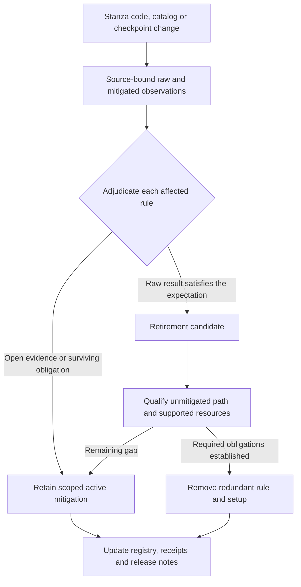

# Upstream Defects and Workaround Retirement

**Status:** Current
**Last updated:** 2026-11-15 10:36 EST

BA3 integrates Stanza and other libraries through typed inference and output
boundaries. Each workaround owns a named defect, its source-bound evidence,
its intervention point and its retirement condition. Dependency upgrades are
opportunities to remove that debt.

## Evidence and ownership

For Stanza, these documents own complementary parts of the relationship.

| Owner | Responsibility |
| --- | --- |
| [Stanza limitations](../reference/stanza-limitations.md) | Stable defect identity, observed inputs, expected linguistic result, mitigation and retirement criteria |
| [Mitigation map](../architecture/stanza-defect-mitigation-map.md) | Current intervention point, implementation and test pointers |
| [Managed qualification](testing.md#stanza-qualification-through-managed-sessions) | Explicit interpreter, shared managed workers, isolated resources and comparison receipts |
| [Probe harnesses](investigation-probe-harnesses.md) | Admitted expectations, retained observations and strict expected-failure semantics |
| `batchalign/tests/_stanza_confirmation.py` | Package versions with completed, adjudicated qualification |

A package confirmation records its reviewed scope. Per-defect observations keep
their own dates and asset identities. A passing end-to-end run may exercise a
mitigation that still corrects broken upstream output.

The registry includes library defects, model-quality limitations, CHAT
conventions and integration contracts. Classify the reason for each rule.
CHAT representation, source correspondence and live capability selection have
obligations that survive improvements to individual model predictions. Mixed
rules need a disposition for each obligation.

## Track code and model changes together

Review Stanza release notes and source changes, linked issues/PRs, resource
catalog changes and retrained checkpoints when preparing an upgrade. Follow
changes relevant to active defect entries, including fixes shipped through
weights while the package version stays the same.

Record the actual identities used by each observation.

- BA3 source/build and exact input, language, processor packages and options.
- Stanza package version and upstream source revision when inspected.
- Resource catalog version and content hash, plus selected model paths/hashes.
- Fresh or retained resource population, observed load path and cache/batch
  conditions that affect the reported behavior.
- Raw upstream result, mitigation-applied result, expected linguistic result,
  affected CHAT output and the corresponding receipts.

Stanza 1.15.1 still uses resource version 1.15.0. Worker bootstrap refreshes
an existing catalog. Normal `REUSE_RESOURCES` pipeline construction then checks
each selected model against its catalog's primary hash and downloads a mismatch.
Downloaded bytes may also satisfy a declared alternate hash. Qualification
therefore records the catalog and weights after loading as well as the initial
population. The qualified primary and retained caches contain the same
retrained English POS weight. Follow the [1.15.1 qualification scope](../reference/stanza-limitations.md#stanza-1151-qualification).

Record upstream reporting accurately. A prepared reproducer, filed issue,
merged fix, released package/model and BA3-adopted fix are separate milestones.
Include the actual issue/PR/release link and last inspected revision when
available. An unreported issue retains that status. External reporting follows
the project's communication authority.

## Add or refine a workaround

1. Preserve a minimal raw upstream reproduction and its exact asset identities.
   Use public synthetic examples in this book and its source tree.
2. Design the complete type graph before adding a test. Admit outside values
   once, carry input provenance and completed inference into the next phase,
   and close bypass construction and invalid transitions. Mutation invalidates
   the affected evidence.
3. Narrow the actual defect trigger and establish the linguistic expectation.
   Reuse an existing intervention point and work on the typed UD/model layer.
   Unsupported output retains its diagnosis through the command's outcome policy.
4. Retain focused checks for the precise external bytes, model behavior, effect
   or semantic choice beyond that graph. Each reviewed test carries Guards,
   Kind, Not a type, State and Concurrency. Stateful claims first consider an
   admitted observation or shared typed effect double. Reuse existing controls
   and remove checks or setup made redundant by the new types.
5. Record the rule in the limitation registry and update its mitigation-map
   row. Include the producing code, trigger scope, expected output, observation
   date, qualified assets, upstream status and concrete retirement evidence.
   Cross-link its surviving controls and observable diagnostics.

An unadjudicated case uses the explicit diagnostic route. A known expected
failure must execute its admitted predicate under strict, narrowly classified
xfail handling. Count changes establish count behavior. Lemmas, POS, features,
heads and source correspondence require their own stated observations.

## Output admission and linguistic quality

A targeted rewrite operates on the typed intermediate model and records its
reason through the existing diagnostics. It preserves the association between
the source and computed analysis. It supplies only an adjudicated correction.
Unknown or malformed data follows the typed rejection/diagnosis path.

CHAT validation establishes its documented structural and semantic invariants,
including tier correspondence. Linguistically incorrect POS or lemmas can
still form valid CHAT. The Stanza registry therefore keeps explicit
content-quality observations alongside output validation. Each command's
[output contract](../architecture/command-contracts.md) owns whether an affected
file is completed, diagnosed or refused.

## Retirement review on an upgrade

The review lifecycle is recorded in the registry and qualification receipts.
Each transition requires evidence for its exact source and asset scope.

1. Give each reviewed defect a disposition, such as retained, narrowed,
   retirement candidate, retired, or further evidence required. Carry forward
   the precise last observation for cases outside the new assessment's scope.
2. For a proposed removal, obtain the relevant raw result before that
   mitigation. A post-tokenizer probe can already contain another BA3 repair.
   Use the existing explicit raw-probe or typed-stage seam appropriate to the
   rule and retain its completed output. Keep exploratory bypasses isolated
   from normal processing and production configuration.
3. Compare raw, mitigated and expected results over the rule's affected inputs
   and nearby controls. Check the full obligation being retired, including
   context, UD components, lemma/POS/features, dependencies and CHAT alignment
   where relevant. A strict XPASS identifies a changed predicate for review.
4. Qualify the supported resource populations and real managed entry point
   with the candidate rule removed or narrowed. Old accepted weights may still
   need the rule. Record their disposition with the package/model support
   decision before admitting removal.
5. Remove the redundant detector/rewrite, obsolete diagnostics, bypass setup,
   stale marks and tests whose obligations disappear. Retain focused upstream
   admission, user-output and linguistic controls for surviving obligations
   under the test rubric. Record actual reductions separately from annotations.
6. Update the registry, map, relevant language page and release notes. Preserve
   the reproducer and observed output as evidence. A retained executable check
   needs its current residual justification. Update package confirmation last,
   after adjudicating the qualification run.

A fix to one example can narrow a rule while its other triggers remain active.
Retirement is scoped to the actual obligation and supported assets. A future
regression starts a new source-bound observation and review.

## Current enforcement and release handoff

The confirmed-version test rejects an unreviewed installed package. Managed
qualification admits the selected interpreter and native build. Checked probe
payloads require actual expectations and carry completed observations.
Catalog/weight identities and per-defect retirement decisions are currently
retained in qualification evidence. A loaded-pipeline type carrying all model
asset identities remains a design follow-up.

For a release intended to improve morphotag, qualify the actual model population
that the managed service will load and include its output changes in the
release record. Record model notices when distributing checkpoints. Source
qualification, installed-artifact qualification and deployment each retain their
own evidence and authority.

## Related guidance

- [Stanza limitation registry](../reference/stanza-limitations.md)
- [Stanza intervention map](../architecture/stanza-defect-mitigation-map.md)
- [Apple MPS workarounds](apple-mps-workarounds.md)
