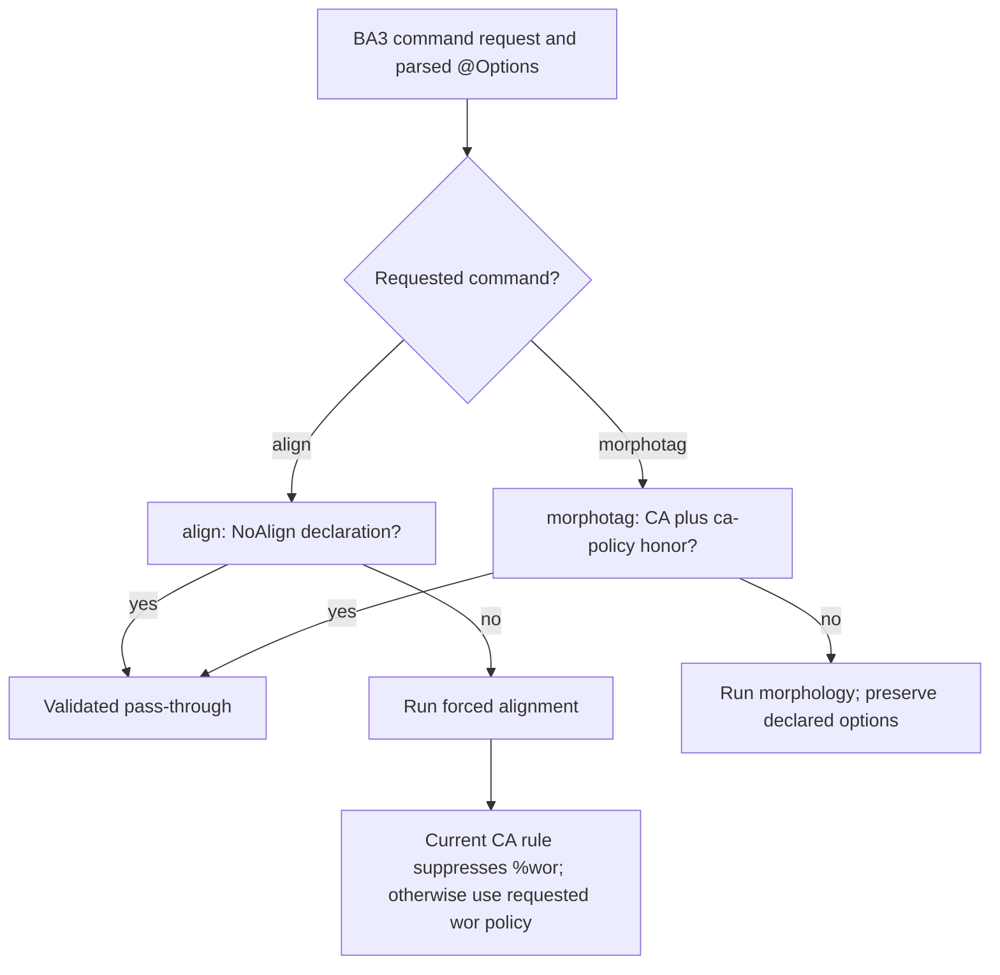

# `@Options`: format exceptions and legacy processing policy

**Status:** Current implementation and migration guidance
**Last modified:** {{git-dates:page}}

`@Options: CA` is not required simply because a transcript uses notation from
Conversation Analysis. CA overlap brackets, arrows, pauses and other supported
symbols are part of CHAT. Their presence does not demonstrate that forced
alignment or morphology will fail, and the header is not a model-capability
assessment.

The option has been overloaded: CHAT readers apply particular format effects,
while BA3 applies additional command and output policies. Keep those meanings
separate. Do not add CA to newly converted data merely because an older
published edition carried it. Work toward removing unnecessary declarations
while preserving transcript content and meaning.

## Current BA3 behavior

This table describes the existing implementation, not a justification for its
legacy defaults and not a claim that a policy migration has been deployed.

| Header | `align` | `%wor` from `align` | `morphotag` |
| --- | --- | --- | --- |
| No CA or NoAlign option | Runs when requested. | Controlled by `--wor` / `--nowor`. | Runs when requested. |
| `CA` | **Runs**; CA alone is not the current alignment opt-out. | Currently suppressed even when `--wor` was requested. | Defaults to validated pass-through under `--ca-policy honor`; `--ca-policy analyze` runs analysis while preserving the header. |
| `NoAlign` | Validated pass-through; no forced alignment or timing rewrite. | No new FA output. | Runs normally unless a separate CA policy declines it. |
| `CA, NoAlign` | Validated pass-through because of NoAlign. | No new FA output. | CA policy determines pass-through versus analysis. |

`NoAlign` is the flag that currently opts a file out of BA3 `align`. Describing
CA as the current align-skip switch would be inaccurate. Conversely, saying
that CA has no align-side effect is also inaccurate: it changes the requested
word-timing output policy.

CA also changes FA input admission: `read_fa_source_named` selects
`WordTimingPlan::Preserve` instead of `PreferRetained` for CA-declared input.
This governs admission of retained word timing; it does not skip downstream
alignment or promise byte-identical output. Source-preservation admission,
command execution and durable timing output are distinct decisions.

Pass-through does not waive validity. Retained headers, main tiers and dependent
tiers must pass the command's admission checks. A skip declaration cannot make
invalid retained data into a successful output.

## Why the inherited CA policy needs reassessment

Historical difficulties with some transcripts and an older aligner are not
empirical proof that all CA-marked files must be excluded from later alignment
algorithms. Nor does CA notation establish that POS/dependency analysis is
useless or that a `%wor` tier is inherently noise. Earlier descriptions making
those blanket claims supplied a rationale the evidence did not establish.

Assess current algorithms against actual inputs, explicit task/output options,
written results and acoustic or linguistic review. A general exception based
on a header must not replace a demonstrated, scoped limitation. Compatibility
with an old convention and empirical correctness are different claims.

The current CA-specific `%wor` suppression is especially consequential:
`run_fa_from_ast` changes requested word-tier output before finalization. FA
injection stores word intervals in `Word.inline_bullet`; ordinary main-tier
word serialization does not emit that field as inline CHAT bullets. `%wor`
serialization explicitly writes it, and actual `InternalBullet` content is a
different representation. There is no general inline fallback to assume.

Therefore internal timed-word counts do not establish durable CHAT word-timing
coverage when `%wor` is omitted. Verify injection -> exact serialization ->
reparse against the effective output contract before claiming saved coverage.
This does not quantify timing loss in any particular corpus or establish that
all retained evidence channels lack those intervals. Do not blanket-change
`Word::write_chat`: `%wor` already explicitly emits its bullets.

BA3 owns requested/effective processing policy and final timing admission.
Chatter owns generic CHAT syntax, interpretation and serialization. A future
policy change must be explicit; documenting the defect does not itself alter
current CLI behavior or authorize rerunning a corpus.

## Removing an unnecessary CA option

Chatter's CA option is not purely cosmetic. Among its current effects are a
missing-terminator waiver, reinterpretation of standalone `(word)` as a CA
omission, and tolerance for alignment padding after a tier tab. Removing it
requires checking actual transcript meaning as well as validity. Supported CA
symbols alone are not a reason to retain it.

For a maintained reconstruction, retain the source and transformation lineage,
remove unnecessary CA declarations in a new version, validate normally and
compare intended interpretations. A successful roundtrip establishes stability
of the new interpretation, not semantic equivalence to the old one or acoustic
accuracy. Existing source data must not be silently rewritten in place.

When the option genuinely remains necessary, `--ca-policy analyze` is the
current explicit way to request morphology without deleting its declaration.
That override affects morphology only. It does not override NoAlign or the
current FA-side CA suppression of `%wor`.

## Implementation and related references

- [CHAT manual](https://talkbank.org/0info/manuals/CHAT.html): optional header and
  terminator convention; not evidence for broad machine-analysis exclusions.
- [Chatter header reference](https://github.com/TalkBank/chatter/blob/main/book/src/chat-format/headers.md):
  format behavior and migration considerations.
- [`align`](../user-guide/commands/align.md), [forced alignment](forced-alignment.md)
  and [word timing](wor-tier.md).
- [`morphotag`](../user-guide/commands/morphotag.md) and
  [morphosyntax](morphosyntax.md).
- `crates/batchalign/src/fa/mod.rs`: NoAlign input admission and current
  CA-specific word-tier suppression.
- `crates/batchalign/src/pipeline/morphosyntax/states.rs`: parsed header and
  `CaMorphotagPolicy` determine validated pass-through or analysis.
